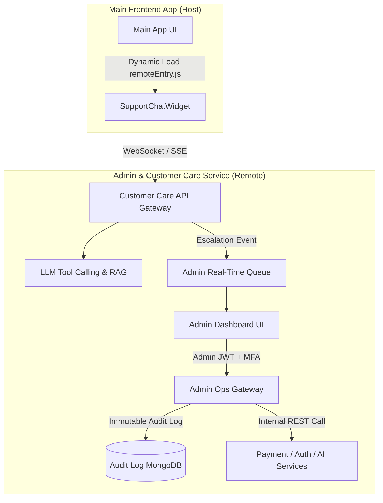

# 🛡️ Admin & Customer Care Service

> The centralized operations, customer care, and real-time monitoring platform — combining an audit-logged Admin Operations Gateway, a real-time support escalation dashboard, and an embeddable AI Customer Care Agent exposed via Vite Module Federation.


---

## 📖 Table of Contents
- [Overview & The "Why"](#-overview--the-why)
- [Built Features & Current State](#-built-features--current-state)
- [Architecture & Design Patterns](#-architecture--design-patterns)
- [Vite Module Federation Integration](#-vite-module-federation-integration)
- [Usage & Setup](#-usage--setup)
- [Communication & Contracts](#-communication--contracts)
- [Production Readiness](#-production-readiness)
- [Changelog & Migration State](#-changelog--migration-state)

---

## 🎯 Overview & The "Why"

### What this service does
The **Admin & Customer Care Service** provides administrative oversight, real-time application health assessment, customer support ticketing, and an AI-driven support agent. It consists of:
1. **AI Support & Feedback Agent**: Handles first-line customer inquiries via LLM tool-calling (RAG on FAQs, credit status lookups) and collects structured feedback.
2. **Real-time Escalation System**: Connects users to human admin agents via WebSockets/SSE when issues cannot be resolved automatically.
3. **Internal Admin Operations Gateway**: Allows authorized admins to trigger internal service repairs (e.g., manual payment resync, credit adjustments) through audit-logged APIs without executing dangerous raw database mutations.
4. **Vite Module Federation Remote**: Exposes the `<SupportChatWidget />` component so the main frontend can dynamically load the chat UI at runtime without bundling admin logic.

### Why this is a standalone service (not part of the main app or monolith)

- **Strict Security Isolation & Least Privilege:** Admin capabilities (manually adjusting credits, viewing system logs, resetting user state) carry high privilege. Keeping admin routes and UI logic in a separate service behind MFA/RBAC prevents administrative endpoints and secret credentials from being exposed in the public end-user application bundle.
- **Micro-Frontend Component Sharing:** By exposing the AI Support Agent via Vite Module Federation (`@originjs/vite-plugin-federation`), the main app renders the support widget seamlessly while the code and agent logic live entirely inside this repository.
- **Audit-Logged Administrative Controls:** Direct database mutation (`UPDATE payments SET status='success'`) bypasses service events and causes split-brain data states. This service calls explicit internal admin endpoints on sibling services (`POST /internal/v1/payments/:id/reconcile`) and writes an immutable audit record for every action.
- **Failure Domain Isolation:** High traffic or real-time WebSocket chatter in the main app will not degrade the admin team's ability to monitor application health or resolve support escalations.

### The "User" of this service

| Caller / Consumer | Call Type | Purpose |
|---|---|---|
| Main Frontend App | Remote React Component (Module Federation) | Dynamically renders `<SupportChatWidget />` at runtime from `remoteEntry.js` |
| Customer Support Reps | Sync REST / Real-time WebSockets | Authenticates via Admin JWT + MFA to monitor live support queues and take over chats |
| End-User Support Widget | SSE / WebSockets | Streams AI agent responses and sends escalation requests |
| Admin Service → Sibling Microservices | Outbound Internal REST | Invokes internal admin endpoints (`/internal/v1/*`) to resolve stuck state |
| Admin Service → RabbitMQ | Async Event (Produces) | Publishes `admin.action.logged` and `support.ticket.escalated` events |

---

## 🚧 Built Features & Current State

### Current State
| Field | Value |
|---|---|
| **Status** | 🟢 Production |
| **Version** | v1.0.0 |
| **Last Deployed** | 2026-07 |
| **Owner(s)** | Engineering & Operations Team |
| **Module Federation Entry** | `http://localhost:5001/assets/remoteEntry.js` (Dev) / `https://admin.yourdomain.com/assets/remoteEntry.js` (Prod) |

### Features Built (Working Today)

**AI Support Agent & Customer Care:**
- `POST /api/support/chat` — Streaming AI response endpoint with RAG context and tool-calling — ✅ done
- `POST /api/support/escalate` — Flags session for live human agent intervention — ✅ done
- `POST /api/support/feedback` — Ingests user bug reports and ratings into MongoDB — ✅ done

**Admin Operations & Overrides:**
- `POST /api/admin/auth/login` — Admin login with MFA verification — ✅ done
- `GET /api/admin/health/aggregate` — Real-time health matrix across all microservices — ✅ done
- `POST /api/admin/payments/reconcile` — Triggers internal payment sync API — ✅ done
- `POST /api/admin/users/grant-credits` — Triggers credit balance adjustment with reason logging — ✅ done
- `GET /api/admin/audit-logs` — Paginated view of all administrative actions taken — ✅ done

---

## 🏗️ Architecture & Design Patterns



### Design Patterns Used
1. **Module Federation (Remote Pattern)**: Uses `@originjs/vite-plugin-federation` to compile `remoteEntry.js`, allowing host applications to lazy-load `<SupportChatWidget />` on demand.
2. **Human-in-the-Loop (HITL) Escalation**: The AI support agent assesses user intent; if sentiment is negative or an unresolvable error occurs, it emits an escalation event to the WebSocket queue for admin takeover.
3. **Internal Gateway & Proxy Pattern**: Admin actions pass through an authorization check and write an audit record *before* dispatching internal HTTP requests to sibling microservice `/internal/v1/*` routes.

---

## ⚡ Vite Module Federation Integration

### Exposing the Component in `vite.config.js` (Remote)
```javascript
import { defineConfig } from 'vite';
import react from '@vitejs/plugin-react';
import federation from '@originjs/vite-plugin-federation';

export default defineConfig({
  plugins: [
    react(),
    federation({
      name: 'adminApp',
      filename: 'remoteEntry.js',
      exposes: {
        './SupportChatWidget': './src/components/SupportChatWidget.jsx',
      },
      shared: ['react', 'react-dom'],
    }),
  ],
  build: {
    target: 'esnext',
  },
});
```

### Consuming in Main App (`vite.config.js` - Host)
```javascript
federation({
  name: 'mainApp',
  remotes: {
    adminApp: 'http://localhost:5001/assets/remoteEntry.js',
  },
  shared: ['react', 'react-dom'],
})
```

---

## 💻 Usage & Setup

### Run Locally
```bash
# Install dependencies
npm install

# Run locally in development mode (spins up Express backend & Vite remote)
npm run dev

# Build production bundle with remoteEntry.js
npm run build
```

### Environment Variables
| Variable | Description | Required | Fake Example Value |
|---|---|---|---|
| `PORT` | Service port | Yes | `5001` |
| `MONGO_URI` | MongoDB connection string | Yes | `mongodb://localhost:27017/admin_db` |
| `ADMIN_JWT_SECRET` | Secret for Admin token signing | Yes | `fake-admin-jwt-secret-key-32-chars` |
| `OPENAI_API_KEY` | Key for support chatbot LLM | Yes | `sk-fake-openai-key-abc123xyz` |
| `PAYMENT_SERVICE_URL` | Internal URL for Payment service | Yes | `http://payment-service:5002` |
| `AUTH_SERVICE_URL` | Internal URL for Auth service | Yes | `http://auth-service:5000` |

---

## 📡 Communication & Contracts

### Inbound Contracts
- **REST Endpoints**: `/api/support/*`, `/api/admin/*`
- **WebSockets / SSE**: `/ws/support/chat` for live streaming support response and admin takeover.
- **Module Federation Entry**: `/assets/remoteEntry.js` exposing `./SupportChatWidget`.

### Outbound Contracts
- **HTTP / Internal REST**: Calls `http://payment-service:5002/internal/v1/payments/reconcile` with headers `X-Admin-Token` and `X-Admin-Reason`.
- **RabbitMQ**: Emits `admin.action.logged` events to `admin_audit_queue`.

---

## 🛡️ Production Readiness

### Health Check Endpoints
- `GET /healthz` — Returns 200 OK if service process is healthy.
- `GET /ready` — Returns 200 OK if MongoDB connection and upstream service routes are ready.

### Mandatory Audit Log Schema
Every admin action writes an unalterable document to the `AuditLog` collection:
```json
{
  "timestamp": "2026-07-26T13:30:00Z",
  "adminUserId": "admin_67890",
  "action": "MANUAL_PAYMENT_RECONCILE",
  "targetUserId": "usr_12345",
  "reason": "Payment webhook failed due to gateway timeout",
  "ipAddress": "192.168.1.50",
  "status": "SUCCESS"
}
```

---

## 📜 Changelog & Migration State

- **v1.0.0 (2026-07)**: Initial release of standalone Admin Service with AI Customer Care Agent, live escalation WebSockets, and Vite Module Federation remote setup.
