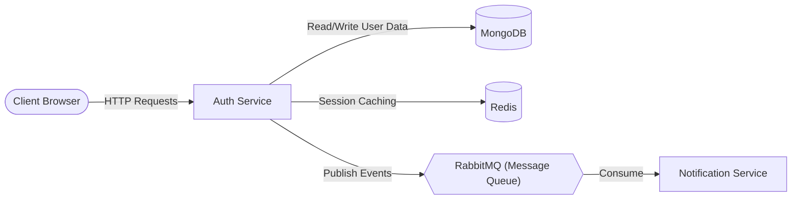

# Auth Service

The **Auth Service** is the central authentication and user identity management service for the AI Sandbox platform. It handles user authentication, profile details, preferences, and credit quotas.

---

## 🔑 Key Responsibilities

1. **User Authentication**: Signup, login, password hashing, and token-based authentication (JWT).
2. **Profile & Preferences Management**: Managing user details and interface preferences (theme, keybindings, etc.).
3. **Credit Management**: Tracking and updating user credits needed to interact with the AI orchestrator.
4. **Event Publishing**: Publishing user registration and credit lifecycle events to RabbitMQ (e.g., triggering welcome/alert emails via the Notification Service).

---

## 🏗️ Architecture & Flow

- **Database (MongoDB)**: Stores permanent user records, credentials, profiles, and credit metrics.
- **Cache (Redis)**: Caches active session tokens and state for fast lookup.
- **Message Broker (RabbitMQ)**: Dispatches background events asynchronously (like sending verification emails) to keep HTTP response times low.

---

## 📂 Directory Structure

* `src/app/app.js`: Express application setup and middleware configuration.
* `src/config/`: Database, Redis, and RabbitMQ client initializations.
* `src/controllers/`: Handles request logic for authentication, profiles, preferences, and credits.
* `src/middleware/`: JWT verification and request validation middlewares.
* `src/models/`: Mongoose schemas defining user, profile, preference, and credit data models.
* `src/routes/`: Express routes mapping API paths to their respective controllers.

---

## 🛠️ Environment Variables

Ensure the following variables are defined in your environment or `.env` file:

| Variable | Description |
| :--- | :--- |
| `PORT` | Service port (defaults to 3000) |
| `MONGO_URI` | MongoDB connection string |
| `REDIS_URL` | Redis connection URL |
| `RABBITMQ_URL` | RabbitMQ connection URL |
| `JWT_SECRET` | Secret key used for signing JWT tokens |
