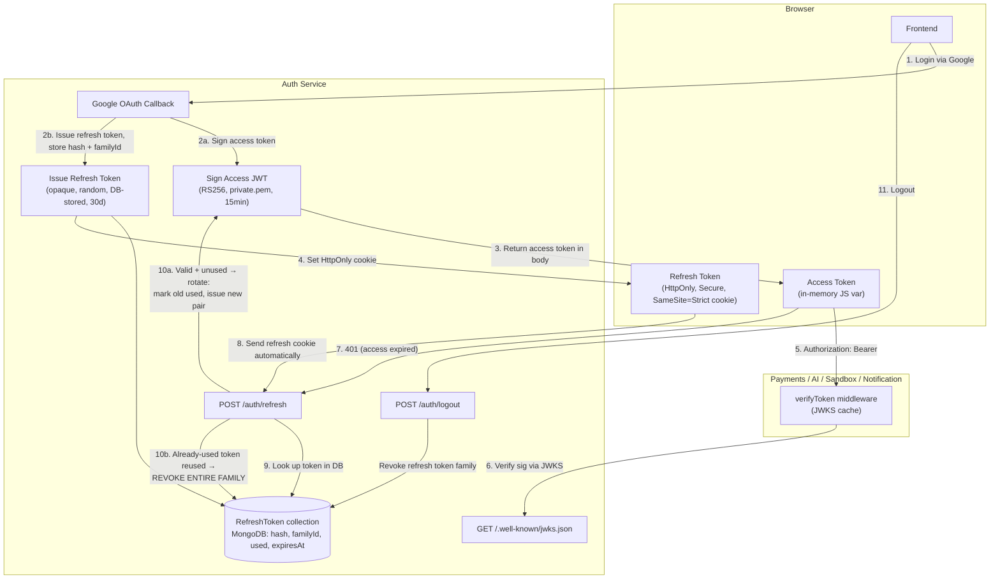

# Access + Refresh Token Auth — Best-Practice Plan
## RS256 Access Tokens (JWKS-verified) + Rotating, Reuse-Detected Refresh Tokens

> **Goal:** The industry-standard pattern (same shape used by Auth0, Google, AWS Cognito): short-lived, stateless JWT access tokens verified locally via JWKS, plus a long-lived, DB-backed, **rotating** refresh token with reuse detection so a stolen refresh token gets caught, not just trusted until expiry.

---

## 1. Why rotation + reuse detection, not just "refresh token exists"

A plain refresh token (issue once, reuse until expiry) has one weakness: if it's stolen, the attacker has a 7–30 day valid credential and you have no way to tell attacker-traffic from real-user-traffic. **Rotation with reuse detection** fixes this:

- Every time a refresh token is used, it's invalidated and a **new one** is issued (rotation).
- If an already-used (invalidated) refresh token is presented again, that's a signal of theft — because in normal operation the same token is never reused. The system responds by **revoking the entire token family** (all descendants of that refresh token), forcing re-login everywhere.

This is the same mechanism Auth0's "Refresh Token Rotation" and Google's OAuth refresh flow use.

---

## 2. Architecture



---

## 3. Data Model — Refresh Tokens (MongoDB)

Store a **hash** of the refresh token, never the raw value — same principle as password storage.

```javascript
// Auth/src/models/RefreshToken.js
const refreshTokenSchema = new mongoose.Schema({
  userId: { type: mongoose.Schema.Types.ObjectId, ref: 'User', required: true, index: true },
  tokenHash: { type: String, required: true, unique: true }, // sha256 of raw token
  familyId: { type: String, required: true, index: true },   // shared across a rotation chain
  used: { type: Boolean, default: false },
  expiresAt: { type: Date, required: true },
  createdAt: { type: Date, default: Date.now },
});

refreshTokenSchema.index({ expiresAt: 1 }, { expireAfterSeconds: 0 }); // TTL cleanup
```

`familyId` is the key piece: generated once at login, carried forward unchanged through every rotation. Revoking a family means `updateMany({ familyId }, { revoked: true })` or deleting all docs with that `familyId`.

---

## 4. Token Issuance (Login)

```javascript
// Auth/src/auth/issueTokens.js
import crypto from 'crypto';
import jwt from 'jsonwebtoken';
import RefreshToken from '../models/RefreshToken.js';

function hashToken(raw) {
  return crypto.createHash('sha256').update(raw).digest('hex');
}

export async function issueTokenPair(user, familyId = crypto.randomUUID()) {
  // Access token — RS256, short-lived, stateless
  const accessToken = jwt.sign(
    { sub: user._id.toString(), email: user.email, role: user.role },
    process.env.RSA_PRIVATE_KEY,
    {
      algorithm: 'RS256',
      keyid: process.env.JWT_ACTIVE_KID,
      issuer: 'taksha-auth',
      audience: 'taksha-services',
      expiresIn: '15m',
    }
  );

  // Refresh token — opaque random string, DB-backed
  const rawRefreshToken = crypto.randomBytes(64).toString('hex');
  await RefreshToken.create({
    userId: user._id,
    tokenHash: hashToken(rawRefreshToken),
    familyId,
    expiresAt: new Date(Date.now() + 30 * 24 * 60 * 60 * 1000), // 30d
  });

  return { accessToken, refreshToken: rawRefreshToken, familyId };
}
```

Set the refresh token as the cookie:
```javascript
res.cookie('refreshToken', rawRefreshToken, {
  httpOnly: true,
  secure: true,        // HTTPS only
  sameSite: 'strict',  // mitigates CSRF; use 'lax' if cross-subdomain redirects need it
  path: '/api/auth/refresh', // scope the cookie to only the refresh endpoint
  maxAge: 30 * 24 * 60 * 60 * 1000,
});
```

Scoping the cookie's `path` to `/api/auth/refresh` means it's never sent on ordinary API calls — only when the frontend explicitly hits the refresh endpoint. Reduces exposure surface.

---

## 5. The Refresh Endpoint (rotation + reuse detection)

```javascript
// Auth/src/controllers/refresh.js
export async function refresh(req, res) {
  const rawToken = req.cookies.refreshToken;
  if (!rawToken) return res.status(401).json({ error: 'No refresh token' });

  const tokenHash = hashToken(rawToken);
  const stored = await RefreshToken.findOne({ tokenHash });

  if (!stored || stored.expiresAt < new Date()) {
    return res.status(401).json({ error: 'Invalid or expired refresh token' });
  }

  if (stored.used) {
    // REUSE DETECTED — this token was already rotated away.
    // Someone is replaying an old token: revoke the whole family.
    await RefreshToken.deleteMany({ familyId: stored.familyId });
    res.clearCookie('refreshToken', { path: '/api/auth/refresh' });
    return res.status(401).json({ error: 'Token reuse detected — all sessions revoked' });
  }

  // Valid, first use: mark used, issue a new pair in the same family
  stored.used = true;
  await stored.save();

  const user = await User.findById(stored.userId);
  const { accessToken, refreshToken } = await issueTokenPair(user, stored.familyId);

  res.cookie('refreshToken', refreshToken, {
    httpOnly: true, secure: true, sameSite: 'strict',
    path: '/api/auth/refresh', maxAge: 30 * 24 * 60 * 60 * 1000,
  });
  res.json({ accessToken });
}
```

---

## 6. Frontend — Silent Refresh

```javascript
// api.js
let accessToken = null; // in-memory only — never localStorage

const setAccessToken = (t) => { accessToken = t; };

axios.interceptors.request.use((config) => {
  if (accessToken) config.headers.Authorization = `Bearer ${accessToken}`;
  return config;
});

let refreshInFlight = null; // dedupe concurrent 401s into one refresh call

axios.interceptors.response.use(
  (res) => res,
  async (err) => {
    if (err.response?.status === 401 && !err.config._retried) {
      err.config._retried = true;
      refreshInFlight ??= axios.post('/api/auth/refresh', {}, { withCredentials: true })
        .then((res) => {
          setAccessToken(res.data.accessToken);
          return res.data.accessToken;
        })
        .finally(() => { refreshInFlight = null; });

      try {
        const newToken = await refreshInFlight;
        err.config.headers.Authorization = `Bearer ${newToken}`;
        return axios(err.config); // retry original request
      } catch {
        window.location.href = '/login'; // refresh itself failed — full re-login
      }
    }
    return Promise.reject(err);
  }
);
```

The `refreshInFlight` dedupe matters: if 3 API calls 401 at once, you want exactly one refresh call, not three racing rotations (which would trigger your own reuse-detection against yourself).

---

## 7. Logout

```javascript
export async function logout(req, res) {
  const rawToken = req.cookies.refreshToken;
  if (rawToken) {
    const stored = await RefreshToken.findOne({ tokenHash: hashToken(rawToken) });
    if (stored) await RefreshToken.deleteMany({ familyId: stored.familyId });
  }
  res.clearCookie('refreshToken', { path: '/api/auth/refresh' });
  res.status(204).send();
}
```

Note: access tokens issued before logout remain technically valid until their own 15-min expiry (they're stateless JWTs, not checked against a blacklist here). If you need instant access-token kill on logout too, keep the Redis blacklist from your original design as a belt-and-suspenders layer — check it in the JWKS middleware alongside signature verification. Given 15-min access token lifetime, most teams accept that window rather than adding blacklist-check latency to every request; your call based on how sensitive Taksha's actions are.

---

## 8. Consuming Services (Payments / AI / Sandbox / Notification)

Unchanged from the JWKS pattern — these services never see refresh tokens at all, only access tokens:

```javascript
import { expressjwt } from 'express-jwt';
import jwksRsa from 'jwks-rsa';

const verifyJWT = expressjwt({
  secret: jwksRsa.expressJwtSecret({
    cache: true,
    cacheMaxAge: 600000,
    rateLimit: true,
    jwksRequestsPerMinute: 5,
    jwksUri: process.env.AUTH_JWKS_URI,
  }),
  issuer: 'taksha-auth',
  audience: 'taksha-services',
  algorithms: ['RS256'],
});

app.use('/api/protected', verifyJWT, protectedRouter);
```

Refresh logic lives **only** in the Auth service. This is the whole point of separating access vs refresh — the other 6 services stay completely stateless and never touch the RefreshToken collection.

---

## 9. Summary of Lifetimes & Storage

| Token | Lifetime | Storage | Verified by |
|---|---|---|---|
| Access token | 15 min | In-memory (frontend JS var) | All services, locally via JWKS |
| Refresh token | 30 days | HttpOnly, Secure, SameSite=Strict cookie, scoped to `/api/auth/refresh` | Auth service only, against DB hash |

---

## 10. Task Checklist

- [ ] Add `RefreshToken` model (hash, familyId, used, expiresAt, TTL index) to Auth service
- [ ] Implement `issueTokenPair` (access JWT + opaque refresh token + family tracking)
- [ ] Implement `POST /api/auth/refresh` with rotation + reuse-detection revocation
- [ ] Implement `POST /api/auth/logout` — deletes entire token family
- [ ] Set refresh cookie: `httpOnly`, `secure`, `sameSite: strict`, `path` scoped to refresh endpoint only
- [ ] Update Google OAuth callback to call `issueTokenPair` on first login
- [ ] Frontend: in-memory access token storage, request interceptor for Bearer header
- [ ] Frontend: response interceptor with dedup'd silent refresh on 401, redirect to login on refresh failure
- [ ] Keep JWKS endpoint + `jwks-rsa` middleware in all 6 downstream services unchanged
- [ ] Decide: keep Redis blacklist for instant access-token revocation on logout, or accept the 15-min tail (Section 7)
- [ ] Test reuse-detection: manually replay an already-rotated refresh token, confirm entire family is revoked and legitimate device is logged out too (expected — that's the security property)
- [ ] Confirm CORS config allows `withCredentials: true` cookie flow for the refresh endpoint specifically