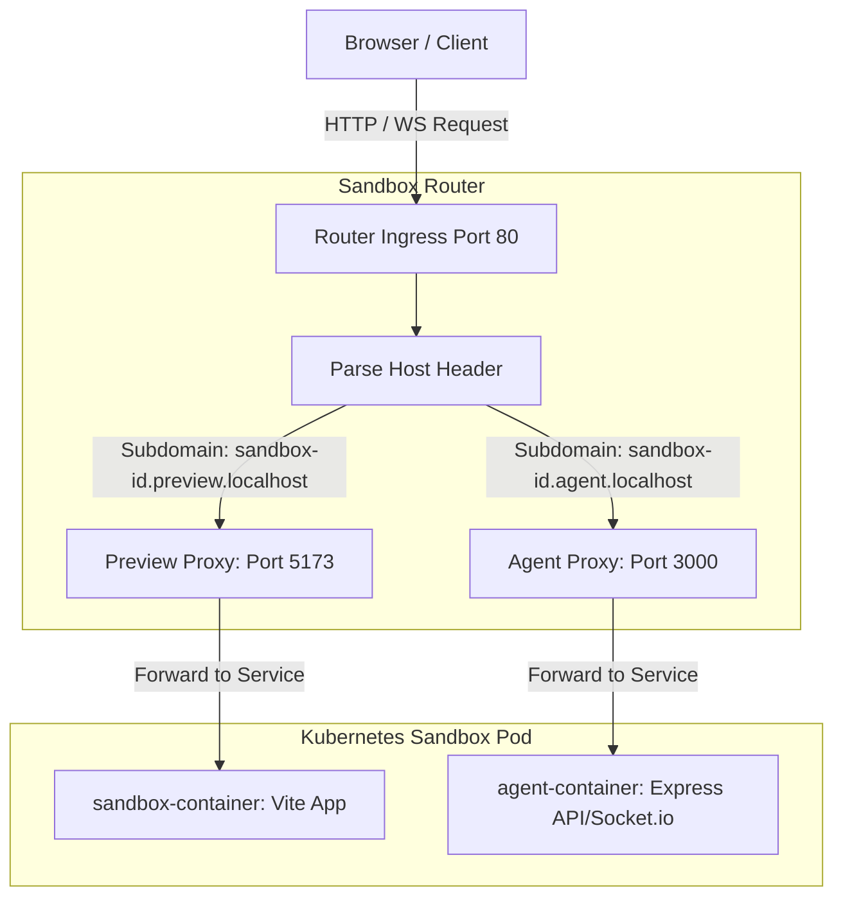

# Sandbox Reverse Proxy & Routing Architecture Guide

This document explains the design, execution, and implementation details of the dynamic Sandbox Router Server. It covers the core challenges of routing both HTTP and WebSockets in a multi-tenant environment, how they were resolved, and how you can build a similar proxy from scratch.

---

## 1. Architectural Overview

In a multi-tenant cloud development platform (like a codespace), each user sandbox runs inside its own isolated environment (e.g., a Kubernetes Pod). The router acts as a unified **Ingress Gateway** that intercepts all traffic on port 80 and forwards it to the correct container based on the subdomain.



---

## 2. Core Routing Rules

The router maps incoming host headers to Kubernetes services using a subdomain schema:

*   **Preview Subdomain**: `[sandbox-id].preview.localhost` $\rightarrow$ Routes to `http://sandbox-service-[sandbox-id]:80` (which Kubernetes maps to Container Port `5173` running the Vite template dev server).
*   **Agent Subdomain**: `[sandbox-id].agent.localhost` $\rightarrow$ Routes to `http://sandbox-service-[sandbox-id]:3000` (which Kubernetes maps to Container Port `3000` running the Agent API & Socket.io server).

---

## 3. The WebSocket Collision Problem (The Catch-22)

When building a dynamic multi-tenant router, standard proxy libraries like `http-proxy-middleware` (HPM) introduce a critical, hidden race condition when handling WebSockets.

### The Problem Sequence
1.  **Automatic Event Binding**: When HPM is configured with `ws: true`, it automatically listens to the Node.js server's `'upgrade'` event.
2.  **Delayed Capture**: Express middleware does not have a reference to the HTTP server at startup. To solve this, HPM waits for the first HTTP request, extracts the server reference from `req.socket.server`, and registers its upgrade listener:
    ```javascript
    server.on('upgrade', proxyInstance.upgrade);
    ```
3.  **The Collision**: In a dynamic router, we cache proxy instances for each sandbox (e.g., `sandbox-A`, `sandbox-B`). Once both sandboxes receive an HTTP request, both of their proxy instances register upgrade listeners on the same HTTP server.
4.  **Socket Crash**: When a WebSocket request comes in for `sandbox-B`, **both** `sandbox-A`'s proxy and `sandbox-B`'s proxy try to handle the upgrade at the same time, leading to collisions, socket hang-ups (`ECONNRESET`), and dropped connections.

### The Solution: Decoupling HTTP & WebSockets
To prevent this, we split proxy management into two completely independent structures:

1.  **HTTP Proxies (`ws: false`)**: Mounted as Express middleware. Since `ws` is disabled, they never register automatic upgrade listeners on the HTTP server.
2.  **WebSocket Proxies (`ws: true`)**: Kept in memory but **never** mounted as Express middleware. They are completely inert.
3.  **Manual Dispatching**: We register a single `'upgrade'` event listener on the HTTP server. When a client upgrades a connection, our code extracts the sandbox ID, retrieves the corresponding WebSocket proxy from the cache, and manually forwards the upgrade via `proxy.upgrade()`.

---

## 4. Code Deep Dive

Here is the production implementation of the router from [app.js](file:///Users/home/Desktop/Capstone/Sandbox/router/src/app.js):

### Importing Dependencies
```javascript
import express from 'express';
import morgan from 'morgan';
import http from 'http';
import { createProxyMiddleware } from 'http-proxy-middleware';
import { refreshTTL } from './config/redis.js';
```

### Proxy Creation & Caching
We maintain separate caches for HTTP and WebSocket proxies. Setting `changeOrigin: true` ensures that the proxy rewrites the Host header to match the internal Kubernetes ClusterIP service DNS.

```javascript
// HTTP Proxy Cache (Strictly ws: false)
const httpProxies = {};
const httpAgentProxies = {};

// WebSocket Proxy Cache (ws: true, never mounted as middleware)
const wsProxies = {};
const wsAgentProxies = {};

// Retrieves or instantiates the HTTP preview proxy (Vite Dev Server)
const getHttpProxy = (sandboxId) => {
    if (!httpProxies[sandboxId]) {
        httpProxies[sandboxId] = createProxyMiddleware({
            target: `http://sandbox-service-${sandboxId}`,
            changeOrigin: true,
            ws: false
        });
    }
    return httpProxies[sandboxId];
};

// Retrieves or instantiates the HTTP agent proxy (Express API)
const getHttpAgentProxy = (sandboxId) => {
    if (!httpAgentProxies[sandboxId]) {
        httpAgentProxies[sandboxId] = createProxyMiddleware({
            target: `http://sandbox-service-${sandboxId}:3000`,
            changeOrigin: true,
            ws: false
        });
    }
    return httpAgentProxies[sandboxId];
};
```

### WebSocket Proxies
These proxies are initialized with `ws: true` and include custom event loggers to track the WebSocket lifecycle:

```javascript
const getWsProxy = (sandboxId) => {
    if (!wsProxies[sandboxId]) {
        wsProxies[sandboxId] = createProxyMiddleware({
            target: `http://sandbox-service-${sandboxId}`,
            changeOrigin: true,
            ws: true,
            on: {
                error: (err, req, res) => console.error(`[WS Error] sandbox: ${sandboxId}`, err),
                proxyReqWs: (proxyReq, req) => console.log(`[WS Upgrade] sandbox: ${sandboxId}`),
                open: () => console.log(`[WS Connected] sandbox: ${sandboxId}`),
                close: () => console.log(`[WS Closed] sandbox: ${sandboxId}`)
            }
        });
    }
    return wsProxies[sandboxId];
};
```

### Express Subdomain Middleware (HTTP)
Express processes requests from top to bottom. This middleware parses the `Host` header to determine the destination subdomain:

```javascript
app.use(async (req, res, next) => {
    const host = req.headers.host;
    if (!host) {
        return res.status(400).json({ status: "error", message: "Missing host header" });
    }

    const sandboxId = host.split('.')[0];
    const targetHost = host.split('.')[1]; // 'agent' or 'preview'

    // Refresh sandbox lease in Redis
    await refreshTTL(sandboxId);

    if (targetHost === 'agent') {
        return getHttpAgentProxy(sandboxId)(req, res, next);
    } else if (targetHost === 'preview') {
        return getHttpProxy(sandboxId)(req, res, next);
    }

    next();
});
```

### Manual Upgrade Dispatcher
This is the heart of the WebSocket router. It hooks directly into Node's HTTP `'upgrade'` event:

```javascript
const server = http.createServer(app);

server.on('upgrade', async (req, socket, head) => {
    const host = req.headers.host;
    if (!host) {
        socket.destroy();
        return;
    }

    const sandboxId = host.split('.')[0];
    const targetHost = host.split('.')[1];
    
    await refreshTTL(sandboxId);

    let proxy;
    if (targetHost === 'agent') {
        proxy = getWsAgentProxy(sandboxId);
    } else if (targetHost === 'preview') {
        proxy = getWsProxy(sandboxId);
    }

    if (proxy && typeof proxy.upgrade === 'function') {
        // Manually delegate the upgrade connection to the correct proxy instance
        proxy.upgrade(req, socket, head);
    } else {
        socket.destroy();
    }
});
```

---

## 5. How to Build Your Own Router (Step-by-Step)

If you want to build a similar reverse proxy on your own machine, follow these steps:

### Step 1: Initialize the Project
```bash
mkdir custom-router
cd custom-router
npm init -y
npm install express http-proxy-middleware
```

### Step 2: Enable ES Modules
Add `"type": "module"` to your `package.json` to support modern `import` syntax.

### Step 3: Configure Local Subdomains
Configure your operating system to resolve local subdomains. On macOS or Linux, add these entries to your `/etc/hosts` file:
```text
127.0.0.1   tenant1.localhost
127.0.0.1   tenant2.localhost
```

### Step 4: Write the Proxy Server (`server.js`)
Create a `server.js` file with the following code to route traffic based on the subdomain:

```javascript
import express from 'express';
import http from 'http';
import { createProxyMiddleware } from 'http-proxy-middleware';

const app = express();

const proxies = {};
const wsProxies = {};

// Helper to get or create HTTP proxy
const getHttpProxy = (tenant) => {
    if (!proxies[tenant]) {
        proxies[tenant] = createProxyMiddleware({
            target: tenant === 'tenant1' ? 'http://localhost:3001' : 'http://localhost:3002',
            changeOrigin: true,
            ws: false
        });
    }
    return proxies[tenant];
};

// Helper to get or create WS proxy
const getWsProxy = (tenant) => {
    if (!wsProxies[tenant]) {
        wsProxies[tenant] = createProxyMiddleware({
            target: tenant === 'tenant1' ? 'http://localhost:3001' : 'http://localhost:3002',
            changeOrigin: true,
            ws: true
        });
    }
    return wsProxies[tenant];
};

// Express routing for HTTP
app.use((req, res, next) => {
    const host = req.headers.host || '';
    const tenant = host.split('.')[0];
    
    if (tenant === 'tenant1' || tenant === 'tenant2') {
        return getHttpProxy(tenant)(req, res, next);
    }
    res.status(404).send('Tenant not found');
});

const server = http.createServer(app);

// Manual upgrade routing for WebSockets
server.on('upgrade', (req, socket, head) => {
    const host = req.headers.host || '';
    const tenant = host.split('.')[0];

    if (tenant === 'tenant1' || tenant === 'tenant2') {
        const proxy = getWsProxy(tenant);
        proxy.upgrade(req, socket, head);
    } else {
        socket.destroy();
    }
});

server.listen(80, () => {
    console.log('Reverse Proxy listening on port 80');
});
```

### Step 5: Test It
1. Start two test servers on ports `3001` and `3002` (these can be simple Node scripts or python servers).
2. Run your proxy server using `sudo node server.js` (sudo is required to listen on port 80).
3. Access `http://tenant1.localhost` and `http://tenant2.localhost` in your browser. Traffic and WebSocket handshakes will route dynamically and isolated to their respective local servers.
