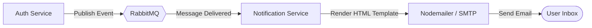

# Notification Service

The **Notification Service** is an asynchronous microservice responsible for dispatching email notifications (such as system alerts, welcome emails, or password reset instructions) to users.

---

## 🔔 Key Responsibilities

1. **Queue Consumer**: Listens to messages published to RabbitMQ from other services (such as the Auth Service).
2. **Email Delivery**: Translates incoming event payloads into styled email templates and dispatches them via SMTP (using Nodemailer).
3. **Decoupled Notification Logs**: Logs transmission status of sent emails to keep notification delivery independent of the critical user-facing auth flow.

---

## 🏗️ Architecture & Integration

- **Asynchronous Execution**: By decoupling notifications from the main services, client requests (like registering a new account) do not block waiting for external mail servers to respond.
- **Queue Durability**: If the SMTP server is temporarily down, messages remain in RabbitMQ to be retried later, preventing lost notifications.

---

## 📂 Directory Structure

* `src/app/app.js`: Service initialization and consumer execution loop.
* `src/config/`: Configuration for RabbitMQ consumer channels.
* `src/emails/template/`: HTML/CSS email templates (e.g., auth notifications).
* `src/services/email.js`: Mail transporter config and delivery logic using Nodemailer.

---

## 🛠️ Environment Variables

Ensure the following variables are configured:

| Variable | Description |
| :--- | :--- |
| `PORT` | Service port (defaults to 3000) |
| `RABBITMQ_URL` | RabbitMQ connection URL |
| `SMTP_HOST` | Host of SMTP email server |
| `SMTP_PORT` | Port of SMTP email server |
| `SMTP_USER` | Username for SMTP authentication |
| `SMTP_PASS` | Password for SMTP authentication |
| `EMAIL_FROM` | Sender address shown in the "From" header |
