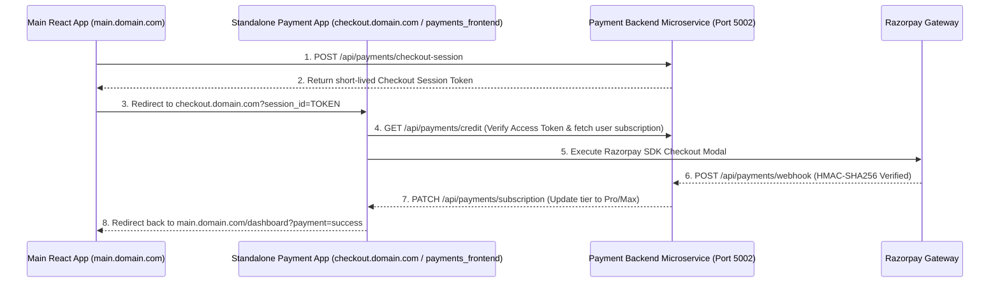

# 💳 Payments Service & Standalone Checkout App (`payments_frontend`)

> Owns every credit, subscription, and financial billing decision in the platform — combining a Razorpay HMAC-verified Payment Backend Microservice (`Payments`) with a dedicated, performance-isolated Standalone Checkout React Application (`payments_frontend` running on `checkout.yourdomain.com`).


---

## 📖 Table of Contents
- [Overview \& The "Why"](#-overview--the-why)
- [Authentication \& Single Source of Truth Model](#-authentication--single-source-of-truth-model)
- [Standalone Checkout Architecture](#-standalone-checkout-architecture)
- [4-Layer Frontend Architecture (`payments_frontend`)](#-4-layer-frontend-architecture-payments_frontend)
- [Design Token System \& Dual Themes](#-design-token-system--dual-themes)
- [Built Features \& Current State](#-built-features--current-state)
- [API Route Reference](#-api-route-reference)
- [Usage \& Setup](#-usage--setup)
- [Production Readiness](#-production-readiness)

---

## 🎯 Overview & The "Why"

### What this service & application do
The **Payments Service & Standalone Checkout App** forms the financial ledger and billing engine for Taksha CodeSpace:
1. **Razorpay Order & Webhook Management**: HMAC-SHA256 verified webhook processing for automated billing and credit grants.
2. **Dedicated Standalone Payment App (`payments_frontend`)**: An isolated, lightweight React application built specifically for checkout flows, live subscription status monitoring, pricing tier comparisons, and tax receipt PDF downloads.
3. **Credit Balance & Token Bucket System**: Manages per-user AI credit balances with provider-specific token buckets (Google Gemini, Mistral, OpenAI, Cohere).
4. **Audit Logging & Event Publishing**: Maintains an immutable transaction audit log in MongoDB and publishes `payment.credit.topup` events to RabbitMQ.

---

## 🔐 Authentication & Single Source of Truth Model

### Access Token Verification Only
- The application uses the **JWT Access Token** (`accessToken` cookie or `Authorization: Bearer <token>` header) strictly to authenticate and identify the user.
- Upon receiving a request, the `identifyUser` middleware in the `Payments` backend verifies the JWT signature (`process.env.JWT_ACCESS_SECRET`) and extracts `req.user = { id, email, name }`.

### Single Source of Truth for Subscriptions
- **No Subscription Status in Auth Service**: The Auth service stores ONLY core user identity (`googleId`, `name`, `email`, `photo`, `refreshToken`).
- **Payment Service Ownership**: The `Payments` backend microservice is the sole authoritative owner of all subscription tiers (`free`, `pro`, `max`), token buckets, usage logs, and billing periods.

---

## 🏗️ Standalone Checkout Architecture



---

## 🏗️ 4-Layer Frontend Architecture (`payments_frontend`)

Following `Helpers/frontend_architecture_skill.md`, `payments_frontend` is organized into 4 distinct execution layers:

```text
payments_frontend/src/
├── components/                 # Shared UI (Header, BrandLogo, ThemeToggle)
├── features/
│   └── payments/               # Payments Feature Module
│       ├── components/         # Layer 4: React UI Components (LandingPage, PlanCard, CheckoutModal, InvoicesView, SubscriptionDashboard)
│       ├── Hooks/              # Layer 3: Custom React Hooks (usePayments.js)
│       ├── service/            # Layer 1: Axios API Service (payments.api.js)
│       └── slice/              # Layer 2: Redux Toolkit Slice (payments.slice.js)
├── services/                   # Global Axios Client with Bearer Token Interceptor (api.js)
├── styles/                     # Design System Tokens & Dual Theme Styles
│   ├── index.scss              # CSS custom properties, resets, theme tokens
│   └── tokens.scss             # SCSS tokens, mixins, spacing scale
├── App.jsx                     # App Orchestrator & View Router
├── main.jsx                    # Application Entry Point
└── store.js                    # Centralized Redux Store
```

### Execution Layers Breakdown
1. **Layer 1: Service Layer (`src/features/payments/service/payments.api.js`)**:
   - Pure async HTTP calls using Axios (`fetchCreditAPI`, `fetchPackagesAPI`, `updateSubscriptionAPI`, `fetchTransactionsAPI`, `fetchTransactionSummaryAPI`, `fetchAnalyticsAPI`, `createCheckoutSessionAPI`).
   - Zero Redux state dependencies.
2. **Layer 2: Redux Slice Layer (`src/features/payments/slice/payments.slice.js`)**:
   - Synchronous reducers for `credit`, `packages`, `transactions`, `summary`, `analytics`, `isLoading`, `error`, `selectedPlanId`, `billingCycle`, `activeView`, `theme`.
3. **Layer 3: Custom Hooks Layer (`src/features/payments/Hooks/payments.hooks.js`)**:
   - Orchestrates business logic, async dispatchers, Razorpay checkout launcher, and theme toggles.
4. **Layer 4: Components Layer (`src/features/payments/components/*`)**:
   - Renders UI, captures events, and consumes `usePayments()` custom hook.

---

## 🎨 Design Token System & Dual Themes

`payments_frontend` uses a Dual-Token Architecture combining CSS Custom Properties (`index.scss`) with SCSS helper mixins (`tokens.scss`).

### Color System & Palette
- **Brand Emerald**: `#10B981` (Dark) / `#059669` (Light)
- **Azure Accent**: `#3B82F6` (Dark) / `#0969DA` (Light)
- **Obsidian Dark Canvas**: `#07080B` with overlay `#161929`
- **Codespace Light Canvas**: `#FFFFFF` with chrome surface `#F4F4F6`

---

## 🚧 Built Features & Current State

| Feature | Description | State |
|---|---|---|
| **Pricing Matrix & Plan Cards** | 3-tier plans (Free, Pro, Max) with monthly/annual 20% discount toggle | ✅ Done |
| **Razorpay SDK Checkout** | Short-lived session token handoff & Razorpay modal integration | ✅ Done |
| **Live Subscription Status** | Real-time provider token bucket gauges (Gemini, Mistral, OpenAI, Cohere) | ✅ Done |
| **Audit Ledger & PDF Invoices** | Paginated transaction log & downloadable itemized PDF tax receipts | ✅ Done |
| **Access Token Auth** | Authenticates via Bearer token with zero subscription state in Auth service | ✅ Done |
| **Dual Theme Support** | Instant toggle between Obsidian Dark & Codespace Light modes | ✅ Done |

---

## 📡 API Route Reference

### Public Routes
- `GET /api/payments/credit/packages` — Returns all available subscription plans.

### Authenticated User Routes (Access Token Required)
- `GET /api/payments/credit` — Returns full credit balance, token buckets, and active subscription tier.
- `GET /api/payments/credit/check` — Provider credit availability check for AI orchestration.
- `POST /api/payments/credit/update` — Deducts tokens/credits upon AI prompt execution.
- `PATCH /api/payments/subscription` — Upgrades/downgrades subscription tier (`free` | `pro` | `max`).
- `GET /api/payments/credit/transactions` — Paginated transaction audit history.
- `GET /api/payments/credit/transactions/summary` — Aggregated spending stats.
- `GET /api/payments/credit/analytics` — Provider and agent token usage breakdown.
- `POST /api/payments/checkout-session` — Generates short-lived checkout session token.

---

## 💻 Usage & Setup

### Run Backend Microservice
```bash
cd Payments
npm install
npm run dev
```

### Run Standalone Payment App (`payments_frontend`)
```bash
cd payments_frontend
npm install
npm run dev
```

The app will run locally at `http://localhost:5174` (or configured port).

---

## 🛡️ Production Readiness

### Health Check Endpoints
- `GET /healthz` — Returns 200 OK if service process is healthy.
- `GET /ready` — Returns 200 OK if MongoDB and RabbitMQ connections are healthy.
