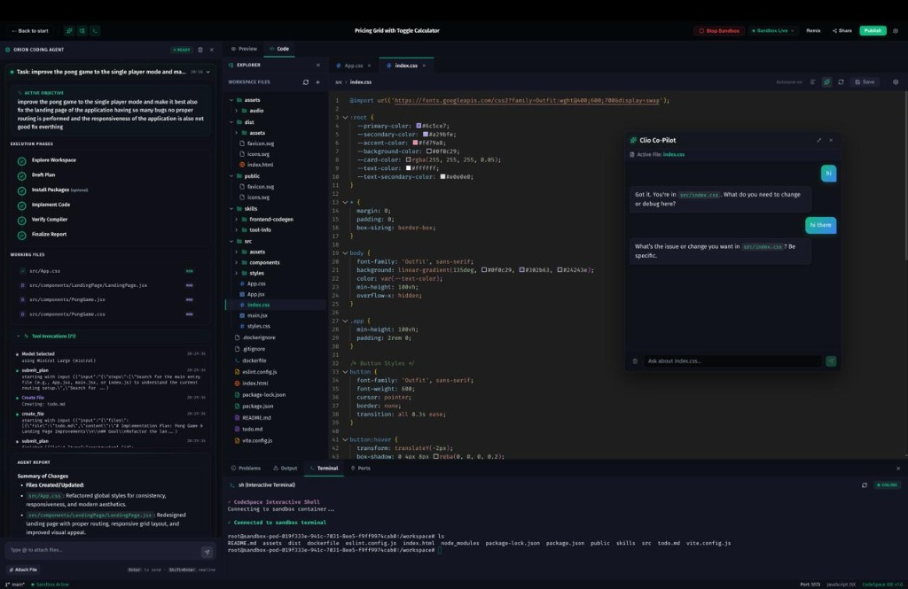
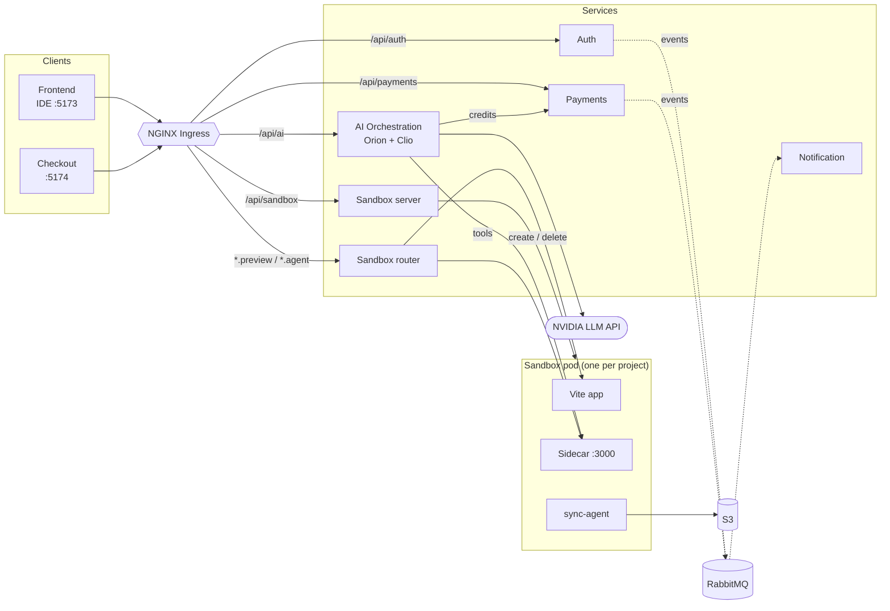

<div align="center">


# Taksha CodeSpace

**A cloud IDE where an AI agent plans, writes, builds and fixes code inside your own Kubernetes sandbox.**

<p>
  
  
  
  
</p>
<p>
  
  
  
  
  
  
</p>

[Features](#features) · [Architecture](#architecture) · [Services](#services) · [Quick start](#quick-start) · [Docs](#documentation)

<br />



</div>

---

## What it is

- **Every project gets its own sandbox.** A Kubernetes pod with a live Vite preview, a terminal and files saved to S3.
- **Orion, the coding agent,** turns a prompt into a plan, waits for your approval, then edits, builds and fixes the code in that sandbox.
- **Clio, the copilot,** explains code and makes small edits to the file you have open.
- **Results are checked, not guessed.** A step passes only when the tool results and the build exit code say so.

---

## Features

| Area | What you get |
|---|---|
| **Editor** | Monaco editor, file tree, xterm.js terminal, live preview at `<id>.preview.localhost` |
| **AI agents** | Orion graph with plan review, tester, reviewer and up to 3 debug rounds. Streams over SSE and re-attaches after a reload. |
| **Sandboxes** | One pod per project, idle pods stop on their own, files restored from S3 on start |
| **Auth** | Google OAuth, RS256 access tokens with JWKS, rotating refresh tokens with reuse detection |
| **Billing** | Razorpay checkout, verified webhooks, subscription slots, credit windows, referrals |
| **Emails** | Welcome and payment emails through RabbitMQ and Nodemailer |

---

## Architecture



Each backend owns its own MongoDB database. Redis handles the token blacklist, rate limits, cron locks and sandbox TTLs.

Full flows (login, sandbox lifecycle, agent run, payments): **[docs/ARCHITECTURE.md](docs/ARCHITECTURE.md)**

---

## Services

| Service | Role | Stack | README |
|---|---|---|---|
| `Auth/` | Google login, JWT issuer, JWKS, refresh rotation | Express, Passport, Redis | [Read](Auth/README.md) |
| `Ai_orchestration/` | Orion and Clio agents, SSE streaming, rate limit | LangGraph, LangChain, Tavily | [Read](Ai_orchestration/readme.md) |
| `Payments/` | Orders, webhooks, subscriptions, credits, cron jobs | Razorpay, node-cron, FaultKit | [Read](Payments/README.md) |
| `Notification/` | Email worker | RabbitMQ, Nodemailer | [Read](Notification/README.md) |
| `Sandbox/server/` | Projects and pod lifecycle | `@kubernetes/client-node` | [Read](Sandbox/server/README.md) |
| `Sandbox/router/` | Subdomain proxy into pods | `http-proxy-middleware` | [Read](Sandbox/router/README.md) |
| `Sandbox/Agent/` | In-pod sidecar: file API, commands, PTY terminal | node-pty, Socket.IO | [Read](Sandbox/Agent/README.md) |
| `Sandbox/sync-agent/` | Restores and backs up workspace files | AWS SDK, chokidar | [Read](Sandbox/sync-agent/README.md) |
| `Sandbox/template/` | Seed Vite + React app for new projects | Vite, React | [Read](Sandbox/template/README.md) |
| `Frontend/` | The cloud IDE | React 19, Redux Toolkit, Monaco, Dexie | [Read](Frontend/README.md) |
| `payments_frontend/` | Pricing and checkout app | React 19, react-razorpay | [Read](payments_frontend/README.md) |
| `Admin/` | Planned, no code yet | n/a | [Read](Admin/README.md) |

---

## Quick start

### Prerequisites

- Node.js 20+ and npm
- Docker Desktop with Kubernetes enabled (or Minikube)
- [Skaffold](https://skaffold.dev) and the NGINX Ingress controller
- Accounts or local instances for MongoDB, Redis, RabbitMQ, AWS S3, Google OAuth, Razorpay (test mode) and an NVIDIA API key

### 1. Configure

Every service has a `.env.example`. Copy it to `.env` and fill in your values.

```bash
cp Auth/.env.example Auth/.env
# repeat for Payments, Ai_orchestration, Notification, Sandbox/server, Sandbox/router,
# Sandbox/sync-agent and payments_frontend
```

For the cluster, build `k8s/secrets.yml` from the keys the manifests in `k8s/` read.

### 2. Run the whole cluster

```bash
skaffold dev
```

This builds every image, applies `k8s/*.yml` and hot-syncs `src/` changes into running pods.

### 3. Run the frontends

```bash
cd Frontend && npm install && npm run dev            # http://localhost:5173
cd payments_frontend && npm install && npm run dev   # http://localhost:5174/payments/
```

Both proxy `/api` to the ingress at `http://localhost`.

### Handy commands

| Task | Command |
|---|---|
| Run one backend outside the cluster | `cd <service> && npm run dev` |
| AI offline tests | `cd Ai_orchestration && npm test` |
| Check the NVIDIA key and model | `cd Ai_orchestration && npm run check:model` |
| Auth load test | `k6 run Auth/src/k6/load-test.js` |
| Health checks | `GET /healthz` and `/readyz` on Auth, Payments, Notification |

> [!WARNING]
> `cd Payments && npm test` clears collections in its database. Run it only against a throwaway database.

---

## Project layout

```
Capstone/
├── Auth/                 identity and tokens
├── Ai_orchestration/     Orion + Clio agents
├── Payments/             billing and credits
├── Notification/         email worker
├── Sandbox/
│   ├── server/           pod lifecycle API
│   ├── router/           subdomain proxy
│   ├── Agent/            in-pod sidecar
│   ├── sync-agent/       S3 backup and restore
│   └── template/         seed project
├── Frontend/             cloud IDE
├── payments_frontend/    checkout app
├── k8s/                  manifests and ingress
├── docs/                 architecture, API and design docs
├── launch-video/         Remotion launch video
└── skaffold.yml          dev loop for the cluster
```

---

## Documentation

| Doc | Topic |
|---|---|
| [docs/ARCHITECTURE.md](docs/ARCHITECTURE.md) | How the services work together, start here |
| [docs/README.md](docs/README.md) | Index of all design docs |
| [docs/openapi.yaml](docs/openapi.yaml) | OpenAPI contract |
| [docs/prd/](docs/prd/taksha-codespace-prd.md) | Product requirements |
| [docs/infrastructure/](docs/infrastructure/k8s-skaffold-production-guide.md) | Kubernetes and Skaffold guide |
| [docs/frontend/](docs/frontend/frontend-architecture-and-design-tokens.md) | Frontend architecture and design tokens |

> [!NOTE]
> Some pages in `docs/` describe planned work (gRPC, the Chrome extension, Loki, Admin). When a doc and the code disagree, the code is right. Current gaps are listed in [docs/ARCHITECTURE.md](docs/ARCHITECTURE.md#known-gaps).

---

<div align="center">

Built by **Sahil Sharma** · [@Sahil-coder-30](https://github.com/Sahil-coder-30)

</div>
