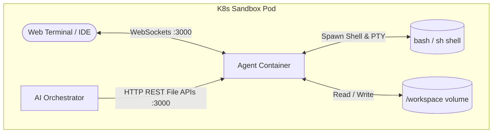

# Sandbox Agent Sidecar

The **Sandbox Agent Sidecar** is a lightweight Node.js service running as a sidecar container (`agent-container`) inside every dynamic Sandbox Pod. It has direct access to the shared `/workspace` volume and exposes key file manipulation, execution, and terminal APIs.

---

## 🛠️ Key Responsibilities

1. **File Operations API**: Exposes endpoints for listing, reading, creating, modifying, and deleting files inside the `/workspace` directory. This is the primary API used by the AI Agent to edit code.
2. **Terminal Shell Stream**: Spawns pseudoterminal sessions (`node-pty`) and streams the input/output in real time via WebSockets (`socket.io`). This allows both the user's browser terminal and the AI to run build commands, start development servers, or run tests inside the container.
3. **Security Safeguards**: Implements strict path-traversal validation (`safeResolve` helper) using absolute path normalization to prevent any operation from reading or writing files outside the designated `/workspace` folder.

---

## 🏗️ Architecture & Interaction

---

## 📂 Directory Structure

* `src/app.js`: Contains all REST endpoints (`/api/agent/*`), WebSocket event handlers for terminal streaming, and helper methods:
  - `stripWorkspace(fullPath)`: Sanitizes absolute paths to relative paths.
  - `safeResolve(file)`: Ensures file paths stay within `/workspace`.
* `server.js`: Standard entry point to bind and start the Express HTTP & Socket.io server.

---

## 🔌 API Summary

| Endpoint | Method | Purpose |
| :--- | :--- | :--- |
| `/api/agent/health` | `GET` | Health check |
| `/api/agent/list-files` | `GET` | Lists all files (excluding `node_modules`, `.git`, `dist`) |
| `/api/agent/read-file` | `GET` | Read contents of one or multiple files |
| `/api/agent/create-file`| `POST` | Create file (auto-creates parent directories) |
| `/api/agent/update-file`| `PATCH` | Overwrite file contents |
| `/api/agent/patch-file` | `POST` | Replace a target substring in a file |
| `/api/agent/delete-file`| `DELETE`| Delete files or directories |

---

## 🛠️ Environment Variables

| Variable | Description |
| :--- | :--- |
| `PORT` | Listening port (defaults to 3000) |
