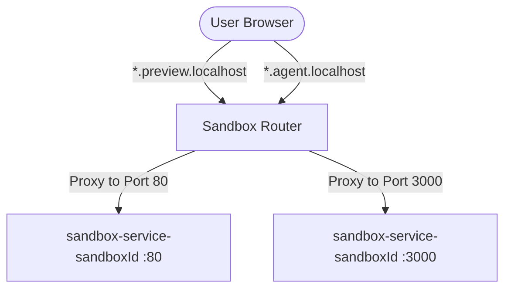

# Sandbox Router

The **Sandbox Router** is a highly dynamic reverse-proxy service that routes incoming editor and preview traffic from sub-domains directly to their respective developer sandbox pods.

---

## 🔀 Key Responsibilities

1. **Sub-domain Proxying**:
   - Parses the sub-domain from incoming requests to extract the `sandboxId` (e.g. `<sandboxId>.preview.localhost`).
   - Forwards request traffic to the matching K8s Service (`sandbox-service-<sandboxId>`).
2. **Port Forwarding Rules**:
   - `*.preview.localhost` -> Proxy to port `80` (Vite Dev Server).
   - `*.agent.localhost` -> Proxy to port `3000` (Agent API Sidecar & Terminal WebSockets).
3. **Connection Tunneling**: Supports active WebSockets (with `ws: true` enabled) to ensure live HMR (Hot Module Replacement) and terminal communication function seamlessly.

---

## 🏗️ Architecture & Traffic Flow

---

## 📂 Directory Structure

* `src/app.js`: Proxy matching logic utilizing `http-proxy-middleware`. Includes caching proxy instances dynamically to avoid resolving DNS names on every single request.
* `server.js`: Standard server listener binding to port 3000.

---

## 🛠️ Environment Variables

Ensure the environment contains:

| Variable | Description | Default |
| :--- | :--- | :--- |
| `PORT` | Service port | `3000` |
| `REDIS_URL` | Redis endpoint (used for routing cache and sandbox state checks) | *None* |
