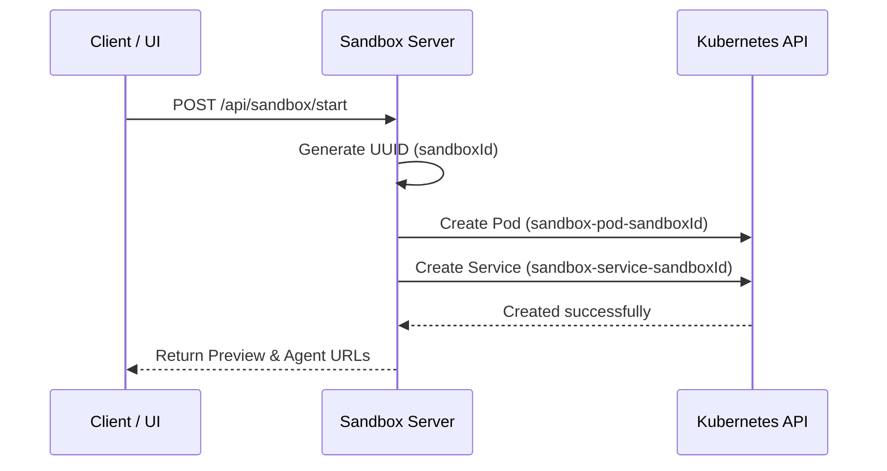

# Sandbox Control Plane Server

The **Sandbox Control Plane Server** is the core orchestration service responsible for the lifecycle (creation, tracking, status checks, and deletion) of developer sandboxes in the Kubernetes cluster.

---

## 🏗️ Key Responsibilities

1. **On-Demand Provisioning**: When a user starts a project, this service receives `POST /api/sandbox/start` and spins up a dedicated K8s Pod and ClusterIP Service.
2. **Multi-Container Pod Spec Orchestration**: Creates pods with:
   - **Init Container (`init-container`)**: Installs the baseline React+Vite template files into `/workspace`.
   - **Sandbox Container (`sandbox-container`)**: Runs the user's live code via Vite Dev Server on port 5173.
   - **Agent Container (`agent-container`)**: The sidecar API allowing file changes and shell command execution.
   - **Sync Agent Container (`sync-agent-container`)**: Real-time mirroring of code edits to AWS S3.
   - **Shared Volume**: Connects containers using a shared `workspace-volume` mounted at `/workspace`.
3. **ClusterIP Service Mapping**: Provisions an internal service maps ports `80` (targeting 5173) and `3000` (targeting 3000) so the Sandbox Router can target them.

---

## 🛠️ Kubernetes Integration Workflow

---

## 📂 Directory Structure

* `src/app/app.js`: Express app routing and base setup.
* `src/config/`: Redis client setup.
* `src/kubernetes/`: Orchestration logic using the official `@kubernetes/client-node` client:
  - `config.js`: Initializes client configuration.
  - `pod.js`: Handles pod manifests, creation, status, and termination.
  - `service.js`: Handles service manifests and lifecycle.
* `src/controllers/sandbox.controller.js`: Exposes API controller actions.
* `src/routes/sandbox.routes.js`: Defines REST routes.

---

## 🔌 API Summary

| Endpoint | Method | Purpose |
| :--- | :--- | :--- |
| `/api/sandbox/health` | `GET` | Health probe |
| `/api/sandbox/ready` | `GET` | Readiness probe |
| `/api/sandbox/start` | `POST` | Provisions sandbox pod + service (expects `projectId` in body) |

---

## 🛠️ Environment Variables

| Variable | Description |
| :--- | :--- |
| `PORT` | Listening port (defaults to 3000) |
| `MONGO_URI` | MongoDB connection URI |
| `REDIS_URL` | Redis URL |
