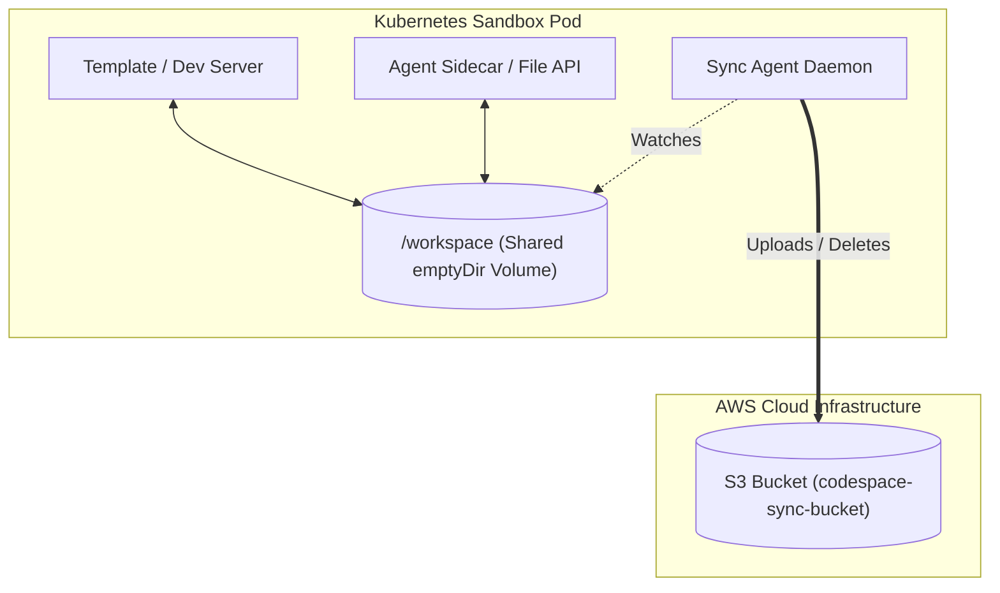

# Sync Agent (Sandbox Sync Service)

The **Sync Agent** is a real-time, event-driven file synchronization daemon that runs inside each user's isolated Kubernetes sandbox pod. Its main responsibility is to watch the shared `/workspace` volume and mirror all file additions, modifications, and deletions to a central AWS S3 bucket in real time.

---

## 🏗️ Architecture Overview

Each sandbox pod contains multiple containers (Template Dev Server, File Agent, and Sync Agent) sharing a common volume mounted at `/workspace`.

1. **Local Modifiers**: Files inside `/workspace` are modified by the user (via the Web Editor) or by the AI Agent (via the Agent Sidecar's File API).
2. **File Watching**: The Sync Agent daemon runs in the background, watching `/workspace` for any changes.
3. **S3 Mirroring**: When a change is detected, it computes the relative path, prefixes it with the `PROJECT_ID` (to separate files belonging to different workspaces), and performs the corresponding upload/delete action on the S3 bucket.

---

## ⚙️ Key Technical Decisions & Justifications

### 1. File Watching with Chokidar
Instead of using Node's native `fs.watch` or `fs.watchFile`, we utilize **Chokidar**.
* **Why it's best**: 
  - **Docker/K8s Volume Compatibility**: In containerized environments, file changes made on shared volume mounts (like `emptyDir` or NFS) often fail to propagate standard OS-level `inotify` events. Chokidar supports `usePolling: true`, which guarantees event detection in volume mounts.
  - **Stability & Performance**: Chokidar resolves common `fs.watch` issues such as duplicate events, missing recursive watching in Linux, and folder-renaming edge cases.
  - **Write Completion Security (`awaitWriteFinish`)**: Prevents uploading a file while it is still being written to disk (e.g., during npm installs or heavy writes). We configure a `stabilityThreshold` of 300ms to ensure S3 only receives complete, non-corrupted file buffers.

### 2. AWS SDK for JavaScript v3 (`@aws-sdk/client-s3`)
We use the modern modular S3 client from AWS SDK v3.
* **Why it's best**:
  - **Modular Architecture**: Instead of importing the entire `aws-sdk` package, we only import the specific client (`S3Client`) and commands (`PutObjectCommand`, `DeleteObjectCommand`). This reduces container start time, memory consumption, and bundle size.
  - **Modern Async/Await Pattern**: Native promise support conforms naturally to modern Node.js async/await control flow.

### 3. Namespace Isolation (Project Prefixing)
Multiple sandboxes share the same S3 bucket.
* **Why it's best**:
  - Creating a separate S3 bucket per user/sandbox is highly inefficient, hits S3 bucket limits (100-1000 per account), and increases provisioning overhead.
  - We isolate files using a flat folder hierarchy inside S3: `${PROJECT_ID}/${relativePath}`.

### 4. Smart Ignoring (File Exclusions)
We run a strict directory matching function `shouldIgnore` to avoid syncing:
* `node_modules/` (Very high volume, easily rebuilt using `npm install` from `package-lock.json`).
* `.git/` (Avoids S3 rate limits during fast Git commits/checkouts).
* `dist/`, `build/`, `.vite/` (Build outputs generated on the fly, redundant to back up).
* `.DS_Store` (System files).

---

## 📈 Room for Improvement & Future Roadmap

While the Sync Agent is highly performant and lightweight, the following features can be added in subsequent phases:

### 1. Two-Way Sync / Startup Restore (State Retention)
* **Current State**: Unidirectional (Local -> S3).
* **Future Improvement**: When a sandbox restarts or a new pod is provisioned, the Sync Agent should perform a one-time "pull" operation on startup (`ListObjectsV2` followed by parallel downloads) to populate `/workspace` with the saved S3 files before starting the file watcher.

### 2. Debouncing & Batching for Rapid Writes
* **Current State**: Files are uploaded immediately after a 300ms write stability window.
* **Future Improvement**: For rapid, repetitive writes (e.g. continuous typing or compiler logs), changes can be debounced or queued in-memory, uploading a single batch or ZIP archive to optimize API costs and network overhead.

### 3. Upload Concurrency Limiting
* **Current State**: If thousands of files change simultaneously, S3 requests are fired in parallel.
* **Future Improvement**: Integrate a concurrency controller (like `p-limit`) to cap the maximum number of concurrent S3 uploads to 5–10, preventing socket depletion or S3 throttling.

### 4. Multipart Uploads for Large Files
* **Current State**: Reads files completely into memory buffer before uploading.
* **Future Improvement**: For files larger than 5MB (e.g., assets/media), implement stream-based multipart uploads to avoid out-of-memory errors in resource-constrained sandbox pods.

---

## 🛠️ Environment Variables Reference

| Variable | Description | Default |
| :--- | :--- | :--- |
| `PROJECT_ID` | Unique identifier for the active coding project (Mandatory) | *None* |
| `AWS_BUCKET_NAME` | The target S3 Bucket (Mandatory) | *None* |
| `AWS_ACCESS_KEY_ID` | AWS credentials access key | *None* |
| `AWS_SECRET_ACCESS_KEY` | AWS credentials secret | *None* |
| `AWS_REGION` | Target S3 bucket region | `us-east-1` |
