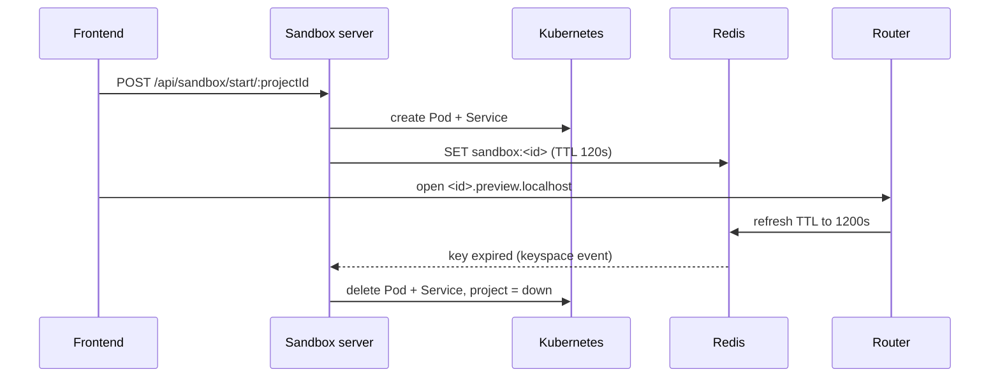

# Architecture

How the services of Taksha CodeSpace fit together. Each section links to the service README for the details.

[Back to the main README](../Readme.md)

---

## Contents

- [Ports and routing](#ports-and-routing)
- [Login and tokens](#login-and-tokens)
- [Project and sandbox lifecycle](#project-and-sandbox-lifecycle)
- [AI agent run](#ai-agent-run)
- [Payments and credits](#payments-and-credits)
- [Emails](#emails)
- [Known gaps](#known-gaps)

---

## Ports and routing

| Service | Local port | K8s Service | Data |
|---|---|---|---|
| Auth | 3000 | `auth-service:80` | Mongo `auth`, Redis |
| Payments | 5002 | `payments-service:80` | Mongo `payments`, Redis |
| AI Orchestration | 3000 | `ai-service:80` | Mongo `ai`, Redis |
| Notification | 4000 | `notification-service:80` | RabbitMQ only |
| Sandbox server | 4000 | `sandbox-service:80` | Mongo `sandbox`, Redis |
| Sandbox router | 3000 | `router-service:80` | Redis |
| Sandbox sidecar | 3000 (in each pod) | `sandbox-service-<sandboxId>` | pod filesystem |
| Frontend | 5173 | n/a | IndexedDB |
| Checkout frontend | 5174 (`/payments/`) | n/a | n/a |

NGINX Ingress ([`k8s/ingress.yml`](../k8s/ingress.yml)):

| Match | Goes to |
|---|---|
| `/api/auth` | auth-service |
| `/api/payments` | payments-service |
| `/api/ai` | ai-service |
| `/api/sandbox` | sandbox-service |
| `*.preview.localhost` | router-service, then the pod's Vite app |
| `*.agent.localhost` | router-service, then the pod's sidecar (:3000) |

Both frontends proxy `/api` to the ingress at `http://localhost` in dev.

---

## Login and tokens

Details: [Auth/README.md](../Auth/README.md)

1. `GET /api/auth/google`, then the callback upserts the `User`, sends a welcome event to RabbitMQ and issues a token pair.
2. **Access token:** RS256, 15 minutes, `kid: auth-rsa-v1`. Claims: `sub`, `id`, `email`, `name`, `role`. Kept in memory only on the frontend.
3. **Refresh token:** opaque, 30 days, `HttpOnly` cookie scoped to `/api/auth/refresh`. Only its SHA-256 hash is stored. Reusing a rotated token revokes the whole token family.
4. **Logout** blacklists the access token in Redis until it expires.

How other services check the token:

| Service | Key source | Blacklist check |
|---|---|---|
| Auth | local public key | yes |
| Payments | JWKS, cached 24h | yes |
| AI Orchestration | JWKS | no |
| Sandbox server | JWKS | no |
| Sandbox sidecar | none | no |

---

## Project and sandbox lifecycle

Details: [Sandbox/server](../Sandbox/server/README.md), [router](../Sandbox/router/README.md), [sidecar](../Sandbox/Agent/README.md), [sync-agent](../Sandbox/sync-agent/README.md), [template](../Sandbox/template/README.md)



- A user can have up to **5 projects**. Each gets a UUIDv7 `sandboxId`.
- The pod runs three containers: `template` (Vite on 5173), `agent` (sidecar on 3000) and `sync-agent` (pushes files to S3).
- Two init containers run first: one copies the seed files, one restores the last S3 snapshot.
- `GET /api/sandbox/projects` matches the DB status with the real pod phase.
- Delete is soft (trash). Permanent delete removes the record.

---

## AI agent run

Details: [Ai_orchestration/readme.md](../Ai_orchestration/readme.md)

| Agent | Job |
|---|---|
| **Orion** | Coding agent. Plans, waits for approval, edits files in the sandbox, builds, reviews, fixes. |
| **Clio** | Editor copilot. Explains code and makes small edits to the open file. |

```
router -+-> general (read-only answer) -> END
        +-> planner -> critic -> plan_review (pause for user)
            -> coder -> tester -> reviewer -> finalizer -> END
                         \-> debugger -> tester   (max 3 fix attempts)
```

Request pipeline:

| Step | What it does | On failure |
|---|---|---|
| Auth | verifies the JWT | 401 |
| Ownership | asks Sandbox if the caller owns the sandbox (60s cache) | fails closed |
| Rate limit | Redis Lua token bucket | fails open |
| Credit check | asks Payments `/credit/check` | fails open, except a real 402 |

- **Model:** NVIDIA-hosted Nemotron through an OpenAI-compatible API. A fast model handles routing and titles.
- **Tools** call the sidecar at `http://sandbox-service-<id>:3000/api/agent/*`: list, read, create, update, patch and delete files, search code, run commands, read Vite runtime errors. `search_internet` uses Tavily.
- **Streaming:** Server-Sent Events. A reloaded page can re-attach with `Last-Event-ID`.
- **Grounding:** step status comes from real tool results, and build pass or fail comes from the exit code, not from the model.
- After a run, token usage is sent to Payments `/credit/update`.

---

## Payments and credits

Details: [Payments/README.md](../Payments/README.md), [payments_frontend/README.md](../payments_frontend/README.md)

| Plan | Price |
|---|---|
| Free | Rs 0 |
| Pro (`pro_regular`) | Rs 499 |
| Max (`max_regular`) | Rs 999 |

- **Checkout:** `POST /order`, Razorpay modal, then `POST /verify` (re-fetches the payment from Razorpay) or the `POST /webhook` (HMAC over the raw body). Processing is idempotent by `paymentId`.
- **Subscriptions** are slots: one active slot plus queued slots. Expired slots are promoted on read and by a nightly job.
- **Credits:** a 5-hour window balance plus per-provider buckets.
- **Cron jobs**, each behind a Redis lock: referral settlement (hourly), slot promotion (daily), credit refill (every 30 min).
- A Postgres schema (Drizzle) is in progress in `Payments/db/`. The running code still uses MongoDB.

---

## Emails

Details: [Notification/README.md](../Notification/README.md)

- Consumes `auth_notification_queue` and `payment_notification_queue` from RabbitMQ.
- Sends mail with Nodemailer. Templates live in `Notification/src/emails/template/`.

---

## Known gaps

| Gap | Impact |
|---|---|
| The sidecar has no auth | Anyone who knows a `sandboxId` can call its API through `<id>.agent.localhost`. |
| Rate limit tier is always `free` | The access token has no `subscription` claim. |
| AI runs as a single replica | Runs and paused plans live in process memory. |
| `previewUrl` is hardcoded | Always `http://<id>.preview.localhost`. |
| Admin service | Only a README exists, no code yet. |
| Some `docs/` pages describe planned work | gRPC, the Chrome extension and Loki are not in the code yet. |
