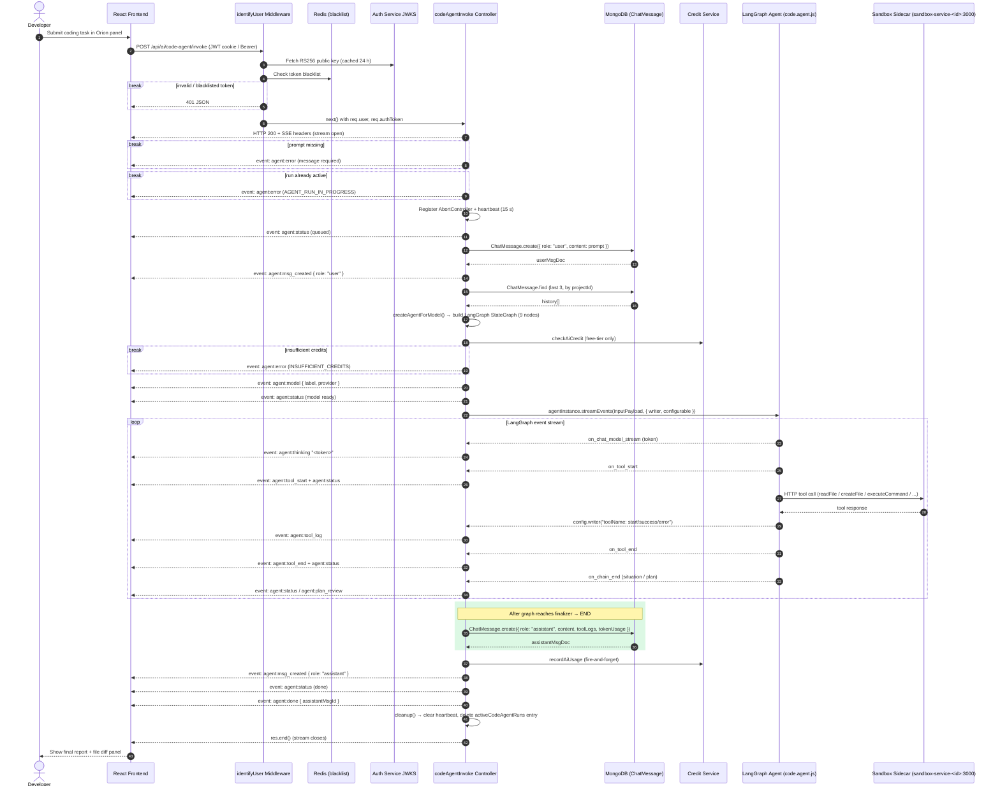
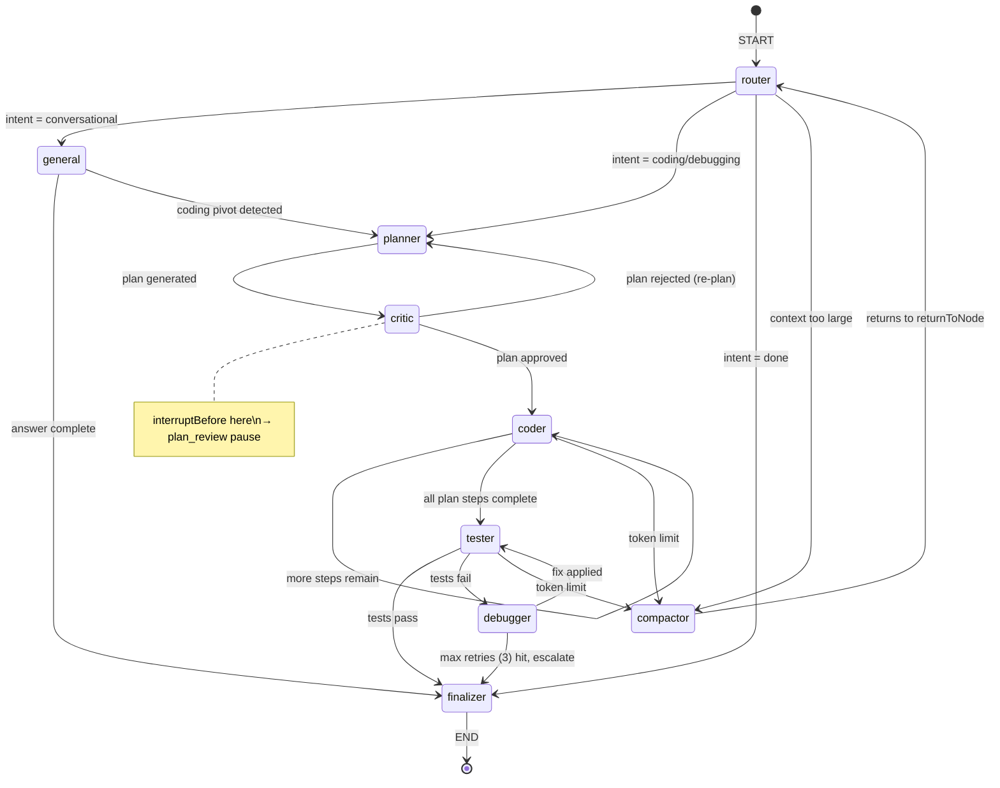
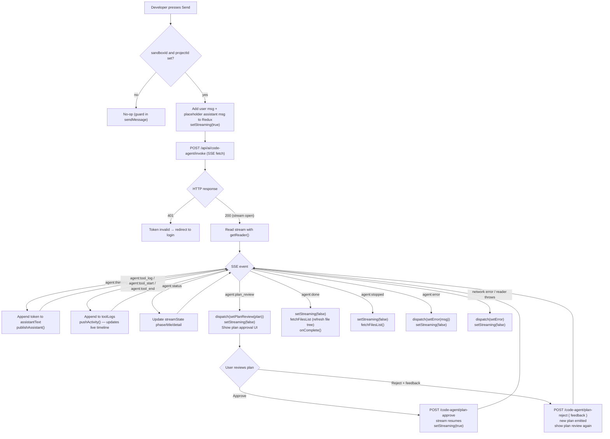

# POST /api/ai/code-agent/invoke — Invoke Orion Coding Agent

> A signed-in developer submits a coding task; Orion's LangGraph multi-agent graph (router → planner → critic → coder → tester → debugger → finalizer) runs against the live sandbox filesystem and streams every intermediate step — model tokens, tool calls, plan proposals, and status events — back to the client over a single long-lived SSE response.

**Assumptions** (inferred from the codebase; correct if wrong):

- One active agent run per `userId:projectId` pair is enforced in-process. A second invoke while a run is live gets an immediate `agent:error` event.
- Orion exclusively uses `Mistral Large` (`mistral-large-latest`) as the model. Other model providers are not wired up in `codeAgentInvoke`.
- Credit checking is bypassed for `pro` and `max` subscription tiers (`isMeteredPlan = true`); free-tier callers go through the credit service.
- Conversation history fetched is **3 messages** (hardcoded `limit(3)`) sorted descending by timestamp, then reversed before injection.
- The plan-review interrupt is triggered by `interruptBefore: ["critic"]` in the compiled LangGraph. The SSE stream **pauses** at that point and only resumes when `POST /code-agent/plan-approve` or `POST /code-agent/plan-reject` is called.
- `sandboxId` resolves to the Docker container hostname in the internal Kubernetes network (`sandbox-service-<projectId>:3000`).

---

## 1. Summary

| Item | Value |
|---|---|
| Actor | Authenticated Taksha developer (end user), calling from the Orion AI Chat panel |
| Auth | RS256-signed JWT via `identifyUser` middleware (cookie `accessToken` or `Authorization: Bearer`) verified against Auth Service JWKS (cached 24 h); token blacklist checked in Redis |
| Sync / async | **Synchronous SSE stream** — HTTP 200 is returned immediately with `Content-Type: text/event-stream`; the body streams events for the full duration of the agent run (typically 30–300 s) |
| Idempotency | **One run per `userId:projectId`**. Second concurrent invoke returns `agent:error { code: "AGENT_RUN_IN_PROGRESS" }`. Natural idempotency only — no `Idempotency-Key` header |
| Rate-limit tier | Model-level token-bucket rate limiting inside `ModelSafety` (exponential backoff, max 30-min wait). No HTTP-layer per-user rate limiter on this endpoint currently |
| SLO target | First SSE event < 3 s; full run < 5 min; 99% of started runs reach `agent:done` or `agent:stopped` |
| Owning service | `Ai_orchestration` — `src/controllers/ai.controller.js` |
| Datastores touched | MongoDB (`ChatMessage` collection — two writes per run: user msg + assistant msg); Redis (JWT blacklist read at auth; ModelSafety state is in-process only) |
| Events emitted | SSE events: `agent:status`, `agent:model`, `agent:msg_created`, `agent:thinking`, `agent:tool_log`, `agent:tool_start`, `agent:tool_end`, `agent:plan_review`, `agent:done`, `agent:stopped`, `agent:error` |

---

## 2. Contract

### 2.1 Request

**Headers**

| Header | Required | Notes |
|---|---|---|
| `Authorization` | yes (or cookie) | `Bearer <RS256 JWT>` — extracted by `identifyUser` middleware. Cookie `accessToken` is tried first |
| `Content-Type` | yes | `application/json` |
| `Accept` | no | Informational only; response is always `text/event-stream` |

**Path / query parameters:** none.

**Body**

| Field | Type | Required | Validation | Notes |
|---|---|---|---|---|
| `message` | string | yes (or `userPrompt`) | non-empty | The developer's coding task |
| `userPrompt` | string | alias for `message` | non-empty | Accepted for backwards compat with Copilot callers |
| `projectId` | string | yes (or `sandboxId`) | non-empty | Taksha project ID; used as MongoDB key and run-lock key |
| `sandboxId` | string | alias/complement to `projectId` | non-empty | Docker sandbox hostname segment (e.g. `abc123` → `sandbox-service-abc123:3000`); falls back to `projectId` |
| `attachments` | array of object | no | max ~12 KB per file (truncated at 12 000 chars) | Files injected into the last user message as `=== ATTACHED FILE CONTEXT ===` blocks |
| `attachments[].path` | string | yes (if attachments) | file path label | Shown as `File: <path>` in context block |
| `attachments[].content` | string | yes (if attachments) | truncated at 12 000 chars | Raw file content injected verbatim |
| `modelName` | string | no | ignored | Accepted but not used — model is always Mistral Large |

```json
{
  "message": "Add a dark-mode toggle to the Navbar component using a context provider",
  "projectId": "66f2a1c3e4b07a0012d4e8f1",
  "sandboxId": "66f2a1c3e4b07a0012d4e8f1",
  "attachments": [
    {
      "path": "src/components/Navbar.jsx",
      "content": "import React from 'react';\nexport default function Navbar() { ... }"
    }
  ]
}
```

### 2.2 Master HTTP Response Status Matrix

Every HTTP status code that can be returned across the coding agent subsystem:

| HTTP Status | Context | Content-Type | Payload Format | Scenario / Cause |
|---|---|---|---|---|
| `200 OK` | `POST /code-agent/invoke` | `text/event-stream` | SSE Event Stream | Connection established. Response headers sent immediately; all model tokens, tool execution logs, status transitions, and final results stream over this single HTTP response. |
| `200 OK` | `POST /code-agent/stop` | `application/json` | JSON Object | Execution stop signal acknowledged. Returns `{ "status": "ok", "message": "Agent run stopped successfully" }` or `{ "status": "ok", "message": "No active agent run found to stop" }`. |
| `200 OK` | `POST /code-agent/plan-approve` | `application/json` | JSON Object | Developer approved plan. Resumes execution from critic node checkpoint through coder, tester, debugger, finalizer. Returns `{ "status": "ok", "message": "Plan approved — execution completed" }`. |
| `200 OK` | `POST /code-agent/plan-reject` | `application/json` | JSON Object | Developer rejected plan with feedback. Resumes planner node to produce a revised plan. Returns `{ "status": "ok", "message": "Plan revision generated" }`. |
| `400 Bad Request` | `POST /code-agent/plan-approve` & `POST /code-agent/plan-reject` | `application/json` | JSON Object | No active run found in paused state (`!activeRun?.interruptResumeNeeded`). Returns `{ "status": "error", "message": "No plan review interrupt pending for this run" }`. |
| `401 Unauthorized` | Pre-stream on all routes (`identifyUser`) | `application/json` | JSON Object | Missing authentication token in cookies (`accessToken`/`token`) and `Authorization: Bearer` header. Returns `{ "status": "error", "message": "Unauthorized - No token provided" }`. |
| `401 Unauthorized` | Pre-stream on all routes (`identifyUser`) | `application/json` | JSON Object | JWT signature failed RS256 JWKS verification, token expired, or token JTI is revoked in Redis blacklist. Returns `{ "status": "error", "message": "Unauthorized - Invalid or expired token" }`. |
| `401 Unauthorized` | Controller level (`codeAgentInvoke`) | `application/json` | JSON Object | User context missing or corrupted in request (`!req.user?.id`). Returns `{ "status": "error", "message": "Unauthorized - Invalid user context" }`. |
| `499 Client Closed Request` | Network / Proxy / Nginx | None | Stream Aborted | Client closed browser tab, navigated away, or unmounted the hook (calling `AbortController.abort()`). The Node.js controller detects `req.on('close')` and cleans up in-flight background resources. |
| `500 Internal Server Error` | Companion routes (`/stop`, `/plan-approve`, `/plan-reject`) | `application/json` | JSON Object | Unhandled server exception during continuation or database persistence. Returns `{ "status": "error", "message": "<detailed error string>" }`. |
| `502 Bad Gateway` | Ingress / Kubernetes / Reverse Proxy | HTML or JSON | Gateway Default | The AI Orchestration Node.js pod crashed (e.g. OOM killed by Kubernetes kernel, unhandled process crash) while handling the request. |
| `504 Gateway Timeout` | Ingress / Cloudflare / AWS ALB | HTML or JSON | Gateway Default | The ingress controller timed out waiting for upstream response bytes. Mitigated by `X-Accel-Buffering: no` header and the controller's 15 s SSE heartbeat frames (`: heartbeat\n\n`). |

---

### 2.3 Companion Lifecycle Endpoints Contract

The coding agent lifecycle spans four endpoints. Frontend clients interact with the companion endpoints during human-in-the-loop plan reviews or when canceling runs:

#### 1. Stop Execution — `POST /api/ai/code-agent/stop`
Cancels an active coding agent run in-process using an `AbortController`.
- **Request Headers**: `Content-Type: application/json`, `Cookie: accessToken=...` or `Authorization: Bearer ...`
- **Request Body**:
  ```json
  {
    "projectId": "66f2a1c3e4b07a0012d4e8f0",
    "sandboxId": "66f2a1c3e4b07a0012d4e8f1"
  }
  ```
- **Responses**:
  - `200 OK`:
    ```json
    { "status": "ok", "message": "Agent run stopped successfully" }
    ```
    *(If no run was active: `{ "status": "ok", "message": "No active agent run found to stop" }`)*
  - `401 Unauthorized`:
    ```json
    { "status": "error", "message": "Unauthorized" }
    ```
  - `500 Internal Server Error`:
    ```json
    { "status": "error", "message": "Failed to abort agent execution" }
    ```

#### 2. Approve Plan — `POST /api/ai/code-agent/plan-approve`
Approves the plan emitted by the planner node at the `interruptBefore: ["critic"]` gate and resumes execution through the coder and tester nodes.
- **Request Headers**: `Content-Type: application/json`, `Cookie: accessToken=...`
- **Request Body**:
  ```json
  {
    "projectId": "66f2a1c3e4b07a0012d4e8f0",
    "sandboxId": "66f2a1c3e4b07a0012d4e8f1"
  }
  ```
- **Responses**:
  - `200 OK`:
    ```json
    { "status": "ok", "message": "Plan approved — execution completed" }
    ```
  - `400 Bad Request`:
    ```json
    { "status": "error", "message": "No plan review interrupt pending for this run" }
    ```
  - `401 Unauthorized`:
    ```json
    { "status": "error", "message": "Unauthorized" }
    ```
  - `500 Internal Server Error`:
    ```json
    { "status": "error", "message": "Plan continuation failed: <error message>" }
    ```

#### 3. Reject Plan — `POST /api/ai/code-agent/plan-reject`
Rejects the proposed plan and prompts the planner node to generate a revision incorporating user feedback.
- **Request Headers**: `Content-Type: application/json`, `Cookie: accessToken=...`
- **Request Body**:
  ```json
  {
    "projectId": "66f2a1c3e4b07a0012d4e8f0",
    "sandboxId": "66f2a1c3e4b07a0012d4e8f1",
    "feedback": "Do not modify Navbar.jsx; create a dedicated HeaderBanner.jsx instead."
  }
  ```
- **Responses**:
  - `200 OK`:
    ```json
    { "status": "ok", "message": "Plan revision generated" }
    ```
  - `400 Bad Request`:
    ```json
    { "status": "error", "message": "No plan review interrupt pending for this run" }
    ```
  - `401 Unauthorized`:
    ```json
    { "status": "error", "message": "Unauthorized" }
    ```
  - `500 Internal Server Error`:
    ```json
    { "status": "error", "message": "Plan revision failed: <error message>" }
    ```

---

### 2.4 SSE Event Frame Catalog

When `POST /code-agent/invoke` returns `200 OK`, the response body is an open SSE stream. Each event frame uses the standard SSE format:
```http
event: <eventName>
data: <payload>

```
*(Comment lines starting with `:` such as `: heartbeat\n\n` are sent every 15 s and should be ignored by the event parser).*

| Event Name | Data Format | Payload Schema | Emission Trigger |
|---|---|---|---|
| `agent:status` | JSON Object | `{ phase: string, title: string, detail: string, status?: "running"\|"paused"\|"success"\|"error" }` | Emitted on every state transition: graph startup (`queued`), node switches (`router`, `planner`, `coder`, `tester`, `debugger`, `finalizer`), model rate-limit backoff (`rate_limit`), and completion (`done`). |
| `agent:model` | JSON Object | `{ requestedModel: string, modelId: string, label: string, provider: string, fallback: boolean }` | Emitted once after credit verification passes, announcing the resolved model (e.g. Mistral Large). |
| `agent:msg_created` | JSON Object | `{ role: "user" \| "assistant", id: string }` | Emitted immediately after MongoDB creates the `ChatMessage` document (once for `user` at start, once for `assistant` at end). |
| `agent:thinking` | Raw String | `"<chunk>"` (plain text token, unquoted or JSON string) | Emitted per streamed token from nodes in `{ general, coder, debugger, finalizer }` during LLM text generation. |
| `agent:tool_start` | JSON Object | `{ toolName: string, input: any }` | Emitted when LangGraph initiates execution of a tool (e.g. `readFile`, `createFile`, `executeCommand`). |
| `agent:tool_log` | JSON Object | `{ toolName: string, level: "info" \| "success" \| "error", message: string }` | Emitted via `config.writer()` inside tools for intra-tool progress updates (e.g. shell command progress, file search hits). |
| `agent:tool_end` | JSON Object | `{ toolName: string, output: any }` | Emitted when tool execution concludes with its return payload or error. |
| `agent:plan_review` | JSON Object | `{ plan: { title: string, totalSteps: number, steps: Array<{ step: number, title: string, description: string, filesToTouch: string[] }> }, taskSubType: string, threadId: string }` | Emitted when the planner node completes and the graph reaches `interruptBefore: ["critic"]`. Stream pauses! |
| `agent:situation_update` | JSON Object | `{ node: string, situation: string }` | Emitted when a node updates `currentSituation` in the graph state. |
| `agent:done` | JSON Object | `{ assistantMsgId: string }` | Final success event. Emitted when the graph hits `finalizer → END`, assistant doc is saved, and credit usage is billed. Stream closes immediately after. |
| `agent:stopped` | JSON Object | `{ message: string, text: string }` | Emitted when execution is aborted via `POST /code-agent/stop`. Stream closes immediately after. |
| `agent:error` | JSON Object | `{ message: string, code?: string }` | Terminal error event. Emitted on credit failure, concurrency conflict, model crash, or persistent throttling. Stream closes immediately after. |

---

### 2.5 Comprehensive In-Stream Return Scenarios Catalog (Frontend Handling)

Every possible execution outcome delivered over the SSE stream after `200 OK` is established:

#### Scenario 1: Normal Full Execution (`SUCCESS_COMPLETED`)
- **Condition**: Developer submits a prompt; agent plans, codes, tests, and completes successfully without interruption.
- **Event Flow**:
  1. `agent:status` (`phase: "queued"`)
  2. `agent:msg_created` (`role: "user"`, `id: "<mongoId>"`)
  3. `agent:model` (`label: "Mistral Large"`, `provider: "mistral"`)
  4. `agent:status` (`phase: "router" → "coder" → ...`)
  5. `agent:tool_start` / `agent:tool_log` / `agent:tool_end` (repeated per tool)
  6. `agent:thinking` (streamed token chunks)
  7. `agent:status` (`phase: "done"`, `title: "Finishing"`)
  8. `agent:msg_created` (`role: "assistant"`, `id: "<mongoId>"`)
  9. `agent:done` (`{ "assistantMsgId": "<mongoId>" }`)
  10. Stream ends (`res.end()`).
- **Terminal Event**: `agent:done`
- **Stream State**: Closed (`res.writableEnded = true`).
- **Database Mutation**: Two documents created in `ChatMessage` (user prompt + finalized assistant response).
- **Frontend Action**:
  - `dispatch(setStreaming(false))`
  - Update last assistant message status to `'completed'`
  - Call `fetchFilesList(sandboxId, { forceNetwork: true })` to refresh the file explorer
  - Re-enable the chat input prompt

#### Scenario 2: Human-in-the-Loop Plan Review Gate (`PLAN_REVIEW_PAUSED`)
- **Condition**: LangGraph compiles with `interruptBefore: ["critic"]`. When planner finishes, graph pauses.
- **Event Flow**:
  1. Standard startup events
  2. `agent:status` (`phase: "planner"`, `title: "Planning"`)
  3. `agent:plan_review` (`{ plan: { ... }, taskSubType: "...", threadId: "..." }`)
  4. `agent:status` (`phase: "plan_review"`, `title: "Plan Review Required"`, `status: "paused"`)
- **Terminal Event**: None — the stream **remains open and paused**!
- **Stream State**: **Paused / Open** (heartbeats `: heartbeat` continue every 15 s).
- **Database Mutation**: User message exists in MongoDB; assistant message is NOT yet created.
- **Frontend Action**:
  - `dispatch(setPlanReview(payload.plan))`
  - `dispatch(setStreaming(false))` (stop typing cursor, keep session open)
  - Display Plan Review card/modal with step checklist, files to touch, and two action buttons:
    - **"Approve & Execute"**: Triggers `POST /api/ai/code-agent/plan-approve` (resumes execution)
    - **"Request Changes"**: Triggers `POST /api/ai/code-agent/plan-reject` with feedback text

#### Scenario 3: User Interrupted / Stopped Task (`USER_STOPPED`)
- **Condition**: While agent is working, user clicks "Stop" button in chat UI (triggering `POST /code-agent/stop`).
- **Event Flow**:
  1. Controller catches `AbortError` or `error.code === "AGENT_STOPPED"`
  2. `agent:stopped`:
     ```json
     {
       "message": "Orion stopped the current task.",
       "text": "Partial code or thought generated prior to stopping..."
     }
     ```
  3. Stream ends (`res.end()`).
- **Terminal Event**: `agent:stopped`
- **Stream State**: Closed.
- **Database Mutation**: Assistant message created in MongoDB with partial content, tool logs, and note `"agent: stopped by user"`.
- **Frontend Action**:
  - `dispatch(setStreaming(false))`
  - Display activity status `'Stopped'`
  - Render whatever partial `assistantText` was accumulated
  - Refresh file explorer in case partial file edits occurred: `fetchFilesList(sandboxId, { forceNetwork: true })`
  - Re-enable chat input

#### Scenario 4: Concurrency Lock Conflict (`AGENT_RUN_IN_PROGRESS`)
- **Condition**: Client makes a second `POST /code-agent/invoke` request while a run is already active for this `userId:projectId`.
- **Event Flow**:
  1. SSE headers sent (`200 OK`).
  2. `agent:error`:
     ```json
     {
       "message": "Orion is already running a task for this project. Please wait for it to finish before starting another.",
       "code": "AGENT_RUN_IN_PROGRESS"
     }
     ```
  3. Stream ends immediately.
- **Terminal Event**: `agent:error`
- **Stream State**: Closed.
- **Database Mutation**: None.
- **Frontend Action**:
  - Do NOT overwrite existing assistant message or clear active stream
  - Display non-destructive warning toast or banner: `"Agent is busy executing another task"`
  - Keep Send button disabled until active run completes

#### Scenario 5: Missing Prompt Validation Error (`PROMPT_REQUIRED`)
- **Condition**: Client sends request body where neither `userPrompt` nor `message` is provided or both are empty strings.
- **Event Flow**:
  1. SSE headers sent (`200 OK`).
  2. `agent:error`:
     ```json
     {
       "message": "Message is required"
     }
     ```
  3. Stream ends immediately.
- **Terminal Event**: `agent:error`
- **Stream State**: Closed.
- **Database Mutation**: None.
- **Frontend Action**:
  - `dispatch(setStreaming(false))`
  - Focus input field and highlight with validation error: `"Message cannot be empty"`

#### Scenario 6: Insufficient Credits (`INSUFFICIENT_CREDITS`)
- **Condition**: Free-tier user invokes agent with 0 AI credits remaining.
- **Event Flow**:
  1. `agent:status` (`phase: "queued"`)
  2. `agent:msg_created` (`role: "user"`)
  3. Credit check fails in `checkAiCredit` guard.
  4. `agent:error`:
     ```json
     {
       "message": "Insufficient AI credits. Please upgrade your plan or wait for your daily credits to refresh.",
       "code": "INSUFFICIENT_CREDITS"
     }
     ```
  5. Stream ends.
- **Terminal Event**: `agent:error`
- **Stream State**: Closed.
- **Database Mutation**: User prompt is recorded in chat history; no assistant message recorded.
- **Frontend Action**:
  - `dispatch(setStreaming(false))`
  - Open Plan Upgrade modal or show "Credit Limit Exceeded" alert with direct link to `/billing`

#### Scenario 7: Model Provider Not Configured (`AI_PROVIDER_NOT_CONFIGURED`)
- **Condition**: Server missing `MISTRALAI_API_KEY` environment variable.
- **Event Flow**:
  1. `agent:error`:
     ```json
     {
       "message": "No configured coding agent model available (check MISTRALAI_API_KEY).",
       "code": "AI_PROVIDER_NOT_CONFIGURED"
     }
     ```
  2. Stream ends.
- **Terminal Event**: `agent:error`
- **Stream State**: Closed.
- **Database Mutation**: User prompt recorded; no assistant message.
- **Frontend Action**:
  - `dispatch(setError(payload.message))`
  - `dispatch(setStreaming(false))`
  - Show error toast: `"AI service misconfigured. Contact system administrator."`

#### Scenario 8: Persistent Model Throttling (`PERSISTENT_RATE_LIMIT`)
- **Condition**: Mistral API responds with HTTP 429 repeatedly; `ModelSafety` backoff exceeds 30 minutes.
- **Event Flow**:
  1. `agent:status` (`phase: "rate_limit"`, `detail: "Rate-limited by Mistral Large. Retrying in Xs..."`)
  2. If retries exhaust `MAX_RATE_LIMIT_WAIT_MS` (30 min):
  3. `agent:error`:
     ```json
     {
       "message": "Still being rate-limited by the model provider after multiple retries. Please wait a few minutes and try again.",
       "code": "PERSISTENT_RATE_LIMIT"
     }
     ```
  4. Stream ends.
- **Terminal Event**: `agent:error`
- **Stream State**: Closed.
- **Database Mutation**: Error recorded to assistant message in MongoDB.
- **Frontend Action**:
  - `dispatch(setStreaming(false))`
  - Show warning: `"Upstream AI provider is temporarily overloaded. Please try again in 5 minutes."`

#### Scenario 9: Unhandled Runtime Error (`AGENT_ERROR`)
- **Condition**: LangGraph node throws an unhandled exception, syntax error in tool parser, or MongoDB error.
- **Event Flow**:
  1. `agent:error`:
     ```json
     {
       "message": "<error description>",
       "code": "AGENT_ERROR"
     }
     ```
  2. Stream ends.
- **Terminal Event**: `agent:error`
- **Stream State**: Closed.
- **Database Mutation**: Assistant message saved with content `"Error occurred during execution: <message>"` and error toolLogs.
- **Frontend Action**:
  - `dispatch(setStreaming(false))`
  - Render error message with "Retry" action button

---

## 3. Flow

### 3.1 Step by step

Numbers match `autonumber` in the diagram below.

1. Developer submits a message in the Orion AI Chat panel. The frontend calls `POST /api/ai/code-agent/invoke` with the JWT cookie and JSON body.
2. `identifyUser` middleware fetches the RS256 public key from the Auth Service JWKS endpoint (cached 24 h), verifies the JWT signature, checks the Redis token blacklist, and injects `req.user` + `req.authToken`. Fails → 401 JSON.
3. Controller writes HTTP 200 headers (`Content-Type: text/event-stream`, `X-Accel-Buffering: no`) — SSE stream is now open.
4. Controller validates that `prompt` is non-empty; if not, sends `agent:error` and ends the stream.
5. Controller checks the in-process `activeCodeAgentRuns` Map for an existing run on `userId:projectId`. Collision → `agent:error { code: AGENT_RUN_IN_PROGRESS }` and ends the stream.
6. Controller allocates an `AbortController`, registers the run entry, and starts a 15-second heartbeat (`": heartbeat\n\n"` frames).
7. Controller persists the user message to MongoDB: `ChatMessage.create({ role: "user", ... })` → emits `agent:msg_created { role: "user", id }`.
8. Controller fetches the last 3 `ChatMessage` documents for the project (excluding trashed), reverses them, and injects attachment context into the last message's content string.
9. `createAgentForModel()` builds a fresh compiled LangGraph `StateGraph` (9 nodes wired with conditional edges, `MemorySaver` checkpointer, `interruptBefore: ["critic"]`).
10. Controller checks AI credits: free-tier → `checkAiCredit()` against the credit service via `req.authToken`; paid plans → bypass. Insufficient credits → throws `INSUFFICIENT_CREDITS`.
11. Controller emits `agent:model { label: "Mistral Large", provider: "mistral" }`.
12. Controller calls `agentInstance.streamEvents(inputPayload, { version: "v2", configurable: { thread_id, projectId }, recursionLimit: 150, writer: ... })`. The `writer` callback wraps every `config.writer(msg)` call from any tool into a `parseToolWriterMessage` → `agent:tool_log` SSE event.
13. The LangGraph event loop begins. Events are dispatched based on `event.event` type:
    - `on_chat_model_start` → `agent:status { phase: "thinking" }`
    - `on_chat_model_stream` (nodes in STREAMABLE_NODES) → `agent:thinking <token>`
    - `on_chat_model_end` → accumulate token usage counters
    - `on_tool_start` → `agent:tool_start` + `agent:status`
    - `on_tool_end` → `agent:tool_end` + `agent:status`
    - `on_chain_end` with `currentSituation` → `agent:status` + `agent:situation_update`
    - `on_chain_end` with `plan` from `planner` node → `agent:plan_review`
    - `on_interrupt` (LangGraph interrupt at `critic` entry) → `agent:plan_review` + sets `activeRun.planReviewPending = true`
14. **Plan-review pause** (if triggered): stream loop exits early; run entry stays alive in `activeCodeAgentRuns`. Stream pauses but stays open. Client must call `plan-approve` or `plan-reject` to continue (see §3.4).
15. **Normal completion**: graph reaches `finalizer → END`. Controller saves the assistant message: `ChatMessage.create({ role: "assistant", content, toolLogs, tokenUsage })`. Emits `agent:msg_created { role: "assistant" }`.
16. Controller calls `recordAiUsage()` (fire-and-forget; failure is logged but does not affect the response).
17. Controller emits `agent:done { assistantMsgId }`, runs `cleanup()` (clears heartbeat, removes from `activeCodeAgentRuns`), and closes the stream with `res.end()`.
18. **Stop path**: if user called `POST /code-agent/stop`, `AbortController.abort()` fires; the `streamEvents` loop throws `AGENT_STOPPED`; controller persists a partial assistant message and emits `agent:stopped`.

### 3.2 Sequence diagram — Normal coding run



### 3.3 Plan-review interrupt / resume sub-flow

```mermaid
sequenceDiagram
    autonumber
    participant FE as React Frontend
    participant CTL as codeAgentInvoke Controller
    participant LG as LangGraph Agent
    participant Mongo as MongoDB

    Note over CTL,LG: Graph hits interruptBefore:["critic"] after planner emits plan
    LG-->>CTL: on_interrupt / on_chain_end with plan
    CTL-->>FE: event: agent:plan_review { plan, taskSubType, threadId }
    CTL-->>FE: event: agent:status { phase: "plan_review", status: "paused" }
    Note over CTL: Stream loop exits; run entry stays in activeCodeAgentRuns

    alt Developer approves plan
        FE->>CTL: POST /code-agent/plan-approve { projectId }
        CTL->>LG: agentInstance.streamEvents(null, { thread_id, writer })
        Note over CTL,LG: Resumes from critic checkpoint
        loop Execution events
            LG-->>CTL: on_chat_model_stream / on_tool_start / on_tool_end
            CTL-->>FE: agent:thinking / agent:tool_start / agent:tool_end (via activeRun.sendEvent)
        end
        CTL->>Mongo: ChatMessage.create({ role: "assistant" })
        CTL-->>FE: event: agent:done
        CTL->>CTL: res.end(), activeCodeAgentRuns.delete(runKey)
        CTL-->>FE: (approve endpoint) 200 { status: "ok" }

    else Developer rejects plan (with optional feedback)
        FE->>CTL: POST /code-agent/plan-reject { projectId, feedback }
        CTL->>LG: agentInstance.streamEvents({ criticFeedback, planApproved: false, plan: null })
        Note over CTL,LG: Re-enters planner with feedback → new plan emitted
        LG-->>CTL: on_chain_end with new plan
        CTL-->>FE: event: agent:plan_review (new plan, via activeRun.sendEvent)
        CTL-->>FE: (reject endpoint) 200 { status: "ok" }
    end
```

### 3.4 Agent graph lifecycle (node topology)



---

## 4. Failure analysis

| Step # | What fails | System state afterwards | Client sees | Recovery |
|---|---|---|---|---|
| 2 | JWKS fetch fails (Auth Service down) | Cached key used if available (24 h TTL); if no cache → request rejected | 401 JSON | Middleware falls back to `JWT_ACCESS_SECRET` env var; alert on JWKS unavailability |
| 2 | Token blacklisted in Redis | Nothing written | 401 JSON | Redis must be healthy; if Redis is down the blacklist check throws and token is rejected |
| 5 | Run-lock collision (second invoke) | Nothing new written | `agent:error AGENT_RUN_IN_PROGRESS` event then stream closes | Frontend should disable the send button while `isStreaming = true`; the run lock cleans up automatically on `agent:done/stopped/error` |
| 7 | MongoDB `ChatMessage.create` (user message) fails | User message not persisted; agent still runs | Stream continues but history will be missing this message | DB errors surface in server logs; consider wrapping in try-catch to emit `agent:error` and abort |
| 9 | `createAgentForModel()` throws (`MISTRALAI_API_KEY` missing) | No run registered (error thrown before registration) | `agent:error AI_PROVIDER_NOT_CONFIGURED` | Set `MISTRALAI_API_KEY` in env; alert on cold-start model init failures |
| 10 | Credit service unreachable | `checkAiCredit` throws; run never starts | `agent:error` then stream closes | Currently no fallback; credit check failure blocks the run — consider allowing paid plans to bypass even on credit-service timeout |
| 12 | LangGraph `streamEvents` fails at model call | AbortController not yet fired; run entry stays in map | `agent:error AGENT_ERROR`; finally block calls `cleanup()` + `res.end()` | ModelSafety layer retries on 429 (up to 30 min); timeout at 110 s per call |
| 12 | Provider 429 during streaming | ModelSafety backs off (exponential with jitter); `rateLimitListener` emits `agent:status { phase: "rate_limit" }` to SSE | Client sees "Rate Limit Backoff" status updates | Backoff resolves automatically; if `PERSISTENT_RATE_LIMIT` is thrown, the run fails after 30 min |
| 13 | Tool call to Sandbox Sidecar times out (30 s) | Tool returns `{ error: true, message: "..." }` back to the LLM context | `agent:tool_log` error event; LLM decides to retry or skip | Sandbox health alert should fire; tool errors surface in toolLogs saved to MongoDB |
| 13 | Tool call crashes mid-execution | `config.writer("toolName: error - ...")` is called; tool returns error JSON | `agent:tool_log` error event | LangGraph continues with the error in model context |
| 14 | Plan-review pauses; user closes tab | SSE connection drops; run entry stays in `activeCodeAgentRuns`; no timeout | Stale lock on `userId:projectId` | **Gap**: no timeout is set on paused plan-review runs. Add a 10-min timeout to `interruptResumeNeeded` entries or they block new invokes |
| 15 | MongoDB `ChatMessage.create` (assistant message) fails | Agent output is lost; MongoDB has only user message; token usage not recorded | Run appears to fail; `agent:error` is emitted | Alert on assistant message write failures; DB errors logged with `projectId` |
| 16 | `recordAiUsage` fails | Token usage not billed | Run completes normally from the user's perspective | Failure is logged but does not block completion; billing reconciliation should alert on dropped usage events |
| 18 | `res.end()` called on already-ended response | `writableEnded` guard in `sendEvent` prevents double write | Silent | Guard covers this; no action needed |

---

## 5. Data and transactions

### 5.1 Data touched

| Store | Collection / key | Access | Index relied on | Notes |
|---|---|---|---|---|
| MongoDB | `chatmessages` | Write ×2 (user msg, assistant msg) | Compound index `{ projectId, agentType, timestamp }` | Schema: `ChatMessage.model.js`; `tokenUsage` embedded in assistant doc |
| MongoDB | `chatmessages` | Read (history fetch) | Compound index; `deletionStatus` filter; `.limit(3)` | Only 3 messages fetched; no pagination |
| Redis | Token blacklist key | Read (at auth) | Key lookup by token hash | If Redis is down, blacklist check throws — no fail-open |
| In-process | `activeCodeAgentRuns` Map | Read / Write | `userId:projectId` string key | Not persisted; lost on pod restart — see §11 Open questions |
| In-process | `modelSafetyState` Map | Read / Write | `modelId` string key | Tracks exponential backoff state per model per pod |
| External HTTP | Sandbox Sidecar (`sandbox-service-<id>:3000/api/agent/*`) | Read / Write (via tools) | N/A — HTTP | 30 s timeout per tool call; no circuit breaker currently |
| External HTTP | Auth Service JWKS (`AUTH_JWKS_URI`) | Read | N/A — cached 24 h | Fallback to in-process PEM cache on failure |
| External HTTP | Credit Service | Read + Write | N/A — REST | `checkAiCredit` and `recordAiUsage`; failures block or log |

### 5.2 Transaction boundary, isolation, locking

There is **no database transaction** across the two `ChatMessage.create()` calls. Each is an independent MongoDB document write.

- **User message write** (step 7): isolated, before the agent runs. If it fails, the agent still executes but history is stale.
- **Assistant message write** (step 15): isolated, after the graph ends. If it fails, the run's output is lost for that session.
- **Run-lock concurrency**: enforced by checking `activeCodeAgentRuns.has(runKey)` before registration. This is **not atomic** across pods — a race is possible in a multi-replica deployment (see §11).
- **Plan-review interrupt**: the LangGraph `MemorySaver` checkpointer persists graph state in-process. Resume reads from that checkpointer via `thread_id`.

### 5.3 Consistency model

- **Immediate**: once `agent:msg_created { role: "user" }` fires, the user message exists in MongoDB.
- **Eventual**: the assistant message is written after the full graph run (30–300 s). During the run, the frontend builds its own in-memory `assistantText` and `toolLogs` from streaming events.
- **Read-your-writes**: the frontend does not re-fetch messages during a run; it reconstructs state from SSE events. After `agent:done`, Redux is updated locally; a refetch confirms persistence.
- **Cache**: no server-side cache on this endpoint. Frontend invalidates the Redux `messages` slice on `agent:done` or `agent:stopped`.

### 5.4 Idempotency and concurrency control

- **Run-lock key**: `${userId}:${projectId}` stored in `activeCodeAgentRuns` (in-process `Map`). Collision detected synchronously before the stream starts.
- **No Idempotency-Key**: unlike the order example, there is no replay mechanism. A new invoke after a completed run starts a fresh agent run.
- **Plan-review pause state**: stored in `activeRun.interruptResumeNeeded`. The `plan-approve` and `plan-reject` endpoints check this flag before resuming.
- **AbortController**: shared between the invoke stream loop and the stop endpoint. `abort()` is idempotent.

---

## 6. Events and side effects

| Event (SSE) | Trigger | Key payload fields | Consumers | Notes |
|---|---|---|---|---|
| `agent:thinking` | `on_chat_model_stream` for STREAMABLE_NODES | raw text token | Frontend (appends to assistantText) | Only emitted for `general`, `coder`, `debugger`, `finalizer` nodes |
| `agent:tool_log` | `config.writer()` inside any tool | `{ toolName, level, message }` | Frontend (appends to toolLogs); `parseToolLogToEvent` in `AIChat.jsx` | This is the primary source for the live activity timeline |
| `agent:plan_review` | planner `on_chain_end` or LangGraph `on_interrupt` | `{ plan, taskSubType, threadId }` | Frontend (dispatches `setPlanReview`); blocks stream | Triggers the plan approval UI |
| `agent:done` | Finalizer completes, assistant msg saved | `{ assistantMsgId }` | Frontend (triggers file list refresh, marks streaming done) | Final event before `res.end()` |
| MongoDB write | After graph completion | `role: "assistant"`, `content`, `toolLogs`, `tokenUsage` | Chat history API (`GET /chats/:projectId/codingAgent`) | Persisted for future session recovery and display |
| Credit usage | `recordAiUsage()` after `agent:done` | `promptTokens`, `completionTokens` | Credit Service | Fire-and-forget; failures do not affect user |

---

## 7. Security and abuse

| Question | Answer |
|---|---|
| Auth method | RS256 JWT signed by Auth Service; verified against JWKS endpoint fetched at startup and cached 24 h. Fallback to `JWT_ACCESS_SECRET` symmetric key for local dev |
| Token revocation | JWT checked against Redis blacklist on every request. If Redis is unavailable, blacklist check throws — no fail-open on logout |
| Object-level rule | Agent runs are scoped to `userId:projectId`. User A cannot invoke an agent for User B's project because both `userId` (from JWT `sub`) and `projectId` (from request body) must match the run-lock key |
| Fields caller may write | `message/userPrompt`, `projectId/sandboxId`, `attachments`, `modelName` (ignored). The agent always uses Mistral Large regardless of `modelName` |
| Abuse scenario | A user runs a very long task (60+ tool calls) tying up a pod for 5 min while blocking new invokes for their project. Mitigation: one-run-per-project guard (already in place); consider a global per-user concurrent-run cap |
| Shell injection via `executeCommand` | `guards.js` blocks shell patterns (`cat`, `head`, `sed`, `grep`, etc.) in `execute_command` tool input. The LLM is instructed to use dedicated file tools instead |
| Attachment injection | Attachment content is injected verbatim as string context into the LLM prompt. Malicious prompt injection via attachments is a risk — no sanitization currently |
| Audit events | Server logs `projectId`, `userId`, `runKey`, model used, token counts. No PII (message content, file content) in logs |
| PII in logs | `tool.js` truncates error fields at 2 000 chars. Tool responses (file content, command output) are not logged at the controller level |

---

## 8. Performance and operations

- **Timeout budget**: no hard HTTP timeout on this endpoint. Proxy timeout protection relies on the 15 s SSE heartbeat. Individual model calls time out at 110 s (ModelSafety `callTimeoutMs`). Tools time out at 30 s.
- **Agent graph recursion limit**: 150 LangGraph iterations.
- **Rate limit (model)**: exponential backoff starting at 1.5 s, max interval 20 s, max total wait 30 min. 429 responses double the interval; 5 consecutive successes bring it back down 20%.
- **Heartbeat**: `": heartbeat\n\n"` every 15 s prevents NGINX / ALB / Cloudflare from closing idle connections.
- **Memory footprint**: each SSE response handle ≈ 4 KB + in-process run state (`toolLogs[]`, `assistantText`, `AbortController`). At 1 000 concurrent runs: ~4 MB of HTTP handles + per-run buffers.
- **Logs**: each tool emits `config.writer()` messages; `parseToolWriterMessage` extracts `toolName` and `level`; stored in `toolLogs[]` for the run duration.
- **Metrics to add**: `code_agent_runs_active` (gauge), `code_agent_run_duration_seconds` (histogram), `code_agent_tool_calls_total` (counter by tool), `code_agent_plan_review_paused_total`, `code_agent_model_rate_limit_total`.
- **Alerts to add**: runs active > pod capacity; run duration > 5 min; plan-review interrupt stuck > 10 min; MongoDB assistant message write failure rate > 0; `PERSISTENT_RATE_LIMIT` events.

---

## 9. Frontend integration

### 9.1 Trigger and request construction

`sendMessage(text, attachments, onComplete)` in [`codingAgent.hooks.js`](file:///Users/home/Desktop/Projects/Capstone/Frontend/src/features/coding-agent/Hooks/codingAgent.hooks.js) fires when the developer submits a message in the Orion AI Chat panel. The hook:
1. Optimistically adds a user message and a placeholder assistant message to Redux.
2. Sets `isStreaming = true`.
3. Calls `authenticatedFetch('/api/ai/code-agent/invoke', { method: 'POST', body: JSON.stringify({ message, projectId, sandboxId, attachments }) })`.
4. Reads the response as a streaming `ReadableStream` using `response.body.getReader()`.

### 9.2 UI states



### 9.3 TypeScript Client Contract

Frontend developers should use these exact TypeScript definitions to ensure compile-time safety across all response statuses and streaming scenarios:

```typescript
// ==========================================
// 1. Request Body Types
// ==========================================
export interface AttachmentContext {
  path: string;
  content: string;
}

export interface CodeAgentInvokeRequest {
  message?: string;
  userPrompt?: string;
  projectId: string;
  sandboxId?: string;
  modelName?: string;
  attachments?: AttachmentContext[];
}

export interface CodeAgentCompanionRequest {
  projectId: string;
  sandboxId?: string;
  feedback?: string; // Only for /code-agent/plan-reject
}

// ==========================================
// 2. Pre-Stream & Companion HTTP Responses
// ==========================================
export interface ApiErrorResponse {
  status: "error";
  message: string;
}

export interface ApiSuccessResponse {
  status: "ok";
  message: string;
}

// ==========================================
// 3. In-Stream SSE Event Payloads
// ==========================================
export interface AgentStatusEvent {
  phase: "queued" | "router" | "planner" | "critic" | "coder" | "tester" | "debugger" | "finalizer" | "rate_limit" | "done" | string;
  title: string;
  detail: string;
  status?: "running" | "paused" | "success" | "error";
}

export interface AgentModelEvent {
  requestedModel: string;
  modelId: string;
  label: string;
  provider: string;
  fallback: boolean;
}

export interface AgentMsgCreatedEvent {
  role: "user" | "assistant";
  id: string; // MongoDB ObjectId
}

export interface AgentToolStartEvent {
  toolName: string;
  input: Record<string, unknown>;
}

export interface AgentToolLogEvent {
  toolName: string;
  level: "info" | "success" | "error";
  message: string;
}

export interface AgentToolEndEvent {
  toolName: string;
  output: unknown;
}

export interface PlanStep {
  step: number;
  title: string;
  description: string;
  filesToTouch: string[];
}

export interface AgentPlanReviewEvent {
  plan: {
    title: string;
    totalSteps: number;
    steps: PlanStep[];
  };
  taskSubType: string;
  threadId: string;
}

export interface AgentDoneEvent {
  assistantMsgId: string;
}

export interface AgentStoppedEvent {
  message: string;
  text: string;
}

export type AgentErrorCode =
  | "AGENT_RUN_IN_PROGRESS"
  | "INSUFFICIENT_CREDITS"
  | "AI_PROVIDER_NOT_CONFIGURED"
  | "PERSISTENT_RATE_LIMIT"
  | "AGENT_ERROR"
  | string;

export interface AgentErrorEvent {
  message: string;
  code?: AgentErrorCode;
}
```

---

### 9.4 Outcome to UX Mapping

Every response scenario and its corresponding UI state transition:

| Scenario / Status | Trigger / Condition | UI Component / Action | Redux / State Updates |
|---|---|---|---|
| **HTTP `401 Unauthorized`** | Missing or expired JWT token | Redirect user to `/login` or prompt session renewal modal | `dispatch(setError("Session expired"))`, `setStreaming(false)` |
| **HTTP `502 / 504 / Network Drop`** | Ingress timeout, pod crash, offline client | Show red banner: *"Connection to Orion lost. Please check connection."* | `dispatch(setError(err.message))`, `setStreaming(false)` |
| **SSE `agent:status`** | Node switch, rate-limit backoff | Update agent activity pill with current title & detail | `pushActivity({ kind: phase, title, detail })` |
| **SSE `agent:model`** | Model confirmed after credit check | Display badge in chat header (e.g. *"Mistral Large"*) | Append model info to activity logs |
| **SSE `agent:msg_created`** | MongoDB document saved | Replace optimistic message ID with real Mongo `_id` | `dispatch(updateMessageId({ role, realId }))` |
| **SSE `agent:thinking`** | LLM generating answer/code | Smoothly stream Markdown text chunk into assistant bubble | `assistantText += chunk; publishAssistant()` |
| **SSE `agent:tool_start`** | LangGraph invoking sidecar tool | Activity feed shows spinning tool card with action summary | `pushActivity({ kind: 'tool', title: toolName, status: 'running' })` |
| **SSE `agent:tool_log`** | Intra-tool status update (`writer`) | Append log line to collapsible tool console | Append to `toolLogs` |
| **SSE `agent:tool_end`** | Tool completed | Tool card turns green (or red on tool error) with output preview | `pushActivity({ kind: 'tool', title, status: 'success' })` |
| **SSE `agent:plan_review`** | Planner finished (`interruptBefore`) | Open Plan Review interactive drawer/modal with "Approve" & "Request Changes" buttons | `dispatch(setPlanReview(payload.plan))`, pause streaming animation |
| **SSE `agent:done`** | Task successfully completed | Mark assistant message complete; refresh editor file explorer; enable Send | `dispatch(setStreaming(false))`, `fetchFilesList(sandboxId, { forceNetwork: true })` |
| **SSE `agent:stopped`** | User pressed "Stop Task" button | Show grey "Execution stopped" indicator; retain partial text; enable Send | `dispatch(setStreaming(false))`, `pushActivity({ kind: 'stopped', status: 'success' })` |
| **SSE `agent:error` (`AGENT_RUN_IN_PROGRESS`)** | Concurrent task running | Orange warning toast: *"Orion is currently working on another task for this project"* | Keep previous message history intact; keep Send disabled |
| **SSE `agent:error` (`INSUFFICIENT_CREDITS`)** | Free-tier credits exhausted | Open Subscription / Credits modal with button to `/billing` | `dispatch(setError("Credits exhausted"))`, `setStreaming(false)` |
| **SSE `agent:error` (`PERSISTENT_RATE_LIMIT`)** | Model provider throttling > 30m | Amber alert: *"Upstream AI model is currently overloaded. Please try again shortly."* | `dispatch(setError(...))`, `setStreaming(false)` |
| **SSE `agent:error` (`AGENT_ERROR`)** | Unhandled server/tool exception | Red error alert inside assistant card with "Retry" action | `dispatch(setError(msg))`, `setStreaming(false)` |

---

### 9.5 Cache and Sync Effects

- **Workspace File Explorer**: On `agent:done` or `agent:stopped`, the client **must** call `fetchFilesList(sandboxId, { forceNetwork: true })` because tool execution (`createFile`, `deleteFile`, `patchFile`, `executeCommand`) modifies the live container filesystem.
- **Redux Message State**: Redux is the local source of truth during an active session. Chat history (`GET /chats/:projectId/codingAgent`) is fetched on initial project load, not after every invoke.
- **Plan Review Reset**: On `agent:done` or `agent:stopped`, the client **must** dispatch `setPlanReview(null)` to ensure stale plan review modals are dismissed.

---

### 9.6 Session Recovery (WebSocket Path)

A parallel Socket.IO connection (`/api/ai/socket.io`) is maintained by [`codingAgent.hooks.js`](file:///Users/home/Desktop/Projects/Capstone/Frontend/src/features/coding-agent/Hooks/codingAgent.hooks.js).
- If the browser tab is refreshed or a temporary network disconnect severs the SSE HTTP stream mid-run:
  1. On reconnection, socket emits `agent:subscribe` with `{ projectId, sandboxId }`.
  2. The server checks `activeCodeAgentRuns.get(runKey)`.
  3. If active, socket responds with `agent:active_run` containing the in-memory `assistantText`, `toolLogs`, and `streamState`.
  4. Subsequent events (`agent:thinking`, `agent:tool_log`, `agent:done`) are streamed over the WebSocket via `emitToRun`.

---

### 9.7 Edge Cases to Handle

- **Double-Click / Rapid Submits**: The UI Send button must be disabled whenever `isStreaming === true` or when `streamState.status === 'running'`.
- **Browser Closes During Plan Review**: The server run map holds the run indefinitely. Frontend should send `POST /code-agent/stop` on component unmount if `planReviewPending === true`.
- **Heartbeat Filtering**: Raw SSE stream emits `: heartbeat\n\n` every 15 s. Parsers that do not filter out lines starting with `:` will crash on `JSON.parse()`.
- **Incomplete SSE Buffer Blocks**: Network chunk boundaries do not align with SSE event boundaries (`\n\n`). Clients must maintain a persistent `buffer` string and split on `\n\n`, retaining the last incomplete chunk across stream reads.

---

### 9.8 Production Frontend Implementation Recipe

Here is the complete, production-tested client handler code demonstrating how to handle every HTTP status code, every SSE event, and the companion endpoints:

```typescript
import { useCallback, useRef } from "react";
import { useDispatch } from "react-redux";
import {
  addMessage,
  updateLastMessage,
  updateMessageId,
  setStreaming,
  setError,
  setPlanReview,
} from "./codingAgent.slice";
import type {
  CodeAgentInvokeRequest,
  CodeAgentPlanReviewEvent,
  AgentStatusEvent,
  AgentToolLogEvent,
  AgentToolStartEvent,
  AgentToolEndEvent,
  AgentErrorEvent,
  AgentStoppedEvent,
  AgentDoneEvent,
} from "./types";

export function useCodingAgent(projectId: string, sandboxId: string) {
  const dispatch = useDispatch();
  const abortControllerRef = useRef<AbortController | null>(null);

  // ----------------------------------------------------
  // 1. Invoke Coding Agent (SSE Stream Handler)
  // ----------------------------------------------------
  const invokeAgent = useCallback(
    async (prompt: string, attachments: Array<{ path: string; content: string }> = []) => {
      if (!prompt.trim() || !projectId) return;

      // Optimistic UI updates
      dispatch(addMessage({ role: "user", text: prompt }));
      dispatch(addMessage({ role: "assistant", text: "", status: "running" }));
      dispatch(setStreaming(true));
      dispatch(setError(null));

      abortControllerRef.current = new AbortController();
      let assistantText = "";
      const toolLogs: string[] = [];

      try {
        const payload: CodeAgentInvokeRequest = {
          message: prompt,
          projectId,
          sandboxId,
          attachments,
        };

        const response = await fetch("/api/ai/code-agent/invoke", {
          method: "POST",
          headers: { "Content-Type": "application/json" },
          body: JSON.stringify(payload),
          signal: abortControllerRef.current.signal,
        });

        // ------------------------------------------------
        // Handle Pre-Stream HTTP Status Codes
        // ------------------------------------------------
        if (!response.ok) {
          if (response.status === 401) {
            dispatch(setError("Authentication required. Redirecting to login..."));
            window.location.href = "/login";
            return;
          }

          const errorJson = await response.json().catch(() => ({ message: "Unknown server error" }));
          throw new Error(`[HTTP ${response.status}] ${errorJson.message || response.statusText}`);
        }

        if (!response.body) {
          throw new Error("ReadableStream not supported by browser environment.");
        }

        // ------------------------------------------------
        // Read SSE Event Stream
        // ------------------------------------------------
        const reader = response.body.getReader();
        const decoder = new TextDecoder("utf-8");
        let buffer = "";

        while (true) {
          const { value, done } = await reader.read();
          if (done) break;

          buffer += decoder.decode(value, { stream: true });
          const frames = buffer.split("\n\n");
          buffer = frames.pop() ?? ""; // Retain incomplete frame

          for (const frame of frames) {
            const trimmed = frame.trim();
            if (!trimmed || trimmed.startsWith(":")) {
              // Ignore empty frames and SSE heartbeat comments (": heartbeat")
              continue;
            }

            const eventMatch = frame.match(/^event:\s*(.+)$/m);
            const dataMatch = frame.match(/^data:\s*([\s\S]+)$/m);
            const eventName = eventMatch ? eventMatch[1].trim() : "message";
            const rawData = dataMatch ? dataMatch[1].trim() : "";

            let parsedData: any = rawData;
            try {
              parsedData = JSON.parse(rawData);
            } catch (_) {
              // Plain string token (e.g. from agent:thinking)
            }

            // --------------------------------------------
            // In-Stream Event Scenarios Switch-Case
            // --------------------------------------------
            switch (eventName) {
              case "agent:thinking": {
                const chunk = typeof parsedData === "string" ? parsedData : rawData;
                assistantText += chunk;
                dispatch(updateLastMessage({ text: assistantText, status: "running" }));
                break;
              }

              case "agent:status": {
                const statusEvent = parsedData as AgentStatusEvent;
                dispatch(
                  updateLastMessage({
                    streamState: {
                      phase: statusEvent.phase,
                      title: statusEvent.title,
                      detail: statusEvent.detail,
                      status: statusEvent.status || "running",
                    },
                  })
                );
                break;
              }

              case "agent:msg_created": {
                const { role, id } = parsedData;
                if (role && id) {
                  dispatch(updateMessageId({ role, realId: id }));
                }
                break;
              }

              case "agent:tool_start": {
                const { toolName, input } = parsedData as AgentToolStartEvent;
                toolLogs.push(`${toolName}: started`);
                dispatch(updateLastMessage({ toolLogs: [...toolLogs] }));
                break;
              }

              case "agent:tool_log": {
                const { toolName, level, message } = parsedData as AgentToolLogEvent;
                toolLogs.push(`[${level.toUpperCase()}] ${toolName}: ${message}`);
                dispatch(updateLastMessage({ toolLogs: [...toolLogs] }));
                break;
              }

              case "agent:tool_end": {
                const { toolName } = parsedData as AgentToolEndEvent;
                toolLogs.push(`${toolName}: finished`);
                dispatch(updateLastMessage({ toolLogs: [...toolLogs] }));
                break;
              }

              case "agent:plan_review": {
                // Scenario 2: Plan Review Pause Gate
                const planEvent = parsedData as AgentPlanReviewEvent;
                dispatch(setPlanReview(planEvent.plan));
                dispatch(setStreaming(false)); // Pauses local streaming indicator
                break;
              }

              case "agent:done": {
                // Scenario 1: Successful Completion
                const doneEvent = parsedData as AgentDoneEvent;
                dispatch(setPlanReview(null));
                dispatch(setStreaming(false));
                dispatch(updateLastMessage({ status: "completed" }));
                // Trigger workspace file refresh
                window.dispatchEvent(new CustomEvent("workspace:refresh-files"));
                break;
              }

              case "agent:stopped": {
                // Scenario 3: Task Aborted by User
                const stoppedEvent = parsedData as AgentStoppedEvent;
                if (stoppedEvent.text) assistantText = stoppedEvent.text;
                dispatch(setPlanReview(null));
                dispatch(setStreaming(false));
                dispatch(
                  updateLastMessage({
                    text: assistantText,
                    status: "completed",
                    streamState: { phase: "stopped", title: "Stopped", detail: stoppedEvent.message, status: "success" },
                  })
                );
                window.dispatchEvent(new CustomEvent("workspace:refresh-files"));
                break;
              }

              case "agent:error": {
                // Scenarios 4 through 9: Error Events
                const errEvent = parsedData as AgentErrorEvent;
                const errCode = errEvent.code || "AGENT_ERROR";
                const errMsg = errEvent.message || "An error occurred during agent execution";

                dispatch(setError(`${errMsg} (${errCode})`));
                dispatch(setStreaming(false));
                dispatch(updateLastMessage({ status: "error" }));
                break;
              }

              default:
                break;
            }
          }
        }
      } catch (err: any) {
        if (err.name === "AbortError") {
          // Handled via user stop action
          return;
        }
        dispatch(setError(err.message || "Failed to communicate with Orion."));
        dispatch(setStreaming(false));
        dispatch(updateLastMessage({ status: "error" }));
      }
    },
    [projectId, sandboxId, dispatch]
  );

  // ----------------------------------------------------
  // 2. Companion Action: Stop Agent Run
  // ----------------------------------------------------
  const stopAgent = useCallback(async () => {
    try {
      const res = await fetch("/api/ai/code-agent/stop", {
        method: "POST",
        headers: { "Content-Type": "application/json" },
        body: JSON.stringify({ projectId, sandboxId }),
      });
      const data = await res.json();
      if (!res.ok) throw new Error(data.message || "Failed to stop agent run");
    } catch (err: any) {
      console.error("[CodingAgent] Stop error:", err);
    }
  }, [projectId, sandboxId]);

  // ----------------------------------------------------
  // 3. Companion Action: Approve Plan
  // ----------------------------------------------------
  const approvePlan = useCallback(async () => {
    dispatch(setStreaming(true));
    try {
      const res = await fetch("/api/ai/code-agent/plan-approve", {
        method: "POST",
        headers: { "Content-Type": "application/json" },
        body: JSON.stringify({ projectId, sandboxId }),
      });
      const data = await res.json();
      if (!res.ok) throw new Error(data.message || "Failed to approve plan");
    } catch (err: any) {
      dispatch(setError(err.message));
      dispatch(setStreaming(false));
    }
  }, [projectId, sandboxId, dispatch]);

  // ----------------------------------------------------
  // 4. Companion Action: Reject Plan (with feedback)
  // ----------------------------------------------------
  const rejectPlan = useCallback(
    async (feedback: string) => {
      try {
        const res = await fetch("/api/ai/code-agent/plan-reject", {
          method: "POST",
          headers: { "Content-Type": "application/json" },
          body: JSON.stringify({ projectId, sandboxId, feedback }),
        });
        const data = await res.json();
        if (!res.ok) throw new Error(data.message || "Failed to request plan revision");
      } catch (err: any) {
        dispatch(setError(err.message));
      }
    },
    [projectId, sandboxId, dispatch]
  );

  return { invokeAgent, stopAgent, approvePlan, rejectPlan };
}
```

---

## 10. Implementation blueprint

### 10.1 Module map

```
Ai_orchestration/src/
  controllers/
    ai.controller.js             # codeAgentInvoke, codeAgentStop, codeAgentPlanApprove, codeAgentPlanReject
  routes/
    ai.routes.js                 # POST /code-agent/invoke → identifyUser → codeAgentInvoke
  middleware/
    auth.middleware.js           # identifyUser — JWKS fetch, RS256 verify, Redis blacklist
  agent/
    code.agent.js                # LangGraph StateGraph (9 nodes), ModelSafety, createAgentForModel
    model.js                     # Mistral model singleton, initModelWithSafety
    guards.js                    # applyGuards — blocks shell commands in execute_command
    tool.js                      # All LangChain tool definitions (listFiles, readFile, createFile,
                                 #   updateFile, patchFile, executeCommand, deleteFile,
                                 #   searchCode, searchInternet, getViteRuntimeErrors)
    nodes/
      router.node.js             # classifies intent (conversational vs coding vs done)
      general.node.js            # handles conversational responses
      planner.node.js            # generates multi-step implementation plan
      critic.node.js             # validates plan (interrupt gate)
      coder.node.js              # executes one plan step at a time using tools
      tester.node.js             # runs build/test checks via executeCommand
      debugger.node.js           # fixes test/build failures (up to maxRetries)
      compactor.node.js          # summarises context when token count is high
      finalizer.node.js          # writes the final developer-facing report
  models/
    ChatMessage.model.js         # Mongoose schema: projectId, userId, agentType, role,
                                 #   content, toolLogs[], tokenUsage, timestamp, deletionStatus
  services/
    credit.service.js            # checkAiCredit, recordAiUsage (HTTP calls to Credit Service)
    internetSearch.service.js    # Tavily search wrapper (used by searchInternet tool)
  socket/
    socket.js                    # Socket.IO — session recovery, agent:subscribe, emitToRun

Frontend/src/features/coding-agent/
  Hooks/
    codingAgent.hooks.js         # sendMessage (SSE fetch), Socket.IO recovery path
  slice/
    codingAgent.slice.js         # Redux: messages, isStreaming, error, planReview
  components/
    AIChat.jsx                   # parseToolLogToEvent, live activity timeline, plan review UI
```

### 10.2 Layer responsibilities and signatures

| Layer | Unit | Signature | Responsibility |
|---|---|---|---|
| Route | `ai.routes.js` | `POST /code-agent/invoke → identifyUser → codeAgentInvoke` | Auth gate, route to controller |
| Middleware | `identifyUser` | `(req, res, next) -> void` | JWKS key fetch + verify, Redis blacklist, attach `req.user` |
| Controller | `codeAgentInvoke` | `(req, res) -> void` (async) | Open SSE stream, orchestrate steps 1-17, all event emission |
| Agent factory | `createAgentForModel()` | `() -> { agent, streamEvents, model }` | Build fresh LangGraph `StateGraph` with 9 nodes + `MemorySaver` |
| Model safety | `applyModelSafety(model, modelId)` | `(model, modelId) -> model` | Wrap `invoke/stream/streamEvents` with rate-limit backoff and call timeout |
| Node | `*.node.js` | `(state: AgentState) -> Partial<AgentState>` | LangGraph node — reads state, calls model, invokes tools, returns state patch |
| Tool | `tool.js` exports | `async (input, config) -> string (JSON)` | Calls Sandbox Sidecar via HTTP, emits progress via `config.writer()` |
| Schema | `ChatMessage.model.js` | Mongoose schema | MongoDB document structure for conversation history |
| Service | `credit.service.js` | `checkAiCredit({ authToken, company }) -> { hasCredit }` | Delegate to Credit Service REST API |

### 10.3 Algorithm

1. `identifyUser` extracts token from cookie / Bearer header, verifies RS256 against JWKS, checks Redis blacklist, attaches `req.user = { id, subscription, ... }`.
2. Controller opens SSE stream (`res.writeHead(200, { "Content-Type": "text/event-stream", ... })`).
3. Guard: empty prompt → `agent:error` → `res.end()`.
4. Guard: `activeCodeAgentRuns.has(runKey)` → `agent:error AGENT_RUN_IN_PROGRESS` → `res.end()`.
5. Allocate `AbortController`, register `{ abortController, res, projectId, sandboxId, userId }` in `activeCodeAgentRuns`.
6. Start heartbeat (`setInterval(() => res.write(": heartbeat\n\n"), 15_000)`).
7. `ChatMessage.create({ role: "user", content: prompt })` → emit `agent:msg_created`.
8. `ChatMessage.find({ projectId, agentType: "codingAgent", deletionStatus: { $ne: "trash" } }).sort({ timestamp: -1 }).limit(3)` → reverse → format with timestamps + attachments.
9. `createAgentForModel()` → `buildAgentGraph()` → `StateGraph.compile({ checkpointer: MemorySaver, interruptBefore: ["critic"] })`.
10. Credit check: if not `pro`/`max`, call `checkAiCredit()`; throw `INSUFFICIENT_CREDITS` if denied.
11. Emit `agent:model`, `agent:status { phase: "model" }`.
12. `agentInstance.streamEvents(inputPayload, { version: "v2", configurable: { thread_id: "<containerId>:<Date.now()>", projectId: containerId }, recursionLimit: 150, writer: (msg) => sendEvent("agent:tool_log", parseToolWriterMessage(msg)) })`.
13. `for await (const event of eventStream)` — dispatch events (see §3.2 loop detail). Accumulate `promptTokens`, `completionTokens`, `totalTokens` from `on_chat_model_end`.
14. If `activeRun.planReviewPending === true` after loop: set `interruptResumeNeeded = true`, emit `agent:status { phase: "plan_review", status: "paused" }`, **return early** (do not save assistant message yet, do not `res.end()`).
15. On normal completion: `effectiveAssistantText = activeRun.lastAIMessageText || assistantText || "Task completed."`. `ChatMessage.create({ role: "assistant", content: effectiveAssistantText, toolLogs, tokenUsage })`.
16. `recordAiUsage({ company: "mistral", ... })` (fire-and-forget).
17. Emit `agent:msg_created`, `agent:status { phase: "done" }`, `agent:done { assistantMsgId }`.
18. `catch` block handles `AGENT_STOPPED` (partial message, `agent:stopped`) and all other errors (`agent:error`).
19. `finally`: `clearInterval(heartbeat)`, `activeCodeAgentRuns.delete(runKey)`, `res.end()`.

### 10.4 Test plan

- **Unit — Controller**:
  - Missing `userId` → 401 JSON (before SSE headers).
  - Empty `prompt` → `agent:error` event + `res.end()`.
  - Duplicate run key → `agent:error AGENT_RUN_IN_PROGRESS`.
  - `createAgentForModel` throws → `agent:error AI_PROVIDER_NOT_CONFIGURED`.
  - `checkAiCredit` returns `{ hasCredit: false }` → `agent:error INSUFFICIENT_CREDITS`.
  - Verify heartbeat timer starts and is cleared on `cleanup()`.

- **Unit — ModelSafety**:
  - 429 response → exponential backoff with jitter (verify `delayMs` formula).
  - 5 consecutive successes → interval reduction.
  - `totalWaitedMs > MAX_RATE_LIMIT_WAIT_MS` → `PERSISTENT_RATE_LIMIT`.
  - `MODEL_CALL_TIMEOUT` is not retried.

- **Unit — Tools (`tool.js`)**:
  - `ensureWriter` returns no-op writer when config is absent.
  - `formatError` truncates at 2 000 chars.
  - `listFiles` on Axios error → returns `{ error: true, message: ... }` JSON.
  - `patchFile` auto-rewrite path: `oldStr` not found → reads live content → retries.

- **Integration — Agent graph**:
  - Submit a simple coding task → graph routes through `router → planner → critic (interrupt) → approve → coder → tester → finalizer → END`.
  - Submit a conversational message → routes through `router → general → END`.
  - Submit a task that triggers debugger → `tester` fails → `debugger` fixes → `tester` passes → `finalizer`.

- **Failure injection** (one per row of §4):
  - Kill MongoDB after user message write → verify agent runs but no assistant message persisted.
  - Return 429 from model twice → verify `agent:status rate_limit` events appear and run completes.
  - Abort after plan-review → verify `agent:stopped` event and partial assistant message saved.
  - Simulate sandbox sidecar timeout → verify tool returns `{ error: true }` and LLM continues.

- **Frontend**:
  - SSE stream drops mid-run → socket connects → `agent:active_run` received → recovery UI shown.
  - `agent:plan_review` event → plan review modal opens → `plan-approve` call → stream resumes.
  - `agent:error AGENT_RUN_IN_PROGRESS` → send button stays disabled.

---

## 11. Decisions and open questions

| Decision | Choice | Why | Alternative considered |
|---|---|---|---|
| Transport | SSE (`text/event-stream`) over a single `POST` | Aligns with industry standard (OpenAI, Anthropic, Vercel AI SDK); native browser `fetch` + `ReadableStream`; no extra client library; simpler proxy/ingress setup vs WebSocket upgrade | WebSocket (Socket.IO) — already used for recovery path; heavier, requires custom auth handshake |
| Run-lock mechanism | In-process `Map` keyed by `userId:projectId` | Zero latency; no external dependency for single-pod workloads | Redis distributed lock — needed for multi-pod (see open questions) |
| LangGraph interrupt | `interruptBefore: ["critic"]` | Human-in-the-loop plan approval before code execution; catches planner mistakes early | No interrupt (cheaper, faster but no user control over the plan) |
| History window | Last 3 messages | Keeps context small; avoids token-limit issues on first model call | Rolling window by token count (more accurate but complex) |
| Model | Mistral Large only | Only configured provider; `modelName` body field is accepted but ignored for now | Multi-provider routing (Gemini, OpenAI) — model.js has the structure; wire-up pending |
| Model safety | In-process `ModelSafety` chain per modelId | Serialises calls to avoid concurrent 429s from a single pod; jitter prevents thundering herd | No safety (simpler but fragile under load); Redis-distributed safety (needed for multi-pod coordination) |
| Chat persistence | Two independent MongoDB writes (user + assistant) | Simple; no transactions needed for a write-append chat log | Single write at the end (simpler, but user message is lost if pod crashes before completion) |

**Open questions**

- **Multi-pod run lock**: `activeCodeAgentRuns` is in-process. In a multi-replica deployment, a second pod can accept an invoke for the same `userId:projectId`, resulting in two concurrent runs. Fix: distributed lock in Redis (TTL ≥ max run duration).
- **Plan-review timeout**: if the user closes the tab during plan-review, `interruptResumeNeeded = true` stays in the map forever, blocking new invokes for that project. Add a timeout (e.g. 10 min) after which the paused run is aborted and the lock released.
- **Attachment injection security**: `attachments[].content` is injected verbatim into the LLM context. Prompt injection via crafted file content is possible. Should we add a sandboxed injection format or a size+rate limit on attachments?
- **Credit-service outage**: a credit-service timeout blocks the run even for paid users. Should paid-tier calls bypass the credit service entirely (avoid one more failure mode)?
- **Model diversity**: `modelName` field is accepted from the client but silently ignored. Route it to the appropriate provider (Gemini, OpenAI) when those providers are configured.
- **SSE reconnect**: if the SSE stream drops mid-run, the client loses the stream and has to wait for the Socket.IO recovery path. Could the client re-open a `GET /code-agent/stream?runId=xyz` endpoint to re-attach to the existing run's `sendEvent` function?

---

## 12. Changelog

| Date | Change |
|---|---|
| 2026-10-04 | Initial draft — documents the live production implementation |
