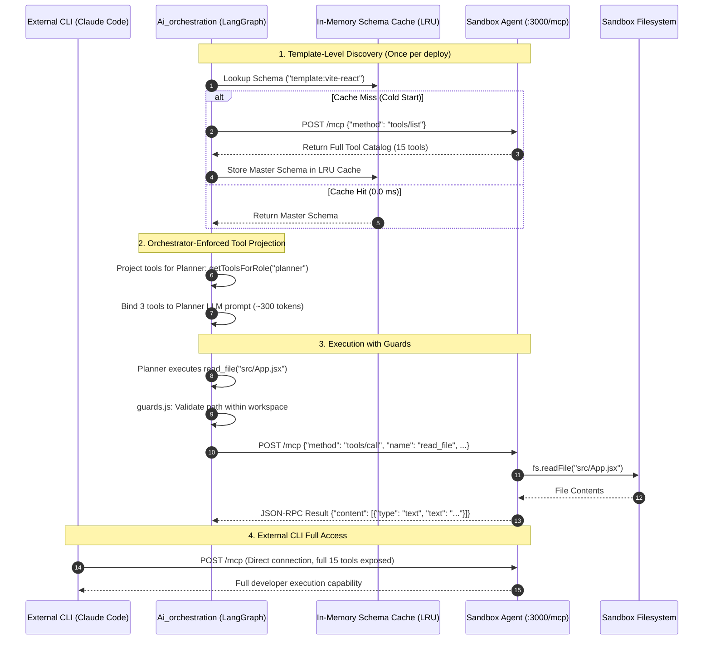

# Master Architecture: Single MCP Sandbox Sidecar & Orchestrator-Enforced Tool Scoping

> **Canonical System Document**: This master document synthesizes and supersedes all prior MCP design documents (`mcp-architecture.md`, `mcp-sandbox-sidecar-agent-architecture.md`, and `scoped-mcp-multi-agent-architecture.md`). It establishes the authoritative architectural blueprint for Model Context Protocol (MCP) in Taksha: a **Single Role-Agnostic MCP Server in the Sandbox Sidecar** paired with **Orchestrator-Enforced Role Scoping and Tool Projection** in `Ai_orchestration`.

---

## 1. Concept in Plain English

Model Context Protocol (MCP) is an open standard that allows AI systems and developer tools to discover and execute tools via standardized **JSON-RPC 2.0** over HTTP.

In Taksha's cloud IDE:
1. **The Sandbox Sidecar hosts ONE Single MCP Server**: Running inside the tenant's container on port 3000 (`POST /mcp`), this server exposes the complete suite of workspace tools (`read_file`, `patch_file`, `execute_command`, etc.). It is completely role-agnostic and serves both internal agents and external developer CLIs (Claude Code, Cursor) with zero route fragmentation.
2. **The Orchestrator Enforces Least Privilege**: In `Ai_orchestration`, individual agent nodes in the LangGraph graph (`planner`, `coder`, `tester`, `debugger`) are **never given the entire toolset**. The orchestrator MCP client queries the server's tools once, caches them, and projects **only the authorized subset of tools** into each node's prompt and model bindings.
3. **Double Benefit**:
   - **Deterministic Security**: A planning agent physically cannot execute destructive shell commands or delete files because those tools do not exist in its prompt or tool bindings.
   - **Massive Token Optimization**: Each agent prompt receives only 3–4 tools (~350 tokens) instead of 15+ tools (~1,800 tokens), cutting tool definition context costs by **>80%** across multi-turn workflows.

---

## 2. Why It Exists & Scale Thresholds

### What Breaks Without Orchestrator-Enforced Tool Scoping?

| Failure Mode | Monolithic "Give Every Agent All Tools" | Taksha Single MCP + Orchestrator Scoping |
| :--- | :--- | :--- |
| **Context Window Bloat** | Every agent node receives all 15+ tool definitions in its system prompt (~1,800 tokens per turn). | Node receives strictly its authorized toolset (~350 tokens per turn) — **>80% token savings**. |
| **Role Confusion & Drift** | A planner LLM gets distracted and attempts to run `rm -rf` or edit files before finishing the plan. | **Impossible**: The model schema provided to the planner only contains read/inspection tools. |
| **Multi-Endpoint Route Sprawl** | Multiplexing 3 separate MCP endpoints (`/mcp/inspector`, `/mcp/editor`) creates route and proxy complexity. | **Single Clean Contract**: Exactly one `POST /mcp` endpoint in `Sandbox/Agent/src/app.js`. |
| **External CLI Incompatibility** | External tools (Claude Code) must figure out which internal agent endpoint to mount. | **Universal Parity**: External developer tools mount `POST /mcp` directly and get full developer-level access. |

---

## 3. Core Mechanism: Single MCP Server + Orchestrator Tool Projection

### 3.1 The Architecture Topology

```
┌────────────────────────────────────────────────────────────────────────────────────────┐
│                                 AI ORCHESTRATION SERVICE                                │
│                                                                                        │
│   1. Discovers tools once via POST /mcp {"method": "tools/list"}                       │
│   2. Caches master schema by TEMPLATE_TYPE in LRU cache (0.0ms recurring latency)      │
│   3. Projects role-specific tool subsets into LangGraph nodes:                         │
│                                                                                        │
│      ┌──────────────────┐  Allowed: [read_file, list_files, search_code]                │
│      │  Planner Node    │  Prompt Cost: ~300 tokens (Inspection Only)                  │
│      └──────────────────┘                                                              │
│      ┌──────────────────┐  Allowed: [read_file, patch_file, create_file]               │
│      │  Coder Node      │  Guards: activeFiles bounds enforced by guards.js            │
│      └──────────────────┘                                                              │
│      ┌──────────────────┐  Allowed: [execute_command, get_vite_runtime_errors]         │
│      │  Tester Node     │  Prompt Cost: ~250 tokens (Execution Only)                   │
│      └──────────────────┘                                                              │
│      ┌──────────────────┐  Allowed: [read_file, patch_file, search_code]               │
│      │  Debugger Node   │  Guards: flaggedFiles surgical patch ONLY (no update_file)   │
│      └──────────────────┘                                                              │
└───────────────────────────────────────────┬────────────────────────────────────────────┘
                                            │
                     Stateless JSON-RPC 2.0 │ POST /mcp (Streamable HTTP)
                                            ▼
┌────────────────────────────────────────────────────────────────────────────────────────┐
│                       TENANT SANDBOX CONTAINER (PORT 3000)                              │
│                                                                                        │
│   Single Unified MCP Server (Sandbox/Agent/src/app.js)                                 │
│   Exposes All Registered Tools:                                                        │
│     • read_file, list_files, search_code, file_tree                                    │
│     • create_file, update_file, patch_file, delete_file                                │
│     • execute_command, get_vite_runtime_errors                                         │
│                                                                                        │
│   ◄── Also directly connects External Developer CLIs (Claude Code, Cursor) with full   │
│       authenticated workspace access.                                                  │
└────────────────────────────────────────────────────────────────────────────────────────┘
```

### 3.2 Role-Based Tool Authorization Matrix (`ALLOWED_TOOLS_BY_ROLE`)

Implemented inside `Ai_orchestration/src/agent/tool.js`:

```typescript
export const ALLOWED_TOOLS_BY_ROLE = {
  planner: [
    "read_file",
    "list_files",
    "search_code",
    "get_file_tree"
  ],
  coder: [
    "read_file",
    "list_files",
    "patch_file",
    "create_file",
    "delete_file",
    "search_code"
  ],
  tester: [
    "execute_command",
    "get_vite_runtime_errors",
    "list_files"
  ],
  debugger: [
    "read_file",
    "patch_file",
    "search_code",
    "get_vite_runtime_errors"
  ],
  // Full access for external authenticated developer sessions
  developer: [
    "*"
  ]
} as const;

/**
 * Filter the master MCP tools array down to the authorized subset for a given node.
 */
export function getToolsForRole(allMcpTools: Tool[], role: keyof typeof ALLOWED_TOOLS_BY_ROLE): Tool[] {
  const allowed = ALLOWED_TOOLS_BY_ROLE[role];
  if (allowed.includes("*")) return allMcpTools;
  return allMcpTools.filter(tool => allowed.includes(tool.name));
}
```

### 3.3 Dynamic Parameter Boundaries (`guards.js`)

While role scoping controls **which tools** an agent sees, `Ai_orchestration/src/agent/guards.js` intercepts tool arguments before execution to enforce **path and command bounds**:
1. **`activeFiles` Check (Coder Node)**: When Coder calls `patch_file` or `create_file`, the target file must belong to `state.plan[currentStep].activeFiles`.
2. **`flaggedFiles` Check (Debugger Node)**: When Debugger calls `patch_file`, it can only modify files flagged in `verificationReport.flaggedFiles`.
3. **Command Whitelist (Tester Node)**: Only authorized build/test commands (`npm run build`, `npm test`) are permitted; destructive commands (`rm -rf /`, shutdown) are blocked mechanically.

---

## 4. Reference Architecture



---

## 5. Scalability Deep Dive

### 5.1 Horizontal Scaling & Connection Pooling
- **Stateless HTTP JSON-RPC 2.0**: The sidecar does not require persistent, stateful WebSockets or SSE streams from `Ai_orchestration`. All tool invocations use stateless `POST /mcp` calls.
- **TCP Keep-Alive Pooling**: `Ai_orchestration` uses an internal Node.js `http.Agent` with `keepAlive: true`, `maxSockets: 100`, and `timeout: 120000ms`, reusing open TCP sockets across multiple turns on the same sandbox pod.

### 5.2 Bottleneck Analysis Across Scale Tiers

```
Scale Tier 1 (1,000 Concurrent Sandboxes)
  ├─ Traffic: ~60 tool invocations/sec.
  ├─ Bottleneck: Cold discovery latency on container startup.
  └─ Resolution: In-memory schema cache keyed by template type (0.0ms discovery).

Scale Tier 2 (10,000 Concurrent Sandboxes)
  ├─ Traffic: ~600 tool invocations/sec.
  ├─ Bottleneck: Single-threaded event loop lag in sandbox Express sidecar during multi-megabyte file reads.
  └─ Resolution: Enforce 2MB maximum file read limit in sidecar; return truncated previews with byte offsets.

Scale Tier 3 (100,000 Concurrent Sandboxes)
  ├─ Traffic: ~6,000 tool invocations/sec.
  ├─ Bottleneck: Memory footprint in orchestrator pods storing connection pools across 100,000 dynamic sandbox DNS endpoints.
  └─ Resolution: Route tool requests through internal Envoy Gateway sidecars with automated connection lifecycle pruning.
```

### 5.3 Caching Strategy: Template Schema Registry
Because every Vite/React sandbox instance shares the identical set of tools, `Ai_orchestration` caches tool schemas by **`TEMPLATE_TYPE`** rather than by individual `sandboxId`:
- **Cache Key**: `schema:vite-react:master`.
- Cold discovery occurs **once per cluster deployment**, not per user session.
- Subsetting tools for `planner`, `coder`, and `debugger` is an in-memory array filter taking **$< 0.1\text{ ms}$**.

---

## 6. Trade-Offs Table: Architectural Comparison

| Dimension | Monolithic Unscoped MCP | Multi-Endpoint Virtual MCP (`/mcp/*`) | Single MCP + Orchestrator Projection (Taksha) |
| :--- | :--- | :--- | :--- |
| **Sidecar Complexity** | 🟢 Minimal (1 endpoint) | ❌ High (Route multiplexing, route maintenance) | 🟢 **Minimal (1 standard `/mcp` endpoint)** |
| **Context Token Savings** | ❌ None (All 15 tools in prompt) | 🟢 >80% savings (~350 tokens) | 🟢 **>80% savings (~350 tokens)** |
| **External CLI Parity** | 🟢 Direct access | 🟡 Must document internal routes | 🟢 **Universal (Claude Code connects to `/mcp`)** |
| **Enforcement Layer** | ❌ Pure LLM prompt trust | 🟢 Network routing layer (404/403) | 🟢 **Orchestrator Model Binding + guards.js** |
| **Schema Caching Simplicity** | 🟢 Single cache key | ❌ Multiple cache keys per endpoint | 🟢 **Single cache key sliced in memory** |

---

## 7. Ties to Core CS Fundamentals

1. **View / Projection Pattern (Database & Systems)**: In database systems, a database view exposes only a restricted slice of a table without duplicating the underlying data. In Taksha, `getToolsForRole()` projects a scoped view of the master MCP catalog to each agent node without creating multiple servers.
2. **Principle of Least Privilege (PoLP)**: By ensuring that a node's prompt and LLM tool bindings only contain tools relevant to its immediate bounded context, the model mathematically cannot emit unauthorized tool calls.
3. **Separation of Concerns**: The sandbox sidecar focuses strictly on **tool execution** in the Linux environment; the orchestrator focuses strictly on **workflow authorization, state management, and guardrails**.

---

## 8. Connection to Taksha Project Infrastructure

- **Sandbox Sidecar**: Located at `Sandbox/Agent/src/app.js` running Express on port 3000. Mounts standard MCP JSON-RPC 2.0 at `POST /mcp`.
- **Tool Mapping & Projection**: Located at `Ai_orchestration/src/agent/tool.js`, defining `ALLOWED_TOOLS_BY_ROLE` and exporting scoped LangChain dynamic tools.
- **Node Integration**:
  - `planner.node.js`: Receives `getToolsForRole("planner")`.
  - `coder.node.js`: Receives `getToolsForRole("coder")` wrapped with `guards.js`.
  - `tester.node.js`: Receives `getToolsForRole("tester")`.
  - `debugger.node.js`: Receives `getToolsForRole("debugger")` restricted to `patch_file`.
- **Pre-execution Bounds**: `Ai_orchestration/src/agent/guards.js` validates file paths against `state.activeFiles` and blocks shell command injection.

---

## 9. If Constraints Were Looser: Native eBPF Shared Memory RPC

If orchestrator and sandboxes were co-scheduled on bare-metal host nodes:
- **Zero-Copy Shared Memory (POSIX shm)**: MCP JSON-RPC payloads could pass over Linux shared memory ring buffers rather than TCP HTTP/1.1.
- **Protobuf Binary Framing**: Serializing tool inputs/outputs via Protocol Buffers instead of JSON would reduce payload serialization latency from ~5ms to <100 microseconds.

---

## 10. Common Pitfalls & Anti-Patterns

1. **Binding All Tools to Every Node**: Exposing `patch_file` to the planner causes the planner to start editing files before producing the plan. **Always project scoped tools via `getToolsForRole()`**.
2. **Re-discovering Tools on Every Step**: Calling `tools/list` on every graph iteration burns 20–50ms. **Always cache the master schema in memory**.
3. **Allowing `debugger` to use `update_file`**: Giving Debugger full rewrite tools causes it to overwrite entire files on minor syntax errors. **Debugger must only possess `patch_file`**.

---

## 11. Production Readiness Checklist

- [x] Sandbox sidecar exposes exactly ONE role-agnostic MCP server at `POST /mcp` on port 3000.
- [x] External developer tools (Claude Code, Cursor) connect directly to `POST /mcp` with full access.
- [x] `ALLOWED_TOOLS_BY_ROLE` mapping implemented in `Ai_orchestration/src/agent/tool.js`.
- [x] LangGraph nodes (`planner`, `coder`, `tester`, `debugger`) receive strictly their projected toolsets.
- [x] Master schema cached by `TEMPLATE_TYPE` in orchestrator LRU cache (0.0ms discovery).
- [x] `guards.js` active and validating `activeFiles` and `flaggedFiles` boundaries before tool transport.
