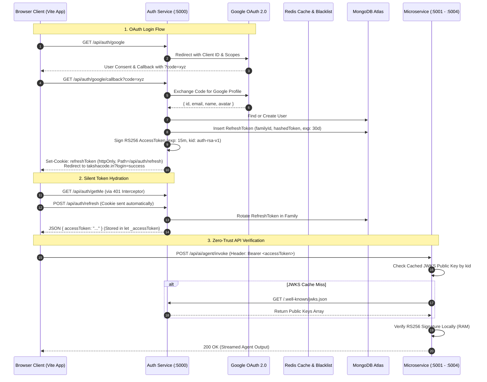

# Master Architecture: Taksha Authentication, Security & Distributed Session Management

> **Canonical System Document**: This master document synthesizes and supersedes all prior authentication and session architecture documents (`docs/auth_architecture.md` and `documents/login-api-deep-dive.md`). It establishes the single source of truth for identity, asymmetric key management (RS256/JWKS), token rotation, and zero-trust cross-service verification across Taksha.

---

## 1. Concept in Plain English

Authentication in a distributed cloud IDE requires solving two conflicting requirements:
1. **Zero Database Overhead on High-Frequency API Calls**: When an AI agent executes 20 tool calls per minute, microservices cannot query a centralized database on every HTTP request to verify if the user is authenticated.
2. **Immediate Revocation on Theft**: If an attacker steals a user's session token, the platform must be able to lock them out without waiting days for tokens to expire.

Taksha solves this using an **Asymmetric RS256 Two-Token Architecture with In-Memory Storage, Token Family Rotation, and JWKS Key Distribution**:
- The **Auth Service** holds an RSA-2048 private key and signs short-lived (15-minute) **Access Tokens**.
- All downstream microservices (`Ai_orchestration`, `Payments`, `Sandbox`, `Notification`) verify tokens locally in sub-millisecond time using the Auth service's public key fetched from `/.well-known/jwks.json`.
- Long-lived sessions rely on an opaque **Refresh Token** (30-day, 128-char hex) stored inside an `httpOnly`, `sameSite: 'lax'`, `path: '/api/auth/refresh'` cookie that JavaScript cannot access (preventing XSS theft).

---

## 2. Why It Exists & Scale Thresholds

### Failure Modes of Naive Authentication Systems

| Vulnerability / Bottleneck | Naive Pattern (e.g. HS256 / Database Sessions) | Taksha Distributed RS256 + JWKS |
| :--- | :--- | :--- |
| **Database Churn** | Every API request queries MongoDB `sessions` collection. Database melts at 2,000 QPS. | Cryptographic verification in RAM ($\approx 0.2\text{ ms}$). Zero database IO on valid access tokens. |
| **Symmetric Key Leak** | HS256 shared secret copied across 5 microservice `.env` files. If one container is compromised, the entire platform is cracked. | Asymmetric: Only Auth holds `private.pem`. Downstream services only hold public keys. |
| **Token Theft via XSS** | JWT stored in browser `localStorage`. Malicious npm package reads `localStorage.getItem('jwt')`. | Access token stored in JS closure memory variable (`let _accessToken = null`). Wiped on page refresh. |
| **Replay Attack Vulnerability** | Stolen refresh token used indefinitely. | Cryptographic Token Family rotation: reusing an already-used token triggers immediate nuclear purge of the entire session family. |

---

## 3. Core Mechanism & Cryptographic Lifecycle

### 3.1 Token Specifications

```
                       TAKSHA TOKEN ARCHITECTURE
                       ─────────────────────────
  1. Access Token (In-Memory JS Closure)
     ├─ Format: RS256 JWT (Header.Payload.Signature)
     ├─ Header: {"alg": "RS256", "typ": "JWT", "kid": "auth-rsa-v1"}
     ├─ Payload: { sub: userId, email: "...", role: "...", exp: +15m }
     └─ Transport: Authorization: Bearer <token>

  2. Refresh Token (httpOnly Cookie)
     ├─ Format: Opaque 128-char Cryptographic Hex String (NOT a JWT)
     ├─ Database Record: Stored strictly as SHA-256 hash in MongoDB
     ├─ Cookie Flags: HttpOnly, Secure, SameSite=Lax, Path=/api/auth/refresh
     └─ Lifecycle: Single-use rotation within a UUID Token Family
```

### 3.2 Token Family Rotation & Anti-Replay Mechanism

When the client needs a new access token, it issues `POST /api/auth/refresh`:
1. The server extracts the cookie and hashes the token via `crypto.createHash('sha256')`.
2. It queries MongoDB for the token record:
   - **Case A: Valid & Unused**: Server marks `used: true`, issues a new refresh token (same `familyId`), sets the new cookie, and returns a fresh 15-minute access token.
   - **Case B: Replay Attack Detected (`used === true`)**: An attacker is attempting to use an already-rotated token! The server triggers **Nuclear Invalidation**:
     $$\text{db.refreshTokens.deleteMany}(\{ \text{familyId}: \text{token.familyId} \})$$
     All active sessions for that login are instantly terminated across all devices.

---

## 4. Reference Architecture & Flow Diagram



---

## 5. Scalability Deep Dive

### 5.1 Asymmetric Verification Performance
- **Zero Latency Amplification**: Because microservices verify tokens using local in-memory RSA public keys, Auth service availability has **zero impact** on active user operations. If the Auth service pod crashes, developers can continue coding for up to 15 minutes without disruption.
- **JWKS Caching**: Microservices cache the JWKS payload in-memory with a 24-hour TTL. Key rotation uses the `kid` header: if an incoming token has an unknown `kid`, the microservice triggers an immediate background refetch before rejecting the token.

### 5.2 Bottleneck Analysis Across Scale Tiers

```
1,000 Concurrent Devs (~100 QPS Total Traffic)
  ├─ Bottleneck: Initial Google OAuth token exchange.
  └─ Resolution: Ephemeral connection pooling to Google APIs.

10,000 Concurrent Devs (~2,000 QPS Total Traffic)
  ├─ Bottleneck: MongoDB RefreshToken collection write IOPS during token refreshes.
  └─ Resolution: MongoDB compound index on { hashedToken: 1 } and TTL index on { expiresAt: 1 }.

100,000 Concurrent Devs (~20,000 QPS Total Traffic)
  ├─ Bottleneck: Redis connection pool exhaustion on logout blacklist checks.
  └─ Resolution: Asymmetric blacklist scoping: Only financial operations (Payments) check Redis blacklist; standard sandbox/agent routes rely on 15-minute token TTL.
```

### 5.3 Blacklist Coverage Trade-Off Matrix

| Service | Checks Redis Blacklist on Every Call? | Latency Impact | Security Justification |
| :--- | :---: | :--- | :--- |
| **Auth Service** | ✅ Yes | +1.2 ms | Manages authentication boundaries; must prevent immediate reuse. |
| **Payments Service** | ✅ Yes | +1.5 ms | Financial operations require zero-tolerance for revoked tokens. |
| **AI Orchestration** | ❌ No | **0.0 ms** | Token expires in $\le 15\text{ min}$; micro-second latency is critical for agent streams. |
| **Sandbox Server** | ❌ No | **0.0 ms** | High-frequency container tool calls cannot afford Redis network hops. |

---

## 6. Trade-Offs Table: Authentication Architectures

| Dimension | Symmetric HS256 JWT | Stateful Session Store (Redis) | Asymmetric RS256 + JWKS (Taksha) |
| :--- | :--- | :--- | :--- |
| **Inter-Service Security** | ❌ Shared secret across all pods | 🟢 Centralized control | 🟢 **Zero secret sharing (Public key only)** |
| **Database / Cache IO** | 🟢 Zero IO | ❌ Hard dependency on Redis | 🟢 **Zero IO during verification** |
| **Revocation Speed** | ❌ Impossible without blacklist | 🟢 Instantaneous | 🟡 **Tiered (Instant for Payments, 15m for AI)** |
| **Horizontal Scalability** | 🟢 Infinite | 🟡 Bound to Redis cluster | 🟢 **Infinite (Stateless validation)** |
| **Key Rotation Complexity** | ❌ Requires rolling reboot of all pods | 🟢 N/A | 🟢 **Seamless via kid in JWKS array** |

---

## 7. Ties to Core CS Fundamentals

1. **Public-Key Cryptography (RSA Asymmetry)**:
   Mathematically, signing requires the private key $d$, while verification requires only the public exponent $(e, n)$:
   $$S = M^d \pmod n, \quad M = S^e \pmod n$$
   This mathematical boundary allows downstream services to verify authenticity without possessing the power to forge credentials.
2. **Cryptographic Hashes & One-Way Functions**: Refresh tokens are never stored in plaintext in the database. Storing $\text{SHA-256}(R)$ ensures that even if a database backup is leaked, attackers cannot generate valid cookies.
3. **Decoupled Asynchronous Transactions**: When a user logs in, email notifications are published to RabbitMQ (`auth_notification_queue`) using fire-and-forget background promises with local `.catch()` handlers, ensuring that email server outages never crash login HTTP transactions.

---

## 8. Connection to Taksha Project Infrastructure

- **Auth Service Root**: `Auth/src/app/app.js` runs on port 5000 exposing `/api/auth/*`.
- **JWKS Endpoint**: `Auth/src/controllers/auth.controller.js` serves `/.well-known/jwks.json`.
- **Private Key Path**: `Auth/certs/private.pem` (RSA-2048, strictly ignored in git).
- **Universal Downstream Middleware**: `Ai_orchestration/src/middleware/verifyToken.middleware.js` and `Sandbox/server/src/middleware/auth.middleware.js` fetch and validate against JWKS.
- **Frontend Interceptor**: `Frontend/src/api/apiClient.js` implements the automatic Axios response interceptor that queues failed 401 requests during silent token refresh.

---

## 9. If Constraints Were Looser: Passkeys (WebAuthn) & mTLS

If user constraints did not require traditional Google OAuth browser redirects:
- **FIDO2 / WebAuthn Hardware Passkeys**: Biometric login directly via TouchID/Windows Hello, storing hardware-bound cryptographic keys in browser Secure Enclaves. Completely eliminates phishing and password theft.
- **Mutual TLS (mTLS) Mesh**: Service-to-service calls inside Kubernetes communicate via Istio mTLS sidecars, embedding SPIFFE identity tokens in network packets and eliminating application-layer token verification entirely.

---

## 10. Common Pitfalls & Anti-Patterns

1. **Storing Access Tokens in `localStorage`**: Storing tokens in web storage makes them readable by any malicious third-party script or browser extension. **Always keep access tokens in JavaScript closure memory**.
2. **Awaiting RabbitMQ Notifications Inside Login Controller**: Awaiting queue dispatch inside `try/catch` causes login requests to return 500 errors if RabbitMQ is temporarily restarting. **Dispatch asynchronously with `.catch()` logging**.
3. **Omitting the `kid` Header in JWTs**: Signing tokens without a Key ID makes seamless cryptographic key rotation impossible without downtime. **Always include `kid` in the JWT header**.

---

## 11. Production Readiness Checklist

- [x] RSA-2048 private key isolated exclusively to `Auth/certs/private.pem`.
- [x] All downstream services verify tokens via cached JWKS (`/.well-known/jwks.json`).
- [x] Access token stored in memory (`_accessToken`), refreshed via Axios 401 interceptor.
- [x] Refresh tokens stored strictly as SHA-256 hashes in MongoDB with TTL index.
- [x] Token Family rotation active with nuclear invalidation on replay attempts.
- [x] Redis blacklist enforcement enabled for financial operations in Payments.
- [x] Asynchronous, non-blocking notification dispatch to RabbitMQ on auth events.
