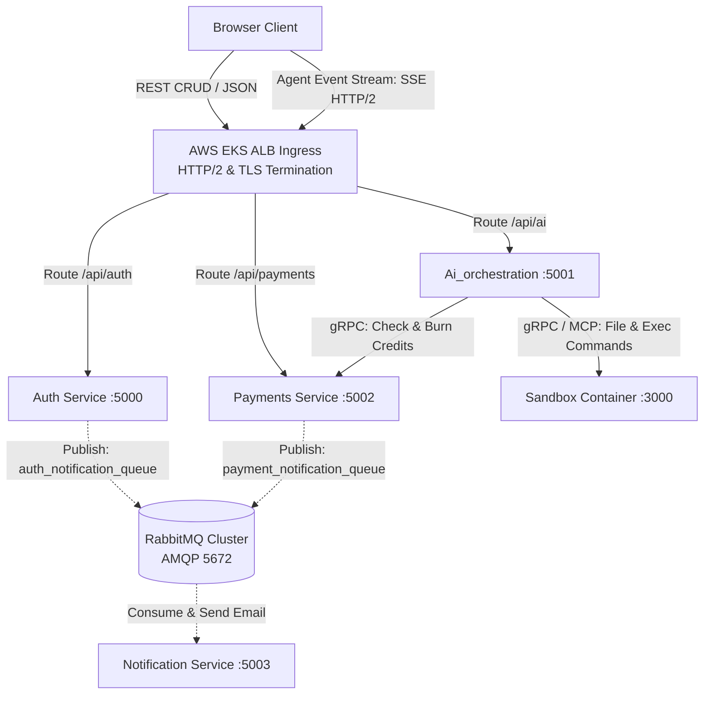

# Master Architecture: Taksha Distributed Inter-Service Communication & Real-Time Streaming

> **Canonical System Document**: This master document synthesizes and supersedes all prior communication and transport design documents (`documents/grpc-microservices-communication.md` and `documents/sse-vs-socketio-streaming.md`). It establishes the platform-wide protocol decision matrix across browser-to-service, inter-microservice (East-West), and asynchronous message queuing layers.

---

## 1. Concept in Plain English

A distributed AI coding platform requires three fundamentally different types of data movement:
1. **Unidirectional Token & Event Streaming (Cloud to Browser)**: The AI agent writes code and streams terminal output down to the user's browser in real time.
2. **Ultra-Low-Latency Synchronous RPC (Service to Service)**: Before executing an agent turn, the AI Orchestration service must check user credit balances with the Payments service and execute bash commands inside the Sandbox container.
3. **Decoupled Asynchronous Tasks (Fire-and-Forget Events)**: When a user signs in or completes a payment, the system must send confirmation emails and record analytical telemetry without blocking the user.

Using a single protocol (e.g. REST everywhere or WebSockets everywhere) leads to connection bottlenecks, high latency, and cascading outages. Taksha uses a **Tri-Modal Transport Architecture**:
- **Server-Sent Events (SSE) over HTTP/2** for browser agent streaming.
- **gRPC over HTTP/2 with Protocol Buffers** for synchronous East-West cluster RPC.
- **RabbitMQ (AMQP)** with durable exchanges for asynchronous decoupled events.

---

## 2. Why It Exists & Protocol Decision Matrix

| Communication Boundary | Selected Protocol | Rejected Alternative | Why the Alternative Was Rejected |
| :--- | :--- | :--- | :--- |
| **Browser $\leftarrow$ AI Orchestrator** (Agent streaming) | **Server-Sent Events (SSE) / HTTP/2** | Socket.IO / WebSockets | Socket.IO introduces proprietary framing protocols, requires complex cookie/query auth workarounds, and gets blocked by corporate firewalls. SSE is native HTTP. |
| **AI Orchestrator $\leftrightarrow$ Payments** (Credit check & burning) | **gRPC Unary RPC (Protobuf)** | REST / JSON HTTP/1.1 | REST burns CPU on JSON serialization and creates new TCP handshakes. gRPC multiplexes calls over persistent HTTP/2 with sub-3ms latency. |
| **AI Orchestrator $\leftrightarrow$ Sandbox** (Command & file ops) | **gRPC Streaming / MCP** | Bespoke REST endpoints | REST cannot stream live stdin/stdout chunks interactively without polling. |
| **Auth / Payments $\rightarrow$ Notification** (Emails & receipts) | **RabbitMQ (AMQP)** | gRPC / REST | Synchronous RPC couples services: an email provider outage would crash user logins and payment checkouts. Queues guarantee durability. |
| **Browser $\leftrightarrow$ Backend REST APIs** (Standard CRUD) | **REST over HTTP/2 (JSON)** | gRPC-Web | Browsers cannot manipulate HTTP/2 frames directly; gRPC-Web requires maintaining an Envoy proxy translation layer. |

---

## 3. Core Mechanism & Protocol Architectures

### 3.1 Streaming Layer: Server-Sent Events (SSE) over HTTP/2

The AI streaming engine replaces Socket.IO with standard HTTP `text/event-stream`:

```
POST /api/ai/agent/invoke  (HTTP/2)
Headers:
  Authorization: Bearer <RS256_JWT>
  Content-Type: application/json
  Accept: text/event-stream

Streamed Body (text/event-stream):
  event: node_transition
  data: {"node":"planner","currentSituation":"Analyzing file tree..."}

  event: token
  data: {"content":"const Navbar = () => {\n"}

  event: verification
  data: {"layer":"build","passed":true}

  event: done
  data: {"runId":"proj-123:17128392","diffSummary":"+12 -2"}
```

- **Reverse Proxy Safety**: Response headers explicitly enforce `X-Accel-Buffering: no` to prevent Nginx/Cloudflare buffer stalls.
- **Connection Keep-Alives**: A lightweight comment heartbeat (`: heartbeat\n\n`) is emitted every 15 seconds to prevent AWS ALB 60-second idle timeouts during lengthy build operations.

### 3.2 High-Speed Cluster RPC: gRPC & Protocol Buffers

For high-frequency credit queries and token updates between `Ai_orchestration` and `Payments`:

```protobuf
syntax = "proto3";

package taksha.payments;

service CreditService {
  rpc CheckCreditBalance (CreditCheckRequest) returns (CreditCheckResponse);
  rpc BurnTokens (TokenBurnRequest) returns (TokenBurnResponse);
}

message CreditCheckRequest {
  string user_id = 1;
  string model_provider = 2;
  int32 estimated_tokens = 3;
}

message CreditCheckResponse {
  bool has_sufficient_credits = 1;
  int64 remaining_balance = 2;
  string active_tier = 3;
}
```

- **Binary Serialization**: Protocol Buffers pack fields into raw binary varints rather than UTF-8 string keys, cutting network payload size by **~75%**.
- **Multiplexed Streams**: A single TCP socket between pods handles thousands of concurrent RPC invocations without Head-of-Line blocking.

---

## 4. Reference Architecture



---

## 5. Scalability Deep Dive

### 5.1 Horizontal Scaling & Ingress Multiplexing
- **HTTP/1.1 vs. HTTP/2 Browser Limits**: Browsers enforce a strict limit of 6 concurrent HTTP/1.1 connections per host. If a developer opens 6 tabs with SSE streams, the 7th hangs. By enabling **HTTP/2 on AWS ALB Ingress**, all SSE streams multiplex across a single underlying TCP connection.
- **K8s Load Balancing for gRPC**: Standard Kubernetes `ClusterIP` operates at Layer 4 (TCP). Because gRPC holds a single long-lived TCP connection, standard K8s routing would send 100% of traffic to a single pod. **Taksha uses gRPC client-side round-robin load balancing** with K8s headless services (`clusterIP: None`) to distribute RPC calls evenly across all target pods.

### 5.2 Bottleneck Analysis Across Scale Tiers

```
Scale Tier 1 (1,000 Concurrent Devs)
  ├─ Traffic: ~1,000 active SSE streams + ~200 gRPC calls/sec.
  ├─ Bottleneck: Ingress proxy connection tracking limits.
  └─ Resolution: Tune worker_connections in Nginx Ingress Controller to 65,535.

Scale Tier 2 (10,000 Concurrent Devs)
  ├─ Traffic: ~10,000 active SSE streams + ~2,000 gRPC calls/sec.
  ├─ Bottleneck: Ephemeral port exhaustion on Orchestrator pods.
  └─ Resolution: gRPC channel pooling with single shared HTTP/2 connection pool per target service.

Scale Tier 3 (100,000 Concurrent Devs)
  ├─ Traffic: ~100,000 active streams.
  ├─ Bottleneck: Memory footprint of idle SSE connection descriptors on application pods.
  └─ Resolution: Offload edge SSE broadcasting to Redis Pub/Sub backed by dedicated Edge Gateway pods.
```

---

## 6. Trade-Offs Table: Transport Comparison

| Metric | Server-Sent Events (SSE) | WebSockets (Socket.IO) | gRPC (Protobuf) | RabbitMQ (AMQP) |
| :--- | :--- | :--- | :--- | :--- |
| **Directionality** | Server-to-Client Unidirectional | Full Duplex Bidirectional | Full Duplex / Unary | Async Push/Pull |
| **Overhead** | Minimal (Standard HTTP) | High (Heartbeats + Framing) | **Lowest (Binary Packing)** | Medium (AMQP envelope) |
| **Auth Ergonomics** | Native `Authorization: Bearer` | Custom Handshake Query / Cookie | Metadata Key-Value pairs | Header Properties |
| **Proxy Compatibility** | **Excellent (Works everywhere)** | Poor (Firewalls drop WS) | Requires HTTP/2 support | Internal cluster only |
| **Failure Decoupling** | Synchronous connection | Synchronous connection | Synchronous connection | **Complete Decoupling** |

---

## 7. Ties to Core CS Fundamentals

1. **Multiplexing over Single Transport Stream**: HTTP/2 introduces binary framing where multiple independent logical streams interleave frames over a single TCP connection, eliminating Head-of-Line blocking at the application layer.
2. **Backpressure & Window Updates**: In Node.js SSE implementations, checking the boolean return value of `res.write()` guarantees that if the browser client is slow to consume tokens, the server pauses generation rather than exhausting server RAM buffers.
3. **Queueing Theory & Little's Law**: $L = \lambda W$. By placing asynchronous transactional emails into RabbitMQ, the arrival rate $\lambda$ is completely decoupled from SMTP server latency $W$, guaranteeing stable system capacity $L$.

---

## 8. Connection to Taksha Project Infrastructure

- **SSE Implementation**: Implemented in `Ai_orchestration/src/controllers/ai.controller.js` using `res.writeHead(200, { 'Content-Type': 'text/event-stream' })`.
- **Axios HTTP Client**: `Frontend/src/api/apiClient.js` and `payments_frontend/src/api/axiosInstance.js` handle standard REST endpoints.
- **Message Broker Connector**: `Notification/src/app/app.js` listens on RabbitMQ channels (`AUTH_QUEUE` and `PAYMENT_QUEUE`) with automatic reconnect backoff.
- **Credit Check Migration Path**: Targets `Ai_orchestration/src/controllers/ai.controller.js` and `Payments/controllers/credit.controller.js` for gRPC protocol compilation.

---

## 9. If Constraints Were Looser: WebTransport & eBPF Kernel Bypass

If network constraints required sub-millisecond inter-service communication:
- **HTTP/3 WebTransport (QUIC)**: Replaces TCP with UDP-based QUIC, eliminating TCP-level packet loss Head-of-Line blocking across unstable developer internet connections.
- **Cilium eBPF Host-Level Bypass**: Bypasses the Linux kernel TCP/IP stack entirely for pods running on the same Kubernetes worker node, transferring packets socket-to-socket in RAM with **< 50 microsecond latency**.

---

## 10. Common Pitfalls & Anti-Patterns

1. **Replacing Message Queues with gRPC**: Calling `NotificationService.sendEmail()` directly via gRPC causes email provider outages to cascade backward and crash login and checkout transactions. **Keep asynchronous tasks in RabbitMQ**.
2. **Missing `X-Accel-Buffering: no` on SSE**: Omitting this header causes Nginx and AWS ALB to buffer SSE chunks until the buffer hits 4KB or the agent completes, breaking real-time token streaming.
3. **Renumbering Protocol Buffer Tags**: Changing field tag numbers (`int32 user_id = 1` $\to$ `user_id = 2`) breaks backwards compatibility and corrupts binary deserialization. **Protobuf field tags are immutable forever**.

---

## 11. Production Readiness Checklist

- [x] SSE streaming active on `POST /api/ai/agent/invoke` with `X-Accel-Buffering: no`.
- [x] Periodic 15-second heartbeat comments (`: heartbeat\n\n`) preventing proxy timeouts.
- [x] AWS ALB Ingress configured with HTTP/2 and gRPC protocol support.
- [x] RabbitMQ queues configured with durable storage, explicit ack/nack, and Dead-Letter Exchanges.
- [x] Headless Kubernetes service (`clusterIP: None`) configured for gRPC client-side load balancing.
- [x] Standard REST APIs maintained for browser CRUD operations.
