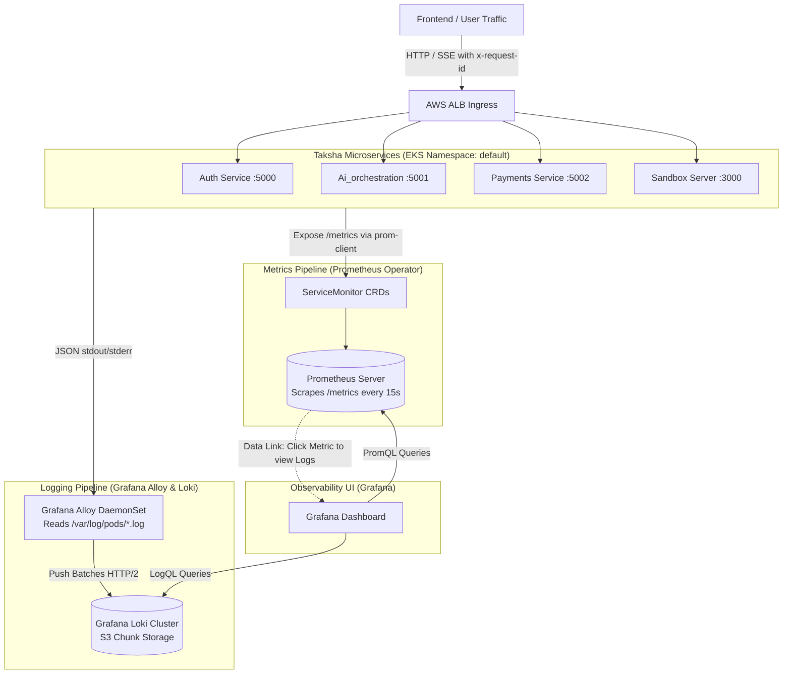

# Master Architecture: Taksha Observability, Distributed Error Handling & Telemetry

> **Canonical System Document**: This master document synthesizes and supersedes all prior observability and logging design documents (`documents/faultkit-distributed-error-handling-and-logging-plan.md` and `documents/grafana-prometheus-loki-monitoring-stack.md`). It establishes the platform-wide production standard for distributed error handling (FaultKit), structured JSON logging (Pino), Prometheus metrics, Grafana dashboards, and Grafana Loki log aggregation.

---

## 1. Concept in Plain English

In a microservice system running AI coding agents, sandboxes, and payments, diagnosing a failure across multiple asynchronous hops is impossible if each service logs differently or returns generic errors:
- If a user's code generation fails, was it an expired JWT, a credit balance depletion in Payments, a compiler timeout in the Sandbox, or an unhandled JSON parse error in the orchestrator?
- When logs are unstructured text strings (`console.log("Error:", err)`), log search engines cannot aggregate error counts, filter by user, or trace requests.

Taksha solves this using a **Two-Layer Unified Observability Architecture**:
1. **Application Runtime Layer (FaultKit + Pino)**: Standardized error contracts (`AppError` subclasses), automatic HTTP 500 masking in production, correlation IDs (`x-request-id`) propagated across microservices, and high-performance structured JSON logging.
2. **Infrastructure Layer (Prometheus + Grafana Loki + Grafana Alloy)**: Metrics scraping via Prometheus Operator (`ServiceMonitor`), strict metric cardinality normalization, node-level log shipping via Grafana Alloy DaemonSets, and unified Grafana dashboards linking metric latency spikes directly to Loki log traces.

---

## 2. Why It Exists & The Scale Threshold

### Failure Modes of Naive Observability

| Failure Mode | Naive Implementation | Taksha Production Architecture |
| :--- | :--- | :--- |
| **Inconsistent API Error Formats** | Services return varying formats (`{ msg: "..." }`, `{ error: "..." }`, HTML 500 pages). | **Standardized FaultKit RFC-7807 Contract**: `{ success: false, error: { code, message, details, requestId } }`. |
| **Sensitive Data Leakage** | `console.log(req.body)` prints database URLs, passwords, and JWTs into log files. | **Pino In-Memory Redaction**: Deep keys (`authorization`, `cookie`, `password`, `key`) replaced with `[REDACTED]`. |
| **Prometheus Time-Series Explosion** | Metrics labeled with raw paths: `taksha_http_requests{route="/api/sandbox/sb_982312"}`. | **Route Normalization**: Cardinality collapsed to parameterized templates: `route="/api/sandbox/:id"`. |
| **Loki Index Churn** | Indexing high-cardinality fields (`userId`, `requestId`) as Loki stream labels. | **LogQL Query-Time Extraction**: Stream labels limited to 5 static keys (`cluster`, `namespace`, `app`, `container`, `stream`). |

---

## 3. Core Mechanism & Application Contracts

### 3.1 Standardized API Error Response Schema

Every HTTP error returned across Taksha adheres to the unified FaultKit schema:

```json
{
  "success": false,
  "error": {
    "code": "INSUFFICIENT_CREDITS",
    "message": "Your account does not have sufficient credits for frontier model execution.",
    "details": {
      "requiredCredits": 50,
      "currentBalance": 12,
      "upgradeUrl": "/payments"
    },
    "requestId": "req_01HP8T6Z3X9Y4B2M1C"
  }
}
```

### 3.2 Error Hierarchy & Class Structure

Implemented in `packages/faultkit` and consumed across all services:

```typescript
// Core Abstract Error Class
export abstract class AppError extends Error {
  abstract readonly statusCode: number;
  abstract readonly code: string;
  readonly isOperational: boolean = true; // Distinguishes operational bugs from system crashes

  constructor(
    message: string,
    public readonly details: Record<string, unknown> = {},
    public readonly cause?: Error
  ) {
    super(message);
    Error.captureStackTrace(this, this.constructor);
  }
}

// Concrete Microservice Subclasses
export class NotFoundError extends AppError { readonly statusCode = 404; readonly code = 'NOT_FOUND'; }
export class UnauthorizedError extends AppError { readonly statusCode = 401; readonly code = 'UNAUTHORIZED'; }
export class ForbiddenError extends AppError { readonly statusCode = 403; readonly code = 'FORBIDDEN'; }
export class ValidationError extends AppError { readonly statusCode = 422; readonly code = 'VALIDATION_ERROR'; }
export class ConflictError extends AppError { readonly statusCode = 409; readonly code = 'CONFLICT'; }
export class RateLimitError extends AppError { readonly statusCode = 429; readonly code = 'RATE_LIMIT_EXCEEDED'; }
```

### 3.3 Request Correlation ID Propagation (`x-request-id`)

Every incoming HTTP request receives or inherits an `x-request-id` header:
1. API Gateway / Ingress generates `req_<cuid2>` if absent.
2. Express middleware attaches `req.id` to the request object.
3. Outgoing HTTP/gRPC requests and RabbitMQ message headers (`x-request-id`) forward this identifier downstream.
4. Pino child loggers bind `{ requestId: req.id, service: "ai-orchestration" }` to all log statements.

---

## 4. Reference Architecture: Observability Pipeline



---

## 5. Scalability Deep Dive

### 5.1 Metric Cardinality Discipline (Prometheus)
- **The Cardinality Trap**: In Prometheus, $\text{Unique Series} = \prod \text{Card}(\text{Label}_i)$. If a metric contains `sandboxId` (100,000 unique values), Prometheus burns gigabytes of RAM and crashes with Out-Of-Memory (OOM).
- **Enforcement**: In `prom-client` middleware, all URL paths are normalized before recording:
  ```javascript
  // Raw: /api/sandbox/sb_982312/files -> Normalized: /api/sandbox/:id/files
  const normalizedRoute = routeNormalizer(req.baseUrl + req.path);
  httpRequestDurationSeconds.observe({ method: req.method, route: normalizedRoute, status: res.statusCode }, duration);
  ```

### 5.2 Log Indexing Discipline (Grafana Loki)
- **Stream Label Limit**: Loki is not Elasticsearch; it does **not** index full-text words. Stream labels are strictly restricted to 5 low-cardinality keys: `cluster`, `namespace`, `app`, `container`, `stream`.
- **Query-Time Parsing**: To query logs by `requestId` or `userId`, LogQL parses the JSON body dynamically at query time:
  ```logql
  {app="ai-orchestration"} | json | requestId="req_01HP8T6Z3X9Y4B2M1C"
  ```

### 5.3 Bottleneck Analysis Across Scale Tiers

```
Scale Tier 1 (100 QPS - 100MB Logs/Day)
  ├─ Infrastructure: Single-replica Prometheus + Loki Filesystem storage.
  └─ Performance: Instant query latency (<100ms).

Scale Tier 2 (1,000 QPS - 50GB Logs/Day)
  ├─ Bottleneck: Local EBS volume disk IOPS on Loki pod.
  └─ Resolution: Shift Loki storage to AWS S3 bucket for immutable chunk storage; Boltdb-shipper for indexes.

Scale Tier 3 (10,000 QPS - 500GB Logs/Day)
  ├─ Bottleneck: Ingestion rate limits on Loki distributor; Prometheus scrape dropouts.
  └─ Resolution: Distributed Loki microservices deployment (separate Ingestor, Distributor, Querier pods); Prometheus Thanos sidecars for long-term metric deduplication.
```

---

## 6. Trade-Offs Table: Observability Strategies

| Dimension | Elasticsearch / Logstash / Kibana (ELK) | Datadog / New Relic (SaaS) | Grafana + Prometheus + Loki (Taksha) |
| :--- | :--- | :--- | :--- |
| **Operational Cost** | High (Heavy Java RAM overhead) | Extremely High ($$$ per host + metric) | **Minimal (Lightweight Go/C++ binaries)** |
| **Infrastructure Overhead** | ~4GB RAM per node for Elastic index | Zero (Managed agent) | **~300MB RAM for Alloy DaemonSet** |
| **Index Maintenance** | High (Index mapping conflicts) | Zero | **Low (Index-free LogQL chunk storage)** |
| **Integration with K8s** | Moderate | Excellent | **Native (Prometheus Operator & ServiceMonitors)** |
| **Data Privacy** | Self-hosted | Third-party cloud risk | **100% On-Premise / VPC Encrypted** |

---

## 7. Ties to Core CS Fundamentals

1. **Inverted Index vs. Chunk Grep Search**: Traditional systems (Lucene/Elasticsearch) index every word, requiring massive RAM. Loki indexes only container metadata streams and streams compressed gzip chunks into memory for SIMD-accelerated regex searching, achieving a **10x reduction in storage cost**.
2. **Circular Reference Sanitization**: When an unhandled error contains circular object references (`a.b = a`), naive `JSON.stringify` throws `TypeError: Converting circular structure to JSON`, crashing the Node.js event loop. FaultKit implements an iterative WeakSet tracking algorithm replacing cycles with `[Circular]` sentinels.
3. **Structured Log Serialization (Pino SonicBoom)**: Pino writes logs asynchronously to file descriptor 1 (stdout) using `SonicBoom` buffers, preventing logging statements from blocking the Node.js single-threaded event loop.

---

## 8. Connection to Taksha Project Infrastructure

- **FaultKit Package**: Located at `packages/faultkit` (shared workspace package).
- **Express Error Middleware**: Mounted as the final middleware across `Auth/src/app/app.js`, `Ai_orchestration/src/app.js`, `Payments/app/app.js`, and `Sandbox/server/src/app/app.js`.
- **K8s Helm Deployments**: Declarative values in `k8s/monitoring/` deploying `kube-prometheus-stack` and `grafana-loki`.
- **Service Monitors**: Declarative `ServiceMonitor` CRDs targeting `/metrics` endpoints across all Taksha microservices.

---

## 9. If Constraints Were Looser: OpenTelemetry eBPF Auto-Instrumentation

If we were not constrained to standard application-layer packages:
- **eBPF Kernel Auto-Instrumentation (Grafana Beyla)**: The Linux kernel directly intercepts `sys_enter_write` and socket syscalls, extracting HTTP status codes and tracing distributed spans across pods with **zero modifications to application code**.
- **Unified OpenTelemetry Protocol (OTLP)**: Unifying traces, metrics, and logs into a single OpenTelemetry Collector sidecar that pushes directly into Grafana Tempo and Mimir.

---

## 10. Common Pitfalls & Anti-Patterns

1. **Calling `logger.error(err)` as a Single String**: Pino's serializer requires an object with an `err` property (`logger.error({ err }, "Message")`). Passing `err` directly drops stack traces.
2. **Forgetting `return next(err)` When Headers Are Sent**: In SSE streams, throwing after `res.writeHead()` causes Express to attempt writing a 500 status header, throwing `ERR_HTTP_HEADERS_SENT`. FaultKit automatically detects `res.headersSent` and delegates to the default stream error handler.
3. **Unacknowledged Messages in RabbitMQ**: Catching an error without calling `channel.nack(msg, false, false)` causes the message to remain in unacked state forever, leaking RAM in the RabbitMQ broker.

---

## 11. Production Readiness Checklist

- [x] FaultKit `createExpressErrorHandler` mounted across all 5 microservices.
- [x] Sensitive fields (`authorization`, `password`, `key`) redacted in Pino logger.
- [x] Request correlation ID (`x-request-id`) generated at ingress and propagated.
- [x] Prometheus `ServiceMonitor` resources active and scraping `/metrics`.
- [x] Route normalization active in `prom-client` middleware to prevent cardinality spikes.
- [x] Grafana Alloy DaemonSet shipping pod stdout logs to Grafana Loki.
- [x] Alerting rules active for 5xx error spikes, p99 latency breaches, and pod CrashLoopBackOff.
