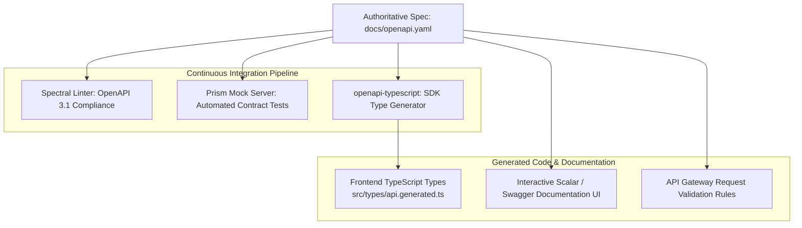

# Master Architecture: Taksha OpenAPI Specification & Universal Distributed Contracts

> **Canonical System Document**: This master document synthesizes and supersedes all prior API contract documents (`documents/openapi-specification.md`, `documents/complete-api-reference-openapi.md`, and `docs/openapi.yaml`). It establishes the single source of truth for API schemas, TypeScript client generation, contract testing, and cross-service interface definitions across Taksha.

---

## 1. Concept in Plain English

In a distributed microservice architecture, the single most common cause of production bugs is **API Contract Drift**:
- A backend engineer renames `user_id` to `userId`, but the frontend still expects `user_id`, causing `undefined` errors.
- The AI Orchestrator expects a sandbox endpoint to return `{ files: [] }`, but the sandbox returns `{ data: { files: [] } }`.
- Documentation written in wiki pages or markdown files goes stale within weeks as code evolves.

**OpenAPI 3.1.0** is the universal, vendor-neutral machine-readable contract (defined in `docs/openapi.yaml`) that solves this:
1. It defines every single endpoint, request payload, query parameter, header, and HTTP status response across all 5 Taksha microservices.
2. It generates compile-time **TypeScript SDK types** for the frontend, catching contract mismatches before code is committed.
3. It serves interactive API documentation (Scalar / Swagger UI) directly to developers and powers AI agent tool generation.

---

## 2. Why It Exists & The Scale Threshold

### Failure Modes of Uncontracted Distributed APIs

| Failure Mode | Ad-Hoc REST / Manual Docs | Taksha OpenAPI 3.1 Single Source of Truth |
| :--- | :--- | :--- |
| **Frontend/Backend Drift** | Mismatched property names discovered in production via user bug reports. | **Compile-Time Type Checking**: `openapi-typescript` generates TS interfaces. TypeScript compiler fails build if types don't match. |
| **Silent API Breakages** | Non-breaking changes accidentally break consumers; missing query params return 500s. | **Automated Schema Validation**: API Gateway and Express validate incoming payloads against YAML schemas. |
| **Manual SDK Maintenance** | Writing manual fetch/axios wrappers for each frontend app and microservice. | **Automated SDK Generation**: Type-safe API clients generated automatically via CLI scripts. |
| **Security Misconfiguration** | Undocumented endpoints bypass authentication or authorization checks. | **Centralized Security Schemes**: Security requirements (`BearerAuth`, `CookieAuth`) declared per endpoint in YAML. |

---

## 3. Core Mechanism & Contract Architecture

### 3.1 The Microservice API Topology (`docs/openapi.yaml`)

The platform's unified API surface maps across 5 distinct bounded contexts:

```
┌────────────────────────────────────────────────────────────────────────┐
│                   TAKSHA UNIFIED API GATEWAY SURFACE                   │
│                                                                        │
│   Service                Port     Base Path        Primary Role        │
│   ───────                ────     ─────────        ────────────        │
│   Auth Service           5000     /api/auth        OAuth, JWT, Session │
│   Ai_orchestration       5001     /api/ai          LangGraph, Streaming│
│   Payments Service       5002     /api/payments    Razorpay, Credits   │
│   Sandbox Service        3000     /api/sandbox     Containers, MCP     │
│   Notification Service   5003     /api/notify      Email, Queue Alerts │
└────────────────────────────────────────────────────────────────────────┘
```

### 3.2 Security Schemes Specification

Standardized across all routes in `components/securitySchemes`:

```yaml
components:
  securitySchemes:
    BearerAuth:
      type: http
      scheme: bearer
      bearerFormat: JWT
      description: Short-lived RS256 Access Token (15-min TTL) passed in Authorization header.
    CookieAuth:
      type: apiKey
      in: cookie
      name: refreshToken
      description: Long-lived opaque Refresh Token cookie scoped strictly to /api/auth/refresh.
```

### 3.3 Uniform Error Contract (`ErrorResponse`)

Every non-2xx status code maps to the shared FaultKit error component:

```yaml
components:
  schemas:
    ErrorResponse:
      type: object
      required:
        - success
        - error
      properties:
        success:
          type: boolean
          example: false
        error:
          type: object
          required:
            - code
            - message
            - requestId
          properties:
            code:
              type: string
              example: "VALIDATION_ERROR"
            message:
              type: string
              example: "The provided payload failed schema validation."
            details:
              type: object
              additionalProperties: true
            requestId:
              type: string
              example: "req_01HP8T6Z3X9Y4B2M1C"
```

---

## 4. Reference Architecture & CI/CD Toolchain



### Automated Code Generation Command
To regenerate TypeScript client interfaces from the master YAML spec:
```bash
npx openapi-typescript docs/openapi.yaml -o Frontend/src/types/api.generated.ts
```

---

## 5. Scalability Deep Dive

### 5.1 Gateway-Level Validation Offloading
- **Eliminating Application Overhead**: By compiling `docs/openapi.yaml` into AWS ALB Ingress or Envoy Gateway validation plugins, malformed payloads and invalid JSON schemas are rejected with HTTP 422 at the Kubernetes ingress boundary.
- **Resource Protection**: Invalid requests never reach Node.js application pods, saving CPU and event-loop capacity for valid AI agent execution.

### 5.2 Bottleneck Analysis Across Scale Tiers

```
Scale Tier 1 (10 Microservice Endpoints)
  ├─ Management: Single monolithic openapi.yaml file.
  └─ Tooling: Standard IDE OpenAPI extensions.

Scale Tier 2 (100 Microservice Endpoints across 5 Teams)
  ├─ Bottleneck: Git merge conflicts on a single 3,000-line openapi.yaml file.
  └─ Resolution: Split spec by service domain (auth.yaml, payments.yaml, ai.yaml) and bundle using Redocly CLI ($ref resolution).

Scale Tier 3 (1,000 Endpoints + Multi-Region Gateways)
  ├─ Bottleneck: Ingress memory bloat loading monolithic validation schemas.
  └─ Resolution: Compile OpenAPI schemas into binary WebAssembly (Wasm) filters running inside Envoy sidecars.
```

---

## 6. Trade-Offs Table: Contract Approaches

| Dimension | Manual Documentation (Markdown / Wiki) | Code-First Generation (tRPC / Swagger-JSDoc) | Spec-First OpenAPI 3.1 (Taksha) |
| :--- | :--- | :--- | :--- |
| **Accuracy Guarantee** | ❌ Stale within weeks | 🟡 Accurate only to backend implementation | 🟢 **Absolute Single Source of Truth** |
| **Language Agnostic** | 🟢 Universal | ❌ Locked to TypeScript / Node.js runtime | 🟢 **Polyglot (Python, Go, Node, Rust)** |
| **Client Type Safety** | ❌ None | 🟢 Strong (in TS-only ecosystems) | 🟢 **Strong (via openapi-typescript)** |
| **Mocking Capability** | ❌ Manual | 🟡 Requires running backend code | 🟢 **Zero-code Mocking via Prism CLI** |
| **API Gateway Ingestion** | ❌ Impossible | 🟡 Requires export pipeline | 🟢 **Native (Supported by Envoy, Kong, AWS)** |

---

## 7. Ties to Core CS Fundamentals

1. **Formal Grammars & Context-Free Grammars (CFGs)**: OpenAPI schemas define the exact formal language accepted by an HTTP interface. A request is valid if and only if it belongs to the language generated by the schema's grammar.
2. **Type Theory & Structural Subtyping**: TypeScript SDK generation maps OpenAPI JSON Schema types directly into TypeScript's structural type system, providing mathematical guarantees that the client cannot pass incompatible types to runtime endpoints.
3. **Interface Segregation Principle (ISP)**: By segmenting API schemas into distinct domain tags (`Auth`, `AI Agent`, `Payments`, `Sandbox`), clients depend only on the interfaces they actually invoke.

---

## 8. Connection to Taksha Project Infrastructure

- **Authoritative Spec File**: `docs/openapi.yaml` (113KB, defining all platform paths).
- **Frontend Type Consumer**: `Frontend/src/types/` and `payments_frontend/src/types/`.
- **Backend Error Standard**: `packages/faultkit` implements the exact `ErrorResponse` schema defined in `components/schemas/ErrorResponse`.
- **Validation Pipeline**: Express request validator middlewares referencing JSON schema components for runtime validation.

---

## 9. If Constraints Were Looser: Automated Contract Diff Breaking Checks in CI

If CI/CD resources were unconstrained:
- **Breaking Change Gate (Optic / Buf)**: Every pull request automatically diffs OpenAPI specs against the production deployment. If a field is removed or a type changed without a major SemVer bump, the CI pipeline blocks the PR automatically.
- **Bi-Directional Contract Testing (Pact)**: Consumer-driven contract tests continuously replay captured production requests against mock servers to verify that backend services never deviate from client expectations.

---

## 10. Common Pitfalls & Anti-Patterns

1. **Documenting APIs After Coding (Code-First Stale Docs)**: Writing documentation as an afterthought ensures it will miss edge cases and diverge from actual behavior. **Always design the spec first before writing endpoints**.
2. **Missing `nullable: true` or Optional Properties**: Forgetting to declare fields as optional causes frontend TypeScript builds to enforce nonexistent fields, leading to runtime null-pointer crashes.
3. **Allowing Free-Form Untyped Objects**: Using `type: object` without `properties` or `additionalProperties: false` defeats the purpose of schema validation, allowing arbitrary unvalidated JSON into internal services.

---

## 11. Production Readiness Checklist

- [x] Master specification updated at `docs/openapi.yaml` adhering to OpenAPI 3.1.0.
- [x] All 5 microservice endpoints cataloged with accurate HTTP status codes and responses.
- [x] Security schemes (`BearerAuth`, `CookieAuth`) accurately defined and applied.
- [x] Shared `ErrorResponse` schema matching the FaultKit specification.
- [x] TypeScript client generation script documented and operational.
- [x] Spectral linting passing with zero schema violation errors.
