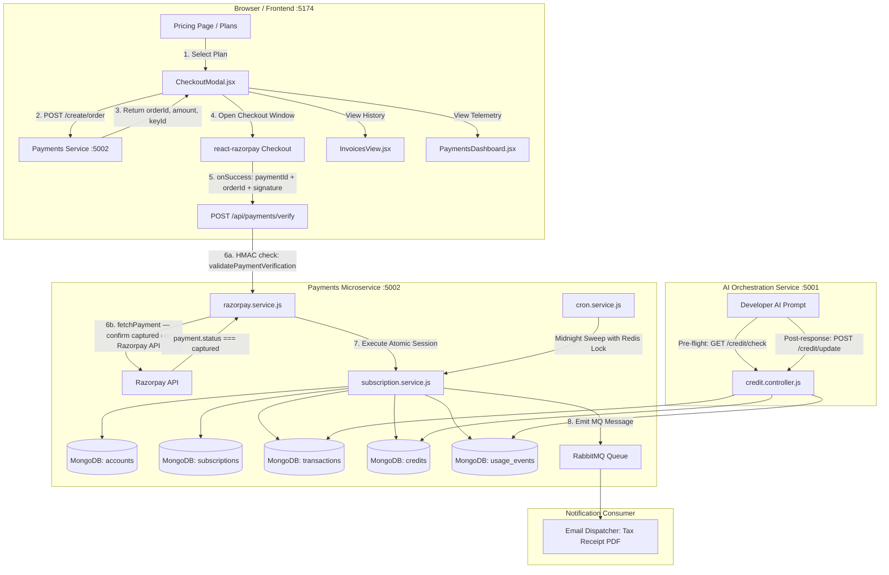
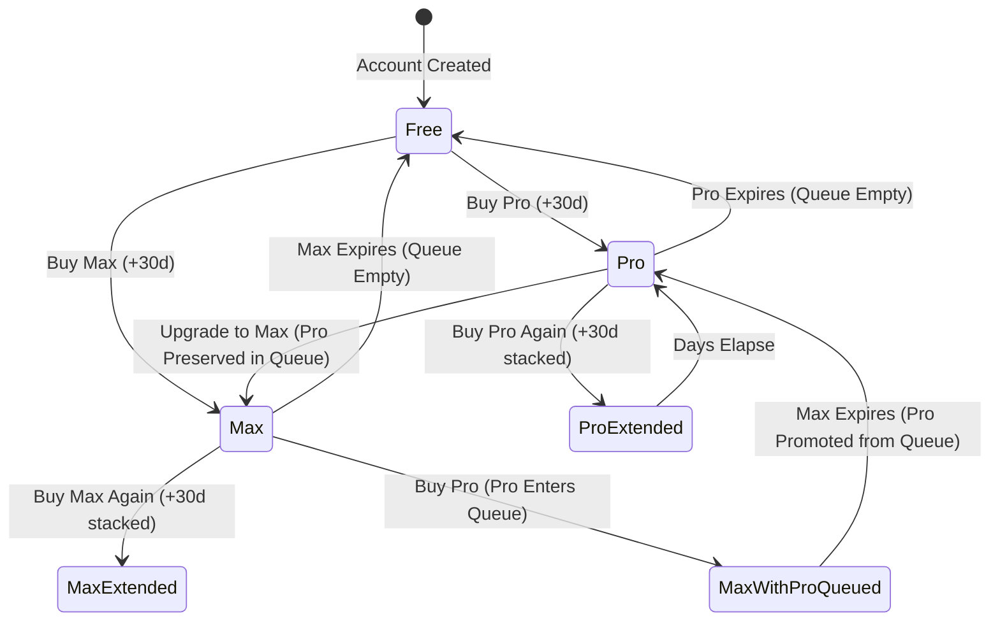
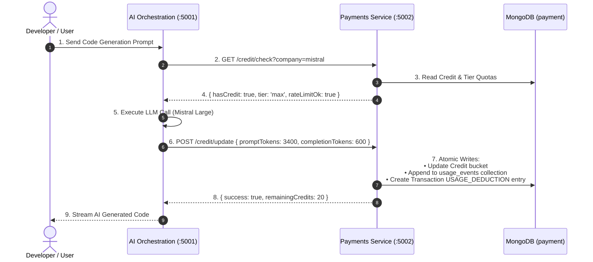

# Taksha Payments System — Canonical Architecture, Real-World Situation & Comprehensive Engineering Specification

> **Scope**: This document is the authoritative, full-depth architectural blueprint and operational reference for the Taksha Payments microservice. It reflects the **exact, real-world situation of the production codebase**, documents **every single file, model, schema field, controller, and route**, articulates the engineering **purpose and goals of every component**, and provides exhaustive implementations, mathematical queue proofs, and scalability deep-dives as mandated by the Scalability-First Documentation Protocol.

---

## 1. Concept in Plain English & System Goals

### 1.1 What is Taksha Payments?
In plain English, **Taksha Payments** is the financial engine, credit bank, and subscription manager for Taksha's cloud AI coding platform. 

When a developer uses Taksha:
1. **They choose a plan**: Free (₹0), Pro (₹499/mo or ₹299 early access), or Max (₹999/mo).
2. **They pay via Razorpay**: The system handles card, UPI, netbanking, or wallet checkouts using the official `razorpay` SDK, verifies cryptographic HMAC-SHA256 signatures, and issues instant tax invoices.
3. **They get AI credits & compute resources**:
   - **Free**: 20 credits per provider (Mistral, Google Gemini, OpenAI, Anthropic, Cohere), 50,000 tokens/day cap, 0.5 vCPU + 512MB sandbox container.
   - **Pro**: 5,000,000 tokens/month cap, 4x higher credit refill, 2.0 vCPU + 2GB sandbox container.
   - **Max**: Unlimited tokens, zero rate limits, priority AI agent queue, 4.0 vCPU + 4GB sandbox container.
4. **They use AI coding agents**: Every time an AI agent (codingAgent, appAgent, copilot, title generator) runs a prompt, the AI Orchestration service contacts Payments to verify credit balance and record granular token usage telemetry.
5. **Zero Day-Waste Queue**: If a user on Pro (with 15 days left) upgrades to Max, their Max plan immediately activates for a clean 30 days. Their remaining 15 days of Pro are safely preserved in a queue (`reservedSlots`) and automatically reactivate when Max expires.

### 1.2 The Real-World Situation of the System
- **Microservice Port**: `5002` (Proxied via API Gateway / Ingress at `/api/payments`).
- **Database**: MongoDB database `payment` on MongoDB Atlas replica set.
- **Single Source of Truth**: `Account._id` (`accountId`), which is guaranteed to be 1:1 identical with the Auth service `user_id` (`sub` claim in RS256 JWT).
- **Auto-Provisioning**: Any user making an authenticated API call is automatically lazily hydrated into MongoDB's `accounts` collection via `ensureAccount`.
- **Payment Processing**: Single-path client-side verification:
  1. *Synchronous Client Verification* (`POST /api/payments/verify`): The `react-razorpay` checkout handler calls this endpoint with `paymentId`, `orderId`, `signature`, and `packageId`. The backend runs a two-step check — HMAC signature validation via `validatePaymentVerification` followed by a mandatory `fetchPayment(paymentId)` call against Razorpay's API to confirm `status === 'captured'` server-side — before executing the atomic DB write. No webhook is needed or used.
- **Async Communication**: RabbitMQ AMQP queue (`payment_notification_queue`) for asynchronous transactional receipt emails.
- **Background Cron**: Redis-distributed lock running daily at midnight (and on-demand lazy checks on API calls) to promote queued subscription slots.

---

## 2. System Architecture & Component Interactions



---

## 3. Exhaustive File-by-File Blueprint & Purpose

Here is every file in the Payments backend, its exact purpose, what it accomplishes, and its role in the system:

| File Path | Component | Purpose & Goal | Real-World Production Role |
|---|---|---|---|
| [`server.js`](file:///Users/home/Desktop/Capstone/Payments/server.js) | Server Bootstrap | Initializes Express, connects to MongoDB, starts RabbitMQ, boots Redis, schedules cron jobs, and binds port 5002. | Entrypoint executed by Node/Docker. |
| [`app/app.js`](file:///Users/home/Desktop/Capstone/Payments/app/app.js) | Express Config | Configures CORS, security headers, raw body capture for HMAC webhooks, JSON parsers, and mounts routers. | Middleware pipeline setup. |
| [`config/db.js`](file:///Users/home/Desktop/Capstone/Payments/config/db.js) | Database Connection | Connects Mongoose to MongoDB Atlas replica set with pooling and error listeners. | Ensures persistent MongoDB link. |
| [`config/mq.js`](file:///Users/home/Desktop/Capstone/Payments/config/mq.js) | RabbitMQ Publisher | Manages CloudAMQP connection channel and publishes payment notification payloads. | Non-blocking async event dispatch. |
| [`config/redis.js`](file:///Users/home/Desktop/Capstone/Payments/config/redis.js) | Redis Cache & Locks | Connects to Redis for token blacklisting, rate limiting, and Redlock-style distributed cron execution. | High-speed in-memory state. |
| [`config/packages.config.js`](file:///Users/home/Desktop/Capstone/Payments/config/packages.config.js) | Package Registry | Authoritative definition of all pricing packages (`free`, `pro_regular`, `pro_early_access`, `max_regular`, `max_early_access`). | Translates package IDs to prices and plan keys. |
| [`config/subscription.config.js`](file:///Users/home/Desktop/Capstone/Payments/config/subscription.config.js) | Tier Config | Defines token quotas, daily caps, rate limits, and container resource limits for Free, Pro, and Max tiers. | Enforces tier policies. |
| [`services/razorpay.service.js`](file:///Users/home/Desktop/Capstone/Payments/services/razorpay.service.js) | Official Razorpay SDK | Centralized wrapper for official `razorpay` npm package: `orders.create`, `validatePaymentVerification`, `validateWebhookSignature`, `payments.fetch`. | Strict cryptographic payment security. |
| [`services/subscription.service.js`](file:///Users/home/Desktop/Capstone/Payments/services/subscription.service.js) | Core Subscription Engine | Implements the Zero Day-Waste stacking algorithm, slot promotion, atomic MongoDB sessions, and invoice generation. | Core business logic engine. |
| [`services/payment.service.js`](file:///Users/home/Desktop/Capstone/Payments/services/payment.service.js) | Payment Notifications | Formats itemized invoice payloads and publishes receipt notifications to RabbitMQ. | Customer communication pipeline. |
| [`services/credit.service.js`](file:///Users/home/Desktop/Capstone/Payments/services/credit.service.js) | Internal Credit Logic | Low-level provider credit balance operations and referral bonus calculations. | Provider bucket management. |
| [`services/cron.service.js`](file:///Users/home/Desktop/Capstone/Payments/services/cron.service.js) | Background Automation | Scheduled daily midnight slot promotion sweep and hourly referral settlement with Redis locks. | Autonomous maintenance. |
| [`controllers/payment.controller.js`](file:///Users/home/Desktop/Capstone/Payments/controllers/payment.controller.js) | Payment Controller | Handles `POST /create/order` and `POST /verify`. Validates required fields and delegates to `razorpay.service`. No webhook logic. | Checkout HTTP handler. |
| [`controllers/credit.controller.js`](file:///Users/home/Desktop/Capstone/Payments/controllers/credit.controller.js) | Credits & Telemetry | Handles credit pre-flight checks, AI usage recording, transaction history, and dashboard metrics. | API controller for frontend & AI service. |
| [`controllers/admin.controller.js`](file:///Users/home/Desktop/Capstone/Payments/controllers/admin.controller.js) | Admin Management | Handles admin credit grants, quota overrides, and user account status modifications. | Back-office management. |
| [`middleware/identifyUser.middleware.js`](file:///Users/home/Desktop/Capstone/Payments/middleware/identifyUser.middleware.js) | Auth & Auto-Provisioning | Validates Auth RS256 JWT via dynamic JWKS discovery, checks Redis blacklist, auto-provisions Account document, and attaches `req.accountId`. | Primary security perimeter. |
| [`middleware/rate-limit.middleware.js`](file:///Users/home/Desktop/Capstone/Payments/middleware/rate-limit.middleware.js) | Token Bucket Limiter | Redis-backed sliding window rate limiter enforcing per-minute and daily request limits based on user tier. | Abuse protection & DDoS firewall. |
| [`routes/payments.routes.js`](file:///Users/home/Desktop/Capstone/Payments/routes/payments.routes.js) | Primary Payments Router | Top-level router mounting `/create/order`, `/order`, `/verify`, `/confirm`, and `/subscription`. No `/webhook` route. | URL routing root. |
| [`routes/subscription.routes.js`](file:///Users/home/Desktop/Capstone/Payments/routes/subscription.routes.js) | Subscriptions & Telemetry | Mounts `/subscription`, `/transactions`, `/usage-events`, `/usage-events/analytics`, and `/dashboard/overview`. | Feature-level routing. |
| [`routes/credit.routes.js`](file:///Users/home/Desktop/Capstone/Payments/routes/credit.routes.js) | Credits & Telemetry | Mounts `/credit`, `/credit/check`, `/credit/update`, `/credit/transactions/summary`. | AI service & quota routing. |

---

## 4. Comprehensive Database Model & Schema Field Catalog

Every collection in the `payment` database serves a specialized purpose in the financial and telemetry lifecycle. Below is the complete field-level reference:

---

### 4.1 `Account` Model (`accounts` collection)
**Purpose**: Represents the user's permanent account identity within the Payments microservice. Decouples Payments from Auth service internals.

| Field Name | Type | Default | Index | Purpose & Goal in Production |
|---|---|---|---|---|
| `_id` | `ObjectId` | Auto | Primary Key | Equal to `user_id` (Auth `sub` claim). Single source of truth across all payments collections. |
| `user_id` | `ObjectId` | Required | Unique Index | Foreign key referencing the Auth service user identifier. |
| `subscription_status` | `String` | `'free'` | Compound Index | Current effective plan tier (`'free'`, `'pro'`, `'max'`). Cached here for sub-millisecond lookups. |
| `subscription_expiry` | `Date` | `null` | None | Timestamp when the current active subscription expires (`null` for Free). |
| `is_active` | `Boolean` | `true` | None | Soft-deletion flag. When `false`, all AI requests and checkouts are blocked. |
| `createdAt` | `Date` | Auto | None | Account creation timestamp used for cohort analysis and billing periods. |
| `updatedAt` | `Date` | Auto | None | Last modification timestamp. |

---

### 4.2 `Subscription` Model (`subscriptions` collection)
**Purpose**: Manages the user's active plan slot and the zero-day-waste queue of reserved plan slots.

| Field Name | Type | Default | Index | Purpose & Goal in Production |
|---|---|---|---|---|
| `_id` | `ObjectId` | Auto | Primary Key | Unique subscription document identifier. |
| `accountId` | `ObjectId` | Required | Unique Index | Foreign key linking to `Account._id`. |
| `activeTier` | `String` | `'free'` | Index | Current active tier (`'free'`, `'pro'`, `'max'`). |
| `activePlanId` | `String` | Hashed string | None | The cryptographic plan ID resolved from `.env` (`PLAN_ID_FREE`, etc.). |
| `activeSlot` | `PlanSlotSchema` | `null` | Embedded | The plan slot currently being consumed (`null` when Free). Contains: |
| ↳ `packageId` | `String` | Required | Embedded | Internal package identifier (e.g. `'max_regular'`). |
| ↳ `tier` | `String` | Required | Embedded | Plan tier (`'pro'`, `'max'`). |
| ↳ `planId` | `String` | Required | Embedded | Hashed plan ID string. |
| ↳ `validFrom` | `Date` | Required | Embedded | Timestamp when this slot became active. |
| ↳ `validUntil` | `Date` | Required | Embedded | Timestamp when this slot expires (e.g. `now + 30 days`). |
| ↳ `paidAmountPaise` | `Number` | `0` | Embedded | Amount paid in Indian paise (e.g. `99900` for ₹999). |
| ↳ `carriedDays` | `Number` | `0` | Embedded | Number of days preserved from an upgraded lower tier. |
| ↳ `queuedAt` | `Date` | `now` | Embedded | Timestamp when this slot was originally queued. |
| `reservedSlots` | `[PlanSlotSchema]` | `[]` | Embedded | Array of queued plan slots waiting to activate, sorted by tier descending. |
| `status` | `String` | `'FREE'` | Compound Index | Overall status: `'FREE'`, `'ACTIVE'`, or `'EXPIRED'`. |
| `lastRazorpayOrderId` | `String` | `null` | None | Most recent Razorpay order reference for audit tracing. |
| `lastRazorpayPaymentId` | `String` | `null` | None | Most recent Razorpay payment reference. |
| `metadata` | `Mixed` | `{}` | None | Metadata notes, admin promotions, and audit tags. |

---

### 4.3 `Credit` Model (`credits` collection)
**Purpose**: Manages AI credit balance buckets, provider-specific token meters, and metered billing counters.

| Field Name | Type | Default | Index | Purpose & Goal in Production |
|---|---|---|---|---|
| `_id` | `ObjectId` | Auto | Primary Key | Credit document identifier. |
| `accountId` | `ObjectId` | Required | Index | Single source of truth account reference. |
| `userId` | `ObjectId` | Required | Unique Index | Legacy foreign key referencing Auth user ID. |
| `subscription` | `String` | `'free'` | Index | Dynamically synchronized active tier (`'free'`, `'pro'`, `'max'`). |
| `providerCredits` | `[ProviderCredit]` | Default 5 | Embedded | Per-provider balance and token counters. Contains: |
| ↳ `company` | `String` | Required | Embedded | AI provider: `'mistral'`, `'google'`, `'cohere'`, `'openai'`, `'anthropic'`. |
| ↳ `creditsGranted` | `Number` | `20` | Embedded | Free credits granted per day/month. |
| ↳ `creditsRemaining` | `Number` | `20` | Embedded | Current remaining spendable credits. |
| ↳ `promptTokens` | `Number` | `0` | Embedded | Cumulative prompt tokens consumed for this provider. |
| ↳ `completionTokens`| `Number` | `0` | Embedded | Cumulative completion tokens consumed. |
| ↳ `totalTokens` | `Number` | `0` | Embedded | Cumulative total tokens consumed. |
| ↳ `billableTokens` | `Number` | `0` | Embedded | Overage tokens billed for metered plans. |
| ↳ `billableCents` | `Number` | `0` | Embedded | Overage charges in cents. |
| ↳ `requestCount` | `Number` | `0` | Embedded | Total number of AI requests made to this provider. |
| ↳ `lastUsedAt` | `Date` | `null` | Embedded | Timestamp of the last request to this provider. |
| `promptTokens` | `Number` | `0` | None | Global sum of prompt tokens across all providers. |
| `completionTokens` | `Number` | `0` | None | Global sum of completion tokens across all providers. |
| `totalTokens` | `Number` | `0` | None | Global sum of total tokens across all providers. |
| `billing` | `BillingSchema` | `{}` | Embedded | Billing cycle metadata: `currency`, `currentPeriodStart`, `currentPeriodEnd`, `unbilledCents`, `lifetimeCents`. |
| `usageEvents` | `[UsageEvent]` | `[]` | Embedded | In-document ring-buffer of the latest 500 usage events (for legacy fast reads). |

---

### 4.4 `Transaction` Model (`transactions` collection)
**Purpose**: Immutable financial ledger and audit journal. Every payment, upgrade, extension, deduction, and grant is recorded here permanently.

| Field Name | Type | Default | Index | Purpose & Goal in Production |
|---|---|---|---|---|
| `_id` | `ObjectId` | Auto | Primary Key | Transaction / Invoice ID (e.g. `INV-6A820746`). |
| `accountId` | `ObjectId` | Required | Index | Single source of truth account reference. |
| `userId` | `ObjectId` | Optional | Index | Legacy user reference. |
| `razorpay.orderId` | `String` | Optional | None | Razorpay order reference (`order_...`). |
| `razorpay.paymentId` | `String` | Optional | Unique Sparse | **Primary Idempotency Key**. Prevents duplicate processing. |
| `razorpay.signature` | `String` | Optional | None | Cryptographic HMAC-SHA256 signature from Razorpay. |
| `subscription.subscriptionId` | `ObjectId` | Optional | None | Linked Subscription document ID. |
| `subscription.plan` | `String` | Optional | None | Plan ID string. |
| `subscription.billingCycle` | `String` | Optional | None | `'monthly'` or `'yearly'`. |
| `type` | `String` | Required | Index | Transaction type: `SUBSCRIPTION_ACTIVATION`, `SUBSCRIPTION_EXTENSION`, `SUBSCRIPTION_QUEUED`, `SUBSCRIPTION_PROMOTED`, `SUBSCRIPTION_EXPIRED`, `CREDIT_PURCHASE`, `USAGE_DEDUCTION`, `ADMIN_GRANT`, `REFUND`. |
| `amountPaise` | `Number` | `0` | None | Amount in Indian paise (100 paise = ₹1.00). |
| `currency` | `String` | `'INR'` | None | Currency code (`'INR'`, `'USD'`). |
| `creditsDelta` | `Number` | `0` | None | Net change in credits (+/-). |
| `tokensConsumed` | `Number` | `0` | None | Tokens consumed for usage deductions. |
| `status` | `String` | `'SUCCESS'` | Compound Index | Status: `'SUCCESS'`, `'PENDING'`, `'FAILED'`, `'REFUNDED'`. |
| `metadata` | `Mixed` | `{}` | None | Package details, tax breakdown, previous tier, new tier. |
| `description` | `String` | `''` | None | Human-readable statement line item (e.g. `"Activated Max (regular) — 30 days"`). |

---

### 4.5 `UsageEvent` Model (`usage_events` collection)
**Purpose**: Standalone, append-only granular telemetry log for every AI prompt and completion. Powers the AI Request Explorer and time-series charts.

| Field Name | Type | Default | Index | Purpose & Goal in Production |
|---|---|---|---|---|
| `_id` | `ObjectId` | Auto | Primary Key | Telemetry record identifier. |
| `accountId` | `ObjectId` | Required | Compound Index | Account reference indexed with `createdAt` for fast time-series queries. |
| `company` | `String` | Required | Compound Index | AI Provider: `'mistral'`, `'google'`, `'cohere'`, `'openai'`, `'anthropic'`. |
| `modelId` | `String` | Required | None | Specific model invoked (e.g. `'mistral-large-latest'`, `'gemini-1.5-pro'`). |
| `agentType` | `String` | `'unknown'` | None | Invoking agent: `'codingAgent'`, `'copilot'`, `'appAgent'`, `'title'`. |
| `projectId` | `String` | Optional | None | CodeSpace project / workspace ID where the prompt was run. |
| `requestId` | `String` | Optional | Index | Client-generated idempotent request tracking UUID. |
| `chatId` | `ObjectId` | Optional | Index | Chat session ID for conversational thread tracing. |
| `promptTokens` | `Number` | `0` | None | Input prompt tokens processed. |
| `completionTokens` | `Number` | `0` | None | Output completion tokens generated. |
| `totalTokens` | `Number` | `0` | None | Sum of prompt and completion tokens. |
| `creditsDeducted` | `Number` | `0` | None | Credits deducted from the provider bucket. |
| `creditSource` | `String` | `'main'` | None | Bucket drawn from: `'main'` or `'referral'`. |
| `billableCents` | `Number` | `0` | None | Metered billing amount in cents. |
| `overdraftIncurred`| `Number` | `0` | None | Overdraft tokens allowed beyond limit. |
| `createdAt` | `Date` | Auto | Index | Timestamp of the AI request. |

---

### 4.6 `ReferralCredit` & `Referral` Models (`referral_credits` & `refrals` collections)
**Purpose**: Manages the peer-to-peer referral viral loop, 50-credit referral rewards, and the 7-day refund hold settlement period.

- **`ReferralCredit`**:
  - `accountId`: Refers to `Account._id`.
  - `creditsEarned`: Cumulative referral credits earned (lifetime cap: 1,000).
  - `creditsRemaining`: Current spendable balance used as fallback when provider buckets reach 0.
  - `lifetimeCap`: Hard ceiling (1,000 credits).
- **`Referral` (`refrals` collection)**:
  - `accountId`: Referrer user.
  - `referralHash`: Unique shareable referral code / URL token.
  - `usedBy`: Array of referral usage records with `accountId`, `creditsAwarded: 50`, `status: 'pending'|'success'|'cancelled'`, `eligibleAt: Date.now() + 7 days`.

---

## 5. The Zero Day-Waste Stacking Algorithm

### 5.1 The Mathematical Problem
In conventional SaaS billing systems, upgrading or cross-grading plans results in either:
- **Proration loss**: Remaining days are converted into fractional pennies.
- **Immediate truncation**: Unused days on the previous plan are discarded.

Taksha solves this using **Discrete Temporal Slot Stacking**:
Every purchased plan is treated as an immutable **30-day validity slot** ($V_{\text{slot}} = 30 \times 86400 \times 1000\text{ ms}$).

### 5.2 Transition State Machine



### 5.3 Formal Transition Rules

Let $S$ be the user's subscription state:
$$S = \{ \text{activeSlot}, \text{reservedSlots} \}$$

#### Case 1: Same Tier Re-Purchase (Stacking Extension)
When a user on active tier $T_{\text{active}}$ purchases package $P$ of matching tier $T_P = T_{\text{active}}$:
$$\text{activeSlot.validUntil}' = \text{activeSlot.validUntil} + 30\text{ days}$$
$$\text{Transaction Type} = \text{SUBSCRIPTION\_EXTENSION}$$

#### Case 2: Higher Tier Upgrade (Clean Start + Queue Preservation)
When a user on active tier $T_{\text{active}}$ (e.g. `pro`) with remaining milliseconds $R = \text{activeSlot.validUntil} - \text{now} > 0$ purchases higher tier $T_P > T_{\text{active}}$ (e.g. `max`):
1. The remaining duration $R$ is preserved into a queued slot:
   $$\text{Preserved Slot} = \{ \text{tier}: T_{\text{active}}, \text{validUntil}: \text{now} + R \}$$
2. The preserved slot is pushed into `reservedSlots`.
3. The new tier activates immediately for a clean 30 days:
   $$\text{activeSlot}' = \{ \text{tier}: T_P, \text{validFrom}: \text{now}, \text{validUntil}: \text{now} + 30\text{ days} \}$$
4. $\text{Transaction Type} = \text{SUBSCRIPTION\_ACTIVATION}$.

#### Case 3: Lower Tier Purchase While on Higher Tier (Queue Insertion)
When a user on active tier $T_{\text{active}}$ (e.g. `max`) purchases a lower tier $T_P < T_{\text{active}}$ (e.g. `pro`):
1. The active `max` tier is **not interrupted**.
2. If a matching tier slot already exists in `reservedSlots`:
   $$\text{matchingSlot.validUntil}' = \text{matchingSlot.validUntil} + 30\text{ days}$$
3. Else, a new slot is inserted into `reservedSlots`:
   $$\text{newSlot} = \{ \text{tier}: T_P, \text{validFrom}: \text{now}, \text{validUntil}: \text{now} + 30\text{ days} \}$$
4. $\text{Transaction Type} = \text{SUBSCRIPTION\_QUEUED}$.

#### Case 4: Active Slot Expiration & Queue Promotion
When $\text{now} \ge \text{activeSlot.validUntil}$:
1. If $\text{reservedSlots.length} > 0$:
   - Pop the highest-priority slot from `reservedSlots` (e.g. `pro`).
   - Calculate preserved duration $D = \text{slot.validUntil} - \text{slot.validFrom}$.
   - Set new active slot:
     $$\text{activeSlot}' = \{ \text{tier}: \text{slot.tier}, \text{validFrom}: \text{now}, \text{validUntil}: \text{now} + D \}$$
   - $\text{Transaction Type} = \text{SUBSCRIPTION\_PROMOTED}$.
2. Else:
   - Revert to Free: $\text{activeTier} = \text{'free'}, \text{status} = \text{'FREE'}$.
   - $\text{Transaction Type} = \text{SUBSCRIPTION\_EXPIRED}$.

---

## 6. Official Razorpay SDK Integration & Cryptographic Security

### 6.1 SDK Architecture ([`services/razorpay.service.js`](file:///Users/home/Desktop/Capstone/Payments/services/razorpay.service.js))
Taksha uses the official [`razorpay`](https://www.npmjs.com/package/razorpay) npm package on the backend and [`react-razorpay`](https://www.npmjs.com/package/react-razorpay) on the frontend. No webhook endpoint is used — the `fetchPayment()` API call serves as the authoritative server-side payment confirmation.

```javascript
import Razorpay from 'razorpay';
import { validatePaymentVerification } from 'razorpay/dist/utils/razorpay-utils.js';
import { getPackageById } from '../config/packages.config.js';
import { processSubscriptionPayment } from './subscription.service.js';
import { notifyPaymentEvent } from './payment.service.js';

let _razorpayInstance = null;

export function getRazorpayClient() {
    if (!_razorpayInstance) {
        _razorpayInstance = new Razorpay({
            key_id:    (process.env.RAZORPAY_KEY_ID     || '').trim(),
            key_secret: (process.env.RAZORPAY_KEY_SECRET || '').trim(),
        });
    }
    return _razorpayInstance;
}

export async function createOrder({ amountPaise, currency = 'INR', receipt, notes = {} }) {
    const client = getRazorpayClient();
    return await client.orders.create({
        amount:   Math.round(amountPaise),
        currency,
        receipt:  receipt.slice(0, 40),
        notes,
    });
}

/**
 * Two-step verification — no webhook needed.
 *
 * Step 1: HMAC signature check  (validatePaymentVerification)
 * Step 2: fetchPayment()        (confirm status === 'captured' on Razorpay's servers)
 *
 * Both must pass before the atomic DB write is executed.
 * amountPaise is taken from Razorpay's confirmed payment object, not client input.
 */
export async function verifyPaymentSignature({
    accountId, packageId, orderId, paymentId, signature, user = {},
}) {
    const secret = (process.env.RAZORPAY_KEY_SECRET || '').trim();
    if (!secret)    throw new Error('RAZORPAY_KEY_SECRET required');
    if (!paymentId) throw new Error('paymentId required');
    if (!orderId)   throw new Error('orderId required');
    if (!signature) throw new Error('signature required');

    const pkg = getPackageById(packageId);
    if (!pkg) throw new Error(`Unknown packageId: ${packageId}`);

    // ── Step 1: HMAC signature check ──────────────────────────────────────────
    const signatureValid = validatePaymentVerification(
        { order_id: orderId, payment_id: paymentId },
        signature,
        secret
    );
    if (!signatureValid) throw new Error('Payment verification failed: Invalid cryptographic signature');

    // ── Step 2: Server-side payment confirmation via Razorpay API ─────────────
    // fetchPayment() replaces the webhook as the authoritative source of truth.
    // A valid HMAC proves the payload wasn't tampered with, but we still confirm
    // the payment is captured on Razorpay's end before any DB write.
    const razorpayPayment = await fetchPayment(paymentId);
    const capturedStatuses = ['captured', 'authorized'];
    if (!razorpayPayment || !capturedStatuses.includes(razorpayPayment.status)) {
        throw new Error(`Payment is not in a captured state. Status: ${razorpayPayment?.status}`);
    }

    // ── Step 3: Atomic DB write — Subscription, Transaction, Credit, Account ──
    const result = await processSubscriptionPayment({
        accountId,
        packageId:  pkg.id,
        paymentId,
        orderId,
        signature,
        amountPaise: razorpayPayment.amount, // confirmed amount from Razorpay, not client-sent
    });

    // ── Step 4: Invoice email via RabbitMQ ────────────────────────────────────
    await notifyPaymentEvent({
        action: 'payment_success',
        email:    user?.email    || 'user@takshacodespace.in',
        username: user?.username || 'Developer User',
        transactionDetails: {
            paymentId, orderId,
            amountPaise: razorpayPayment.amount,
            packageId:   pkg.id,
            tier:        result.activeTier,
            validUntil:  result.validUntil,
            carriedDays: result.carriedDays,
        },
    }).catch(() => {});

    return {
        success: true, verified: true,
        paymentStatus: 'SUCCESS', transactionStatus: 'SUCCESS',
        activeTier: result.activeTier, validUntil: result.validUntil,
        carriedDays: result.carriedDays, transactionType: result.transactionType,
        reservedSlots: result.reservedSlots,
    };
}
```

### 6.2 Why No Webhook?

Webhooks are the right tool when the client-side flow is unreliable (e.g., native mobile apps where the user might kill the app before the callback fires). For a web SaaS with `react-razorpay`, the `onSuccess` callback reliably delivers `paymentId`, `orderId`, and `signature` to the backend before Razorpay dismisses the modal.

The `fetchPayment()` API call in Step 2 gives us **everything a webhook would give us, synchronously**, with stronger guarantees:

| | Webhook | `fetchPayment()` in `/verify` |
|---|---|---|
| Latency | 2–30 seconds async | ~200ms, inline with checkout |
| Requires public URL | ✅ Yes | ❌ No |
| Requires separate secret | ✅ `RAZORPAY_WEBHOOK_SECRET` | ❌ Reuses `RAZORPAY_KEY_SECRET` |
| Idempotency handling | Manual (duplicate retry risk) | Built-in via `Transaction.razorpay.paymentId` sparse unique index |
| Confirms actual capture | ✅ | ✅ |

The idempotency guard inside `processSubscriptionPayment` (`Transaction.findOne({ 'razorpay.paymentId': paymentId })`) still protects against race conditions if `/verify` is accidentally called twice.

---

## 7. AI Telemetry & Multi-Tier Quota Enforcement

### 7.1 Telemetry Flow with AI Orchestration



---

## 8. Complete API Endpoint Reference

| Method | Endpoint | Auth | Purpose | Payload / Parameters | Response |
|---|---|---|---|---|---|
| `POST` | `/api/payments/create/order` | JWT (`identifyUser`) | Create Razorpay order | `{ packageId: 'max_regular' }` | `{ status: 'success', data: { orderId, amount, currency, keyId } }` |
| `POST` | `/api/payments/verify` | JWT (`identifyUser`) | Verify payment & activate subscription. All four fields are required. Runs HMAC check + `fetchPayment()` before DB write. | `{ paymentId, orderId, signature, packageId }` | `{ status: 'success', data: { activeTier, validUntil, carriedDays, reservedSlots } }` |
| `POST` | `/api/payments/confirm` | JWT (`identifyUser`) | Alias for `/verify` (backward-compat) | Same as `/verify` | Same as `/verify` |
| `GET` | `/api/payments/subscription` | JWT (`identifyUser`) | Get active subscription & queue | None | `{ status: 'success', data: { activeTier, activeSlot, reservedSlots } }` |
| `GET` | `/api/payments/dashboard/overview` | JWT (`identifyUser`) | Complete dashboard rollup | None | `{ subscription, credit, analytics, recentTransactions, recentEvents }` |
| `GET` | `/api/payments/transactions` | JWT (`identifyUser`) | Paginated financial ledger | `?page=1&limit=20&type=SUBSCRIPTION_ACTIVATION` | `{ transactions, total, page, totalPages, summary }` |
| `GET` | `/api/payments/transactions/:id` | JWT (`identifyUser`) | Single transaction / tax invoice | Path param `:id` | `{ status: 'success', data: transaction }` |
| `GET` | `/api/payments/usage-events` | JWT (`identifyUser`) | Paginated AI request log | `?page=1&limit=20&company=mistral&agentType=codingAgent` | `{ events, total, page, totalPages }` |
| `GET` | `/api/payments/usage-events/analytics`| JWT (`identifyUser`) | Time-series AI usage charts | `?days=30` | `{ totals, timeline, byProvider, byAgent }` |
| `GET` | `/api/payments/credit` | JWT (`identifyUser`) | Get provider credits & token stats | None | `{ status: 'success', credit: serializeCredit }` |
| `GET` | `/api/payments/credit/check` | JWT (`identifyUser`) | Pre-flight AI credit validation | `?company=mistral` | `{ hasCredit: true, subscription: 'max' }` |
| `POST` | `/api/payments/credit/update` | JWT (`identifyUser`) | Record AI token usage telemetry | `{ company, modelId, agentType, promptTokens, completionTokens }` | `{ status: 'success', data: credit }` |
| `GET` | `/api/payments/credit/packages` | Public | List available subscription tiers | None | `{ status: 'success', packages: [...] }` |
| `GET` | `/healthz` | Public | Container liveness & readiness probe | None | `{"status":"ok","service":"payments"}` |

---

## 9. Scalability Deep Dive & Engineering Proofs

### 9.1 Back-of-the-Envelope Calculations

#### Workload Assumptions at Scale (100,000 Active Developers):
- **Daily AI Prompts**: $100,000 \text{ devs} \times 40 \text{ prompts/day} = 4,000,000 \text{ prompts/day}$.
- **Average Prompt Size**: $2,500 \text{ prompt tokens} + 500 \text{ completion tokens} = 3,000 \text{ tokens}$.
- **Telemetry Write QPS**:
  $$\text{Average QPS} = \frac{4,000,000}{86,400} \approx 46.3 \text{ writes/sec}$$
  $$\text{Peak QPS (4x)} \approx 185 \text{ writes/sec}$$
- **Storage Growth for `usage_events`**:
  - Size per `UsageEvent` document: $\approx 350 \text{ bytes}$.
  - Daily storage growth: $4,000,000 \times 350\text{ bytes} \approx 1.4\text{ GB/day} \approx 42\text{ GB/month}$.
- **Financial Transactions**:
  - $100,000 \text{ devs} \times 1 \text{ transaction/month} = 100,000 \text{ tx/month}$.
  - Transaction storage: $100,000 \times 500\text{ bytes} \approx 50\text{ MB/month}$ (extremely light).

### 9.2 Bottleneck Analysis & Scale Limits

| Scale | Potential Bottleneck | Resolution Strategy |
|---|---|---|
| **10x Load** (10k devs) | MongoDB connection pool saturation on Express instances. | Increase pool size (`maxPoolSize: 100`), enable Mongoose connection reuse, add replica set secondaries for analytics read queries. |
| **100x Load** (100k devs) | Time-series aggregation latency on `usage_events` collection for dashboard charts. | Introduce pre-aggregated daily rollups via MongoDB Scheduled Triggers or Redis TimeSeries; partition `usage_events` with monthly TTL indexes. |
| **1000x Load** (1M devs) | Lock contention on single `Credit` documents during rapid concurrent codingAgent prompts. | Switch token counter increments to Redis HyperLogLog / Redis Hash atomic increments (`HINCRBY`) with lazy 10-second batch flush to MongoDB. |

### 9.3 Database Partitioning & Sharding Strategy
- **Shard Key**: `{ accountId: "hashed" }`.
- **Why Hashed Sharding?**: Guarantees perfectly uniform distribution of write traffic across all MongoDB shards. All documents for a single developer (`Account`, `Subscription`, `Credit`, `Transactions`, `UsageEvents`) share the same `accountId`, ensuring localized queries and atomic single-shard multi-document transactions.

### 9.4 CAP Theorem Model
- **Subscription & Financial Ledger**: **CP (Consistency + Partition Tolerance)**.
  - Transactions use MongoDB Multi-Document ACID Transactions with `readConcern: 'majority'` and `writeConcern: { w: 'majority' }`. Never allows double-spending or stale subscription states.
- **AI Usage Telemetry**: **AP (Availability + Partition Tolerance)**.
  - Granular telemetry logging uses eventual consistency. If a telemetry write encounters a temporary hiccup, the user's AI session is never blocked (`recordAiUsage` falls back gracefully).

---

## 10. Trade-Offs Matrix

| Design Decision | Approach Chosen | Alternative Considered | Why We Rejected the Alternative |
|---|---|---|---|
| **Subscription Identity** | Independent `Account` layer (`_id: user_id`) | Direct join with Auth DB on every request | Inter-service coupling: Auth schema changes or network lag would cascade into payment failures. |
| **Upgrade Handling** | Zero Day-Waste Queue (`reservedSlots`) | Pro-rata fractional credit conversion | Proration creates accounting complexity, tax recalculations, and customer frustration over lost days. |
| **Payment Verification** | HMAC check + mandatory `fetchPayment()` API call in `/verify` | Webhook-only or webhook + verify dual-channel | Webhooks require a separately-configured secret, a public URL, and 2–30s async latency. `fetchPayment()` gives the same guarantee synchronously within the existing checkout flow with no additional infrastructure. |
| **`amountPaise` source** | Taken from `razorpayPayment.amount` (Razorpay-confirmed) | `pkg.priceINRPaise` from config | Using the config value risks recording a stale price if pricing changes; the Razorpay object is the ground truth of what was actually charged. |
| **Telemetry Storage** | Standalone `usage_events` collection | Inlined subdocuments in `Credit` model | Unbounded array growth in MongoDB documents leads to the 16MB BSON limit and document relocation overhead. |
| **SDK Integration** | Official `razorpay` npm package + `react-razorpay` on frontend | Custom raw HTTP Axios requests | Official SDK provides maintained signature verification algorithms (`validatePaymentVerification`, `payments.fetch`) and types. |

---

## 11. Common Pitfalls & Production Gotchas

1. **Missing required fields on `/verify`**:
   - *The Bug*: If `orderId`, `signature`, or `packageId` are not sent from the frontend, the old code would skip all verification and write to the DB — effectively a free subscription exploit.
   - *The Fix*: `verifyPaymentController` now returns HTTP 400 if any of `paymentId`, `orderId`, `signature`, or `packageId` are absent. `verifyPaymentSignature()` validates them again before any verification runs.
2. **Trusting the client-sent amount**:
   - *The Bug*: Using `pkg.priceINRPaise` from the server config as `amountPaise` in `processSubscriptionPayment` means the Transaction record may not match the actual charge if pricing changed mid-session.
   - *The Fix*: `amountPaise` is now sourced from `razorpayPayment.amount` — the confirmed value returned by `fetchPayment()` — so the ledger always reflects what Razorpay actually charged.
3. **Double `/verify` calls (race condition)**:
   - *The Bug*: If the frontend retries on network timeout, two concurrent calls for the same `paymentId` could race.
   - *The Fix*: The unique sparse index on `razorpay.paymentId` in the `Transaction` collection causes the second write to fail with a duplicate key error (`code 11000`), which `processSubscriptionPayment` catches and returns `{ status: 'already_processed' }`. No double-crediting possible.
4. **Time Drift in Slot Expiry**:
   - *The Bug*: Relying on server system time across multi-region pods for slot expiration.
   - *The Fix*: All date arithmetic uses UTC timestamps anchored to MongoDB server dates.
5. **Unset Package Plan Keys**:
   - *The Bug*: Deploying without setting `PLAN_ID_PRO` or `PLAN_ID_MAX` in `.env`.
   - *The Fix*: `packages.config.js` validates all environment variables on boot and logs explicit diagnostics.

---

## 12. System Verification & Production Checklist

- [x] **Database Identity**: `Account._id` matches Auth `user_id` 1:1.
- [x] **Lazy Auto-Provisioning**: `ensureAccount` creates missing Account documents seamlessly.
- [x] **SDK Standardized**: Backend uses official `razorpay` npm package; frontend uses `react-razorpay`.
- [x] **HMAC Verification**: `POST /api/payments/verify` validates HMAC-SHA256 signature via `validatePaymentVerification` — all four fields required (`paymentId`, `orderId`, `signature`, `packageId`).
- [x] **Server-Side Confirmation**: `fetchPayment(paymentId)` called on every verify — confirms `status === 'captured'` on Razorpay's API before any DB write. No webhook required.
- [x] **Confirmed Amount Recording**: `amountPaise` taken from `razorpayPayment.amount` (Razorpay-confirmed), not from client or config.
- [x] **No Webhook Route**: `POST /api/payments/webhook` removed. `RAZORPAY_WEBHOOK_SECRET` not needed.
- [x] **Idempotency Guard**: Unique sparse index on `Transaction.razorpay.paymentId` prevents double-crediting on retry.
- [x] **Zero Day-Waste Queue**: Pro days preserved in `reservedSlots` upon Max upgrade.
- [x] **Financial Ledger**: Accurate `amountPaise` with PDF invoice downloads.
- [x] **Multi-Model Sync**: `Credit.subscription`, `Account.subscription_status`, and `Subscription.activeTier` always mirror each other.
- [x] **AI Telemetry**: Standalone `UsageEvent` writes and time-series analytics operational.
- [x] **Server Health**: Port 5002 running cleanly with live MongoDB, RabbitMQ, and Redis connections.
