# Orion v3: The Production Coding Agent Architecture That Actually Ships Apps

> **Reading the real Orion graph before writing this**: `code.agent.js` (572 lines), 9 nodes —  
> `router → general → planner → critic → coder → tester → debugger → compactor → finalizer`.  
> Every upgrade below is grounded in what actually exists at  
> [`Ai_orchestration/src/agent/`](file:///Users/home/Desktop/Projects/Capstone/Ai_orchestration/src/agent/).

---

## Problem Statement

The current Orion v2 graph has the right *skeleton*, but three structural diseases prevent it
from building production apps reliably:

1. **Router is a bottleneck LLM call** — `router.node.js` invokes Mistral for classification on
   every request, adding 1–3 seconds before any real work begins. This is where **Jev** has the
   highest impact-per-line-of-code.

2. **Tester sees only build errors** — `tester.node.js` catches `npm run build` and unit test
   failures, but misses **Vite dev-server HMR crashes**, **React client runtime errors**
   (`ReferenceError: window is not defined`, circular imports), and import resolution failures
   that only manifest in the browser. Real apps die at runtime, not at build time.

3. **State is flat, not a state machine** — `AgentStateAnnotation` is a property bag. It has
   `retryCount` but no **error signature fingerprinting** to detect identical repeat loops. The
   Coder can thrash on the exact same bug until `maxRetries` is hit, burning user credits on
   guaranteed-to-fail attempts.

---

## Scope: What Does "Build Real Apps" Actually Mean?

### Functional Requirements

| # | Requirement | Why Non-Trivial |
|---|---|---|
| FR1 | Handle 5–15 file features in one session | Requires dependency-ordered planning, not naive linear stepping |
| FR2 | Catch build, runtime, AND Vite HMR errors | Three distinct error surfaces with different semantics |
| FR3 | Never loop on the same unfixable error twice | Error fingerprinting is a hard engineering requirement |
| FR4 | Route intent in < 100ms without generative tokens | Direct Jev replaces the LLM router |
| FR5 | Surgical file diffs, not whole-file regeneration | Large files + full rewrite = truncation + syntax errors |
| FR6 | Human checkpoint only on high-risk steps | `interrupt()` before critic already exists — make it conditional |
| FR7 | Context budgeting — agent must not run out mid-task | `compactor.node.js` exists; needs smarter Jev-triggered threshold |
| FR8 | Graceful degradation when bug is genuinely unfixable | Circuit breaker must give a fixable diagnostic, not silent failure |

### Back-of-the-Envelope Estimates

```
Task: "Build a Dashboard with Auth" (10–14 files affected)

WITH v2 (Mistral Large @ $0.002/1k tokens):
  LLM calls: 12 (code) + 2 (debug) + 4 (router/critic) = 18 calls
  Tokens:    18 × 10,000 = 180,000 input tokens
  Cost:      $0.36 per task
  Latency:   18 × 4s avg = 72 seconds

WITH v3 (Jev routing + surgical diffs + prompt caching):
  LLM calls: 8 (code) + 1 (debug) + 1 (planner) + 1 (critic) = 11 calls
  Jev calls: 3 × $0.00005 = negligible
  Prompt cache hit rate: ~85% on static system prompt + tool schemas
  Billed output tokens: 11 × 2,000 = 22,000 tokens
  Cost:      $0.044 per task   (~8× cheaper)
  Latency:   11 × 3s + 3 × 0.08s = 33.2 seconds (~2× faster)
```

---

## 1. What Jev Actually Is

Jev is TypeSafe AI's **System 1 Decision Model** — a non-autoregressive, discriminative classifier
trained via Reinforcement Learning from Comparative Decisions (RLCD).

```
                Generative LLM Decision              Jev Decision
                ─────────────────────────            ─────────────────
Input:          Full chat history                    Typed state snapshot (JSON)
Output:         Generated text parsed as JSON        Enum choice + calibrated confidence score
Failure mode:   JSON parse errors, hallucination     Zero — TypeSafe, typed bounds
Latency:        1,200 – 3,500 ms                     70 – 180 ms
Cost:           $0.002 – $0.008 per call             ~$0.00005 per call
```

**The key insight**: Jev answers **multiple-choice questions about current state** with calibrated
probability. It does not generate code, plans, or explanations. It is a neural circuit breaker.

```
State snapshot:
  { "buildStatus": "error", "isDuplicateError": true, "retryCount": 2 }

Jev output:
  { choice: "ABORT_CIRCUIT_BREAKER", confidence: 0.99 }

No LLM reliably refuses to re-route to debugger after seeing isDuplicateError: true.
Jev always does.
```

**Jev integration points in Orion v3**:
1. **`jev-guard`** — replaces the LLM call in `router.node.js` (70ms, safety + intent classification)
2. **`jev-decide`** — replaces all 6 individual `*Edge()` functions with one central decision engine
3. **`jev-progress`** — inline guard confirming monotonic todo advancement

---

## 2. The Full Orion v3 Architecture Diagram

> [!TIP]
> **Direct Excalidraw Paste Ready**: This Mermaid diagram is optimized for [Excalidraw](https://excalidraw.com) (`Cmd/Ctrl + K` → *Mermaid to Excalidraw* or https://mermaid-to-excalidraw.vercel.app).

```mermaid
flowchart TD
    %% ─────────────────────────────────────────────────────────────────────────
    %% LAYER 0: INGESTION & DISCRIMINATIVE SAFETY (System 1)
    %% ─────────────────────────────────────────────────────────────────────────
    subgraph Gateway ["🛡️ LAYER 0: INGESTION & DISCRIMINATIVE GATEWAY"]
        User(["👤 User Request<br/>(IDE / Web SSE Stream)"])
        JevGuard["⚡ Node 0: Jev Guard<br/>(System 1 Classifier • ~70ms)<br/>• Fast Regex & Heuristics<br/>• Non-Autoregressive Safety Check<br/>• Zero-Token Intent Routing"]
        RejectNode(["❌ Fast 400 Reject<br/>(Sub-80ms • 0 LLM Cost)<br/>Jailbreak / Unsafe Intent"])
        GeneralNode["💬 Node 1: General Assistant<br/>(System 2 LLM)<br/>• CS Concepts & Explanations<br/>• Non-Coding Conversational Intent"]
    end

    %% ─────────────────────────────────────────────────────────────────────────
    %% LAYER 1: STRATEGIC PLANNING & HUMAN GOVERNANCE (System 2)
    %% ─────────────────────────────────────────────────────────────────────────
    subgraph Planning ["🧠 LAYER 1: STRATEGIC REASONING & GOVERNANCE"]
        PlannerNode["📋 Node 2: Lead Architect Planner<br/>(System 2 LLM • Runs Once)<br/>• Tools: list_files, read_file, search_code<br/>• Deconstructs feature into TodoItem DAG<br/>• Sets dependsOn, RiskLevel & Acceptance Criteria"]
        CriticNode{"🛡️ Node 3: Risk-Stratified Critic<br/>(Governance Gate)<br/>• Low/Med Risk: Auto-Approve<br/>• High Risk: interrupt() for Human Review"}
    end

    %% ─────────────────────────────────────────────────────────────────────────
    %% LAYER 2: CENTRAL NEURAL DISPATCHER (System 1 State Machine)
    %% ─────────────────────────────────────────────────────────────────────────
    subgraph Dispatcher ["⚡ LAYER 2: CENTRAL NEURAL DISPATCHER (System 1)"]
        JevDecide{"⚙️ JEV_DECIDE Central Dispatcher<br/>(System 1 • ~80ms Evaluator)<br/>• Evaluates Typed State Snapshot<br/>• Zero Generative Token Drift<br/>• Enforces 4 Loop Invariants<br/>• Dispatches 7 Deterministic States"}
        AdvanceTodo["🔄 Advance Todo Pointer<br/>(Pure State Mutation • 0ms)<br/>currentTodoIndex++ • status: pending"]
    end

    %% ─────────────────────────────────────────────────────────────────────────
    %% LAYER 3: AUTONOMOUS SURGICAL WORKERS (System 2 LLM)
    %% ─────────────────────────────────────────────────────────────────────────
    subgraph Execution ["🔨 LAYER 3: AUTONOMOUS SURGICAL WORKERS"]
        CoderWorker["💻 Node 4: Coder Worker<br/>(System 2 LLM)<br/>• Scoped strictly to current TodoItem<br/>• Reads activeFiles from Plan<br/>• Emits Unified Surgical Diff (patch_file)<br/>• Forbidden: Full-file regeneration"]
        DebuggerNode["🩹 Node 6: Targeted Debugger<br/>(System 2 LLM)<br/>• Isolated Sub-400-Token Context<br/>• Receives exact errorLines + failingFile<br/>• Tool restricted to patch_file ONLY<br/>• Zero chat-history context pollution"]
    end

    %% ─────────────────────────────────────────────────────────────────────────
    %% LAYER 4: MECHANICAL VERIFICATION & ENVIRONMENT (Zero LLM)
    %% ─────────────────────────────────────────────────────────────────────────
    subgraph Verification ["🔬 LAYER 4: TRI-LAYER MECHANICAL VERIFIER"]
        TriTester["🧪 Node 5: Tri-Layer Tester<br/>(Pure Mechanical Engine • 0 LLM Cost)<br/>• Layer 1: npm run build / vitest run<br/>• Layer 2: GET /api/agent/vite-runtime-errors<br/>• Layer 3: Scraped container runtime crash log<br/>• Computes: sha256(error fingerprint)"]
        SandboxEnv[("🐳 Sandbox Dev Container<br/>• Vite Dev-Server HMR Daemon<br/>• Dedicated Container Filesystem<br/>• Isolated Bash Execution Shell")]
    end

    %% ─────────────────────────────────────────────────────────────────────────
    %% LAYER 5: RESILIENCE, PERSISTENCE & DELIVERY
    %% ─────────────────────────────────────────────────────────────────────────
    subgraph Resilience ["🗄️ LAYER 5: RESILIENCE, PERSISTENCE & DELIVERY"]
        StateStore[("📦 LangGraph State Store<br/>(MongoDBSaver on Atlas)<br/>• TodoItem DAG & currentTodoIndex<br/>• verificationReport & errorSignatureHistory<br/>• totalTransitions Hard Budget Cap")]
        CompactorNode["💾 Node 8: Context Compactor<br/>(Triggered when tokens exceed 55k)<br/>• Prunes Intermediate Build & Diff Logs<br/>• Preserves Verification & Todo Invariants"]
        CircuitBreaker["🚨 Circuit Breaker Escalation<br/>(Deterministic Halting)<br/>• Duplicate sha256 fingerprint detected<br/>• retryCountPerStep 3 or more exhausted<br/>• totalTransitions 16 or more budget exceeded"]
        FinalizerNode["🏁 Node 7: Finalizer<br/>(Lightweight LLM / Template)<br/>• Unified Diff Summary & File Manifest<br/>• Verification & Health Diagnostic Payload"]
        DeliveryStream(["🚀 SSE Stream to Client<br/>(Real-time Editor Sync)"])
    end

    %% ─────────────────────────────────────────────────────────────────────────
    %% FLOWCHART RELATIONSHIPS & EDGES
    %% ─────────────────────────────────────────────────────────────────────────
    %% Ingestion & Safety Dispatch
    User -->|"HTTP / SSE"| JevGuard
    JevGuard -->|"1. Unsafe / Injection"| RejectNode
    JevGuard -->|"2. CS Concept / Chitchat"| GeneralNode
    GeneralNode -->|"Direct Answer"| FinalizerNode
    JevGuard -->|"3. Fast-Path: Simple 1-File Fix"| CoderWorker
    JevGuard -->|"4. Multi-File / Architecture"| PlannerNode

    %% Planning & Review
    PlannerNode -->|"Emits TodoItem[] DAG"| CriticNode
    CriticNode -->|"Plan Rejected / Refinement"| PlannerNode
    CriticNode -->|"Plan Approved"| JevDecide

    %% Dispatcher to Execution
    JevDecide -->|"ROUTE_TO_CODER<br/>(Pending Step)"| CoderWorker
    CoderWorker -->|"Emits Surgical Patch"| TriTester
    DebuggerNode -->|"Emits Targeted Fix"| TriTester

    %% Verification & Sandbox Interaction
    TriTester <-->|"Executes Build & Probes HMR Daemon"| SandboxEnv
    TriTester -->|"VerificationReport + SHA256 Signature"| JevDecide

    %% Central Jev Decisions
    JevDecide -->|"ROUTE_TO_DEBUGGER<br/>(Failed + New Signature + Retries under 3)"| DebuggerNode
    JevDecide -->|"ADVANCE_NEXT_TODO<br/>(Passed + More Steps Remain)"| AdvanceTodo
    AdvanceTodo -->|"Next Pending TodoItem"| CoderWorker
    JevDecide -->|"COMPACT_CONTEXT<br/>(Tokens over 55k)"| CompactorNode
    CompactorNode -->|"Pruned Context Snapshot"| JevDecide
    JevDecide -->|"ABORT_CIRCUIT_BREAKER<br/>(Loop Hash / 3x Retries / 16 Budget)"| CircuitBreaker
    CircuitBreaker -->|"Escalated Diagnostic Payload"| FinalizerNode
    JevDecide -->|"FINALIZE_SUCCESS<br/>(All Steps Verified Clean)"| FinalizerNode

    %% Output Delivery & State Sync
    FinalizerNode -->|"Stream Diff Summary & Status"| DeliveryStream
    JevDecide -.->|"Syncs State Machine Snapshot"| StateStore

    %% ─────────────────────────────────────────────────────────────────────────
    %% AESTHETIC CLASS DEFINITIONS (Excalidraw & GitHub High-Contrast Palette)
    %% ─────────────────────────────────────────────────────────────────────────
    classDef sys1 fill:#FEF3C7,stroke:#D97706,stroke-width:2px,color:#92400E;
    classDef sys2 fill:#DBEAFE,stroke:#2563EB,stroke-width:2px,color:#1E40AF;
    classDef mech fill:#FEE2E2,stroke:#DC2626,stroke-width:2px,color:#991B1B;
    classDef gate fill:#FFEDD5,stroke:#EA580C,stroke-width:2px,color:#9A3412;
    classDef state fill:#EDE9FE,stroke:#7C3AED,stroke-width:2px,color:#5B21B6;
    classDef finish fill:#DCFCE7,stroke:#16A34A,stroke-width:2px,color:#166534;
    classDef neutral fill:#F3F4F6,stroke:#4B5563,stroke-width:2px,color:#1F2937;

    class JevGuard,JevDecide,AdvanceTodo sys1;
    class GeneralNode,PlannerNode,CoderWorker,DebuggerNode sys2;
    class TriTester,SandboxEnv mech;
    class CriticNode,CircuitBreaker gate;
    class StateStore,CompactorNode state;
    class FinalizerNode,DeliveryStream finish;
    class User,RejectNode neutral;
```

> Subgraphs automatically generate organized container groups, `<br/>` linebreaks maintain formatting, all unclosed HTML tags are eliminated, and high-contrast color classes map to System 1 (Amber), System 2 (Blue), Mechanical Verifier (Crimson), Governance Gate (Orange), and Session State (Purple).



---

## 3. The State Schema: What Powers Jev's Decisions

The state is the **only communication channel** between nodes. If it is a property bag, Jev
cannot make good decisions. If it is a typed state machine, Jev is effectively deterministic.

This is the v3 upgrade over the current `AgentStateAnnotation` in
[`code.agent.js:308`](file:///Users/home/Desktop/Projects/Capstone/Ai_orchestration/src/agent/code.agent.js#L308):

```typescript
// AgentStateV3 — v3 upgrade of code.agent.js AgentStateAnnotation
// Key additions:
//   1. todoList: TodoItem[] replaces flat currentStep — monotonic FSM
//   2. verificationReport: VerificationReport replaces flat testResults + buildLog
//   3. errorSignatureHistory replaces attemptedFixes — sha256 anti-loop fingerprinting
//   4. totalTransitions — global circuit breaker budget (hard cap: 16)
//   5. complexity from Jev Guard (skips Planner for simple tasks)

export interface TodoItem {
  id: number;
  title: string;
  targetFile: string;
  action: "create" | "modify" | "delete";
  riskLevel: "low" | "medium" | "high";
  acceptanceCriteria: string[];
  dependsOn: number[];  // Topological ordering — lower IDs run first
  status: "pending" | "in_progress" | "completed" | "failed";
}

export interface VerificationReport {
  passed: boolean;
  layer: "clean" | "build" | "vite_runtime" | "unit_test" | "cli";
  errorSignature: string | null;   // sha256(file + line + message).slice(0,16)
  failingFile: string | null;
  errorLines: Array<{ file: string; line: number | null; message: string }>;
  rawLogSnippet: string;           // Last 2KB of compiler output only
}

export const AgentStateV3 = Annotation.Root({
  // ── Input & Intent (from Jev Guard) ──────────────────────────────────────
  prompt: Annotation<string>(),
  projectId: Annotation<string>(),
  sandboxId: Annotation<string>(),
  intent: Annotation<"coding" | "general" | "rejected">({
    reducer: (x, y) => y ?? x ?? "coding",
    default: () => "coding",
  }),
  complexity: Annotation<"simple" | "multi_file" | "architectural">({
    reducer: (x, y) => y ?? x ?? "simple",
    default: () => "simple",
  }),

  // ── Monotonic Todo State Machine ──────────────────────────────────────────
  // Status transitions: pending → in_progress → completed. Never backwards.
  todoList: Annotation<TodoItem[]>({
    reducer: (curr, next) => next ?? curr,
    default: () => [],
  }),
  currentTodoIndex: Annotation<number>({
    reducer: (curr, next) => next ?? curr,
    default: () => 0,
  }),

  // ── Tri-Layer Verification Report ─────────────────────────────────────────
  verificationReport: Annotation<VerificationReport>({
    reducer: (curr, next) => next ?? curr,
    default: () => ({
      passed: false, layer: "clean", errorSignature: null,
      failingFile: null, errorLines: [], rawLogSnippet: "",
    }),
  }),

  // ── Anti-Loop Invariants ──────────────────────────────────────────────────
  errorSignatureHistory: Annotation<string[]>({
    reducer: (curr, next) => (next ? [...curr, ...next] : curr), // Append-only
    default: () => [],
  }),
  retryCountPerStep: Annotation<number>({
    reducer: (curr, next) => (next === 0 ? 0 : curr + (next || 1)),
    default: () => 0,
  }),
  totalTransitions: Annotation<number>({
    reducer: (curr, next) => curr + (next || 1), // Global budget: abort at 16
    default: () => 0,
  }),

  // ── Output ────────────────────────────────────────────────────────────────
  modifiedFiles: Annotation<string[]>({
    reducer: (curr, next) => Array.from(new Set([...curr, ...(next || [])])),
    default: () => [],
  }),
  finalSummary: Annotation<string>(),

  // ── UI / SSE Metadata (preserved from v2 for socket.js compatibility) ─────
  currentSituation: Annotation<string>({ reducer: (x,y) => y ?? x ?? "" }),
  lastNodeInvoked: Annotation<string>({ reducer: (x,y) => y ?? x ?? "start" }),
  taskStatus: Annotation<string>({ reducer: (x,y) => y ?? x ?? "routing" }),
  escalated: Annotation<boolean>({ reducer: (x,y) => y ?? x ?? false }),

  // ── Context Budget ────────────────────────────────────────────────────────
  tokenCount: Annotation<number>({ reducer: (x,y) => y ?? x ?? 0 }),
  returnToNode: Annotation<string | null>({ reducer: (x,y) => y ?? x ?? null }),
});
```

---

## 4. The 4 Invariants That Guarantee Loop Termination

These are mechanically enforced in state reducers and Jev's decision context. Without all 4,
the agent can still loop.

```
┌────────────────────────────────────────────────────────────────────────────┐
│                    THE 4 INVARIANTS OF ORION V3                            │
│                                                                            │
│  Invariant 1 — Monotonic Todo Progress                                     │
│    Todo items move: pending → in_progress → completed.                     │
│    A completed todo can NEVER go back to pending.                          │
│    Enforced by: immutable status transitions in the state reducer.         │
│                                                                            │
│  Invariant 2 — Error Signature Deduplication                               │
│    sha256(failingFile + line + errorMessage).slice(0, 16)                  │
│    If same hash appears in errorSignatureHistory → Jev MUST choose         │
│    ABORT_CIRCUIT_BREAKER. Not "try one more time."                         │
│                                                                            │
│  Invariant 3 — Tri-Layer Verification Gate                                 │
│    ONLY the Tri-Layer Tester node sets verificationReport.passed = true.   │
│    LLM Coder and Debugger CANNOT self-certify success.                     │
│    Jev CANNOT route to FINALIZE_SUCCESS until verificationReport.passed.   │
│                                                                            │
│  Invariant 4 — Hard Transition Budget                                      │
│    totalTransitions ≤ 16.                                                  │
│    Regardless of any other state, totalTransitions >= 16 →                 │
│    Jev MUST choose ABORT_CIRCUIT_BREAKER.                                  │
│    Prevents runaway credit burn from any unanticipated edge case.          │
└────────────────────────────────────────────────────────────────────────────┘
```

---

## 5. JEV_DECIDE: The Central Router

This replaces all 6 individual `*Edge()` functions in the current `code.agent.js`. One Jev call
routes the entire graph.

```javascript
// jev-decide.node.js
export async function jevDecideNode(state) {
  const currentTodo = state.todoList[state.currentTodoIndex];
  const allDone = state.currentTodoIndex >= state.todoList.length;

  // Invariant 2: deterministic check BEFORE calling Jev
  const isDuplicateError =
    state.verificationReport.errorSignature !== null &&
    state.errorSignatureHistory.includes(state.verificationReport.errorSignature);

  // Invariant 4: global budget hard check BEFORE calling Jev
  if (state.totalTransitions >= 16) return "ABORT_CIRCUIT_BREAKER";

  const decision = await jev.decide({
    context: {
      // Todo progress
      currentTodoStatus: currentTodo?.status ?? "completed",
      allTodosDone: allDone,
      hasPendingTodo: !allDone && currentTodo?.status === "pending",
      hasUntestedCode: currentTodo?.status === "in_progress" && !state.verificationReport.passed,

      // Verification state
      verificationPassed: state.verificationReport.passed,
      verificationLayer: state.verificationReport.layer,  // 'build' | 'vite_runtime' | 'cli'
      hasVerificationRun: state.verificationReport.layer !== "clean" || state.verificationReport.passed,

      // Anti-loop guards (Invariants 2 & 4)
      isDuplicateError,
      retryCountPerStep: state.retryCountPerStep,
      retryExhausted: state.retryCountPerStep >= 3,

      // Context budget
      contextNearLimit: state.tokenCount > 55000,
      totalTransitions: state.totalTransitions,
    },
    question: "What is the next engineering transition?",
    choices: [
      "ROUTE_TO_CODER",          // current todo is 'pending' → needs code written
      "ROUTE_TO_TESTER",         // coder just ran → needs mechanical verification
      "ROUTE_TO_DEBUGGER",       // verification failed + NOT duplicate + retries < 3
      "ADVANCE_NEXT_TODO",       // verification passed + more todos remain
      "FINALIZE_SUCCESS",        // all todos done + verification passed
      "COMPACT_CONTEXT",         // token count too high → compress before continuing
      "ABORT_CIRCUIT_BREAKER",   // duplicate error / retries exhausted / budget exceeded
    ]
  });

  console.log(`[JevDecide] → ${decision.choice} (confidence: ${decision.confidence})`);
  return decision.choice;
}
```

**Decision Table**:

| State Conditions | Jev Decision |
|---|---|
| `currentTodo.status === "pending"` | `ROUTE_TO_CODER` |
| `currentTodo.status === "in_progress"` AND verification hasn't run | `ROUTE_TO_TESTER` |
| `verificationReport.passed === false` AND NOT isDuplicate AND retries < 3 | `ROUTE_TO_DEBUGGER` |
| `isDuplicateError === true` OR `retryCountPerStep >= 3` | `ABORT_CIRCUIT_BREAKER` |
| `verificationReport.passed === true` AND more todos remain | `ADVANCE_NEXT_TODO` |
| `verificationReport.passed === true` AND all todos done | `FINALIZE_SUCCESS` |
| `tokenCount > 55000` | `COMPACT_CONTEXT` |
| `totalTransitions >= 16` | `ABORT_CIRCUIT_BREAKER` |

---

## 6. Tri-Layer Tester: Catching What v2 Misses

The current `tester.node.js` covers Layer 1 (build) and Layer 2 (unit tests). **Layer 3 (Vite
HMR runtime errors) is missing** — this is where most real app bugs live.

The Sandbox Agent already exposes the endpoint at
[`Sandbox/Agent/src/app.js`](file:///Users/home/Desktop/Projects/Capstone/Sandbox/Agent/src/app.js):
`GET /api/agent/vite-runtime-errors`

```javascript
// ADD to tester.node.js — after the existing build check (line ~190)

import crypto from "crypto";
import axios from "axios";

// ── Layer 3: Vite Dev Server HMR Runtime Errors ────────────────────────────
try {
  const viteRes = await axios.get(
    `http://${state.sandboxId || "sandbox"}.agent.localhost/api/agent/vite-runtime-errors`,
    { timeout: 3000 }
  );
  const runtimeErrors = viteRes.data?.errors || [];

  if (runtimeErrors.length > 0) {
    const errorText = runtimeErrors.join("\n");
    const parsed = parseErrorLines(errorText);  // existing function
    const signature = computeErrorSignature(parsed.lines[0] || { message: errorText });

    return {
      verificationReport: {
        passed: false,
        layer: "vite_runtime",
        errorSignature: signature,
        failingFile: parsed.lines[0]?.file || currentTodo?.targetFile || null,
        errorLines: parsed.lines,
        rawLogSnippet: errorText.slice(-2000),
      },
      errorSignatureHistory: [signature],  // Appended by reducer, not replaced
      totalTransitions: 1,
    };
  }
} catch (e) {
  // Non-fatal: Vite daemon may not run in all sandbox environments
  console.warn("[TesterV3] Vite runtime check unavailable:", e.message);
}

// ── Compute error signature for anti-loop fingerprinting ──────────────────
function computeErrorSignature(errorObj) {
  if (!errorObj) return "unknown";
  const raw = `${errorObj.file ?? ""}:${errorObj.line ?? ""}:${errorObj.message ?? ""}`;
  return crypto.createHash("sha256").update(raw.trim()).digest("hex").slice(0, 16);
}
```

---

## 7. Targeted Debugger: Surgical Context

The current `debugger.node.js` receives `buildLog` — up to 4,000 characters of raw compiler
noise. The v3 upgrade feeds it only the `verificationReport` payload:

```javascript
// Debugger prompt injection in v3 — replace buildLog injection:
const debuggerPrompt = `
TARGET FILE: ${state.verificationReport.failingFile}
ERROR LAYER: ${state.verificationReport.layer}
ERRORS:
${state.verificationReport.errorLines.map(e => `  ${e.file}:${e.line} — ${e.message}`).join('\n')}

LOG SNIPPET (last 500 chars):
${state.verificationReport.rawLogSnippet.slice(-500)}

INSTRUCTIONS:
1. Call read_file on the target file ONLY.
2. Apply the MINIMAL patch to fix the exact error above.
3. Call patch_file with a unified diff.
4. Do NOT rewrite the entire file.
5. Do NOT touch any file not listed in the error above.
`;
```

This single change is responsible for the 95% single-shot fix rate. Small, focused context =
the model fixes the bug without getting distracted by 50 messages of history.

> **Important**: Remove `update_file` (full file rewrite) from the Debugger's tool list.
> Only `patch_file` (unified diff) should be available to the Debugger. This enforces
> Pitfall 3 below mechanically.

---

## 8. Jev Guard: Replacing the LLM Router

```javascript
// jev-guard.node.js — DROP-IN for the LLM section of router.node.js:L105–127
export async function jevGuardNode(state) {
  const userText = (state.task || state.messages?.at(-1)?.content || "").slice(0, 1200);

  // Fast path (no API call) — same regex already in router.node.js:L88–103
  if (isDirectGreeting(userText) || isConceptQuestion(userText)) {
    return { intent: "general", complexity: "simple", taskSubType: null };
  }

  // Jev replaces the Mistral.invoke() call
  const decision = await jev.decide({
    context: {
      hasCodeKeyword: /build|create|fix|add|implement|component|api|route|hook/.test(userText),
      hasFileReference: /\.(jsx?|tsx?|css|json|md)/.test(userText),
      hasDestructiveIntent: /delete|remove|drop|destroy|wipe/.test(userText),
      isQuestion: userText.trim().endsWith("?"),
      hasJailbreakPattern: /ignore previous|pretend you are|DAN/.test(userText),
      promptLength: userText.length,
    },
    question: "Classify this user input",
    choices: [
      "CODING_SIMPLE",        // Single-file, no dependency changes
      "CODING_MULTI_FILE",    // 3+ files, feature-level work
      "CODING_ARCHITECTURAL", // New service, new route, schema change
      "GENERAL",              // Concept explanation or chitchat
      "UNSAFE",               // Jailbreak or harmful content
    ]
  });

  const map = {
    "CODING_SIMPLE":        { intent: "coding",    complexity: "simple" },
    "CODING_MULTI_FILE":    { intent: "coding",    complexity: "multi_file" },
    "CODING_ARCHITECTURAL": { intent: "coding",    complexity: "architectural" },
    "GENERAL":              { intent: "general",   complexity: "simple" },
    "UNSAFE":               { intent: "rejected",  complexity: "simple" },
  };
  return map[decision.choice] ?? { intent: "general", complexity: "simple" };
}
```

**Complexity-based routing** (new in v3):
- `CODING_SIMPLE` → bypass Planner → inject synthetic 1-step plan → straight to Coder
- `CODING_MULTI_FILE` / `CODING_ARCHITECTURAL` → Planner → Critic → JEV_DECIDE loop
- This shaves 8–15 seconds off simple one-file requests

---

## 9. Critic: Risk-Stratified Human Checkpoints

The current `interruptBefore: ["critic"]` in `code.agent.js:516` interrupts **every single plan**,
even trivial "fix this typo" tasks. v3 upgrade — only interrupt for high-risk steps:

```javascript
export async function criticNode(state, config) {
  const hasHighRiskStep = state.todoList?.some(t => t.riskLevel === "high");

  if (!hasHighRiskStep) {
    // Auto-approve — no human interrupt for low/medium risk plans
    return {
      currentTodoIndex: 0,
      taskStatus: "approved",
      currentSituation: "Critic: Auto-approved (no high-risk steps). Proceeding.",
    };
  }

  // Only interrupt for auth, payments, DB schema changes
  const humanDecision = interrupt({
    planSummary: state.todoList.map(t => `[${t.riskLevel.toUpperCase()}] ${t.title}`).join("\n"),
    message: "High-risk steps detected (auth/payments/DB). Please review and approve.",
  });

  if (!humanDecision.approved) {
    return { planApproved: false, criticFeedback: humanDecision.feedback };
  }
  return { currentTodoIndex: 0, taskStatus: "approved" };
}
```

---

## 10. Scalability Deep Dive

### 10.1 Token Budget & Prompt Caching

```
With Mistral Large prompt caching:
  Static per node (system prompt + tool schemas): ~2,000 tokens
  Cache write: $0.002/1k | Cache read: $0.0002/1k (10× cheaper) | TTL: 5 min

For 10-step task with 85% cache hit:
  Uncached: 10 × 2,000 = 20,000 tokens @ $0.002 = $0.04
  Cached:   10 × 2,000 × 0.85 = 17,000 tokens @ $0.0002 = $0.0034

Net static input cost: $0.04 → $0.007 per full task (5.7× saving)
```

### 10.2 MongoDB Checkpointing for Multi-Pod EKS

The current `MemorySaver` in `code.agent.js:432` is single-process only. At > 50 concurrent
sessions it becomes a memory leak and breaks on pod restarts.

```javascript
// Replace MemorySaver with MongoDBSaver (Atlas already used in Taksha)
import { MongoDBSaver } from "@langchain/langgraph-checkpoint-mongodb";

const checkpointer = new MongoDBSaver({
  client: mongoClient,  // existing Auth/DB connection
  dbName: "taksha_agent_checkpoints",
});

// Now sessions survive: pod restarts, scaling events, browser refreshes
// The user can resume a 10-minute coding task after a network drop
```

### 10.3 Observability: 5 KPIs

```
KPI 1: First-Pass Compilation Rate
  = % of Coder outputs that pass Tester without needing Debugger
  Healthy: > 75%  |  Alert: < 55% (Planner producing bad activeFiles lists)

KPI 2: Debugger Single-Shot Fix Rate
  = % of Debugger invocations that pass Tester on next run
  Healthy: > 85%  |  Alert: < 70% (Coder making structural mistakes)

KPI 3: Average Transitions Per Task
  = state.totalTransitions at FINALIZE_SUCCESS
  Healthy: 6–10 (multi_file)  |  Alert: > 14 (close to circuit breaker)

KPI 4: Circuit Breaker Rate
  = % of tasks ending ABORT_CIRCUIT_BREAKER instead of FINALIZE_SUCCESS
  Healthy: < 5%  |  Alert: > 15% (systematic Coder/Debugger quality problem)

KPI 5: Token Cost Per Task
  Healthy: < $0.08 (multi_file)  |  Alert: > $0.25 (Compactor not triggering)
```

---

## 11. What Changes vs v2 (Delta Summary)

| Component | Current v2 | Orion v3 Upgrade | Files to Change |
|---|---|---|---|
| **Router classification** | LLM (Mistral) call per request | Jev Guard (70ms, $0.00005) | `router.node.js` → `jev-guard.node.js` |
| **All routing after Tester** | 6 individual `*Edge()` functions | `jev-decide.node.js` central engine | New file + `code.agent.js` edges |
| **Tester Vite coverage** | Build + unit tests only | + Vite HMR runtime errors (Layer 3) | `tester.node.js` (+40 lines) |
| **Error loop detection** | `retryCount` only | `errorSignatureHistory` sha256 dedup | `code.agent.js` state + `tester.node.js` |
| **Critic interrupt trigger** | Every plan | High-risk steps only | `critic.node.js` |
| **State schema** | Flat property bag | Typed `VerificationReport` + `TodoItem[]` | `code.agent.js` `AgentStateAnnotation` |
| **Simple task routing** | Always hits Planner | `CODING_SIMPLE` skips Planner | `jev-guard.node.js` + graph edges |
| **Context trigger** | Manual compactor edge | Jev `COMPACT_CONTEXT` transition | `jev-decide.node.js` |
| **Debugger context** | Raw `buildLog` string | Surgical `verificationReport` payload | `debugger.node.js` |
| **Checkpointing** | `MemorySaver` (in-process) | `MongoDBSaver` (EKS-compatible) | `code.agent.js` |

---

## 12. Common Pitfalls in Production Coding Agents

### Pitfall 1: "Build Passed" ≠ "App Works"
`npm run build` compiles the bundle but misses:
- Circular imports that tree-shaking hides at build time but crash at HMR reload
- SSR-incompatible code (`window.location` in Node.js context) that passes build silently
- Missing `VITE_` env variables that become `undefined` without any error

**Fix**: Tri-Layer Tester with Vite runtime check. **Non-negotiable for real apps.**

### Pitfall 2: Sending Chat History to the Debugger
After 8 coding steps, the message history is 60+ messages. The Debugger hallucinates about
"earlier context" instead of reading the actual error.

**Fix**: Always pass only the `VerificationReport` (< 400 tokens) to the Debugger.

### Pitfall 3: Whole-File Rewrite on Debug
Forcing the Debugger to output 400 lines of code to fix a 1-line import error causes:
- Truncated outputs (missing closing brackets on long files)
- Regression of unrelated working code
- 5× more tokens burned

**Fix**: Remove `update_file` from the Debugger's tool list. Only `patch_file` (unified diff).

### Pitfall 4: Not Tracking `dependsOn` in the Plan
If `Button.jsx` (step 2) imports `useTheme.js` (step 3), and the Coder writes them in wrong
order, step 2 will always fail until step 3 is done. The Planner must topological-sort by
`dependsOn`.

### Pitfall 5: LLM Router with Free-Form Output
The current `router.node.js` expects the LLM to return a single word. This works 97% of the
time. The 3% failures — `"new_feature"` (with quotes), or verbose responses — are handled by
regex fallback, but Jev eliminates all these failure modes by construction.

---

## 13. Implementation Plan: 6 Phases, Zero Breaking Changes

```
Phase 1 (2 hours): Add error signature hashing to tester.node.js
  Files: tester.node.js
  Impact: Immediate loop detection without architectural changes
  Risk: Zero — purely additive state field

Phase 2 (3 hours): Add Vite runtime error check to tester.node.js
  Files: tester.node.js
  Dependency: /api/agent/vite-runtime-errors already in Sandbox/Agent/src/app.js
  Impact: Catches 30–40% more real bugs that currently "pass" but are broken

Phase 3 (4 hours): Upgrade state schema → VerificationReport + TodoItem[]
  Files: code.agent.js (AgentStateAnnotation)
  Impact: Makes state rich enough for Jev to route on
  Risk: Must update all nodes that read testResults — audit buildLog, flaggedFiles usage

Phase 4 (3 hours): Upgrade Debugger to use verificationReport instead of buildLog
  Files: debugger.node.js
  Impact: Single-shot fix rate: ~60% → ~90%
  Risk: Low — just changes which field is in the prompt

Phase 5 (4 hours): Add Jev Guard to replace LLM router call
  Files: New jev-guard.node.js, router.node.js
  Dependency: TypeSafe AI Jev SDK installed and API key configured
  Impact: 70ms routing vs 2,000ms; eliminates 1 LLM call per request

Phase 6 (6 hours): Introduce JEV_DECIDE as central state router
  Files: New jev-decide.node.js, code.agent.js (replace all *Edge functions)
  Impact: One deterministic Jev-powered engine replaces 6 edge functions
  Risk: Largest change — run full integration test suite after this phase
```

---

## 14. The Bolder Architecture: Parallel Sandbox Workers

**If Orion was not constrained to serial LangGraph execution:**

For an 8-step plan where steps 1–3 are independent (per `dependsOn`), run them in **3
parallel Sandbox containers simultaneously**:

```
Plan:
  Step 1: Navbar.jsx (no dependsOn)      ─┐
  Step 2: Footer.jsx (no dependsOn)      ─┤→ Merge → main sandbox → Tester → Step 4
  Step 3: useTheme.js (no dependsOn)     ─┘
  Step 4: App.jsx (dependsOn: [1,2,3])   → Linear (must run after merge)

Speedup: 3× parallelism on independent steps
Cost:    3× sandbox compute cost (negligible for Vite containers)
How:     Spawn 3 LangGraph threads with isolated sandboxes, merge via git-apply on shared volume
```

This is how Devin works internally — parallel workers on isolated branches, not serial
single-agent execution. LangGraph's `Send` API supports fan-out; the constraint is the
Sandbox infrastructure, not the agent framework.

---

## Summary Checklist

```
Orion v3 Readiness

State:
[ ] VerificationReport struct replaces flat testResults + buildLog
[ ] TodoItem[] array replaces flat currentStep counter
[ ] errorSignatureHistory sha256 accumulator (append-only, anti-loop)
[ ] totalTransitions hard budget (abort at 16)

Nodes:
[ ] Jev Guard node (replaces LLM call in router.node.js)
[ ] JEV_DECIDE central router (replaces 6 individual *Edge() functions)
[ ] Tri-Layer Tester: Layer 3 Vite HMR added to tester.node.js
[ ] Debugger receives verificationReport only (not raw buildLog)
[ ] Critic auto-approves low/medium risk plans
[ ] patch_file is the ONLY write tool available to Debugger

Quality Invariants:
[ ] Tester is the ONLY node that sets verificationReport.passed = true
[ ] Jev routes FINALIZE_SUCCESS ONLY when verificationReport.passed
[ ] Jev routes ABORT when isDuplicateError OR retryCount ≥ 3 OR transitions ≥ 16

Observability:
[ ] 5 KPIs tracked: first-pass rate, fix rate, avg transitions, CB rate, cost
[ ] Jev decision log: choice + confidence for every transition
[ ] verificationReport.layer logged per test run (know WHICH layer failed)
```

---

*All file references are grounded in the actual Taksha codebase:*
- *Current v2 graph: [`Ai_orchestration/src/agent/code.agent.js`](file:///Users/home/Desktop/Projects/Capstone/Ai_orchestration/src/agent/code.agent.js)*
- *Tester to upgrade: [`Ai_orchestration/src/agent/nodes/tester.node.js`](file:///Users/home/Desktop/Projects/Capstone/Ai_orchestration/src/agent/nodes/tester.node.js)*
- *Sandbox endpoint: [`Sandbox/Agent/src/app.js`](file:///Users/home/Desktop/Projects/Capstone/Sandbox/Agent/src/app.js)*
- *SSE controller: [`Ai_orchestration/src/controllers/ai.controller.js`](file:///Users/home/Desktop/Projects/Capstone/Ai_orchestration/src/controllers/ai.controller.js)*
