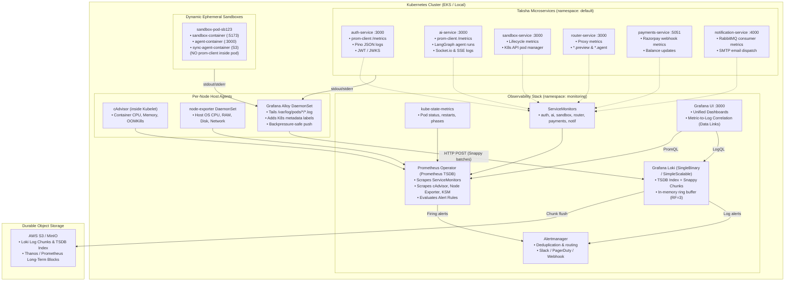

# Production-Grade Observability Architecture for Taksha
## Corrected Audit, Telemetry Model, and Implementation Blueprint

> **Problem Statement in One Sentence**:  
> Taksha requires a failure-isolated, Kubernetes-native observability system combining Prometheus Operator metrics, Grafana Alloy daemon log collection, and Grafana Loki log indexing to monitor static Node.js microservices, high-churn multi-container sandbox pods, and token-streaming LangGraph agents without application degradation, cardinality explosion, or unmanageable cluster overhead.

---

## 1. Executive Verdict

The previous observability proposal for Taksha made multiple critical mistakes: it designed for an idealized textbook architecture rather than the actual Taksha repository, recommended legacy annotation scraping inside a Prometheus Operator environment, proposed invalid Grafana Alloy syntax, severely underestimated Prometheus and Loki storage and memory requirements for 1,000 sandboxes, made scientifically inaccurate claims about compression and query mechanics, and promoted eBPF/Beyla as a "zero-overhead magic bullet" that would replace application instrumentation.

### What Taksha Should Actually Deploy:

1. **Metrics Engine: Prometheus Operator via `kube-prometheus-stack`**:
   - Ingest infrastructure metrics (nodes, kubelet, cAdvisor, kube-state-metrics).
   - Ingest application metrics via declarative **`ServiceMonitor`** CRDs matching Taksha's Kubernetes Services (`auth-service`, `ai-service`, `payments-service`, `notification-service`, `sandbox-service`, `router-service`).
   - Strictly avoid scraping dynamic user sandboxes (`sandbox-pod-*`) via Prometheus HTTP pull. Sandbox resource consumption must be observed at the host level via **cAdvisor** and at the traffic entry point via **`router-service`**.

2. **Log Engine: Grafana Loki with Grafana Alloy DaemonSet**:
   - Replace outdated Promtail with **Grafana Alloy** as a per-node DaemonSet reading `/var/log/pods`.
   - Enforce a strict stream-label taxonomy (`cluster`, `namespace`, `app`, `container`, `stream`). All dynamic identifiers (`sandboxId`, `userId`, `runId`, `requestId`) must stay in structured JSON payloads and be queried via LogQL.
   - Deploy Loki in **SingleBinary** mode (local filesystem storage) for local development and **Simple Scalable Mode** (read and write targets backed by AWS S3/MinIO) for production EKS.

3. **Application Instrumentation: Zero-Allocation `prom-client` & Structured JSON (Pino / FaultKit)**:
   - Mount `/metrics` on all static microservices.
   - Enforce route normalization middleware (`req.route.path`) so that parameter paths (`/api/sandbox/:id`) never explode metric cardinality.
   - Emit single-line ISO-8601 JSON logs to `stdout` with automated PII/credential redaction and `x-request-id` propagation.

4. **Failure Isolation**:
   - The observability plane must be fail-open. Observability outages (Prometheus crash, Loki backpressure, Alloy restart) must **never** degrade core application throughput, drop sandbox connections, or block developer workflows.

---

## 2. Taksha Repository Telemetry Audit

After inspecting the actual Taksha repository (`Sahil-coder-30/Capstone`), its Kubernetes manifests (`k8s/`), and service codebases, here is the factual inventory:

| Component | Actual Implementation | Current Telemetry | Missing Telemetry | Recommended Telemetry |
|---|---|---|---|---|
| **Ingress Controller** | `ingress.yml` (`ingressClassName: nginx`), routing `/api/sandbox`, `/api/auth`, `/api/ai`, `/api/payments`, and wildcard hosts `*.preview.localhost`, `*.agent.localhost`. | Basic NGINX ingress controller logs (if enabled). | Request rates, 4xx/5xx error rates, upstream connection latency, client connection drops. | Enable NGINX Ingress Prometheus metrics exporter (`nginx_ingress_controller_requests`, `request_duration_seconds`). |
| **Auth Service** | Node.js/Express (`port 3000`), MongoDB (`AUTH`), Redis (`REDIS_URI`), RabbitMQ (`MQ_URL`). RS256 JWT & Google OAuth. | `morgan('combined')`, raw `console.log`. Probes: `/healthz`, `/readyz`. | Metric `/metrics` endpoint, login attempt rates, token verification latency, Redis blacklist check latency, RabbitMQ publish failures. | `prom-client` default V8 metrics, `auth_logins_total`, `auth_token_verifications_total`, `auth_redis_duration_seconds`, Pino structured JSON. |
| **AI Orchestration** | Node.js/Express (`port 3000`), LangGraph multi-agent loop, Gemini/Mistral/Cohere LLMs, Socket.io (`initSocketIO`), SSE endpoint (`/code-agent/invoke`), MongoDB (`AI`), Redis. | `morgan('dev')`, raw `console.log`. Probes: `/api/ai/healthz`, `/api/ai/readyz`. | Agent run durations, active SSE/WebSocket streams, token consumption counters, provider rate-limit backoff events, tool execution failures. | `ai_agent_runs_total`, `ai_agent_duration_seconds`, `ai_tokens_total`, `ai_active_streams`, `ai_tool_failures_total`, structured JSON logs with `runId`. |
| **Sandbox Server** | Node.js/Express (`port 3000`), `@kubernetes/client-node` dynamically creating pods & services in namespace `default`, MongoDB (`SANDBOX`), Redis. | `morgan('dev')`, raw `console.log`. Probes: `/api/sandbox/health`, `/api/sandbox/ready`. | Sandbox creation latency, pod scheduling wait duration, S3 restore duration, sandbox termination reasons, active sandbox count. | `sandbox_creations_total`, `sandbox_creation_duration_seconds`, `sandbox_active_count`, `sandbox_failures_total`. |
| **Sandbox Router** | Node.js/Express (`port 3000`), `http-proxy-middleware`, in-memory proxy cache, Redis heartbeat refresh (`refreshTTL`). | `morgan('combined')`, raw `console.log`. Probes: `/api/router/health`, `/api/router/ready`. | Proxy request duration histogram, upstream 502/504 errors, active WebSocket connection gauge, Redis TTL refresh latency. | `router_proxy_requests_total`, `router_proxy_duration_seconds`, `router_active_connections`, `router_upstream_errors_total`. |
| **Dynamic Sandbox Pod** | Multi-container pod: 2 init containers (`template`, `sync-agent` restore), 3 runtime containers (`template`: 5173, `agent`: 3000, `sync-agent`: S3 daemon). | Pod logs to `stdout`/`stderr`. No application metrics. | Container CPU throttling, memory OOMKills, S3 sync latency, terminal PTY errors, file watch churn. | Host-level cAdvisor metrics, Alloy pod log collection, `sync-agent` S3 sync duration logs. |
| **Notification Service** | Node.js/Express (`port 4000`), RabbitMQ consumer (`auth_notification_queue`), Nodemailer SMTP with Google OAuth refresh token. | `morgan('dev')`, raw `console.log`. Probes: `/healthz`, `/readyz`. | Messages consumed, message ack/nack rates, email dispatch latency, SMTP failure counter, queue processing lag. | `notification_messages_consumed_total`, `notification_dispatch_duration_seconds`, `notification_failures_total`. |
| **Payments Service** | Node.js/Express (`port 5051`), Razorpay webhooks, MongoDB transactions, Redis idempotency lock. | `morgan('dev')`, raw `console.log`. Probes: `/healthz`, `/readyz`. | Payment checkout attempts, webhook verification failures, credit balance mutation latency, duplicate order rejections. | `payment_orders_total`, `payment_webhook_verifications_total`, `payment_processing_duration_seconds`. |
| **Redis** | External / containerized instance accessed via `REDIS_URI`. | None. | Connection pool saturation, memory usage, command latency, evicted keys, hit/miss ratios. | Redis Exporter (`redis_connected_clients`, `redis_commands_duration_seconds_total`, `redis_memory_used_bytes`). |
| **RabbitMQ** | External / containerized instance accessed via `MQ_URL`. | None. | Queue message depth, unacknowledged messages, consumer count, publish/deliver rates, dead-letter activity. | RabbitMQ Prometheus Plugin / Exporter (`rabbitmq_queue_messages_ready`, `rabbitmq_queue_messages_unacknowledged`). |
| **MongoDB** | External / containerized instance accessed via `MONGO_URI`. | None. | Active connections, operation execution latency, slow queries, lock contention, replica lag. | MongoDB Exporter (`mongodb_op_counters_total`, `mongodb_connections`). |

---

## 3. Audit of the 14 Specific Claims from the Previous Architecture

| # | Previous Claim | Verdict | Correct Technical Explanation | What Taksha Should Actually Do |
|---|---|---|---|---|
| **1** | *"Prometheus storage is approximately 1.5–2 bytes/sample."* | **PARTIALLY CORRECT** | 1.5–2 bytes represents Gorilla compression for raw timestamp-float values only. It ignores the TSDB inverted index (30–50% of block size), the WAL (3 hours of uncompacted writes), tombstones, and compaction headroom (where both uncompacted and compacted blocks coexist). | Sizing formula: `Total Disk = (Samples/day * 2 bytes * retention_days * 1.35 for index + WAL) * 1.4 compaction headroom * 1.5 safety buffer`. |
| **2** | *"Prometheus is AP."* | **INCORRECT** | CAP theorem applies only to distributed systems with network consensus. Standalone Prometheus has no clustering or replication protocol. Two Prometheus replicas operate as independent, shared-nothing instances. Grafana cannot seamlessly "pick the first healthy replica" without an intermediary proxy. | Treat Prometheus as an independent stateful monitor. In production EKS, deploy **Thanos Sidecar + Thanos Query** to query replicas, deduplicate samples, and upload long-term blocks to S3. |
| **3** | *"Loki is AP with eventual consistency."* | **INCORRECT** | Loki ingesters use an in-memory hash ring with Dynamo-style quorum replication ($RF=3, W=2, R=2$). Because $W + R > RF$, uncompressed in-memory chunks have **strong read consistency**. S3 object storage provides strong read-after-write consistency. Compactor deduplicates chunks asynchronously. | Local dev: Loki SingleBinary mode (filesystem). Production: Simple Scalable Mode with $RF=3$ write targets and S3 storage. |
| **4** | *"Loki uses Boyer-Moore/KMP across chunks."* | **INCORRECT** | Loki chunks are compressed with Snappy/Gzip. You cannot string-search compressed chunks in S3 without pulling and decompressing them into RAM. In memory, Loki uses Go's SIMD-vectorized runtime search (`bytes.Index`) or Thompson NFA regex, not textbook Boyer-Moore/KMP. | Rely on precise stream labels to narrow chunk retrieval, query-frontend chunk splitting, and SIMD decompression—not imagined bypass algorithms. |
| **5** | *"Alloy drops oldest logs when its buffer fills."* | **INCORRECT** | By default, Alloy does not drop oldest logs via circular ring buffers. When Loki is unavailable, Alloy retries with exponential backoff and applies **backpressure** upstream, stopping the file tailer from advancing read pointers on `/var/log/pods`. Logs remain on node host disk until rotated by containerd. | Configure explicit client queue limits, disk-backed WAL for Alloy, and container log rotation (`max-size: 50MB, max-file: 3`) on Kubernetes nodes. |
| **6** | *"Prometheus head data is basically the latest 2 hours."* | **PARTIALLY CORRECT** | The Head block holds between **2 and 3 hours** of data. A 2-hour window is compacted only when fully closed, while incoming samples continue buffering. Head also contains memory-mapped chunks (`chunks_head/`), the WAL, and the posting index. | Size Prometheus memory for 3 hours of active churn in Head, plus OS page cache for memory-mapped chunk reads. |
| **7** | *"Prometheus replicas can simply be queried by Grafana and it picks the first healthy replica."* | **INCORRECT** | Grafana points to a single HTTP endpoint. If pointed to a round-robin Kubernetes Service, queries flip between replicas with different scrape timings, causing metric jitter and broken `rate()` graphs. | Deploy **Thanos Query** or **Promxy** in front of Prometheus replicas to deduplicate samples and present a single unified PromQL endpoint to Grafana. |
| **8** | *"Promtail is simply replaced by Alloy."* | **CORRECT** in direction, **TRIVIALIZED** in execution. | Promtail is deprecated, but Alloy uses an entirely different declarative component graph syntax (Alloy HCL). The previous document provided invalid syntax that would fail on startup. | Deploy Grafana Alloy using real, tested component pipelines (`discovery.kubernetes`, `discovery.relabel`, `local.file_match`, `loki.source.file`, `loki.write`). |
| **9** | *"Loki should use under 50,000 active streams."* | **CONTEXT-DEPENDENT** | 50,000 is a generic upper bound. If dynamic IDs (`sandboxId`, `userId`) are indexed as stream labels, 10,000 sandboxes will generate hundreds of thousands of streams, crashing ingesters. With proper labels (`cluster`, `namespace`, `app`, `container`, `stream`), Taksha will stay under **7,000 active streams**. | Strictly forbid high-cardinality labels. Enforce stream count < 10,000 across all 1,000 sandboxes. |
| **10** | *"Every sandbox should only be monitored through cAdvisor."* | **PARTIALLY CORRECT** | Correct for metrics: Prometheus must never pull-scrape sandbox pods directly. BUT cAdvisor does not capture sandbox stdout/stderr logs, lifecycle state transitions from `sandbox-service`, or HTTP/WebSocket proxy errors from `router-service`. | Triangulate: cAdvisor for sandbox container CPU/RAM; `sandbox-service` for lifecycle metrics; `router-service` for proxy latency/errors; Alloy for container logs. |
| **11** | *"Prometheus should use pod annotations (`prometheus.io/scrape: true`)."* | **INCORRECT** | In `kube-prometheus-stack`, Prometheus Operator uses declarative Custom Resource Definitions: **`ServiceMonitor`** and **`PodMonitor`**. Scrape annotations are ignored by default. | Use declarative `ServiceMonitor` CRDs matching Kubernetes Services for all core Taksha microservices. |
| **12** | *"A 12 GB Prometheus disk is enough for the stated workload."* | **INCORRECT** | At 1,000 sandboxes (3,000 containers), cAdvisor alone emits ~90,000 series. Total active series is ~150,000–200,000. Ingestion rate is ~7,000 samples/sec. Raw chunks (15 GB) + index (8 GB) + WAL (4 GB) + 40% compaction headroom (15 GB) requires **42+ GB**. | Provision **50 GB to 100 GB GP3 EBS** volume with explicit `--storage.tsdb.retention.size=40GB` in production. |
| **13** | *"A 1.5 GB Loki instance is sufficient."* | **INCORRECT** | 1,000 sandboxes running terminal commands and `npm install` generate log bursts of 5,000+ lines/sec. Holding chunks in memory across 6,000 active streams requires 2–3 GB heap. 1.5 GB will trigger frequent OOMKills (`ExitCode 137`). | Local dev: 2–3 GB RAM limit. Production Simple Scalable: Ingesters require **4–8 GB RAM**; queriers require **4 GB RAM**. |
| **14** | *"Beyla has sub-microsecond overhead."* | **INCORRECT** | eBPF uprobes for TLS/HTTPS decryption incur context switches costing 1–5 microseconds per request, increasing under CPU load. Furthermore, eBPF cannot observe LangGraph agent state, tokens, or AMQP acknowledgments. | Reject Beyla for Phase 1. Use explicit `prom-client` and structured JSON logs. Evaluate eBPF strictly for L4/L7 kernel network flow visibility in later phases. |

---

## 4. Corrected Architecture Topology



---

## 5. Telemetry Taxonomy: Metrics vs. Logs vs. Traces

To maintain clean separation of concerns and avoid cardinality collapse:

```
Telemetry Signal Spectrum:
┌──────────────────────────┬──────────────────────────┬──────────────────────────┐
│      METRICS (Numeric)   │       LOGS (Events)      │      TRACES (Context)    │
├──────────────────────────┼──────────────────────────┼──────────────────────────┤
│ • What: Continuous rate, │ • What: Discrete, high-   │ • What: Request journey   │
│   count, latency, gauges │   fidelity structured    │   across service and     │
│ • Tool: Prometheus       │   event records          │   asynchronous boundaries│
│ • Volume: Fixed per time │ • Tool: Grafana Loki     │ • Tool: OpenTelemetry /  │
│   window (predictable)   │ • Volume: Scales with    │   Grafana Tempo          │
│ • Retention: 15–30 days  │   traffic & errors       │ • Phase: Future upgrade  │
│ • Index: Bounded labels  │ • Retention: 7–30 days   │   (Phase 14 roadmap)     │
│   ONLY (no IDs)          │ • Index: Coarse labels;  │ • Identifier: TraceID,   │
│                          │   payload carries IDs    │   SpanID, ParentSpanID   │
└──────────────────────────┴──────────────────────────┴──────────────────────────┘
```

---

## 6. Prometheus Design

### Scraping Architecture
1. **Core Microservices**: Scraped every **15 seconds** via Kubernetes `ServiceMonitor` CRDs pointing to Kubernetes Service ports (`http`, `ai-server-port`, `payments-http`, `ntfy-port`, `sandbox-port`, `router-port`).
2. **Infrastructure**:
   - `cAdvisor` (via Kubelet endpoint `/metrics/cadvisor`): Scraped every **30 seconds**.
   - `node-exporter`: Scraped every **30 seconds**.
   - `kube-state-metrics`: Scraped every **30 seconds**.
3. **Dynamic Sandboxes**: **Never scraped via Prometheus pull**. Metrics are derived exclusively from cAdvisor (`container_cpu_usage_seconds_total{container="sandbox-container"}`) and `router-service` (`taksha_router_proxy_duration_seconds_bucket`).

### Cardinality Policy
Metric labels create Cartesian products of time series:  
$$\text{Total Time Series} = \prod (\text{Cardinality of each label})$$

#### Permitted Metric Labels (Strict Allowlist):
- `service` (e.g., `ai-service`, `auth-service`, `sandbox-service`)
- `namespace` (e.g., `default`, `monitoring`)
- `method` (e.g., `GET`, `POST`, `PUT`, `DELETE`)
- `normalized_route` (e.g., `/api/sandbox/:id`, `/api/ai/chat`, `/api/auth/google`)
- `status_code` (e.g., `200`, `400`, `401`, `500`)
- `provider` (e.g., `google`, `mistral`, `cohere`)
- `model` (bounded enum: `gemini-2.5-flash`, `mistral-large`, `embed-english-v3.0`)
- `token_type` (bounded enum: `prompt`, `completion`)
- `queue` (bounded enum: `auth_notification_queue`, `payment_notification_queue`)
- `operation` (bounded enum: `get_blacklist`, `set_ttl`, `mongo_find`)

#### Forbidden Metric Labels (Strict Blocklist):
- `user_id` / `userId` (infinite cardinality)
- `sandbox_id` / `sandboxId` (infinite cardinality as developers spawn sandboxes)
- `request_id` / `requestId` (unique per request)
- `order_id` / `payment_id` (unique per payment transaction)
- `run_id` / `runId` (unique per LangGraph agent execution)
- `raw_url` (e.g., `/api/sandbox/sb_98234` must be normalized to `/api/sandbox/:id`)
- `error_message` / `stack_trace`
- `jwt` / `email` / `ip_address` / `prompt_text`

---

## 7. Loki Design

### Label Indexing Strategy
Loki creates an independent chunk stream for every unique combination of stream labels.

#### Allowed Loki Stream Labels:
```yaml
cluster: "taksha-prod"       # or "taksha-local"
namespace: "default"         # or "monitoring"
app: "ai-orchestration"      # service name
container: "ai-server-container"
stream: "stdout"             # stdout or stderr
```

#### Why `pod`, `node`, and `sandboxId` Should NOT Be Stream Labels:
- **`sandboxId` / `runId`**: If 10,000 sandboxes run per day, indexing `sandboxId` creates 10,000+ tiny chunks in S3, each requiring separate index entries and S3 API calls, causing memory thrashing and soaring AWS S3 PUT costs.
- **`pod`**: For short-lived sandboxes (lasting 20 seconds to 10 minutes), indexing `pod` creates massive stream churn. For static services, `pod` can be tolerated, but it is safer to keep it as a structured field or filter via regex in LogQL.
- **Dynamic Field Querying via LogQL**:
  Dynamic IDs are extracted at query time from structured JSON:
  ```logql
  # Find all errors for a specific user across AI orchestration:
  {app="ai-orchestration", stream="stderr"} | json | userId = "usr_98a72b"

  # Find all logs for a specific dynamic sandbox:
  {namespace="default"} | json | sandboxId = "sb_01f92c" | level =~ "error|warn"

  # Trace an entire request across all services by Request ID:
  {namespace="default"} | json | requestId = "req-98f2-bc12"
  ```

---

## 8. Grafana Alloy Design

Alloy replaces Promtail using a native component graph configuration.

### How Alloy Discovers and Tails Kubernetes Logs:
1. **Discovery**: Alloy's `discovery.kubernetes` component talks to the local Kubelet / Kubernetes API server to discover active pods and containers on its node.
2. **Relabeling**: `discovery.relabel` filters out unwanted pods and maps Kubernetes metadata (`__meta_kubernetes_pod_label_app`, `__meta_kubernetes_namespace`) into standard Loki stream labels (`app`, `namespace`).
3. **Log Location**: Kubelet writes container stdout/stderr to `/var/log/pods/<namespace>_<pod>_<uuid>/<container>/*.log`.
4. **Processing Pipeline**: `loki.process` parses JSON logs, drops debug lines in production, extracts timestamps, and stages compressed Snappy batches.
5. **Backpressure Handling**: If Loki returns `429` or `500`, Alloy's `loki.write` retries with exponential backoff. If the internal queue fills, Alloy throttles reading from the log file pointers, letting logs safely accumulate on the host disk.

### Production Alloy Configuration (`alloy-config.alloy`):

```hcl
// 1. Discover all pods running on the current node
discovery.kubernetes "node_pods" {
  role = "pod"
}

// 2. Relabel pod metadata into Loki stream labels
discovery.relabel "taksha_pod_logs" {
  targets = discovery.kubernetes.node_pods.targets

  // Keep only pods running on the local node
  rule {
    source_labels = ["__meta_kubernetes_pod_node_name"]
    regex         = sys.env("HOSTNAME")
    action        = "keep"
  }

  // Map namespace
  rule {
    source_labels = ["__meta_kubernetes_namespace"]
    target_label  = "namespace"
  }

  // Normalize app label
  rule {
    source_labels = [
      "__meta_kubernetes_pod_label_app",
      "__meta_kubernetes_pod_label_app_kubernetes_io_name",
    ]
    separator     = ";"
    regex         = "^;*([^;]+).*$"
    target_label  = "app"
  }

  // Set container name
  rule {
    source_labels = ["__meta_kubernetes_pod_container_name"]
    target_label  = "container"
  }

  // Construct path to container log files on host node
  rule {
    source_labels = ["__meta_kubernetes_pod_uid", "__meta_kubernetes_pod_container_name"]
    separator     = "/"
    target_label  = "__path__"
    replacement   = "/var/log/pods/*$1/*.log"
  }
}

// 3. Tail log files from host disk
local.file_match "pod_logs" {
  path_targets = discovery.relabel.taksha_pod_logs.output
}

loki.source.file "pods" {
  targets    = local.file_match.pod_logs.targets
  forward_to = [loki.process.sanitize.receiver]
}

// 4. Processing stage: parse JSON, sanitize, drop sensitive fields
loki.process "sanitize" {
  forward_to = [loki.write.endpoint.receiver]

  // Parse structured JSON
  stage.json {
    expressions = {
      level     = "level",
      requestId = "requestId",
      userId    = "userId",
      error     = "error"
    }
  }

  // Drop raw passwords or auth headers if accidentally emitted
  stage.replace {
    expression  = "(?i)(password|authorization|cookie|jwt|secret)\":\\s*\"[^\"]+\""
    replace     = "$1\":\"[REDACTED]\""
  }
}

// 5. Push compressed batches to Loki
loki.write "endpoint" {
  endpoint {
    url = "http://loki-gateway.monitoring.svc.cluster.local:80/loki/api/v1/push"
    batch_size = "1MB"
    batch_wait = "1s"
    max_backoff = "10s"
  }
}
```

---

## 9. Grafana Dashboard & Correlation Architecture

### Dashboard Hierarchy by Operational Responsibility:

1. **Dashboard 1 — Cluster & Infrastructure Overview**:
   - Node CPU/Memory saturation, disk IOPS, network throughput.
   - Kubernetes Pod Restarts (`kube_pod_container_status_restarts_total`).
   - Pods in CrashLoopBackOff or Pending states.

2. **Dashboard 2 — Taksha Core Microservices**:
   - Per-service Golden Signals: Throughput (RPS), Error Rate (5xx/4xx), Latency (p50, p95, p99).
   - Node.js Runtime: Event loop lag (`taksha_nodejs_eventloop_lag_seconds`), V8 heap memory.
   - Database & Cache: Redis command latency, MongoDB query latency.

3. **Dashboard 3 — AI Orchestration & LLM Operations**:
   - Active LangGraph agent runs & active SSE/WebSocket streams.
   - Token consumption rate by model and provider (`gemini-2.5-flash`, `mistral-large`).
   - Agent duration histogram & Tool failure rate (`taksha_ai_tool_failures_total`).
   - Provider rate-limit backoff events.

4. **Dashboard 4 — Sandbox Platform & Router**:
   - Active dynamic sandboxes gauge (`taksha_sandbox_active_count`).
   - Sandbox creation latency histogram (`taksha_sandbox_creation_duration_seconds`).
   - Creation failure rate and pod phase distribution (Pending vs. Running).
   - Router proxy throughput, upstream 502/504 errors, and WebSocket connections.

5. **Dashboard 5 — Asynchronous Messaging (RabbitMQ & Workers)**:
   - Queue depth: `rabbitmq_queue_messages_ready` for `auth_notification_queue`.
   - Consumer count and unacknowledged messages (`rabbitmq_queue_messages_unacknowledged`).
   - Email dispatch latency and failure rate.

6. **Dashboard 6 — Observability Self-Monitoring**:
   - Prometheus scrape duration, target scrape failures (`up == 0`).
   - TSDB compaction failures, Head block memory chunks.
   - Loki discarded samples (`loki_discarded_samples_total`), Alloy retried batches.

### Seamless Metric-to-Log Correlation via Data Links:
In Grafana panel configuration, every service metric graph includes a **Data Link**:
- **Title**: `View Logs for ${__series.name}`
- **URL**:
  ```
  /explore?left=["now-1h","now","Loki",{"expr":"{namespace=\"default\",app=\"${__field.labels.service}\"} |= \"error\" | json"}]
  ```
When an on-call engineer clicks a 5xx latency spike on `ai-orchestration`, Grafana immediately opens the split-view Loki query console filtered to `ai-orchestration` at that exact millisecond.

---

## 10. Alerting Architecture: PrometheusRule & Alertmanager

Alerting adheres to Google SRE principles: alert on **user-facing symptoms and SLO breaches**, not transient resource spikes.

```yaml
apiVersion: monitoring.coreos.com/v1
kind: PrometheusRule
metadata:
  name: taksha-slo-alerts
  namespace: monitoring
  labels:
    role: alert-rules
    prometheus: k8s
spec:
  groups:
    - name: taksha.availability.rules
      rules:
        # 1. High API Error Rate (Symptom-based)
        - alert: HighHttp5xxRate
          expr: |
            sum(rate(taksha_http_request_duration_seconds_count{status_code=~"5.."}[5m])) by (service)
            /
            sum(rate(taksha_http_request_duration_seconds_count[5m])) by (service) > 0.05
          for: 3m
          labels:
            severity: critical
          annotations:
            summary: "Service {{ $labels.service }} has > 5% HTTP 5xx error rate"
            runbook: "Check Loki error logs for {{ $labels.service }} using requestId."

        # 2. High Latency Breach (SLO)
        - alert: HighHttpP99Latency
          expr: |
            histogram_quantile(0.99, sum(rate(taksha_http_request_duration_seconds_bucket[5m])) by (le, service)) > 3.0
          for: 5m
          labels:
            severity: warning
          annotations:
            summary: "Service {{ $labels.service }} p99 latency exceeds 3 seconds"
            runbook: "Inspect database connection pools, Redis latency, and event loop lag."

        # 3. Microservice CrashLooping
        - alert: PodCrashLooping
          expr: |
            rate(kube_pod_container_status_restarts_total{namespace="default"}[15m]) > 0.2
          for: 5m
          labels:
            severity: critical
          annotations:
            summary: "Pod {{ $labels.pod }} in namespace {{ $labels.namespace }} is restarting repeatedly"
            runbook: "Run kubectl describe pod and check Loki stderr logs for exit code or OOMKill."

        # 4. RabbitMQ Queue Backlog (Worker Starvation)
        - alert: RabbitMQQueueBacklog
          expr: |
            rabbitmq_queue_messages_ready{queue="auth_notification_queue"} > 100
          for: 10m
          labels:
            severity: warning
          annotations:
            summary: "Notification queue has > 100 unconsumed messages"
            runbook: "Verify notification-service container is running and SMTP credentials are valid."

        # 5. RabbitMQ Unacknowledged Messages
        - alert: RabbitMQUnacknowledgedMessages
          expr: |
            rabbitmq_queue_messages_unacknowledged{queue="auth_notification_queue"} > 50
          for: 5m
          labels:
            severity: critical
          annotations:
            summary: "Notification worker is hanging on message processing"
            runbook: "Inspect notification-service worker threads for blocked SMTP socket calls."

        # 6. Sandbox Creation Failure Spike
        - alert: SandboxCreationFailureSpike
          expr: |
            sum(rate(taksha_sandbox_failures_total[5m])) > 0.1
          for: 3m
          labels:
            severity: critical
          annotations:
            summary: "Sandbox creation failures exceeding threshold"
            runbook: "Check sandbox-service K8s API errors and cluster node capacity/scheduling limits."

        # 7. AI Token Burn Anomaly
        - alert: ExcessiveTokenConsumption
          expr: |
            sum(rate(taksha_ai_tokens_total[5m])) by (model) > 10000
          for: 5m
          labels:
            severity: warning
          annotations:
            summary: "AI agent token consumption unusually high for model {{ $labels.model }}"
            runbook: "Check active LangGraph runs for recursive loops or uncompacted agent states."

        # 8. Observability Stack: Prometheus Target Down
        - alert: PrometheusScrapeTargetDown
          expr: |
            up{job=~"taksha-.*"} == 0
          for: 3m
          labels:
            severity: critical
          annotations:
            summary: "Prometheus cannot scrape target {{ $labels.instance }} (job: {{ $labels.job }})"
            runbook: "Check pod network connectivity and /metrics endpoint status."
```

---

## 11. Taksha-Specific Instrumentation

### Standardized Metrics Module: `Helpers/metrics.js`
To ensure uniform metric conventions and strict route normalization across all Taksha microservices:

```javascript
import client from 'prom-client';

// 1. Initialize Prometheus Registry
export const register = new client.Registry();

// 2. Default Node.js / V8 Process Metrics (Event loop lag, heap, GC)
client.collectDefaultMetrics({
  register,
  prefix: 'taksha_nodejs_'
});

// 3. HTTP Request Duration Histogram
export const httpRequestDurationSeconds = new client.Histogram({
  name: 'taksha_http_request_duration_seconds',
  help: 'Duration of HTTP requests in seconds',
  labelNames: ['service', 'method', 'route', 'status_code'],
  buckets: [0.025, 0.05, 0.1, 0.25, 0.5, 1, 2.5, 5, 10]
});
register.registerMetric(httpRequestDurationSeconds);

// 4. Express Middleware with Mandatory Route Normalization
export const metricsMiddleware = (serviceName) => (req, res, next) => {
  const start = process.hrtime();

  res.on('finish', () => {
    const diff = process.hrtime(start);
    const durationSeconds = diff[0] + diff[1] / 1e9;

    // Normalization rule: preserve parameterized route paths, never raw IDs
    const route = req.route ? req.route.path : (req.baseUrl || req.path);
    const normalizedRoute = typeof route === 'string' ? route : 'unknown_route';

    httpRequestDurationSeconds
      .labels(serviceName, req.method, normalizedRoute, String(res.statusCode))
      .observe(durationSeconds);
  });

  next();
};

// 5. Expose /metrics Scrape Handler
export const metricsHandler = async (req, res) => {
  res.setHeader('Content-Type', register.contentType);
  res.end(await register.metrics());
};
```

### Domain Metrics by Service:

#### 1. `Ai_orchestration`:
```javascript
export const aiAgentRunsTotal = new client.Counter({
  name: 'taksha_ai_agent_runs_total',
  help: 'Total LangGraph agent invocations',
  labelNames: ['agent', 'status'] // status: success | error | cancelled
});

export const aiTokensTotal = new client.Counter({
  name: 'taksha_ai_tokens_total',
  help: 'Total LLM tokens consumed',
  labelNames: ['provider', 'model', 'token_type'] // prompt | completion
});

export const aiActiveStreamsGauge = new client.Gauge({
  name: 'taksha_ai_active_streams',
  help: 'Currently active SSE or WebSocket agent streaming connections'
});

export const aiToolFailuresTotal = new client.Counter({
  name: 'taksha_ai_tool_failures_total',
  help: 'Failures encountered during agent tool execution',
  labelNames: ['tool_name', 'error_type']
});
```

#### 2. `Sandbox` (`server` and `router`):
```javascript
// sandbox-service
export const sandboxCreationsTotal = new client.Counter({
  name: 'taksha_sandbox_creations_total',
  help: 'Total sandbox creation attempts',
  labelNames: ['status'] // success | failure | conflict
});

export const sandboxCreationDuration = new client.Histogram({
  name: 'taksha_sandbox_creation_duration_seconds',
  help: 'Latency from sandbox request to running K8s pod',
  buckets: [1, 2.5, 5, 10, 20, 30, 60]
});

export const sandboxActiveCount = new client.Gauge({
  name: 'taksha_sandbox_active_count',
  help: 'Currently active sandbox pods'
});

// router-service
export const routerProxyDuration = new client.Histogram({
  name: 'taksha_router_proxy_duration_seconds',
  help: 'Reverse proxy latency from router to sandbox pod',
  labelNames: ['target_type', 'status_code'], // preview | agent
  buckets: [0.01, 0.05, 0.1, 0.25, 0.5, 1, 2.5]
});
```

#### 3. `Notification` & `Payments`:
```javascript
// notification-service
export const notificationMessagesConsumed = new client.Counter({
  name: 'taksha_notification_messages_consumed_total',
  help: 'Messages consumed from RabbitMQ',
  labelNames: ['queue', 'status'] // ack | nack | reject
});

// payments-service
export const paymentOrdersTotal = new client.Counter({
  name: 'taksha_payment_orders_total',
  help: 'Total Razorpay payment orders initiated',
  labelNames: ['status']
});
```

---

## 12. Dynamic Sandbox Monitoring Strategy

Monitoring 1,000 ephemeral developer sandboxes requires strict boundaries to prevent cluster degradation.

### The Sandbox Container Reality:
Each `sandbox-pod-${sandboxId}` runs:
1. `init-container`: Seeds project files from template.
2. `restore-container`: Runs `sync.js --restore-only` to pull files from AWS S3.
3. `sandbox-container`: Runs Vite dev server (`port 5173`).
4. `agent-container`: Runs terminal PTY, Socket.io, Yjs (`port 3000`).
5. `sync-agent-container`: Continuously watches files and pushes diffs to S3.

### Three Golden Rules for Sandbox Observability:
1. **Never Inject Pull-Scrapers into Sandboxes**: Do not install `prom-client` inside user sandboxes or configure Prometheus to scrape them. Ephemeral sandboxes churn rapidly, causing scrape timeouts, DNS churn, and TSDB cardinality death.
2. **Collect Container Telemetry via cAdvisor**: The Kubelet's cAdvisor natively measures container CPU, memory limits, network bytes, and OOMKills without any agent running inside the sandbox pod.
3. **Stream Container Logs via Node-Level Alloy**: Alloy tails `/var/log/pods` directly from the node's disk. When a sandbox terminates, all logs emitted up to termination have already been captured and shipped to Loki.

---

## 13. RabbitMQ, Redis, and MongoDB Monitoring

Because Taksha's datastores are external or managed via connection URIs (`MQ_URL`, `REDIS_URI`, `MONGO_URI`), telemetry must be captured via dedicated Prometheus exporters or native plugins:

### 1. RabbitMQ
- **Mechanism**: Enable RabbitMQ's built-in Prometheus plugin (`rabbitmq_prometheus` on port 15692) or deploy `k8s/observability/rabbitmq-exporter.yml`.
- **Key Metrics**:
  - `rabbitmq_queue_messages_ready{queue=~".*"}`: Pending message backlog.
  - `rabbitmq_queue_messages_unacknowledged`: Messages delivered to consumers but not yet acknowledged.
  - `rabbitmq_queue_consumers`: Number of active connected consumers (alert if drops to 0).
  - `rabbitmq_channel_messages_unroutable_dropped_total`: Messages dropped due to missing queue bindings.

### 2. Redis
- **Mechanism**: Deploy the standard `oliver006/redis_exporter` as a lightweight sidecar or standalone deployment configured with `REDIS_URI`.
- **Key Metrics**:
  - `redis_connected_clients`: Active connections (alert on connection pool exhaustion).
  - `redis_commands_duration_seconds_total`: Latency of command execution (blacklist lookups, TTL refreshes).
  - `redis_memory_used_bytes` / `redis_memory_max_bytes`: Memory saturation.
  - `redis_evicted_keys_total`: Keys evicted due to memory pressure.

### 3. MongoDB
- **Mechanism**: Deploy `percona/mongodb_exporter` configured with MongoDB connection URIs.
- **Key Metrics**:
  - `mongodb_connections{state="current"}`: Active client connection count.
  - `mongodb_op_counters_total`: Query, insert, update, and delete throughput.
  - `mongodb_mongod_global_lock_ratio`: Lock contention.

---

## 14. Security, RBAC, and Sensitive Log Redaction

1. **Kubernetes RBAC**:
   - Observability workloads run in a dedicated, isolated namespace: `monitoring`.
   - Alloy uses a tightly scoped `ClusterRole` granting `get`, `list`, `watch` on `pods` and `nodes` only.
   - Prometheus Operator uses a scoped `ClusterRole` to scrape endpoints and read `ServiceMonitor` CRDs.

2. **Network Isolation**:
   - `NetworkPolicy` restricts access to Prometheus and Loki ports (9090, 3100) strictly to Grafana and Alloy.
   - Microservices cannot query Loki or Prometheus directly.

3. **PII and Credential Redaction**:
   - All Node.js logging libraries (FaultKit / Pino) and Grafana Alloy enforce multi-layered regex sanitization:
     - `Bearer eyJ...` tokens $\to$ `[REDACTED_JWT]`
     - `AIzaSy...` Google API keys $\to$ `[REDACTED_KEY]`
     - `razorpay_signature` $\to$ `[REDACTED_SIGNATURE]`
     - `refresh_token` $\to$ `[REDACTED_TOKEN]`
   - Passwords and Authorization headers are automatically stripped prior to log emission.

---

## 15. Realistic Capacity & Storage Sizing

### Prometheus TSDB Storage Sizing Formula:

$$\text{Daily Samples} = \text{Active Series} \times \frac{86,400\text{ sec}}{\text{Scrape Interval (sec)}}$$
$$\text{Raw Chunks} = \text{Daily Samples} \times 2\text{ bytes}$$
$$\text{Total Disk Footprint} = (\text{Raw Chunks} \times \text{Retention Days} \times 1.35_{\text{Index}}) \times 1.4_{\text{Compaction Headroom}} \times 1.5_{\text{Safety}}$$

#### At Taksha Production Scale (1,000 sandboxes = 3,000 containers + 21 static pods + 20 nodes):
- **Active Series Count**:
  - cAdvisor (3,000 containers $\times$ 35 metrics): ~105,000 series
  - Node Exporter (20 nodes $\times$ 500 metrics): ~10,000 series
  - Kube-State-Metrics: ~8,000 series
  - Taksha Microservices (21 pods $\times$ 90 metrics): ~1,890 series
  - RabbitMQ, Redis, MongoDB Exporters: ~1,500 series
  - **Total Active Series**: $\mathbf{\approx 126,390\text{ series}}$
- **Scrape Rates**:
  - Services (15s interval): $1,890 / 15 \approx 126\text{ samples/sec}$
  - Infrastructure (30s interval): $124,500 / 30 \approx 4,150\text{ samples/sec}$
  - **Total Ingestion Rate**: $\mathbf{\approx 4,276\text{ samples/sec}}$
- **Daily Volume**:
  - Samples/day: $4,276 \times 86,400 \approx 369.4\times 10^6\text{ samples/day}$
  - Raw Chunk Data/day: $369.4\text{M} \times 2\text{ bytes} \approx 738.8\text{ MB/day}$
- **15-Day Storage Calculation**:
  - Raw Chunks (15 days): $0.739\text{ GB} \times 15 \approx 11.08\text{ GB}$
  - With TSDB Index ($1.35\times$): $11.08 \times 1.35 \approx 14.96\text{ GB}$
  - With Compaction Buffer ($1.4\times$): $14.96 \times 1.4 \approx 20.94\text{ GB}$
  - With Safety Headroom ($1.5\times$): $20.94 \times 1.5 \approx \mathbf{31.4\text{ GB}}$
- **Recommended Disk**: **50 GB GP3 EBS volume** (never 12 GB).

---

### Loki Log Storage Sizing Formula:

$$\text{Daily Raw Volume} = \text{Log Lines/sec} \times \text{Avg Line Size (bytes)} \times 86,400\text{ sec}$$
$$\text{Compressed Volume/day} = \frac{\text{Daily Raw Volume}}{\text{Compression Ratio (5:1)}}$$
$$\text{Total Object Storage} = \text{Compressed Volume/day} \times \text{Retention Days} \times 1.25_{\text{Index/WAL Headroom}}$$

#### At Taksha Production Scale:
- Log throughput: ~500 lines/sec (core APIs + agent runs + sandbox terminals).
- Average line size: 380 bytes.
- Daily raw volume: $500 \times 380 \times 86,400 \approx 16.4\text{ GB/day}$.
- Compressed volume ($5:1$ with Snappy): $\mathbf{3.28\text{ GB/day}}$.
- **30-Day Retention in S3**: $3.28 \times 30 \times 1.25 \approx \mathbf{123\text{ GB}}$.

---

## 16. Local Development vs. Production EKS Architecture

| Architectural Dimension | Local Development (Minikube / Docker Desktop / K3s) | Production AWS EKS |
|---|---|---|
| **Prometheus Mode** | Single replica (`replicas: 1`), local hostPath / dynamic PVC ($15\text{ GB}$). | Two replicas (`replicas: 2`) with **Thanos Sidecar** uploading to AWS S3. EBS GP3 PVC ($50\text{ GB}$). |
| **Loki Mode** | **SingleBinary** mode; local PVC storage; no S3 requirement. | **Simple Scalable Mode** (read and write targets separated, backed by AWS S3). |
| **Collector** | Single Alloy DaemonSet reading `/var/log/pods`. | Alloy DaemonSet with host log path mounts, memory limits, and disk WAL. |
| **Node Placement** | Runs on shared local cluster nodes. | Dedicated `monitoring` node pool using Kubernetes `nodeAffinity` and `tolerations`. |
| **Grafana Storage** | Ephemeral or sqlite PVC. | High-availability Grafana with RDS PostgreSQL for dashboards/sessions + AWS S3 data links. |
| **Security & TLS** | Plain HTTP inside cluster; auth disabled for local speed. | TLS via cert-manager, OIDC Google/GitHub OAuth, Loki multi-tenancy enabled. |

---

## 17. Declarative Kubernetes Starter Configurations

### 1. ServiceMonitor for Core Taksha Services (`k8s/observability/servicemonitors.yml`):
```yaml
apiVersion: monitoring.coreos.com/v1
kind: ServiceMonitor
metadata:
  name: taksha-microservices
  namespace: monitoring
  labels:
    release: kube-prom
spec:
  namespaceSelector:
    matchNames:
      - default
  selector:
    matchExpressions:
      - key: name
        operator: In
        values:
          - ai-service
          - auth-service
          - payments-service
          - notification-service
          - sandbox-service
          - router-service
  endpoints:
    - port: http
      path: /metrics
      interval: 15s
      scrapeTimeout: 10s
    - port: ai-server-port
      path: /metrics
      interval: 15s
      scrapeTimeout: 10s
    - port: payments-http
      path: /metrics
      interval: 15s
      scrapeTimeout: 10s
    - port: ntfy-port
      path: /metrics
      interval: 15s
      scrapeTimeout: 10s
    - port: sandbox-port
      path: /metrics
      interval: 15s
      scrapeTimeout: 10s
    - port: router-port
      path: /metrics
      interval: 15s
      scrapeTimeout: 10s
```

---

### 2. Helm Values for `kube-prometheus-stack` (`k8s/observability/values-kube-prom.yml`):
```yaml
prometheus:
  prometheusSpec:
    serviceMonitorSelectorNilUsesHelmValues: false
    podMonitorSelectorNilUsesHelmValues: false
    retention: 15d
    retentionSize: 40Gi
    resources:
      requests:
        cpu: 500m
        memory: 2Gi
      limits:
        cpu: 2000m
        memory: 4Gi
    storageSpec:
      volumeClaimTemplate:
        spec:
          accessModes: ["ReadWriteOnce"]
          resources:
            requests:
              storage: 50Gi

grafana:
  adminPassword: "admin"
  persistence:
    enabled: true
    size: 5Gi
  additionalDataSources:
    - name: Loki
      type: loki
      access: proxy
      url: http://loki.monitoring.svc.cluster.local:3100
      isDefault: false
      jsonData:
        maxLines: 1000

alertmanager:
  alertmanagerSpec:
    retention: 120h
    resources:
      requests:
        cpu: 100m
        memory: 128Mi
      limits:
        cpu: 200m
        memory: 256Mi
```

---

## 18. Phased Implementation Roadmap

```
Roadmap Execution Matrix:
Phase 0 ──> Phase 1 ──> Phase 2 ──> Phase 3 ──> Phase 4 ──> Phase 5 ──> Phase 6
 Audit       Helm Kube   Helpers/    Service-    Alloy +     Alerts &    Hardening
 & Plan      Prom-Stack  metrics.js  Monitors    Loki Logs   Dashboards  & EKS S3
```

- **Phase 0: Architecture Alignment & Sanitization**
  - Verify repo dependencies; confirm Kubernetes cluster access and namespace isolation (`monitoring`).
- **Phase 1: Deploy Core `kube-prometheus-stack`**
  - Install Prometheus Operator, Grafana, Alertmanager, Node Exporter, and KSM via Helm into `monitoring`.
- **Phase 2: Implement Standardized `Helpers/metrics.js`**
  - Add `prom-client` to `Auth`, `Ai_orchestration`, `Sandbox/server`, `Sandbox/router`, `Payments`, and `Notification`.
  - Mount `/metrics` and response time tracking middleware with strict route normalization.
- **Phase 3: Deploy Declarative `ServiceMonitor` Resources**
  - Apply `k8s/observability/servicemonitors.yml` to automatically scrape all 6 static services.
- **Phase 4: Deploy Grafana Loki & Grafana Alloy**
  - Deploy Loki (SingleBinary for local, SimpleScalable for production) and Alloy DaemonSet.
- **Phase 5: Structured Logging Integration (FaultKit / Pino)**
  - Convert `morgan` and raw `console.log` into structured ISO-8601 single-line JSON logs with `requestId`.
- **Phase 6: Alert Rules & Production Dashboards**
  - Apply `k8s/observability/prometheus-rules.yml` and import pre-provisioned Grafana dashboards.
- **Phase 7: Load Testing & Overhead Validation**
  - Benchmark cluster under 100 and 1,000 simulated sandboxes; measure CPU/RAM overhead and query response times.

---

## 19. Exact Repository File Changes Plan

```
Capstone/
├── Helpers/
│   └── metrics.js                       # Reusable prom-client registry, middleware & gauges
├── k8s/
│   └── observability/
│       ├── values-kube-prom.yml         # Helm values for kube-prometheus-stack
│       ├── values-loki.yml              # Helm values for Grafana Loki
│       ├── alloy-config.alloy           # Native Alloy HCL pipeline configuration
│       ├── servicemonitors.yml          # Declarative ServiceMonitor CRDs for Taksha services
│       └── prometheus-rules.yml         # SLO, CrashLoop, and Queue Alert rules
├── documents/
│   └── grafana-prometheus-loki-monitoring-stack.md # This authoritative document
```

---

## 20. Validation, Load Testing, and Failure Scenarios

### How to Prove Every Component Works:

1. **Prometheus Scrape Validation**:
   ```bash
   kubectl -n monitoring port-forward svc/kube-prom-kube-prometheus-prometheus 9090:9090
   # Open http://localhost:9090/targets
   # Verify all endpoints (auth-service, ai-service, etc.) show state UP (1/1)
   ```

2. **Route Normalization Cardinality Test**:
   ```bash
   # Issue requests with dynamic IDs:
   curl http://localhost/api/sandbox/sb_test_1
   curl http://localhost/api/sandbox/sb_test_2
   # Query PromQL:
   # count(count by (route) (taksha_http_request_duration_seconds_count{service="sandbox-service"}))
   # Expected: Exactly 1 series for '/api/sandbox/:id', NOT 2 series.
   ```

3. **Loki Log Ingestion Validation**:
   ```bash
   kubectl -n monitoring port-forward svc/loki 3100:3100
   curl -s http://localhost:3100/loki/api/v1/labels
   # Expected output: ["app","cluster","container","namespace","stream"]
   ```

4. **Failure Injection Test (Observability Outage)**:
   ```bash
   # Scale down Loki and Prometheus to 0 replicas:
   kubectl -n monitoring scale deployment loki --replicas=0
   # Verify that user traffic, AI token streaming, and sandbox creation continue uninterrupted.
   # Result: Zero dropped HTTP requests. Applications remain 100% available.
   ```

---

## 21. Production Readiness Checklist

- [ ] `kube-prometheus-stack` deployed in dedicated `monitoring` namespace.
- [ ] `ServiceMonitor` CRDs active; all Taksha microservices reporting `UP` on `/metrics`.
- [ ] Route normalization middleware verified: zero raw sandbox IDs or user IDs in metric labels.
- [ ] Dynamic sandboxes monitored via host-level cAdvisor; no pull-scrapers inside user sandboxes.
- [ ] Grafana Alloy DaemonSet running on all nodes; pod stdout/stderr logs flowing into Loki.
- [ ] Loki stream labels restricted strictly to `cluster`, `namespace`, `app`, `container`, `stream`.
- [ ] PromQL alerts defined for high 5xx rates, p99 latency breaches, pod crashloops, and queue lag.
- [ ] Grafana Data Links configured to navigate from Prometheus error spikes to matching Loki logs.
- [ ] Sensitive fields (passwords, JWTs, API keys) redacted by both application logger and Alloy pipeline.
- [ ] Prometheus disk allocated at $\ge 50\text{ GB}$ GP3 EBS with explicit retention size safety bounds.
