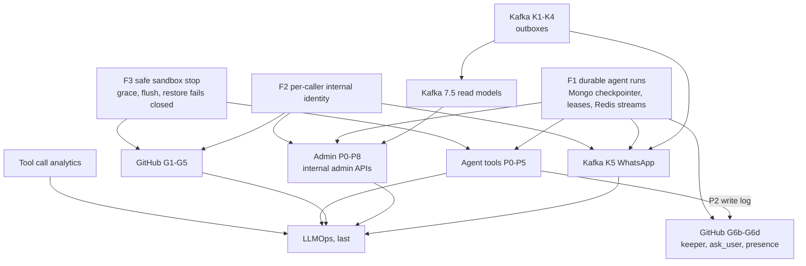

# Plan audit, 2026-11-24

Every plan in `docs/plans/` was read end to end and checked against the code on `main` at `8e0bf26`, under the developer's rule from `CLAUDE.md` ("Architecture first, no shortcuts"): never bypass a layer, no silent fallbacks, nothing that breaks with a second replica, full LLD, ask when the design is unclear. The `ui/` folder was not touched (another thread owns it).

## 1. Result in one paragraph

The plans are detailed and mostly right, but five designs broke the new rule: the GitHub plan let `git-service` call sandbox pods directly and kept a user JWT inside the pod; the admin platform read and wrote every service's database and Redis directly; the Kafka plan published AI usage (money) with a direct write and a silent HTTP fallback; three plans built long pauses on an in-memory checkpointer that blocks a second AI replica; and the GitHub plan's `.git` save on stop could never run, because pods are deleted with a 0 second grace period. All five are fixed in the plans. The cross-cutting fixes are a new plan, [platform-foundations-plan.md](platform-foundations-plan.md), built first. The admin change was the developer's decision (2026-11-24: internal admin APIs per service).

## 2. Dependency view after the audit

## 3. Findings

Severity: **critical** = breaks the architecture rule or loses data; **high** = breaks at scale or a real security gap; **medium** = wrong or missing LLD; **low** = stale text.

### 3.1 Cross-cutting

| # | Sev | Finding | Evidence | Fix |
|---|---|---|---|---|
| X1 | critical | Long pauses (plan review, ask-first, `ask_user` 24 h, push approval, WhatsApp approve, admin stop) all sit on `MemorySaver`, a process `Map` and `setTimeout`. A restart loses them, and a second AI replica breaks streams and resumes | `orion.graph.js:35`, `agentRun.service.js:64`, `:39`, `k8s/ai-deployment.yml` `replicas: 1` | Foundation F1 |
| X2 | high | Model pacing is per process, so N AI replicas send N times the provider's rate | `llm/rateLimiter.js:18` | F1c, Redis token bucket per model |
| X3 | high | One shared `INTERNAL_SERVICE_TOKEN` opens every internal route; any holder can mint a sandbox token for any user. Each plan adds callers | `internalSandboxToken.controller.js`, `internalAuth.middleware.js` | Foundation F2, per-caller tokens and route allowlists |
| X4 | critical | Pods are deleted with `gracePeriodSeconds: 0`, and the sync-agent runs under nodemon, so its `SIGTERM` flush never runs; edits inside the 400 ms debounce are lost today | `pod.js:286`, `sync.js:426`, `sync-agent/dockerfile` | Foundation F3 |
| X5 | critical | A failed S3 listing at restore continues with the template; a later edit to a template file then overwrites the user's real file on S3 | `sync.js:308` | F3: restore fails closed, project shows `error` |
| X6 | low | Several plans still said the AI service calls sidecars directly | `mcp-sandbox-server.md`, agent tools section 2 and 3 | Updated to the router path (`3f800a6`, `8e0bf26`) |

### 3.2 GitHub source control plan

| # | Sev | Finding | Fix in the plan |
|---|---|---|---|
| G-1 | critical | `git-service` called the sidecar directly (`/internal/git/remote`) and the network policy was to admit `git-service` into pods: bypasses the router (no TTL refresh, second entry point). The router's internal proxy only forwards to `/mcp`, so the route could not go through it anyway | Remote ops are the MCP tool `git_remote` (scope `git-remote`) through `POST /internal/sandboxes/:id/mcp`. Sandbox policy stays router-only |
| G-2 | critical | Terminal credentials: the sidecar was to keep the owner's JWT in memory. The terminal runs in the same container and uid as the sidecar (`terminal.service.js`, `env: process.env`), so any npm script could read it; and pod egress blocks private ranges, so the sidecar could not reach git-service at all | Browser-brokered credential (section 6.5): the open editor requests the token with its own JWT, git-service delivers it through the router, no user token ever in the pod, sweeper revokes at 10 min |
| G-3 | high | Callback trusted `installation_id`; GitHub documents it as spoofable | Verify with `GET /user/installations`; random single-use state in Redis; PKCE |
| G-4 | high | Refresh tokens rotate on use; parallel refreshes would lock a user out | Single-flight Redis lock plus version compare-and-set |
| G-5 | high | `.git` tar could be taken mid-commit; no integrity check; save on stop impossible (X4) | Section 4.5.1: lock check, `fsck`, 3 versions, restore fallback with a visible banner; needs F3 |
| G-6 | high | `git_keeper` took "files Orion changed" from the tool layer, missing everything `run_command` writes; a shell regex was treated as enforcement | Tree snapshots at start and finish, sidecar write-attribution log, HEAD and refs verification before commit; regex only on the AI side as a hint |
| G-7 | medium | Push approval implied the AI service pushes with a stored token | The frontend pushes through git-service after the card; the AI never calls git-service; unattended runs never push |
| G-8 | medium | 4.9 was stale (keep-alive built) and proposed a Sandbox server `touch` route plus an in-process presence timer that is wrong with two tabs on two replicas | Presence on a Redis key under F1; `touch` route dropped |
| G-9 | medium | Missing LLD: request and response schemas, error codes, indexes, Redis keys, failure paths, scaling, GitHub rate limits, webhooks for uninstall | Sections 5, 6.1, 6.2, 6.7 to 6.9; uninstall and revoke webhooks moved to G4 |
| G-10 | medium | No Sandbox server route existed for "does this user own this project" | `GET /internal/projects/:projectId/owner` added |

### 3.3 Admin platform

| # | Sev | Finding | Fix |
|---|---|---|---|
| A-1 | critical | The admin backend read every service's Mongo, Postgres (with `BYPASSRLS`) and Redis directly, wrote to them as maintainer, and stopped sandboxes with `EXPIRE` on the Sandbox server's key | **Developer decision 2026-11-24:** internal admin APIs per service (HLD section 1a). Analytics from Kafka-fed read models (Kafka 7.5, now required). Data explorer reduced to typed views and edits. `Admin/PLAN.md` still describes the old design and should be updated when the admin work starts |

### 3.4 Kafka and WhatsApp

| # | Sev | Finding | Fix |
|---|---|---|---|
| K-1 | critical | AI usage (money) published directly with an HTTP fallback: a dual write plus a silent second path | Mongo outbox in the same transaction as the chat message; no fallback; unpublished count is a metric |
| K-2 | medium | Auth published directly ("Mongo outbox later") | Same outbox helper |
| K-3 | medium | One retry topic with mixed delays and partition pause gives head-of-line delay | Tiered retry topics (1 m, 10 m, 1 h) |
| K-4 | medium | WhatsApp pricing from memory | Checked: per-message pricing since 2025-07-01; utility templates inside the window free; marketing always charged |
| K-5 | medium | WhatsApp run control on in-memory runs; admin reading `deliveries` with a DB user | Needs F1 and F2; reads through Notification's internal admin route |
| K-6 | low | Node client on Alpine unverified | Checked: official client ships musl prebuilt binaries |

### 3.5 Agent tools

| # | Sev | Finding | Fix |
|---|---|---|---|
| T-1 | high | Checkpoints in `/home/node` die with the pod (sync-agent cannot see that path), accepted as a limit while the GitHub plan builds an archive for `.git` | `/taksha-state` shared volume, same archive code path |
| T-2 | medium | Ask-first pause needs durable runs | Marked as needing F1 |
| T-3 | medium | No write attribution, which the keeper needs | Added to the P2 file layer |

### 3.6 LLMOps

| # | Sev | Finding | Fix |
|---|---|---|---|
| L-1 | medium | "Always keep runs that errored" is impossible with SDK head sampling | OpenTelemetry Collector with tail sampling in front of Tempo |
| L-2 | medium | Per-user semantic cache: low hit rate, an embedding call on every request, project-dependent answers | Measure first (T6a), exact match before embeddings |
| L-3 | high | Sandbox images are bare names with `IfNotPresent`; a cloud deploy would never update them | Registry-qualified, digest-pinned names in Sandbox server env, updated by `deploy.yml` |
| L-4 | high | A single 24 GB node fits about 10 to 12 sandboxes; nothing stops the 13th from evicting everyone | `MAX_LIVE_SANDBOXES` cap, 503 when full |
| L-5 | low | ARM VM needs arm64 images; Payments has no MongoDB; Langfuse self-host now needs Postgres, ClickHouse, Redis and S3 | Fixed in text |

### 3.7 Tool call analytics and MCP server record

| # | Sev | Finding | Fix |
|---|---|---|---|
| N-1 | low | `SIGTERM` flush not awaited | Awaited in the shutdown hook |
| N-2 | low | Admin and external-agent paths assumed DB reads and an AI ingest route | AI internal admin route; external calls later from the router over Kafka |
| M-1 | low | MCP server record showed the old direct AI path | Updated |

## 4. What changed, file by file

| File | Change |
|---|---|
| `platform-foundations-plan.md` | **New.** F1, F2, F3 with LLD, flows, failure paths, steps |
| `github-source-control-plan.md` | Router-only paths, browser-brokered terminal credentials, GitHub App LLD, `.git` archive LLD, keeper redesign, 4.9 rewritten, data model, APIs, failure paths, scaling, phases and checklist |
| `admin-platform-hld.md` | New section 1a (internal admin APIs), diagrams, data ownership, trust, failure, threats, changes to other services |
| `kafka-whatsapp-architecture.md` | Mongo outbox for AI and Auth, no HTTP fallback, tiered retries, pricing, F1 and F2 prerequisites, admin reads and 7.5 read models |
| `taksha-agent-tools-build-plan.md` | Router path, write log in P2, persisted checkpoints in P4, F1 for ask-first |
| `llmops-evals-cicd-plan.md` | Collector and tail sampling, cache measure-first, sandbox image tags, capacity cap, multi-arch, Langfuse components |
| `taksha-tool-call-analytics-plan.md` | Awaited flush, admin and external paths |
| `mcp-sandbox-server.md` | Router path, known gaps |
| `README.md`, `CHECKLIST.md` | Foundations and GitHub plan added, order, changed lines |

## 5. Still open (for the developer)

| Question | Recommendation |
|---|---|
| Update `Admin/PLAN.md` now or when admin work starts? | When admin P0 starts, from HLD section 1a |
| Per-caller static tokens now, projected ServiceAccount tokens later (F2)? | Yes, static per-caller tokens now, they work on Docker Desktop |
| GitHub D1 to D6, K1 to K3 | Unchanged by the audit; still to settle at G0 |

## 6. Sources checked on 2026-11-24

- GitHub: [About the setup URL](https://docs.github.com/en/apps/creating-github-apps/registering-a-github-app/about-the-setup-url) (spoofable `installation_id`), [Generating a user access token](https://docs.github.com/en/apps/creating-github-apps/authenticating-with-a-github-app/generating-a-user-access-token-for-a-github-app) (8 h, 6 months, PKCE S256, state), [Installations REST](https://docs.github.com/en/rest/apps/installations) (`GET /user/installations`, `DELETE /installation/token`), [Apps REST](https://docs.github.com/en/rest/apps/apps) (scoped 1 h installation tokens), [Best practices](https://docs.github.com/en/enterprise-server@3.20/apps/creating-github-apps/about-creating-github-apps/best-practices-for-creating-a-github-app)
- LangGraph: [@langchain/langgraph-checkpoint-mongodb](https://npmjs.com/package/@langchain/langgraph-checkpoint-mongodb) (0.0.x, peer range unverified, hence spike S1), [MongoDB LangGraph JS docs](https://www.mongodb.com/docs/atlas/ai-integrations/langgraph-js/)
- Meta: [WhatsApp pricing](https://developers.facebook.com/docs/whatsapp/pricing)
- Langfuse: [Self-hosting](https://langfuse.com/self-hosting.md)
- Confluent: [JavaScript client overview](https://docs.confluent.io/kafka-clients/javascript/current/overview.html)

Not verified live (kept as "verify at the step"): the refresh token rotation detail (G0 item 6), the WhatsApp test number recipient limit, Oracle Always Free sizes, Langfuse resource minimums.
