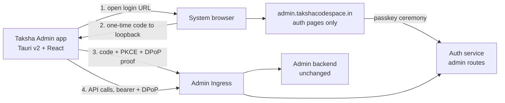
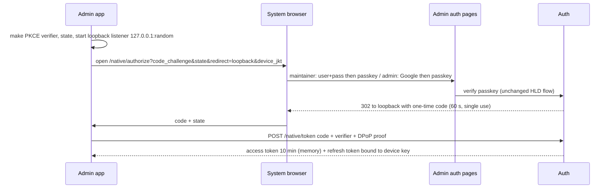
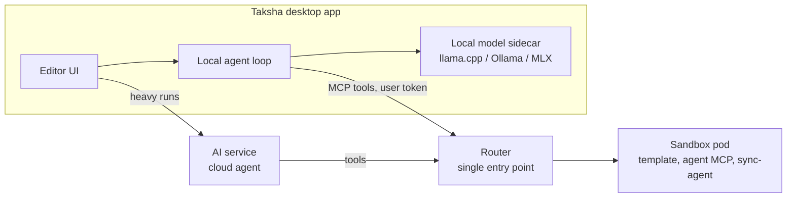
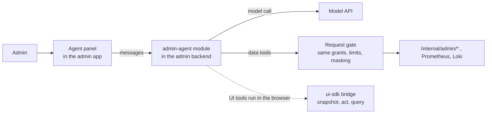

# Admin App: Web + PWA, then Tauri v2: Plan

Status: **draft for review, nothing built.** Written 2026-11-25 in the thread "Plan native admin app".
Extends [admin-platform-hld.md](admin-platform-hld.md). Where the two disagree on how the admin *client* logs in and holds its session, this file wins. Everything behind the ingress (admin backend, request gate, `/internal/admin/*`, audit) is unchanged.

## 0. Decision and what it costs

**Decided by Sahil on 2026-11-25 (second decision, replaces "Tauri from day one"):** the admin client is built in **two phases**:

| Phase | Client | Auth | Why |
|---|---|---|---|
| **Phase 1** | React **web app that is also an installable PWA** at `admin.takshacodespace.in` | The admin HLD as written: passkey in the browser, httpOnly `SameSite=Strict` refresh cookie, access token in memory | Passkeys work natively, nothing to sign or ship, every admin just opens a URL |
| **Phase 2** | The same React code wrapped in **Tauri v2** (macOS first) | Sections 3 and 4 below: system-browser passkey, DPoP device-bound token in the Keychain, Touch ID | Native app on Sahil's Mac, Touch ID unlock, offline numbers |

All business logic stays on the server in both phases, and the app only calls APIs. Rust in Phase 2 is limited to plugin wiring.

The React code must stay **shell-agnostic** from day one so Phase 2 is a wrap, not a rewrite: one `authClient` interface (`cookie` implementation for the web, `native` implementation for Tauri) and one `offlineStore` interface. No component reads cookies, `window.location` auth params or Tauri APIs directly.

### Phase 1 (web + PWA) details

| Item | Detail |
|---|---|
| Install | Web app manifest + service worker. Installs from Safari on macOS ("Add to Dock"), Chrome and Edge on any OS, Android, and iOS (Home Screen) |
| Service worker | Caches the app shell only (JS, CSS, fonts). **Never caches `/api/*` responses** except the offline allow list below |
| Offline (option B, same rule as section 4a) | Allow-listed aggregate routes cached in IndexedDB, encrypted with AES-GCM. The key comes from the passkey's **WebAuthn PRF extension** (Touch ID gives the key), so the cache can't be read without the passkey. Where PRF isn't supported, Phase 1 falls back to option A (shell only). Wiped on logout and after 24 h |
| Updates | Automatic on the next load. The service worker checks for a new version and prompts "Reload to update" |
| Security | Unchanged from the HLD: strict CSP, no third-party scripts, cookies never leave the admin host |

### Phase 2 (Tauri) costs

What we accept when we move to Tauri (weighed against staying a PWA):

| Cost | Why | How this plan handles it |
|---|---|---|
| Passkeys can't run in the app window | A passkey is bound to `admin.takshacodespace.in`, and the Tauri window's origin is `tauri://localhost` (or `http://tauri.localhost` on Windows). WebAuthn inside the webview is unreliable: macOS needs Apple associated-domain entitlements, and Linux WebKitGTK has none | Every passkey ceremony (login, registration, step-up) runs in the **system browser** on the real domain (section 3) |
| No httpOnly cookie session | The app's origin can't send a `SameSite=Strict` cookie that belongs to the admin host | Bearer tokens. The refresh token sits in the OS keychain and is **bound to a device key** (DPoP), so a copied token alone is useless (section 4) |
| Signing and updates | Unsigned apps get Gatekeeper and SmartScreen warnings | Tauri updater with its own free signing key. OS code signing is a cost decision (section 7) |
| A small web part remains | The login, registration and applicant pages must live on the real domain for passkeys | `admin-portal` pod stays, serving only the auth pages (section 2) |

## 1. Scope (Phase 2, Tauri)

| In scope | Later |
|---|---|
| **macOS first** (Sahil's Mac). Windows and Linux come from the same code later | Android, then iOS (Tauri v2 mobile, same code; section 8) |
| System-browser login, registration, step-up, **offline cached numbers (no PII)** (section 4a) | |
| Device-bound refresh token in the OS keychain, **Touch ID unlock in v1** | Tray alerts (WhatsApp K6 covers alerts first) |
| Maintainer "Devices" page: list and revoke every app install | |
| Signed auto-updates | |

**Confirmed by Sahil 2026-11-25:** macOS first, with offline use and biometric (Touch ID) unlock.

## 2. System context (what changes)

- The app talks only to the **admin ingress**, exactly like the portal did. No new entry point and no direct pod access.
- The Sandbox router is not involved. It stays the single entry point for sandboxes. The admin app never reaches a sandbox; sandbox actions go admin backend → Sandbox server's `/internal/admin/*`, as in the HLD.
- `admin-portal` shrinks to the auth pages: maintainer login, Google + passkey for admins, applicant form, passkey registration, step-up, and "return to the app".

## 3. Login, registration and step-up (system browser, RFC 8252)

| Rule | Detail |
|---|---|
| Redirect target | Desktop: **loopback** `http://127.0.0.1:<random port>/cb` (most reliable on all 3 OSes). Mobile later: claimed HTTPS app link. A custom scheme `taksha-admin://` only as a last resort, since another app can register it |
| PKCE | S256, required. The code is useless without the verifier, which never leaves the app |
| `state` | Checked by the app. Kills login CSRF |
| Code | One-time, 60 s, tied to `code_challenge` and `device_jkt` |
| Step-up | Sensitive action → 401 `step_up_required` → the app opens the browser at `/native/step-up` → passkey → new code → new access token with a fresh `auth_time`. Same 5-minute window as the HLD |
| Applicants and registration | All in the browser on the real domain. The app only says "continue in your browser" |

Tauri plugins: `tauri-plugin-opener` (open the browser) and a small loopback listener (the community `tauri-plugin-oauth`, or around 30 lines of Rust).

## 4. Session and device binding

| Item | Detail |
|---|---|
| Device key | Created on first run (P-256). Private key kept in the OS keychain (macOS Keychain, Windows Credential Manager, Linux Secret Service). Public key thumbprint = `device_jkt` |
| DPoP (RFC 9449) | Every token request and every API call carries a DPoP proof signed by the device key. Auth binds the refresh token (`cnf.jkt`); the admin backend's gate checks the proof on access tokens too |
| Access token | 10 min, **memory only**, `aud: taksha-admin` (unchanged) |
| Refresh token | Keychain, rotated on every use, **reuse detection revokes the whole family**. Auth already has rotating families in `Auth/src/utils/generateTokens.js`, so the admin version reuses that pattern |
| Absolute life | 8 h, as in the HLD. After that, a full browser login |
| Touch ID unlock (v1) | The keychain items (refresh token, device key) are stored with macOS access control `biometryCurrentSet`, so the OS asks for Touch ID before releasing them, and they become unreadable if the fingerprints change. This takes a small Rust command (`security-framework` crate) or a community plugin. It's a **local lock only**: the server still trusts only the passkey and DPoP. Mobile later: official `tauri-plugin-biometric` |
| Devices registry | New Auth collection `admindevices` (accountId, jkt, OS, app version, first seen, last seen, revokedAt). Maintainer page "Devices": revoke one → its refresh family dies, and the gate rejects its DPoP key within 30 s |

**Why DPoP and not only the keychain:** malware that reads the keychain item gets a token it can't use without the private key. On macOS and Windows the key can later move to the Secure Enclave or TPM (needs a small amount of Rust); that's a hardening step, not needed for v1.

## 4a. Offline use (decided: option B, Sahil 2026-11-25)

Admin data is user PII and live operational state, so "offline" needs a clear meaning first:

| Option | What works offline | Risk |
|---|---|---|
| A. Offline shell | App opens, Touch ID unlocks, shows "offline" and the last refresh time. No data | None |
| B. Cached aggregates | A + last-known dashboards with **numbers only** (counts, revenue totals, cluster health), encrypted on disk with a key behind Touch ID, expiring after 24 h | Low: no PII on disk |
| C. Full offline cache | B + users, chats, payments readable offline | High: a lost laptop leaks PII; data is stale; revoking a device can't wipe it |

Actions (suspend, refund, stop sandbox) never run offline: they need a fresh passkey step-up and the live service. **Decided: B.**

How B works: the admin backend marks each response field as `aggregate` or `pii`. Only routes on an allow list (`/api/admin/analytics/summary`, cluster health) are cached. The cache is one AES-GCM file whose key lives in the Keychain behind Touch ID. It is wiped on logout, on device revoke (next online check), and after 24 h. The UI shows "Offline, data from <time>" and disables every action.

## 5. App security (Tauri capabilities)

| Control | Setting |
|---|---|
| Capabilities | Only `opener` (open URL), the loopback listener, `keyring`, `updater`. **No** `shell`, `fs`, `process`, or arbitrary `http` |
| Network | `fetch` from the webview to `https://admin.takshacodespace.in/api/*` only. CSP `connect-src` locked to that host |
| CORS (server) | Admin ingress allows the origins `tauri://localhost` and `http://tauri.localhost` on `/api/admin` and `/api/auth/admin/native/*` only, with no credentials mode (bearer, not cookies) |
| Content | All UI bundled in the app. No remote code, no `eval` |
| Updates | Signed by the Tauri updater key (the private key lives only in CI secrets). Update JSON hosted on GitHub Releases |

## 6. Changes to the existing system (additive)

| Where | Change |
|---|---|
| Auth | `/api/auth/admin/native/authorize`, `/native/token`, `/native/step-up`; one-time codes (Redis, 60 s); DPoP verify; `admindevices` collection; refresh `cnf.jkt` |
| Admin backend gate | Check DPoP proof + `jkt` against the token; check the device isn't revoked (30 s cache) |
| Admin ingress | CORS for the two Tauri origins on API paths |
| admin-portal | Auth pages only, plus a "return to app" page |
| New repo folder | `Admin/app/` (Tauri project). The React screens from the wireframes in `docs/plans/ui/admin-platform/` |
| HLD | Section 4 trust boundaries and section 5.1 get a "native client" row pointing here |

## 7. Build and distribution

| OS | Signing | Cost |
|---|---|---|
| macOS | Developer ID + notarization, or unsigned with a one-time "Open anyway" | $99 a year for Apple, or free with a warning |
| Windows | Azure Trusted Signing, or unsigned (SmartScreen warning) | About $10 a month, or free with a warning |
| Linux | AppImage / .deb, no signing | Free |

**v1 (macOS, Sahil only): free.** The app is built on Sahil's own Mac, and locally built apps aren't quarantined, so no Apple fee is needed. Ad-hoc signing (`codesign -s -`) is enough, and updates come from a rebuild or the Tauri updater with its free key. Paid signing is only needed when other admins install it. CI: GitHub Actions `tauri-action` builds all 3 OSes on tag.

## 8. Phases

**Phase 1, web + PWA** (built with admin HLD P0 to P4):

| Step | Delivers | Needs |
|---|---|---|
| W0 | React app skeleton, screens from the wireframes on mock data, `authClient` and `offlineStore` interfaces, manifest and service worker (shell only) | Wireframes |
| W1 | Real login through the HLD flow (cookie `authClient`) | Admin HLD P1 |
| W2 | Installable PWA polish: install prompt, update prompt, offline banner | W1 |
| W3 | Offline aggregates in IndexedDB with a PRF-derived key, wiped after 24 h | W2 + admin P4 analytics |

**Phase 2, Tauri v2** (after Phase 1 is in use):

| Step | Delivers | Needs |
|---|---|---|
| N0 | Tauri shell around the Phase 1 React code, capabilities locked | Phase 1 done |
| N1 | Native login: authorize, loopback, PKCE, token, keychain | Admin HLD P1 (admin auth in Auth) |
| N2 | DPoP binding, rotation, reuse detection, Devices page | N1 |
| N3 | Step-up through the browser, sensitive actions live | N2 + HLD step-up |
| N4 | Updater, CI builds for 3 OSes, release | N3 |
| N5 (later) | Android, then iOS; biometric unlock with the official plugin | N4 |

## 9. V3: Taksha native app with a local LLM (high level)

Separate product from the admin app, but the same Tauri skills apply.

**Constraint:** the cloud can't reach a model on the user's machine, and a reverse tunnel would be a security hole. So when a local model is used, **the agent loop runs in the desktop app**, not in the AI service.

| Question | Proposal |
|---|---|
| Where do tools run? | Still in the cloud sandbox, **through the router** (the TTL refreshes, the ownership checks stay). The local loop is just another MCP client with the user's token |
| Which model for what? | Local: autocomplete, inline edits, commit messages, summaries. Cloud: long multi-step agent runs. A router in the app picks a model by task and hardware |
| Billing | Local runs spend no model credits. Tool calls still count against sandbox time |
| Shared agent code | The agent graph needs to be portable (shared package) so cloud and local behave the same. Decide when V3 starts |
| Fully offline (local files, no sandbox) | Wanted later (Sahil 2026-11-25). Needs a local workspace, a local tool server speaking the **same MCP tool contract** as the sandbox agent, and an isolation layer (container or VM), never raw host access |
| Analytics | The local loop reports tool calls to the same analytics pipeline (redacted), so the admin dashboards still see them |

### 9a. Run modes: one app, many combinations (Sahil 2026-11-25)

The main goal for the local model is **saving cost**. Code runs in the cloud sandbox first, and moves to the machine later. To keep every combination in one app without a mess, split the app into two pluggable parts behind fixed interfaces:

| Part | Interface | Implementations |
|---|---|---|
| Model provider | One chat + tool-call API | Cloud (through the AI service, credits), Local (llama.cpp / Ollama / MLX, free) |
| Workspace / tools | The existing MCP tool contract | Cloud sandbox (through the router), Local workspace (later, isolated) |

| Mode | Model | Tools | When |
|---|---|---|---|
| 1. Cloud | Cloud | Cloud sandbox | Today's product |
| 2. Hybrid (V3 first) | Local for cheap tasks, cloud for heavy runs | Cloud sandbox | Saves cost, still online |
| 3. Local model | Local | Cloud sandbox | Max saving, online |
| 4. Fully local (later) | Local | Local workspace | Offline coding |

Rules: one agent loop, picked per run, never silently switched mid-run. If the chosen side is down, fail and ask; no hidden fallback (architecture rule). Every mode logs tool calls to the same analytics.

## 10. Admin agent (decided: hybrid, Sahil 2026-11-25)

An assistant inside the admin app that finds things, searches logs, analyzes data and drives the screen. Works the same in Phase 1 (PWA) and Phase 2 (Tauri).

### 10.1 What vercel-labs/ui really is (checked 2026-11-25)

`@ui-sdk/*` version `0.1.0-beta.17` (beta, APIs may change). It's a headless behavior library (focus, keyboard, selection, popups) with React, Vue, Svelte, Solid and Web Components adapters, plus an **agent bridge** (`@ui-sdk/react/agent`):

| Gives us | Doesn't give us |
|---|---|
| `snapshot()` lists every ui-sdk component with its label, state and actions; `act({steps})` calls actions such as `setValue`, `press`, `open`; `query()` finds items in lists | **No vision.** It reads component state, not pixels, so charts and plain HTML are invisible |
| `allow(step)` approves or refuses every step; `data-agent-confirm` forces a person; `data-agent-hidden` and `data-agent-secret` hide regions or values | No data table or chart components. Ours have to be built with `definePrimitive` and an `agent` key |
| Change callbacks get `source: "agent"` and can cancel; history and undo of agent changes | It can only do what the UI can do: it isn't a way to query data in bulk |
| "Run the model on your server": tools declared on the server, executed in the browser | |

### 10.2 Design

| Part | Detail |
|---|---|
| Where the model runs | New `agent` module in the **admin backend** (not the user-facing AI service, so the admin platform still can't affect users). Model keys live only there |
| Data tools (server) | Typed, read-only: `search_logs` (Loki, time-boxed), `get_metrics` (Prometheus), `find_user`, `get_user_360`, `list_payments`, `get_ai_usage`, `cluster_status`, `run_report`. Each one calls the **same service clients** as the screens, through the same gate, with the admin's own grants, `historyDays`, `maskPii` and `maxRows`. The agent never sees more than the admin can |
| UI tools (browser) | `snapshot`, `act`, `query` from ui-sdk, declared on the server without `execute` and run in the admin app. Used to open pages, set filters and show results |
| WebMCP | **Not registered.** The bridge is only for our in-app agent, never for an outside browser agent |
| Calculations | Done by data tools on the server (aggregates) or a small sandboxed expression tool, never by the model "in its head" for money numbers |

### 10.3 Permissions and safety

| Rule | How |
|---|---|
| Read-only by default | No write tools exist on the server side. `allow` permits only navigation, filters, tabs, search and `query` |
| Every write is human | Refund, suspend, force logout, stop run, stop sandbox, grant changes: buttons carry `data-agent-confirm`, and `allow` refuses them, so the agent can prepare the screen but **the admin presses the button** |
| Passkey for sensitive actions | Unchanged server rule: `auth_time` under 5 min or 401 `step_up_required`. An agent can't produce a passkey assertion |
| Hidden regions | `data-agent-hidden` on passkey, device and secret screens; `data-agent-secret` on any unmasked field |
| Prompt injection | Logs, chats, usernames and project names are attacker-written. Tool output is wrapped as data, the system prompt says so, there are no outbound tools (no mail, no URL fetch, no link opening), and writes are impossible anyway. Answers that quote user data are shown as quotes |
| Limits | Per-admin daily token budget, max tool calls per turn, Loki query span cap. Fails closed when the model is down ("assistant unavailable"); the app keeps working |
| Audit | Every turn and every tool call is written to the audit log: `actor`, `via: agent`, `runId`, tool, arguments (redacted), row counts. Kept forever like other admin actions |
| Offline | Agent disabled offline |

### 10.4 Admin UI decisions with ui-sdk (from the installed `ui-sdk` skill, 2026-11-25)

The skill is installed in Capstone at `.agents/skills/ui-sdk/` (pinned in `skills-lock.json`, commit `d5c6249`), linked for Claude Code at `.claude/skills/ui-sdk`. Every admin UI task loads it.

| # | Decision | Why (from the skill) |
|---|---|---|
| U1 | **Every interactive control in the admin app is a ui-sdk part** (`@ui-sdk/react/*`): Button, Field + Input, Select, Combobox, Tabs, Dialog, Alert Dialog, Drawer, Menu, Command, Pagination, Toast, Date Picker, Switch, Tooltip. No plain `<button>`, `<input>`, `<select>` and no `FieldControl` for text | The bridge only sees ui-sdk parts: a plain button is invisible to the agent. A lint rule in the admin app blocks raw `<button>`, `<input>`, `<select>` and hand-written `role=` |
| U2 | **Headless, styled with our tokens**, not `web.css`. Keep the screens.md design decisions: main app tokens, payments_frontend shell, 40 px rows, the scope strip. Style through `data-slot` and state attributes; `@layer ui-sdk;` at the top of the global stylesheet | ui-sdk renders no styles; our existing design decisions stay valid |
| U3 | **Our own `DataTable` primitive** with `definePrimitive` (`createRovingFocus` or `createGridFocus`, selection), `agent: { actions: ["sort", "setFilter", "selectRow", "goToPage"], items }`. Built once, used by Users, Projects, Chats, AI runs, Payments, Audit | ui-sdk ships no table; the skill says to build missing components from core behaviors, never hand-rolled ARIA |
| U4 | **Row actions:** one Menu per row, trigger named for the row ("Actions for Jane Doe") | A Menu can't be shared between rows and stay findable by name |
| U5 | **Confirm pattern (AD-51):** Alert Dialog. `data-agent-confirm` goes on `AlertDialogClose value="confirm"`, never on the trigger. The sentence comes from app state ("Refunds ₹499 to s•••@g••••.com"). The confirm button text differs from the trigger's ("Refund now" vs "Refund") | The skill's confirm rules: the trigger is harmless; a shared word would make `press` hit the trigger |
| U6 | **Agent marks:** `data-agent-hidden` on login, passkey, step-up, enrollment (AD-01 to AD-06), Devices, and the data explorer edit form; `data-agent-secret` on any unmasked PII field | Only these three marks exist; a passkey ceremony must never be visible to the agent |
| U7 | **Unique labels per page.** Filters are named by screen ("Users status", "Payments status"), dialogs differ from the page behind them | A label matches every label holding its words, and an exact match doesn't win |
| U8 | **Charts stay `recharts`**, with an `aria-label` summary. The agent reads chart numbers through `get_metrics` and analytics tools, not from the chart | Charts aren't ui-sdk parts, so the bridge can't read them |
| U9 | **Trace view (AD-32) uses Waterfall**, and the log search box uses Command or Combobox | ui-sdk ships these |
| U10 | **State flows through `on…Change` callbacks**, never `onClick` or `onKeyDown` checks. Popups get their content from app state, not a trigger's click | Agent changes call component APIs and run no DOM handlers |
| U11 | **Every screen ships the agent test** (snapshot: every control named; act: every control the screen exists for), plus a refused-then-approved test for every `data-agent-confirm` button | The skill's "prove it with a test" rule; this is the gate for each screen |
| U12 | **Beta risk:** pin the exact `@ui-sdk/*` version, wrap the parts in our own `Admin/app/src/ui/` layer (styled once), and upgrade on purpose with the agent tests as the gate | `0.1.0-beta.17` APIs may change |
| U13 | **Model on the server** with the AI SDK pattern from the docs: `agentTools` declared without `execute` in the admin backend's agent module and run in the browser; `registerTools` (WebMCP) is not used | Keys and budgets stay on the server; no outside browser agent can drive the admin UI |

### 10.5 Steps

| Step | Delivers | Needs |
|---|---|---|
| A0 | `Admin/app/src/ui/` layer on ui-sdk (U1, U2, U12), the `DataTable` primitive (U3), lint rule against raw controls, agent tests on 2 screens | W0 |
| A1 | `agent` module, agent panel, data tools for logs, metrics and users, audit, budgets | P3 + P5 data and log views |
| A2 | UI tools (`snapshot`, `act`, `query`) with `allow`, confirm and hidden marks | A1 |
| A3 | Injection test set (planted "refund user X" in logs and chats) as an eval. Gate: zero writes, zero outbound calls | A2 |

**Open:** which model and monthly budget; all admins or the maintainer only at first.

## 11. Open questions for Sahil

Answered 2026-11-25: macOS first; offline use + Touch ID wanted; V3 local model to save cost; code stays in the cloud sandbox first, moves to the machine later.

Offline in admin: option B, cached numbers with no PII (decided 2026-11-25).

Still open: the admin agent's model and monthly budget, and whether all admins or only the maintainer get it first (section 10).

Admin client phases (decided 2026-11-25): Phase 1 web + PWA, Phase 2 Tauri v2.
