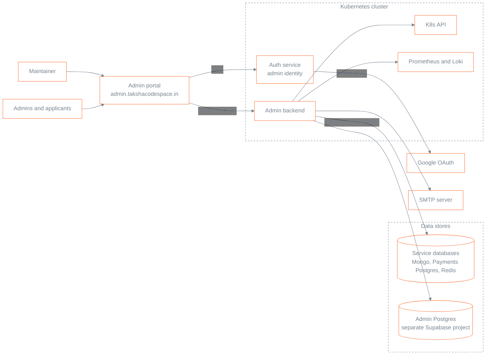
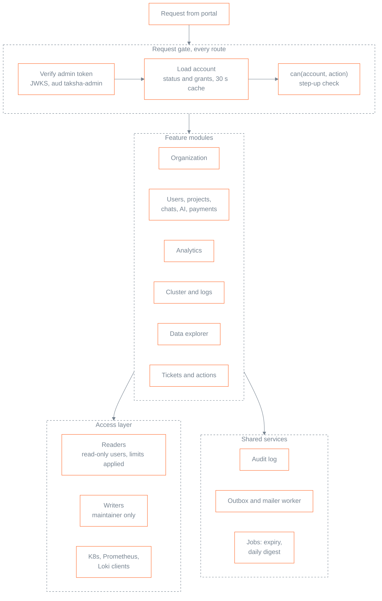
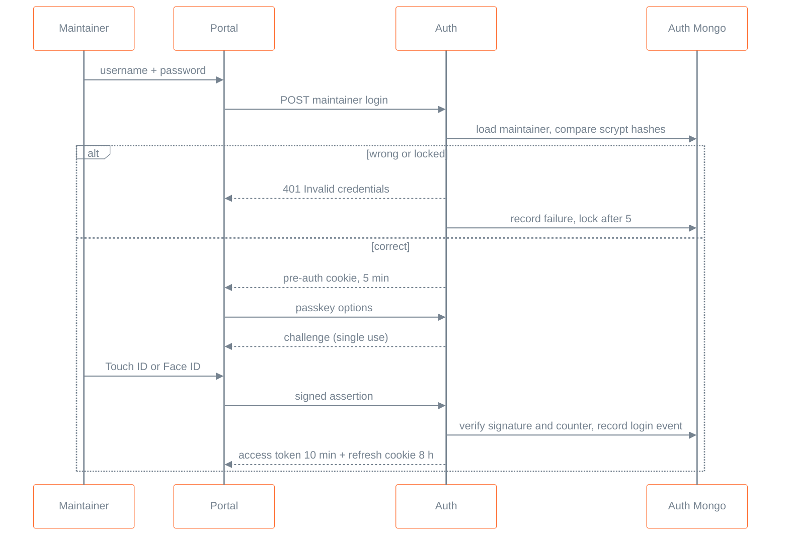
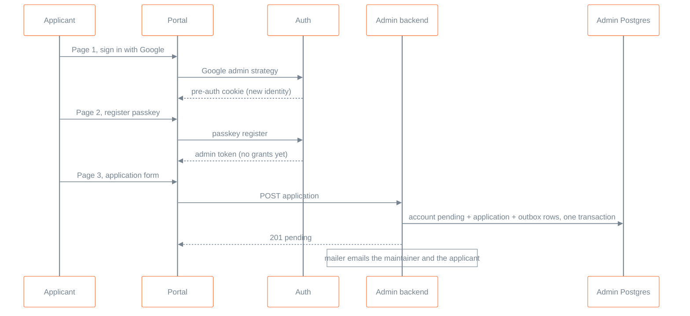
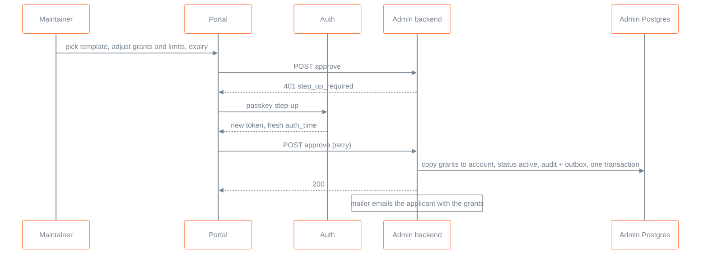
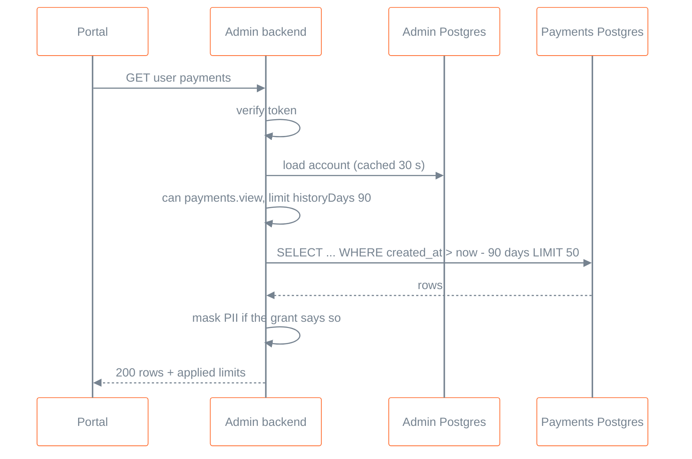
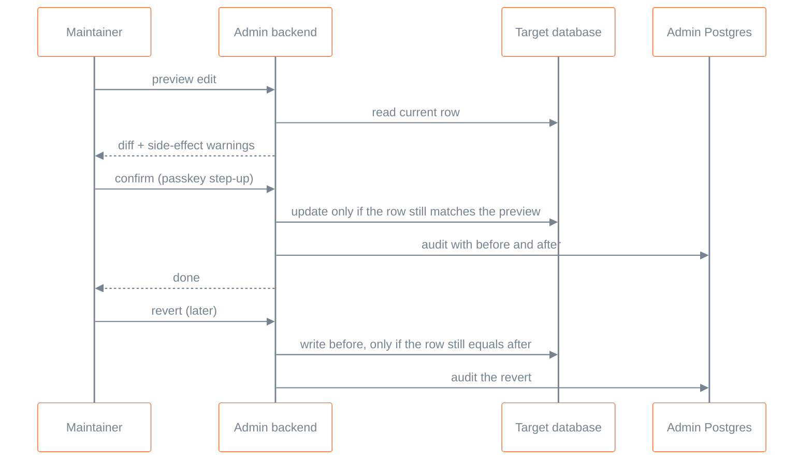
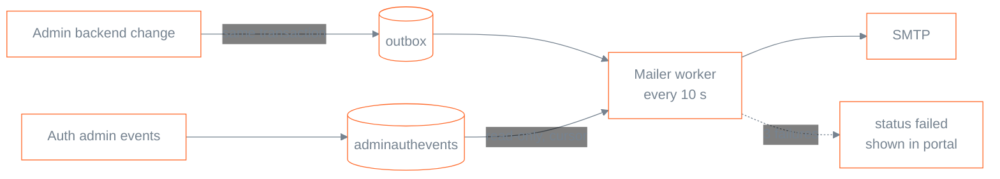
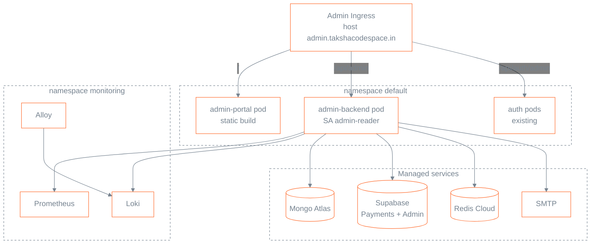

# Admin Platform: High Level Design

Status: **draft for review, nothing built.** Written 2026-11-13, checked against the code on 2026-11-14. Source of decisions: `Admin/PLAN.md`.

Plan index and ownership rules: [README.md](README.md).

**It stands alone.** No phase in this design needs a broker or any other plan. All queue work for the admin platform (admin events on Kafka, announcements, delivery log, DLQ replay) is designed in [kafka-whatsapp-architecture.md](kafka-whatsapp-architecture.md) section 7 as stage K6, and is built there, after this platform exists.

## 1. Scope

| In scope | Out of scope (later) |
|---|---|
| Maintainer and admin login, approval, grants, limits, audit | Plan editing, coupons, discounts, credit grants, refunds (PLAN P8) |
| Read views: users, projects, chats, AI runs, payments, analytics | Announcements and offers to users, delivery log, DLQ replay (Kafka plan, stage K6) |
| Cluster, pods, live and historic logs | Request id tracing inside services (needs service changes) |
| Maintainer data explorer with edit and revert | Raw SQL writes |
| Admin mail through the admin backend | WhatsApp alerts (Kafka plan, stage K6) |

Hard rule: user-facing services keep working exactly as today. If the whole admin platform is down, users notice nothing. Changes outside `Admin/` are additive only, and section 11 lists every one of them.

## 2. System context

| Actor | Gets in with | Can do |
|---|---|---|
| Maintainer (one, fixed) | Random username + random password + passkey | Everything, including organization and data edits |
| Admin | Google + passkey, approved by the maintainer | Only the granted modules, inside the granted limits |
| Applicant | Google + passkey | Fill the application form, see its status |

## 3. Admin backend components

| Component | Responsibility | Never does |
|---|---|---|
| Request gate | Token check, account status, grant check, step-up check | Trust the frontend's idea of permissions |
| Readers | One file per source service. Apply limits (date window, service list, PII mask) inside the query | Import code from other services, create indexes, run without a limit |
| Writers | Maintainer edits with diff, transaction, before and after snapshot | Run for an admin, whatever the grants say |
| Audit log | Append only, written in the same transaction as admin-side changes | Update or delete rows (blocked by a trigger) |
| Outbox and mailer | Sends admin mail, reads Auth admin events | Send bulk mail to users |
| Jobs | Expire accounts, send the maintainer digest | Run twice at once (Postgres advisory lock) |

## 4. Trust boundaries

| Boundary | Check | Fails |
|---|---|---|
| Browser to admin host | TLS. httpOnly `SameSite=Strict` cookies for refresh and pre-auth. Access token in memory only. Strict CSP. | No cookie leaves the admin host |
| Ingress to Auth admin routes | Host must be the admin host | 404 on any other host |
| Login factors | Maintainer: username + password, then passkey. Admin: Google, then passkey. Passkey is bound to the admin domain. | One factor alone gives nothing |
| Admin token to admin backend | RS256 signature, `aud: taksha-admin`, 10 min expiry | 401 |
| Admin token to user services | They require `aud: takshacodespace-services` | Rejected everywhere |
| Account and grant | Loaded from the admin Postgres on every request (30 s cache) | 403, suspended or expired accounts get nothing |
| Sensitive action | `auth_time` under 5 min, else passkey again | 401 with `step_up_required` |
| Admin backend to databases | Separate read-only users. Write users loaded only by the maintainer writers. | A reader bug cannot write |

## 5. Key flows

### 5.1 Maintainer login

The login event lands in `adminauthevents`. The admin mailer picks it up and emails the maintainer.

### 5.2 Admin registration

The passkey is registered before approval, so a Google account hijacked later cannot add its own device.

### 5.3 Approval

### 5.4 Read with limits

The response says which limits were applied, so the portal can show "last 90 days only".

### 5.5 Data explorer edit and revert (maintainer)

The "only if the row still matches" check stops an edit or revert from overwriting a change made in between.

### 5.6 Admin mail

This flow needs no broker. When Kafka stage K6 is built, the worker publishes to `admin.events` instead of calling SMTP, and nothing else here moves (Kafka plan section 7.4). If K6 is never built, this flow stays as it is.

## 6. Data ownership

| Data | Owner | Admin backend access |
|---|---|---|
| Admin identities, passkeys, admin refresh tokens, admin auth events | Auth (new Mongo collections) | Read-only (events for the mailer) |
| Admin accounts, applications, templates, audit, outbox, tickets | Admin backend (own Supabase project) | Read and write |
| Users, sessions | Auth Mongo | Read. Write: maintainer, force logout, and suspend (section 11) |
| Projects, MCP tokens | Sandbox Mongo | Read. Write: maintainer |
| Chats, memories | AI Mongo | Read. Write: maintainer |
| Live agent runs | AI service memory (`agentRun.service.js`), not in any database | Stop only, through one internal AI route (section 11) |
| Tool call records (only if the tool call analytics plan is built) | AI Mongo `toolcalls`, `toolstatshourly` | Read |
| Accounts, orders, payments, usage | Payments Postgres | Read. Write: maintainer (with ledger warnings) |
| Live sandboxes | Redis `sandbox:*` | Read, `EXPIRE` to stop a sandbox |
| Pods, events, logs | Kubernetes | Read |
| Metrics, log history | Prometheus, Loki | Read |

## 7. Deployment

| Item | Detail |
|---|---|
| Manifests | `Admin/k8s/`, applied by `Admin/skaffold.yml`. The main `skaffold.yml` is untouched. |
| Secrets | `admin-secrets` (read-only DB URIs, SMTP, admin Supabase URL) and `admin-writer-secrets` (maintainer write URIs), separate k8s secrets |
| ServiceAccount `admin-reader` | get, list, watch on pods, pods/log, events, services, deployments. Nothing else. |
| Replicas | 1 admin backend, 1 portal. Jobs and mailer run in the backend with an advisory lock, safe if a second replica appears. |
| Local | `admin.localhost`, passkey relying party `localhost` |

## 8. Failure modes

| What fails | Users | Admin portal |
|---|---|---|
| Admin backend | Nothing | Down |
| Auth | Their login fails as today | No new admin logins. Open sessions keep working until the 10 min token ends (JWKS is cached) |
| Admin Postgres | Nothing | Fails closed: every route returns 503, nothing is served without a grant check |
| One service database | That service's own problem | Only that module shows "source unavailable", the rest works |
| Prometheus or Loki | Nothing | Metric and log history panels unavailable, live K8s logs still work |
| AI service | Their agent runs fail as today | "Stop run" unavailable, every read view still works |
| K8s API | Sandboxes cannot start (existing behavior) | Cluster pages unavailable |
| SMTP | Nothing | Mail waits in the outbox, retried, then shown as failed |

## 9. Non-functional targets

| Target | Value |
|---|---|
| Admin users | 1 maintainer, up to 20 admins |
| API latency | p95 under 1 s for list and detail views, analytics under 3 s (`statement_timeout`) |
| Load on shared databases | Pool max 2 per database, every query limited and indexed, `maxTimeMS` 3 s |
| Grant or suspend takes effect | Within 30 s |
| Admin mail delivered | Within 1 min while SMTP is up |
| Session | Access 10 min, refresh 8 h absolute, step-up window 5 min |
| Audit | Every admin action and every maintainer write, kept forever |

## 10. Threats

| Threat | Defense |
|---|---|
| Maintainer username and password stolen | Passkey still required, lockout after 5 tries, alert mail on every attempt |
| Admin's Google account taken over | Passkey still required, registered before approval |
| Phishing site | Passkeys only sign for the admin domain |
| Stolen admin access token | 10 min life, admin audience only, step-up for sensitive actions |
| XSS in the portal | Strict CSP, access token in memory, refresh in an httpOnly cookie |
| CSRF | `SameSite=Strict` cookies on the admin host, Origin check on cookie routes |
| Admin abuses access | Least grants, limits, PII masking, reason on chat views, audit, maintainer digest |
| Internal service token leaks from the admin backend | It is loaded only for the stop-run action, in its own k8s secret reference. Internal routes are not routed by any ingress |
| Admin backend pod compromised | Write credentials in a separate secret used only by maintainer writers. Read-only K8s SA. Rotate on suspicion. |
| Spam applications | Rate limit per IP, identities without an application are deleted after 7 days |
| Mailbox of the maintainer stolen | Mail has no approve button, approval needs the passkey |

## 11. Changes to the existing system

Every change is additive. No existing route, field or flow changes its behavior.

| Where | Change | Phase |
|---|---|---|
| Auth | 2 lines in `src/app/app.js`, `@simplewebauthn/server`, new admin files and collections, 2 CLI scripts | P1 |
| Auth | New optional field `suspendedAt` on `users`, checked in the Google callback and in refresh. Empty for every user today, so nothing changes until an admin sets it | P7 |
| AI | One internal route, `POST` `internal/runs/stop` with `userId` and `projectId`, behind `INTERNAL_SERVICE_TOKEN`. It calls the same stop function as the public `code-agent/stop` route. Needs the `internal-service` secret in `k8s/ai-deployment.yml` | P7 |
| Databases | New read-only and maintainer users, Postgres roles with `BYPASSRLS`, Redis ACL user | P0 |
| Cluster | ServiceAccount `admin-reader`, admin Ingress | P0 |
| Cluster | `monitoring` namespace via Helm, values in `k8s/monitoring/`. Shared with Kafka plan stage K7: whichever runs first installs it, the other only checks it is there | P5 |
| Notification, Payments, Sandbox, Router, Frontend | None | |

Why the two service changes are needed (checked 2026-11-14):

| Action | Why no database-only way exists |
|---|---|
| Stop a run | Runs live in the AI service's memory. The public stop route needs the user's own token, and an admin token is rejected by every user service (`aud`) |
| Suspend a user | The `users` collection has no status field. Deleting refresh tokens (force logout) does not stop the user from logging in again with Google |

The AI internal routes file is also wanted by the Kafka plan (WhatsApp control, stage K5). Whoever builds first creates `Ai_orchestration/src/routes/internal.routes.js` with the same `requireInternalCaller` pattern as Auth, and the other adds its route.

## 12. Open questions for the PRD

- Exact field lists for the user 360 view.
- Which analytics charts ship first.
- Ticket intake: support page only, or also email.
