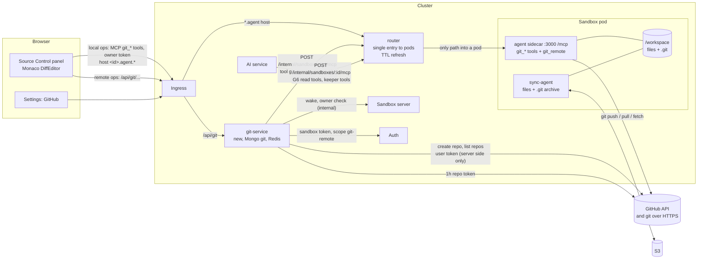
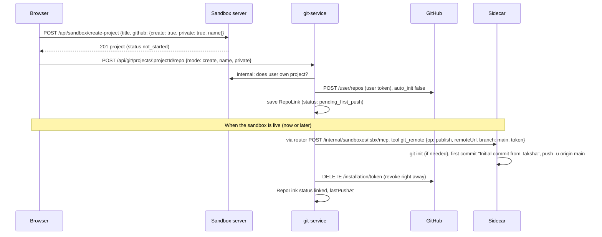
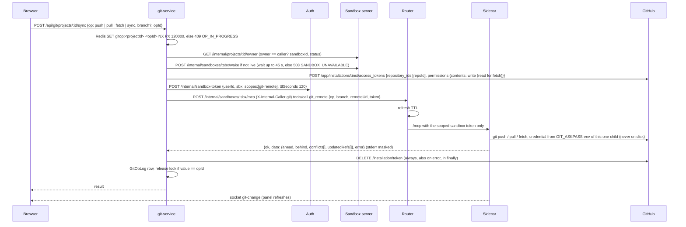
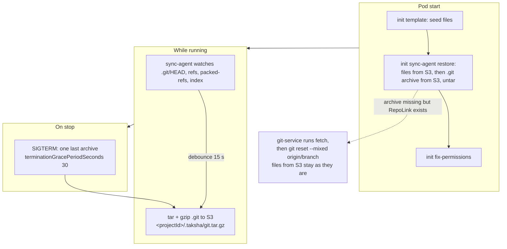
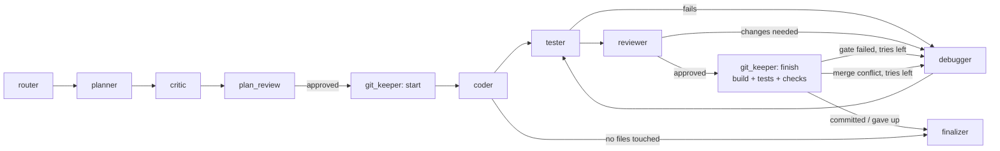
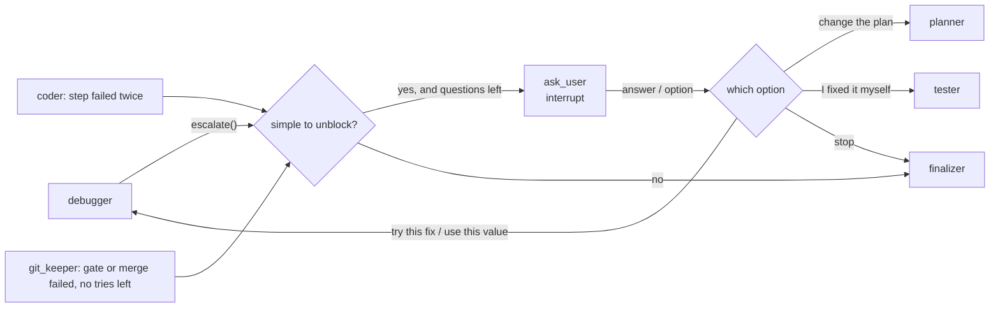
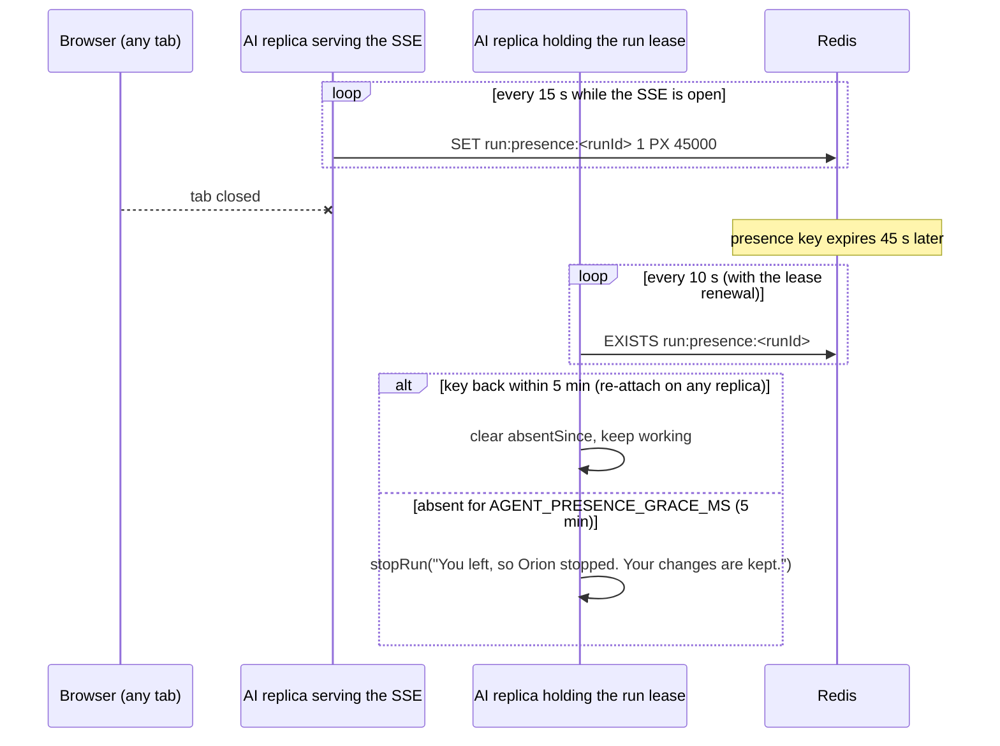
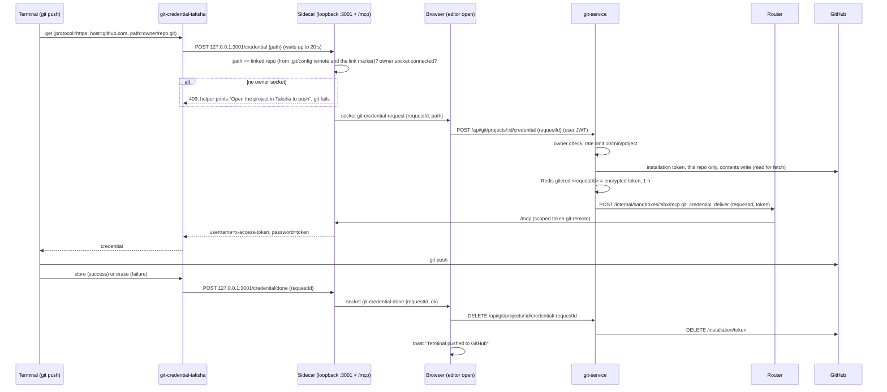

# Plan: GitHub integration and Source Control panel

Status: **draft for discussion, nothing built.** Written 2026-11-24, checked against the code the same day. This is the last v2 feature before the deployment-ready version.

Plan index and ownership rules: [README.md](README.md). Related: [taksha-agent-tools-build-plan.md](taksha-agent-tools-build-plan.md) (checkpoints, Phase 4), [platform-foundations-plan.md](platform-foundations-plan.md) (F1 durable runs, F2 internal identity, F3 safe sandbox stop).

**Audit 2026-11-24** ([AUDIT-2026-11-24.md](AUDIT-2026-11-24.md)). Changed in this file:

| Was | Now | Why |
|---|---|---|
| `git-service` called the sidecar directly (`POST /internal/git/remote`) and the network policy let `git-service` into sandbox pods | Every git-service call to a pod goes **through the router** (`POST /internal/sandboxes/:id/mcp`) as the MCP tool `git_remote` with scope `git-remote`. No new ingress rule on sandbox pods | Router is the single entry point and refreshes the TTL. The router proxy only forwards to `/mcp`, so a second sidecar route could only be reached by bypassing it |
| Terminal credential helper: the sidecar kept the owner's JWT in memory and called git-service | **Browser-brokered credential**: the sidecar asks the open editor over the socket, the browser asks git-service with its own token, git-service delivers the GitHub token to the pod through the router | User code runs in the same container and uid as the sidecar, so a JWT held there is readable by any npm script. The pod's egress also blocks private ranges, so the sidecar could not reach git-service anyway |
| Connect trusted the `installation_id` on the callback | Callback verifies the installation through `GET /user/installations` with the user token, plus PKCE and a single-flight refresh lock | GitHub docs: the setup URL's `installation_id` can be spoofed |
| `.git` archive with no consistency rule, SIGTERM save | Snapshot only when no `*.lock` exists, `git fsck --connectivity-only` before upload, 3 versions kept, restore falls back to the previous good version with a visible warning. Needs F3 (pod delete grace is 0 today) | A tar taken during a commit can be corrupt; a 0 s grace never runs the save |
| `ask_user` and approve cards on `MemorySaver` as a known limit | Depend on F1 (Mongo checkpointer, `agentruns`, Redis lease and streams) | A 24 h pause on an in-memory saver is lost on any restart and blocks a second AI replica |
| Section 4.9 described the AI calling sidecars directly | Updated: built in `3f800a6` and `8e0bf26`. Presence timer moved onto F1's Redis presence key | Code changed |
| `git_keeper` staged "files Orion changed" from the tool layer's path list, and relied on a shell regex to stop the model writing git | Run delta from **tree snapshots** (`write-tree` on a temporary index) at start and finish, plus a write-attribution log in the sidecar; the keeper verifies `HEAD`, branch and refs did not move outside its own steps | `run_command` changes files too (`npm install`, codegen); a regex over shell text is not a security boundary |

New in this file: section 4.5.1 (archive LLD), request and response schemas with error codes (6.1), the full tool list with scopes (6.2), GitHub token lifecycle (6.7), failure paths (6.8) and scaling (6.9). Mongo indexes and Redis keys in section 5.

## 1. Summary

A user connects their GitHub account once. Every Taksha project can then create (or link) a repository on **the user's own account**. The editor gets a Source Control panel that works like the one in VS Code and Antigravity: changes, staging, diffs in Monaco, commit, push, pull, fetch, branches, and later history and an AI commit message button.

The design follows three ideas:

1. **Git runs where the files are.** A real `.git` lives in `/workspace` inside the sandbox pod. All local work (status, diff, stage, commit, branch) is plain `git` run by the sidecar, so the terminal, the agent and the panel all see the same repo.
2. **GitHub secrets never live in the pod or the browser.** A new small service, `Git/` (`git-service`), owns the GitHub connection. For each push, pull or fetch it mints a token that works for **one repo, one hour, contents only**, hands it to the sidecar for that one command, then revokes it.
3. **`.git` survives sandbox stops.** Today `sync-agent` skips `.git`, so history would vanish after 20 idle minutes. This plan saves `.git` to S3 as one archive and restores it at start.

| This plan owns | This plan does not touch |
|---|---|
| New service `Git/` (routes, Mongo `git` database, GitHub App) | Payments, Notification, Kafka topics, Admin |
| `Sandbox/Agent`: git tools, `git_remote` and the credential helper | The agent-tools checkpoint repo (`/taksha-state/checkpoints.git`), see section 11 |
| `Sandbox/sync-agent`: `.git` archive save and restore | Auth token format (only reuses `POST /internal/sandbox-token`) |
| `Sandbox/template`: seed `.gitignore` | |
| `Sandbox/server`: project owner internal route, pod stop grace (F3) | |
| `Frontend`: activity bar, Source Control panel, diff editor, branch picker, GitHub settings | |
| `k8s/`: `git-deployment.yml`, ingress `/api/git`, network policy | |

**It stands alone.** Nothing here needs Kafka, the admin platform or the agent tools plan. Phase G6 (agent integration) is optional.

## 2. What the code looks like today (checked)

| Fact | Where | Effect on this plan |
|---|---|---|
| `Project` has `user`, `title`, `sandboxId`, `status`, `deletionStatus`. No repo fields | `Sandbox/server/src/models/Project.model.js` | Repo link lives in the new `git` database, keyed by `projectId`. The Sandbox schema is not changed |
| `sync-agent` ignores `node_modules`, `.git`, `dist`, `build`, ... | `Sandbox/sync-agent/sync.js` line 160 | `.git` is lost on every stop. Phase G2 adds an archive |
| `git` is in the `node:20-bullseye` agent image, but never used | `Sandbox/Agent/dockerfile` | Check `git --version` in a pod in G0. No new install expected |
| Sidecar serves file and exec tools over MCP (`/mcp`), owner token or scoped sandbox token | `Sandbox/Agent/src/mcp/` | Local git operations become MCP tools in the same list. The frontend already calls MCP tools (`sandboxAgentClient.js`) |
| Sidecar pushes `workspace-change` events over Socket.IO from chokidar | `Sandbox/Agent/src/sockets/socket.js` | The panel refreshes on these, plus a new `git-change` event |
| Terminal runs in the agent container as uid 1000 | `Sandbox/Agent/src/services/terminal.service.js` | A user typing `git commit` in the terminal is the same repo the panel shows |
| Network policy: sandbox pods accept traffic **from the router only** (the `ai-server` rule was removed in `8e0bf26`); egress to DNS, Auth and the public internet, private ranges blocked | `k8s/sandbox-networkpolicy.yml` | **No new ingress rule.** git-service reaches pods through the router. The sidecar cannot call git-service (private range), which rules out any design where the pod pulls credentials from git-service |
| Router internal path `POST /internal/sandboxes/:id/mcp` (since `3f800a6`): needs the internal token, refuses sandbox hosts, refreshes the TTL, and **always rewrites the path to `/mcp`** | `Sandbox/router/src/internalMcpProxy.js` | Remote git ops are an MCP tool (`git_remote`), not a separate sidecar route |
| Auth issues scoped sandbox tokens (`aud: taksha-sandbox`, `sbx`) through `POST /internal/sandbox-token`. Allowed scopes are hard-coded to `read`, `write`, `exec`; TTL 60 to 900 s | `Auth/src/controllers/internalSandboxToken.controller.js` | Add scopes `git` and `git-remote` to `SCOPES`. git-service asks for `git-remote` only, 120 s |
| Sandbox server can wake a stopped sandbox: `POST /internal/sandboxes/:id/wake` | `Sandbox/server/src/routes/internal.routes.js` | `git-service` wakes the sandbox before a remote op, the same way the MCP gateway does |
| Sandbox server has **no** internal "who owns this project" route (only `mcp-tokens/:hash` and `wake`) | same file | New `GET /internal/projects/:projectId/owner` (section 4.10.4) |
| Pod delete uses `gracePeriodSeconds: 0`; sync-agent runs `npm run dev` (nodemon) | `Sandbox/server/src/kubernetes/pod.js` line 286, `Sandbox/sync-agent/dockerfile` | A save on `SIGTERM` never runs today. Fixed by foundation F3 before G2 |
| Sync-agent image is `node:20-alpine` without `git` | `Sandbox/sync-agent/dockerfile` | Add `apk add --no-cache git` for `fsck` of the archive (G2) |
| The terminal is one shared `node-pty` shell spawned by the sidecar process with `env: process.env`, same uid 1000 | `Sandbox/Agent/src/services/terminal.service.js` | Anything the sidecar process holds (env, memory) is reachable by user code. The sidecar must never hold a user JWT or a long-lived secret |
| Sidecar MCP call log already masks secrets | `86896aa` | The `git_remote` token argument is also masked by name (`token`) in that log line |
| User profile already has a free-text `github` URL field | `Auth/src/models/profile.model.js`, `SettingsProfilePage.jsx` | Kept as is. After connecting, the settings page can fill it from the verified login |
| Frontend has Monaco (`@monaco-editor/react`, which ships `DiffEditor`), xterm, `lucide-react`. The editor area is `FileExplorer` + `CodeEditor` + `TerminalShell` in `App.jsx` | `Frontend/src/features/editor/` | Add an activity bar that switches the left pane between Explorer and Source Control |
| No GitHub code exists anywhere in the services | grep | Everything here is new |

## 3. Decisions to discuss before we lock the plan

Each has a recommendation. These are the questions to settle together.

| # | Question | Options | Recommendation |
|---|---|---|---|
| D1 | How do we talk to GitHub? | **GitHub App** (fine-grained, user picks repos, tokens expire, can mint 1-hour tokens for one repo) or **OAuth App** (`repo` scope = every private repo, token never expires) | **GitHub App.** Safer and it is what Vercel, Netlify and Replit use. OAuth App only if G0 finds a blocker |
| D2 | Where does the GitHub logic live? | New `Git/` service, or split across Auth (connection) and Sandbox server (repo link) | **New `Git/` service.** Clean bounded context, its own secrets, its own failure domain. Auth stays about identity |
| D3 | Repo on project create | Always, opt-in, or opt-out | **Opt-out checkbox**, on by default when GitHub is connected. Private by default. Name `taksha-<project-slug>`, editable |
| D4 | Pull strategy | Merge (VS Code default), rebase, fast-forward only | **Merge**, with a "Merge Changes" section for conflicts (same as VS Code) |
| D5 | Git typed in the terminal | Local only, or full git including push and pull | **Decided 2026-11-25: full git in the terminal.** Local commands work as is (same `.git`). `git push`, `pull`, `fetch`, `clone` of the linked repo work through a Taksha credential helper, only while the owner has the editor open (section 6.5) |
| D6 | Deleting a Taksha project | Also delete the GitHub repo, or only unlink | **Only unlink.** Taksha never deletes anything on GitHub. The app does not even ask for delete permission |

## 4. High level design

### 4.1 System view



Two paths, on purpose. **Both enter the pod through the router**, which checks the host, refreshes the sandbox TTL and is the only workload the network policy lets in:

| Path | Operations | Why |
|---|---|---|
| Browser to router to sidecar (owner token, the editor's existing channel) | status, diff, file at ref, stage, unstage, discard, commit, branch list, create, switch, stash, log, init | No GitHub secret needed, same channel the editor already uses for files |
| Browser to `git-service`, then `git-service` to router to sidecar (`git_remote` tool) | connect, create or link repo, publish, push, pull, fetch, sync, import (clone), terminal credential | Needs a GitHub token. Only `git-service` can make one |

### 4.2 Connect GitHub (once per user)

```mermaid
sequenceDiagram
  participant U as Browser
  participant G as git-service
  participant H as GitHub
  U->>G: POST /api/git/github/connect (user JWT)
  G->>G: state = random 32 bytes, Redis ghstate:<state> = {userId, codeVerifier, exp 10 min}
  G-->>U: {url: github.com/apps/<app>/installations/new?state=<state>}
  U->>H: user installs app, picks "All repos" or selected
  H-->>U: 302 /api/git/github/callback?code&installation_id&setup_action&state
  U->>G: callback (no JWT on a redirect: the state is the binding)
  G->>G: GETDEL ghstate:<state>; missing or expired: 400 STATE_INVALID
  G->>H: POST /login/oauth/access_token (code, code_verifier, client secret)
  H-->>G: user token (8 h) + refresh token (6 months)
  G->>H: GET /user (id, login, avatar)
  G->>H: GET /user/installations (user token)
  G->>G: installation_id from the URL must be in that list and owned by this GitHub user, else 400 INSTALLATION_MISMATCH
  G->>G: upsert GithubConnection, tokens encrypted (AES-256-GCM, key id stored)
  G-->>U: 302 /settings?tab=github&connected=1
```

Notes for this flow (from the GitHub docs, checked 2026-11-24):

- The app setting **"Request user authorization (OAuth) during installation"** must be on, so the install redirect carries a `code`. With it on, the Callback URL is used and the Setup URL is ignored.
- GitHub says the `installation_id` on the redirect can be spoofed and must be checked against the user's own installations. Hence the `GET /user/installations` step.
- `state` is random and single use (`GETDEL`), and it carries the user id server side, so the callback needs no cookie. PKCE (`S256`) is used even though the client secret stays on the server: it costs nothing and closes code interception.
- Connect is a `POST` that returns the URL (the SPA keeps its token in memory and cannot send it on a top-level navigation). The frontend then does `window.location = url`.
- `setup_action=update` (user changed repo selection later) refreshes `repositorySelection` and re-checks every `RepoLink` with `GET /user/installations/{id}/repositories`.

### 4.3 Create a project with a repo



If the sandbox is not live, the RepoLink stays `pending_first_push` and the panel shows "Publish to GitHub"; the publish runs the next time the user presses it (no background job wakes sandboxes on its own). A repo name that already exists returns `422` from GitHub and becomes `REPO_NAME_TAKEN` with a suggested name.

The frontend sends two calls instead of the Sandbox server calling `git-service`. That keeps project creation working when GitHub or `git-service` is down; the panel then shows "Publish to GitHub" like VS Code does for a folder without a remote.

### 4.4 Push, pull, fetch (every remote op)



One remote op per project at a time. The lock value is the `opId`, released with a compare-and-delete Lua script so a slow op whose lock expired never frees someone else's lock. The browser never sees a GitHub token. A pull that stops with conflicts returns `ok: true` with `conflicts[]`; the panel switches to Merge Changes.

### 4.5 `.git` across sandbox stops



| Option for keeping `.git` | Verdict |
|---|---|
| Sync `.git` file by file like other files | No. Thousands of small objects, chokidar churn, partial states on S3 |
| Rebuild from GitHub every start | Loses unpushed commits, stashes and branches. Used only as the fallback |
| **One archive of `.git`, saved on ref changes and on stop** | **Chosen.** Simple, atomic (upload to a temp key, then copy), cheap. Cap 200 MB; above that the panel warns and the fallback is used |
| `git bundle --all` instead of tar | Rejected as the main format: a bundle keeps refs and objects but drops the index, stash reflog, config (remote, identity) and `MERGE_HEAD`, so a restart in the middle of a merge would lose the merge |

#### 4.5.1 Archive LLD (sync-agent, phase G2, needs foundation F3)

| Step | Rule |
|---|---|
| Trigger | A second chokidar watcher on `.git/HEAD`, `.git/index`, `.git/refs/**`, `.git/packed-refs`, `.git/MERGE_HEAD`, `.git/config`. Debounce 15 s, at most one save per 60 s, plus one on `SIGTERM` |
| Quiet check | Skip and retry in 2 s while any `.git/**/*.lock` exists (`index.lock`, `HEAD.lock`, `refs/**.lock`). Give up after 30 s and log; the next trigger tries again |
| Snapshot | `cp -a .git /tmp/gitsnap-<n>` (local copy, seconds even for 200 MB), then `git --git-dir=/tmp/gitsnap-<n> fsck --connectivity-only --no-dangling`. Fails: drop the snapshot, keep the last good archive, count `git_archive_corrupt` |
| Upload | `tar -czf` the snapshot, multipart upload to `<projectId>/.taksha/git/tmp-<uuid>.tar.gz`, then `CopyObject` to `git-<ts>.tar.gz` and write `<projectId>/.taksha/git/LATEST` (a small JSON: key, sha256, size, headSha, createdAt). Keep the newest 3 archives, delete older ones |
| Size | Above 200 MB compressed: no upload, the panel shows "History too large to keep across restarts; it stays on GitHub" and the fetch fallback is used |
| Restore (init container) | Read `LATEST`, download, check sha256, untar into `/workspace/.git`, `git fsck --connectivity-only`. Fails: try the previous archive, and write `/workspace/.taksha/git-restore.json` with `{restoredFrom, lostSince}` so the panel shows a yellow banner ("History restored from 14:02, later commits are on GitHub only if they were pushed"). No archive and no RepoLink: no `.git`, panel offers "Initialize Repository" |
| Ownership | Restore runs before `fix-permissions`, so the files end up owned by uid 1000 like the rest |

The working tree and `.git` are saved by different paths (files every 400 ms, `.git` every 15 to 60 s). After a crash the restored index can be older than the files; git then simply shows those files as modified, which is correct and loses nothing.

## 4.6 Why git: what Taksha and the agent gain

Git is not only a backup button. It gives the agent a memory of the project and gives the user control and freedom.

**For the agent (Orion, Clio, external agents over MCP)**

| Gain | How | Phase |
|---|---|---|
| Knows what changed, exactly | `git diff` since the last commit or since the last run, instead of re-reading whole files. Smaller context, fewer tokens and credits | G6 |
| Knows what the **user** changed between turns | At run start, diff `HEAD` + working tree against the commit the last run ended on. The prompt gets "you edited `App.jsx` and `Nav.jsx` since my last turn", so the agent does not undo the user's work | G6 |
| Long-term project memory | `git log` and commit messages say why things changed. The memory agent can read the last commits instead of guessing from chat | G6 |
| Better review | The reviewer node reads the run's diff, not the full files, and judges only what changed | G6 |
| Safe experiments | The agent can work on a branch `taksha/run-<id>`. The user merges it or throws it away, like a pull request at home | G6 |
| Real undo | Commits survive restarts (the `.git` archive), unlike the agent tools checkpoints which die with the pod | G2 |
| Find the breaking change | `git log -p`, `git blame` and `git bisect` let the debugger node find when a bug came in | G6 |
| Many agents, one truth | Orion, the user and an external agent (Claude Code over MCP) all see the same history, so each knows what the others did | G2 |

**For the user**

| Gain | Why it matters |
|---|---|
| Code lives on their own GitHub | No lock-in. They can leave Taksha and keep everything |
| Portfolio and contribution graph | Commits are credited to their GitHub profile |
| One-click deploys | Vercel, Netlify and Cloudflare Pages deploy straight from the GitHub repo |
| Work anywhere | Clone at home, push, then `git pull` in Taksha (panel or terminal) |
| Teamwork | Friends can push to the same repo; Taksha pulls their work |
| Safety | History, revert and branches for every change, by the user or the agent |
| Familiar | Same workflow as VS Code, Antigravity and any terminal |

## 4.7 The `git_keeper` node in Orion (proposed 2026-11-25)

Orion gets one node that owns every git **write**. Other nodes never stage, commit, branch or merge. The node is mostly plain code, not a model loop: git steps must be predictable, so only the commit message comes from the fast model.

### 4.7.1 Where it sits

Today (`graph/orion.graph.js`): `router -> planner -> critic -> plan_review -> coder -> tester -> reviewer -> finalizer`, with `debugger` looping back to `tester`. The keeper is added at two points: once before the coder starts, once after the reviewer approves.



| Step | `git_keeper: start` | `git_keeper: finish` |
|---|---|---|
| 1 | No repo: `git init` (same as the panel) | Run the gates (table below) |
| 2 | Save `baseSha` (HEAD), `baseBranch`, and `baseTree`: the whole working tree written as a tree object through a temporary index (`GIT_INDEX_FILE=/tmp/taksha-run-<id>.idx git add -A && git write-tree`), so the real index is never touched | Compute `endTree` the same way. `git diff --name-status baseTree endTree` is every path that changed **during the run**, whoever changed it (tools, `run_command`, `npm install`, the user). Split it with the sidecar's write log (below): paths written only by the run's token are Orion's; paths the owner token or the terminal wrote are the user's. Stage **only Orion's paths**. A path both wrote is handled by K2 |
| 3 | Branch mode on: create `taksha/run-<id>` from HEAD and switch to it. User's uncommitted edits come along, git keeps them | Commit with a fast-model message (Conventional Commits, from the staged diff) and a trailer `Taksha-Run: <id>` |
| 4 | Take an agent-tools checkpoint if that plan is built | Branch mode: switch back and merge into the base branch (`--no-ff`). Conflict: `git merge --abort`, send the debugger to merge base into the run branch, fix, re-test, then try again |
| 5 | | Check the result: no conflict markers, no Orion changes left uncommitted, base branch has the commit |
| 6 | | Push only if the user said so: an approve card (same `interrupt()` pattern as `plan_review`) or the project setting "Auto push after agent runs" (off by default) |

### 4.7.2 Gates before a commit

| Gate | Command or check | On failure |
|---|---|---|
| Build | `npm run build`, exit 0 (the template has a `build` script) | Back to `debugger` with the error output |
| Tests | `npm test` if a `test` script exists. The Vite template has none today, so this is skipped and the report says so | Back to `debugger` |
| Lint (soft) | `npm run lint` if present | Listed in the report, does not block |
| No conflict markers | Search changed files for `<<<<<<<`, `=======`, `>>>>>>>` | Back to `debugger` |
| No secret files | `.env*`, `*.pem`, `id_rsa` not staged | Unstage, warn the user |
| No build output tracked | `dist/`, `node_modules/` not staged | Fix `.gitignore`, unstage |
| Clean result | After the commit, none of Orion's files show in `git status` | Report as a bug, do not push |

Tries: the finish step shares the debugger budget that already exists (`LIMITS` in `orion.state.js`). When it runs out, nothing is committed, the run branch stays for the user to look at, and the finalizer says why.

### 4.7.3 How other nodes "ask" the keeper

In LangGraph a node cannot call another node in the middle of its own turn. So "asking" works in two ways:

| Need | How |
|---|---|
| Read git (planner wants recent history, coder wants "what changed", reviewer wants the run diff) | Direct read tools: `git_status`, `git_diff`, `git_log`, `git_show_file`. No round trip, no extra model call |
| Write git (commit now, make a branch) | The node writes a request into state (`gitRequests: [{op, reason}]`). The keeper handles it at its next step. The model never gets write tools such as `git_commit` or `git_merge`; a guard in `core/toolLoop.js` blocks them |

Plain `git` typed through `run_command` is refused for write subcommands (`commit`, `push`, `merge`, `rebase`, `reset`, `checkout`, `switch`, `clean`, `stash`, `tag`, `branch -d/-D`) by the **AI-side** guard (`tools/guards.js`) only. The sidecar copy in `mcp/tools.js` is not changed for this: external agents (Claude Code over MCP with `exec`) and the owner are allowed to use git, and blocking them would break D5.

The guard is a convenience that gives the model a clear message. It is **not** the enforcement, because a shell string can always be rewritten (`sh -c`, `env`, an npm script). The enforcement is a check the keeper runs at finish, before it commits:

| Check at finish | On failure |
|---|---|
| `git rev-parse HEAD` == `baseSha` (or the run branch tip the keeper itself made) | Something moved HEAD outside the keeper. No commit, no push, the report names the unexpected commits (`git log baseSha..HEAD`) and the run goes to `ask_user` |
| `git symbolic-ref HEAD` == the branch the keeper expects | Same |
| `git for-each-ref` digest equals the digest taken at start, except the keeper's own refs | Same |

**Write-attribution log (sidecar, G6b).** The sidecar's file layer (agent tools P2, `workspace/files.js`) appends `{path, at, actor}` to an in-memory ring (10,000 entries) for every write, where `actor` is `run:<sbx-token jti>` for the AI service's token, `owner` for the editor, and `external:<token id>` for an MCP token. The terminal and `run_command` writes have no actor; chokidar events with no matching log entry within 1 s are recorded as `actor: shell`. The keeper reads it with a new read tool `git_write_log {since}` (scope `git`, not given to the model). If the AI service's own `run_command` produced a `shell` write during the run (it knows when it ran commands), those paths count as Orion's.

### 4.7.4 New state fields (`orion.state.js`, additive only)

`git: { enabled, baseBranch, baseSha, baseTree, refsDigest, runBranch, userDirtyFiles[], touchedFiles[], commitSha, mergeStatus, gateResults[], pushed }`, `gitRequests: list()`.

The keeper calls its tools (`git_init`, `git_stage`, `git_commit`, `git_checkout`, `git_merge`, `git_write_log`, `git_snapshot_tree`) through the same router path as every other AI tool call, with `actor: system` in the tool call log. They are in a separate `KEEPER_TOOLS` allowlist in `mcp.client.js` that is never bound to a model. `git_merge` and `git_snapshot_tree` are new sidecar tools (scope `git`), listed in 6.2.

The push itself is a git-service operation (it needs a GitHub token), and the AI service never calls git-service. When the user presses **Push** on the card, the frontend calls `POST /api/git/projects/:id/sync {op: push}` itself, then resumes the run with `{pushed: true, sha}` so the finalizer can report it. "Auto push after agent runs" works the same way: the frontend does the push when it receives `agent:git_committed`, and only while the editor is open. A run with nobody watching never pushes.

### 4.7.5 What the user sees

- A "Git" step in the run timeline: branch made, gates (build ✓, tests skipped, lint 2 warnings), commit `feat: add navbar` (sha), merged into `main`.
- An approve card "Push 1 commit to GitHub?" when auto push is off.
- In branch mode, if gates fail: "Changes kept on `taksha/run-ab12`. Open in Source Control to look or discard."

### 4.7.6 Open questions for this node

| # | Question | Recommendation |
|---|---|---|
| K1 | Branch mode on by default? | **Off at first** (commit straight on the current branch, only Orion's files). Turn on once the merge path is proven |
| K2 | Commit when the user's own edits touch the same file as Orion? | Commit the whole file and say so in the report, since the two cannot be split safely |
| K3 | Add a test runner (Vitest) to the template so the test gate means something? | **Yes**, new projects only. Old projects skip the gate |

## 4.8 `ask_user`: ask instead of giving up (proposed 2026-11-25)

**Today:** when the debugger runs out (`LIMITS.maxFixAttempts: 3`), sees the same error twice, or finds no safe fix, it calls `escalate()` and the run goes to the `finalizer` and ends. All the context the run built up is thrown away, and the user starts a new run that re-reads everything, which costs tokens again.

**Change:** a new node `ask_user` that pauses the run with `interrupt()` (the same pattern as `plan_review`) and asks the user one short question. While it waits it costs nothing. After the answer, the run continues from where it stopped, with the same state and a small new retry budget.



### 4.8.1 When it asks (only the simple cases)

A plain-code check runs first, then one fast-model call writes the question. The run asks only when a short answer from the user can unblock it.

| Ask | Do not ask, go to the finalizer |
|---|---|
| A missing value: env var, API key, URL, port ("The app needs `VITE_MAPS_KEY`. Add it or should I mock the map?") | The model provider failed, credits ran out, or the user pressed Stop |
| A choice between two or three clear approaches ("Use `react-router` or keep one page?") | The same question was already asked in this run |
| Something only the user can do: sign in, add a secret, approve installing a package | The run already asked 2 questions (limit per run) |
| A test or check that may itself be wrong ("This test expects the old title. Update the test or the code?") | The error is inside Taksha (sandbox down, tool crash) |
| An unclear requirement found while coding | The fix attempts made no progress at all and there is no concrete question to ask |
| A merge conflict where both sides changed the same lines on purpose | |

### 4.8.2 The question card

Shown in the chat like the plan review card:

- **Question**, one line, plus **why I'm stuck** in at most two lines (the last error, what was tried).
- **2 to 4 options** the model proposes, plus a free-text box, plus always "Stop here and summarise".
- Each option maps to where the run goes next: `debugger` (with the user's hint), `planner` (re-plan), `tester` ("I fixed it myself, check again"), or `finalizer`.

### 4.8.3 Rules

| Rule | Value |
|---|---|
| Questions per run | 2 at most (`LIMITS.maxUserQuestions`) |
| Retry budget after an answer | +2 fix attempts, not a full reset |
| User's answer | Saved in state as `userGuidance[]`, given to the debugger and coder prompts as "USER SAID" |
| No answer | The run stays paused. When the user comes back to the chat, the card is still there. After 24 hours it ends with a summary |
| Sandbox stopped while waiting | The resume call wakes the sandbox first (same as the MCP gateway's wake) |
| Memory agent | Saves the question and answer into the project notes, so the next run does not ask again |
| Billing | Only the one fast-model call that writes the question. Waiting is free |

### 4.8.4 Prerequisite: durable runs (foundation F1)

A question that may wait 24 hours cannot live in `MemorySaver` (`orion.graph.js` line 35) or in a `setTimeout`. **G6c is not started before F1** ([platform-foundations-plan.md](platform-foundations-plan.md) section 2): the pause is a checkpoint in Mongo, the run record says `pausedFor: {type: ask_user}` with `pausedUntil` 24 h later, and the sweeper ends it with a summary when that time passes. The answer route does the same compare-and-set from `paused` to `running` as plan approve, so two tabs answering at once apply one answer.

### 4.8.5 Files it touches

`graph/orion.graph.js` (new node and edges from `debugger`, `coder`, `git_keeper`), `graph/orion.state.js` (`userGuidance`, `questionsAsked`, `LIMITS.maxUserQuestions`), `nodes/debugger.node.js` (`escalate()` routes to the check instead of straight to the finalizer), new `nodes/askUser.node.js`, AI routes for the answer (same shape as plan-approve), Frontend card next to `PlanReviewCard`.

This is agent behaviour more than git. It lives here because the `git_keeper` uses it; if the agent tools plan is built first, move this section there and link to it.

## 4.9 Agent and sandbox when the user leaves (updated by the audit 2026-11-24)

### 4.9.1 What the code does today (checked 2026-11-24)

| Fact | Where |
|---|---|
| **Built (`3f800a6`, `8e0bf26`):** every Orion and Clio tool call goes through the router's internal path `POST /internal/sandboxes/:id/mcp`, which refreshes `sandbox:<id>` to 1200 s. There is no direct path and no fallback; without `INTERNAL_SERVICE_TOKEN` tool calls fail closed | `Sandbox/router/src/internalMcpProxy.js`, `Ai_orchestration/src/agent/tools/sandbox.client.js`, `k8s/sandbox-networkpolicy.yml` |
| A run keeps going when the browser disconnects; the SSE subscriber is just removed | `agentRun.service.js` (`subscribers`, 15 s SSE heartbeat) |
| Only a plan review has a timeout (30 minutes, `setTimeout`) | `agentRun.service.js` `REVIEW_TIMEOUT_MS` |
| **Not built:** the presence rule (stop Orion when nobody watches) | none |

So the "sandbox deleted under a running agent" bug is fixed. What is left is the cost bug: a run keeps spending tokens and credits for up to an hour after the user closed the tab.

### 4.9.2 The rule (unchanged)

1. **While Orion is working, the sandbox stays up.** Tool calls through the router keep it fresh.
2. **If the user is gone for 5 minutes, Orion stops.** Gone means no open chat stream for this run, in any tab, on any AI replica.
3. **Only after Orion stops can the sandbox stop**, through the normal 20-minute idle key.

### 4.9.3 Design (on foundation F1)



| Item | Value |
|---|---|
| Presence key | `run:presence:<runId>`, set by every open SSE response on its existing 15 s heartbeat, 45 s expiry. Works across tabs and replicas |
| Check | The lease holder checks the key with its 10 s lease renewal, keeps `absentSince` in the run record, stops after `AGENT_PRESENCE_GRACE_MS` (default 300000) |
| Long model phases | A single model call is capped at 180 s and tool calls refresh the TTL, so no extra keep-alive is needed. If one is ever needed (for example the rate limiter waiting many minutes), it goes through the **router** (a `ping` MCP tool or the internal path), never a direct Redis write from the AI service, because the router and the Sandbox server own that key. The `POST /internal/sandboxes/:id/touch` route proposed earlier is dropped |
| What "stop" does | The same `stopRun` as the Stop button. Files already written stay. The `git_keeper` does not commit a stopped run |
| Paused runs | A plan review, `ask_user` or push card is not stopped by the presence rule. It holds no lease and costs nothing; its own `pausedUntil` ends it |
| Before F1 exists | Do **not** ship an in-memory version of the timer. It would count only one replica's subscribers and stop runs that a second tab is watching. G6d waits for F1b |
| When the user comes back | "Orion stopped because you left for 5 minutes" with **Continue**, which starts a new turn with the summary |
| Optional later | Per-project "Keep working while I'm away" (off by default), up to the credit limit |

### 4.9.4 Files it touches

`Ai_orchestration/src/services/agentRun.service.js` (presence key on SSE heartbeat, check in the lease loop), Frontend chat (stopped banner and Continue). No Sandbox server change.

## 5. Data model (Mongo `git`)

`GithubConnection` (one per user)

| Field | Notes |
|---|---|
| `userId` | From the token. **Unique index** |
| `githubUserId`, `login`, `avatarUrl` | From `GET /user`. **Unique index on `githubUserId`**: one GitHub account links to one Taksha user, so two Taksha users cannot share one installation |
| `noreplyEmail` | `<id>+<login>@users.noreply.github.com`, used as commit email unless the user picks another verified email |
| `installationId`, `repositorySelection` | Verified against `GET /user/installations` (section 4.2). `all` or `selected` |
| `accessTokenEnc`, `accessTokenExpiresAt`, `refreshTokenEnc`, `refreshTokenExpiresAt`, `keyId` | AES-256-GCM, 12-byte random IV per value, `userId` as additional authenticated data (a ciphertext copied to another row fails to decrypt). Keys from k8s secret `git-service` as `GIT_TOKEN_KEYS` (`keyId:base64key` list, newest first). Rotation: new rows use the newest key; a background pass re-encrypts old rows |
| `status` | `active`, `needs_reconnect`, `revoked` |
| `version` | Optimistic concurrency for the refresh write (section 4.10.2) |

`RepoLink` (one per project)

| Field | Notes |
|---|---|
| `projectId`, `sandboxId`, `userId` | **Unique on `projectId`**. Index `{userId: 1}` for the settings list |
| `owner`, `name`, `githubRepoId`, `htmlUrl`, `private`, `defaultBranch` | `githubRepoId` survives renames; index `{githubRepoId: 1}` for webhooks |
| `createdByTaksha` | `true` when we created it, `false` when linked or imported |
| `status` | `pending_first_push`, `linked`, `repo_missing`, `no_access` |
| `lastPushAt`, `lastFetchAt`, `lastError` | For the panel and support |

`GitOpLog` (TTL index on `at`, 30 days): `userId`, `projectId`, `op`, `source` (`panel`, `terminal`, `agent`), `ok`, `durationMs`, `errorCode`, `at`. No tokens, no file contents. The admin platform reads it through git-service's internal admin API (admin decision 2026-11-24), not from the database.

Redis (keys owned by git-service only)

| Key | Value | Life |
|---|---|---|
| `ghstate:<state>` | `{userId, codeVerifier}` | 10 min, deleted on use (`GETDEL`) |
| `ghrefresh:<userId>` | lock while refreshing a user token | 15 s |
| `gitop:<projectId>` | `opId` of the running remote op | 120 s, compare-and-delete |
| `gitcred:<requestId>` | `{userId, projectId, tokenEnc, createdAt}` for a terminal credential | 1 h; the sweeper revokes anything older than 10 min |
| `ghdelivery:<X-GitHub-Delivery>` | `1` | 24 h, webhook replay guard |
| `ratelimit:gitops:<userId>` | token bucket | 1 min |

## 6. APIs

### 6.1 `git-service` (ingress `/api/git`, user JWT via JWKS like the other services)

All routes except the callback and the webhook need the user's access token. Every project route first calls the Sandbox server's `GET /internal/projects/:projectId/owner` and returns 404 `PROJECT_NOT_FOUND` when the caller is not the owner (404, not 403, so ids cannot be probed).

| Method and path | Request | Response | Errors |
|---|---|---|---|
| `POST /github/connect` | none | `{url}` to the app install page | `ALREADY_CONNECTED` 409 |
| `GET /github/callback` | `code`, `installation_id`, `setup_action`, `state` | 302 to `/settings?tab=github&connected=1`, or `&error=<code>` | `STATE_INVALID`, `INSTALLATION_MISMATCH`, `GITHUB_UNAVAILABLE` |
| `GET /github/status` | none | `{connected, login, avatarUrl, repositorySelection, status, installUrl}` | |
| `DELETE /github` | none | 204 | Revokes the grant (`DELETE /applications/{client_id}/grant`), deletes tokens, sets links to `no_access`. The app stays installed on GitHub until the user uninstalls it; the response tells the UI to show that link. Repos are never touched |
| `GET /github/repos?query=&page=` | | `{repos: [{id, fullName, private, defaultBranch}], nextPage}` from `GET /user/installations/{id}/repositories` | `NEEDS_RECONNECT` 401 |
| `GET /projects/:projectId/repo` | | `RepoLink` or 404 `NOT_LINKED` | |
| `POST /projects/:projectId/repo` | `{mode: create, name, private}` or `{mode: link, repoId}` | 201 `RepoLink` | `REPO_NAME_TAKEN` 409 (with `suggestion`), `REPO_NOT_ACCESSIBLE` 403, `ALREADY_LINKED` 409 |
| `DELETE /projects/:projectId/repo` | | 204. Removes `origin` in the pod (through the router) when the sandbox is live, else on next publish | |
| `POST /projects/:projectId/sync` | `{op: push | pull | fetch | sync | publish, branch?, opId}` (`opId` is a client UUID, so a retried request is the same op) | `{ok, ahead, behind, conflicts[], updatedRefs[], durationMs}` | `OP_IN_PROGRESS` 409, `SANDBOX_UNAVAILABLE` 503, `NON_FAST_FORWARD` 409 ("Pull first"), `SECRET_FILE_STAGED` 422, `REPO_MISSING` 410, `NEEDS_RECONNECT` 401, `RATE_LIMITED` 429, `GIT_FAILED` 502 (masked stderr) |
| `POST /projects/:projectId/credential` (G4b) | `{requestId}` from the socket request | 204 once the token is delivered to the pod | `NO_PENDING_REQUEST` 404, `RATE_LIMITED` 429 |
| `DELETE /projects/:projectId/credential/:requestId` (G4b) | | 204, token revoked | |
| `POST /import` (G7) | `{repoId, title}` | 201 project | |
| `POST /webhooks/github` | GitHub webhook | 202 | `X-Hub-Signature-256` HMAC over the raw body, constant-time compare, `X-GitHub-Delivery` replay guard |

Internal (F2 per-caller identity, not in the ingress):

| Route | Caller | Does |
|---|---|---|
| `GET /internal/admin/git-ops?userId=&from=&to=` | `admin` | Admin views read `GitOpLog` through this, per the admin decision of 2026-11-24 |

Errors use FaultKit, like Payments and AI.

### 6.2 Sidecar MCP tools (new scopes `git` and `git-remote`)

The owner token gets every `git` tool. External MCP tokens may get `git` when the owner ticks it. `git-remote` is only ever in a 120 s token that git-service asks Auth for; no user-facing token can hold it.

| Tool | Scope | Args | Returns |
|---|---|---|---|
| `git_status` | git | none | `{branch, upstream, ahead, behind, staged[], unstaged[], untracked[], conflicted[], merging}` from `git status --porcelain=v2 --branch -z` |
| `git_diff` | git | `path?`, `staged?`, `ref?` | Unified diff, capped like every result |
| `git_show_file` | git | `path`, `ref` (`HEAD`, `:0` for the index) | File content at that ref, the left side of the Monaco diff |
| `git_stage` / `git_unstage` | git | `paths[]` or `all` | New status |
| `git_discard` | git | `paths[]` | New status. The UI asks first; untracked files go to `.taksha/trash/` instead of being removed |
| `git_commit` | git | `message`, `amend?`, `stageAll?`, `trailers?` | `{sha, summary}`. Refuses an empty message or a conflicted index |
| `git_log` | git | `ref?`, `path?`, `limit` (max 200), `cursor` | Commits for the history view |
| `git_branches` | git | none | Local and remote branches, current, upstream |
| `git_checkout` | git | `branch`, `create?`, `from?` | Refuses when the tree is dirty unless `stash: true` |
| `git_merge` | git | `branch`, `noFf?` | `{ok, conflicts[]}`; `abort: true` runs `git merge --abort` |
| `git_stash` | git | `op: push | pop | list` | Result |
| `git_init` | git | none | Used by publish for old projects |
| `git_snapshot_tree` | git | none | Tree id of the working tree through a temporary index (keeper only) |
| `git_write_log` | git | `since` | Write-attribution entries (keeper only, section 4.7.3) |
| `git_remote` | git-remote | `{op: push | pull | fetch | publish | set_remote | clone, remoteUrl, branch?, token}` | `{ahead, behind, conflicts[], updatedRefs[]}` |
| `git_credential_deliver` | git-remote | `{requestId, token, expiresAt}` | `{delivered: true}`, or `NO_PENDING_REQUEST` |

Every tool returns the `{ ok, data, error: { code, message, hint } }` envelope from the agent tools plan. Paths go through the existing `safeResolve`. Git is always run with `execFile` and an argument array, never a shell string, with `GIT_TERMINAL_PROMPT=0`, `GIT_CONFIG_NOSYSTEM` unset (so the system credential entry applies) and a per-op timeout (local 15 s, remote 90 s). A second git op on the same repo waits on an in-process mutex in the sidecar (one sidecar per pod, so in-process is correct here), so the panel and a keeper step never race for `index.lock`.

### 6.3 `git_remote` (replaces the old `/internal/git/remote` route)

Reached only through the router's internal path with a scoped token (`git-remote`), so the router refreshes the TTL and the network policy stays router-only. Runs git with:

- `GIT_ASKPASS` pointing to `/usr/local/bin/taksha-askpass`, which prints `$TAKSHA_GIT_TOKEN`; the token is only in that one child's env, never on disk, never in `.git/config`. Remote URL is `https://github.com/<owner>/<repo>.git` with no credentials in it.
- `-c credential.helper=` for this child, so the terminal's helper (6.5) is not asked.
- stdout and stderr with the token (and any `x-access-token:` URL) masked before they are logged or returned. The MCP call log masks the `token` argument.
- A pre-push check of staged and committed paths for `.env*`, `*.pem`, `id_rsa*` returns `SECRET_FILE_STAGED` unless the request says `confirmSecrets: true` (set only after the user confirms in the UI).

git-service revokes the token in a `finally` block, so even a leaked copy dies within seconds.

### 6.4a Terminal git (D5)

Everything git can do works in the terminal, so a user who knows git never has to touch the panel. The panel and the terminal share one `.git`, so a `git commit` typed in the terminal shows up in the panel within a second (`git-change` event), and the other way round.

| Command type | How it works |
|---|---|
| Local (`status`, `add`, `commit`, `branch`, `switch`, `merge`, `rebase`, `stash`, `log`, `diff`, `reset`, ...) | Plain git on `/workspace/.git`. Nothing to build except the identity: on link, the sidecar sets repo-local `user.name` and `user.email` (the GitHub noreply email) so commits are credited to the user's GitHub profile |
| Remote (`push`, `pull`, `fetch`, `clone` of the linked repo) | Through the browser-brokered credential helper below |
| Remote to any other repo or host | Works for public repos. Private ones need the user's own credentials, like on any machine |

### 6.5 Terminal credential helper (browser-brokered)

The agent image gets a tiny credential helper, set in the system config for GitHub only: `git config --system credential.https://github.com.helper /usr/local/bin/git-credential-taksha`.

The rule that shapes it: **the pod never holds a user token**, and **the browser never holds a GitHub token**. The open editor proves the owner is present by doing the request with its own token; the GitHub token travels git-service to router to sidecar, like every other remote op.



Rules:

- **Owner must be online,** proven by the browser making the request with its own token. No editor open, no credential: the helper prints "Open the project in Taksha to push".
- **No user token in the pod.** The sidecar keeps only `requestId -> waiting helper` for 20 s.
- **Linked repo only.** Any other path gets an empty answer and git falls back to its normal behaviour (public repos work, private ones ask for the user's own credentials).
- **Loopback listener.** The helper endpoint is a second listener bound to `127.0.0.1:3001`, so the router (which reaches the pod IP on 3000) can never reach it.
- **Short life.** One token per git command, revoked on `store` or `erase`. If the browser closes before `done`, git-service's sweeper revokes any `gitcred:*` older than 10 minutes; GitHub expires it at 1 hour regardless.
- **Visible.** Every terminal credential shows a toast and writes a `GitOpLog` row with `source: terminal`.
- **Not stored.** The helper never writes the token to `.git-credentials` or `.git/config`. The panel warns if it finds `~/.git-credentials`.

Accepted risk: a malicious npm script running while the editor is open can trigger the helper. It gets one repo, contents only, revoked within minutes, and the user sees a toast for each use. That is the same power the user's own shell already has over that repo.

### 6.6 Socket events (sidecar)

| Event | When |
|---|---|
| `git-change` | `.git/HEAD`, `.git/index`, refs or `MERGE_HEAD` changed (debounced 300 ms). The panel then calls `git_status` |
| `git-credential-request`, `git-credential-done` | Section 6.5. Sent only to owner sockets (they all are: `requireOwnerSocket`) |
| `workspace-change` (exists) | The panel also refreshes on it, debounced 500 ms |

### 6.7 GitHub details (LLD)

| Topic | Rule |
|---|---|
| App JWT | RS256 with the app private key, `iat` = now - 60 s, `exp` = now + 9 min, `iss` = app id. Cached in memory for 8 min per replica (it is not a secret beyond the key itself) |
| Installation tokens | `POST /app/installations/{id}/access_tokens` with `repository_ids: [repoId]` and the smallest `permissions` for the op (`contents: read` for fetch, `write` for push). One per op, revoked in `finally`. Never cached: a cache would keep a write token alive for an hour |
| User tokens | Used only for: verify installation, create repo, list repos, add repo to a "selected" installation. Expire in 8 h, refresh tokens in 6 months |
| Refresh | Single flight per user: `SET ghrefresh:<userId> NX PX 15000`; the holder re-reads the row, refreshes if still expired, writes both new tokens with `version` compare-and-set. Others wait up to 5 s and re-read. GitHub replaces the refresh token on every refresh, so two parallel refreshes would lock the user out; this is why the lock exists. `bad_refresh_token` sets `needs_reconnect` |
| Create repo | `POST /user/repos {name, private, auto_init: false}` with the user token (needs app permission Administration: write). Then, when `repositorySelection` is `selected`, `PUT /user/installations/{id}/repositories/{repoId}` so the installation can mint tokens for it. Both steps are idempotent; G0 confirms whether the second is needed |
| Rate limits | Every call reads `x-ratelimit-remaining`; on 403/429 with `retry-after` or `x-ratelimit-reset`, back off and return `RATE_LIMITED` with the wait time. A remote op costs 2 REST calls (create and revoke token) plus git traffic |
| Webhooks (moved to G4 for these events) | `installation.deleted`, `installation.suspend`, `github_app_authorization.revoked`: connection `revoked` or `needs_reconnect`, links `no_access`. `installation_repositories.removed`: affected links `no_access`. `repository.renamed`, `transferred`: update `owner`, `name`, `htmlUrl` by `githubRepoId` (G7 for the UI). `repository.deleted`: `repo_missing` |

### 6.8 Failure paths

| Failure | What the user sees | System behaviour |
|---|---|---|
| GitHub down or 5xx | "GitHub is not answering. Your commits are safe here; try again" | Remote op fails with `GITHUB_UNAVAILABLE`, lock released, nothing local changes |
| Token mint fails (app uninstalled) | "Reconnect GitHub" | `NEEDS_RECONNECT`, connection marked |
| Sandbox will not wake in 45 s | "Your project is starting, try again in a minute" | `SANDBOX_UNAVAILABLE` 503 |
| Router or sidecar times out mid-push | "Push may not have finished. Refreshing status" | git-service still revokes the token; the panel calls `git_status` (ahead/behind shows the truth) |
| git-service pod dies mid-op | Request fails | Lock expires in 120 s; the token expires in 1 h (and the sweeper only covers terminal tokens, so mid-op tokens rely on GitHub's 1 h expiry: accepted, one repo, contents only) |
| Push rejected (non fast forward) | "The remote has new commits. Pull first" | `NON_FAST_FORWARD`, no force push in v2 |
| Pull with conflicts | Merge Changes section | `ok: true, conflicts[]` |
| Archive corrupt on restore | Yellow banner with what was lost | Previous archive, or fetch fallback |

### 6.9 Scaling

| Concern | Design |
|---|---|
| git-service replicas | Stateless; state in Mongo and Redis. Start with 2 replicas. Locks and state are in Redis, so any replica serves any request |
| Load per remote op | 2 GitHub REST calls, 1 Auth call, 1 to 2 Sandbox server calls, 1 router call. No polling anywhere |
| Pods | Git runs inside each user's own pod, so git CPU scales with sandboxes, not with git-service |
| `.git` archive | One object per save per project, at most one save a minute, 3 kept. S3 cost grows with projects, not with commits |
| Hot keys | None: every key is per user or per project |
| GitHub limits | Per installation (one per user), so one heavy user cannot starve others. Per-user bucket 30 remote ops a minute |

## 7. Source Control panel (UI)

```
+--+---------------------------+--------------------------------------------+
|E | SOURCE CONTROL    ⟳  ...  |  App.jsx (Working Tree) ↔ HEAD              |
|  | ┌───────────────────────┐ |  ┌──────────────────┬──────────────────┐   |
|S●| │ Message (Ctrl+Enter)  ✨│ |  │ - old line       │ + new line       │   |
|  | └───────────────────────┘ |  │                  │                  │   |
|  | [ ✓ Commit       ▾ ]      |  └──────────────────┴──────────────────┘   |
|  | ▾ Merge Changes (1)       |                                            |
|  |    C  vite.config.js      |                                            |
|  | ▾ Staged Changes (2)   −  |                                            |
|  |    M  src/App.jsx         |                                            |
|  |    A  src/Nav.jsx         |                                            |
|  | ▾ Changes (3)        ↶ +  |                                            |
|  |    M  src/main.jsx   ↶ +  |                                            |
|  |    U  notes.md       ↶ +  |                                            |
|  |    D  old.css        ↶ +  |                                            |
|  | ▸ Graph / History         |                                            |
+--+---------------------------+--------------------------------------------+
| ⎇ main*   ↓0 ↑2  ⟳ Sync      GitHub: sahil/taksha-portfolio               |
+---------------------------------------------------------------------------+
E = Explorer, S = Source Control (badge = number of changes)
```

| Piece | Behaviour (VS Code parity) |
|---|---|
| Activity bar | Explorer and Source Control icons on the far left. Badge with the change count. `Ctrl+Shift+G` opens Source Control |
| No repo yet | "Initialize Repository" and "Publish to GitHub" buttons. Not connected: "Connect GitHub" |
| Commit box | Multi-line, `Ctrl+Enter` commits. Dropdown: Commit, Commit and Push, Commit (Amend). Nothing staged: asks "Stage all and commit?" (setting to always) |
| ✨ button (G6) | Writes a commit message from the staged diff with the fast model |
| Groups | Merge Changes, Staged Changes, Changes. Letters M, A, D, U, R, C with the VS Code colours. Tree or list view toggle |
| Row actions | Open diff (click), open file, stage `+`, unstage `−`, discard `↶` (confirm dialog that names the file) |
| Diff | Monaco `DiffEditor`, side by side or inline toggle. Left from `git_show_file`, right is the live file (editable). Staged diff compares index to HEAD |
| Status bar | Branch picker (switch, create, create from), `↓behind ↑ahead`, Sync button (pull then push), spinner during remote ops |
| Explorer badges (G5) | File tree names coloured M or U, the same letters at the right |
| Editor gutter (G5) | Green, blue and red bars for added, changed and removed lines, from `git_diff` of the open file |
| History (G5) | Commit list with author, time and message, click shows the commit's files and diffs |
| Conflicts | Conflicted files in Merge Changes. Monaco decorations add "Accept Current / Incoming / Both" above each conflict block. Staging the file marks it resolved. A full 3-way merge editor is out of scope |
| Errors | Plain messages with the next step: "Pull first, the remote has new commits", "Reconnect GitHub", "The repo was deleted on GitHub: unlink or create a new one" |

Frontend layout: new feature folder `features/source-control/{components,Hooks,service,slice}`, following the existing conventions. `service/git.api.js` calls `git-service`, `service/git.local.js` calls the sidecar tools through `sandboxAgentClient.js`.

## 8. Security

| Risk | Control |
|---|---|
| Stolen GitHub tokens from our DB | AES-256-GCM, key in a k8s secret, never logged. User tokens expire in 8 h and are refreshed server side |
| Token inside the pod | Only a 1-hour token for one repo with `contents: write`, only in one child process env, revoked right after the op. Never written to disk or `.git/config` |
| Terminal credential misuse | Owner must be online (proven by the browser's own request), no user token in the pod, linked repo only, one token per command, revoked after, swept at 10 min, rate limited, toast on every use (section 6.5) |
| Token in the browser | Never sent. All GitHub API calls are server side |
| OAuth CSRF and code interception | Random single-use `state` stored server side with the user id (10 min), PKCE `S256` |
| Spoofed `installation_id` on the callback | Checked against `GET /user/installations` with the user's own token |
| Pod reached by something other than the router | Not possible: network policy admits the router only, and git-service uses the router's internal path with its own caller identity (F2) |
| Someone else's project | `git-service` asks the Sandbox server (`GET /internal/projects/:projectId/owner`, caller `git`) whether `req.user.id` owns `projectId` before every call; 404 when not |
| Committing secrets | Seed `.gitignore` has `.env*`, `node_modules`, `dist`, `.taksha`. Before a push the sidecar checks staged paths for `.env`, `*.pem`, `id_rsa` and returns `SECRET_FILE_STAGED`; the UI asks the user to confirm |
| Destructive git | No force push, no remote branch delete, no repo delete in v2. Discard moves untracked files to `.taksha/trash/` |
| Webhook spoofing (G7) | HMAC check, constant-time compare, replay guard on `X-GitHub-Delivery` id |
| Abuse | Rate limit 30 remote ops a minute per user (Redis), one op at a time per project |

## 9. Kubernetes and config

| Change | File |
|---|---|
| `git-service` Deployment + Service (port 3000), Mongo `git`, Redis | new `k8s/git-deployment.yml`, add to `skaffold.yml` |
| Ingress path `/api/git` | `k8s/ingress.yml` |
| **No** change to the sandbox network policy (router only). git-service gets its own NetworkPolicy: egress to DNS, Mongo, Redis, Auth, Sandbox server, router, and the public internet on 443 (GitHub) | new `k8s/git-networkpolicy.yml` |
| Router accepts caller `git` on `/internal/sandboxes/:id/mcp` (F2) | `k8s/router-deployment.yml` secret ref |
| Auth `SCOPES` gains `git`, `git-remote`; caller `git` may ask only for `git-remote` | `Auth/src/controllers/internalSandboxToken.controller.js` |
| Sandbox server `GET /internal/projects/:projectId/owner` | `Sandbox/server/src/routes/internal.routes.js` |
| Sync-agent image gets `git` (`apk add --no-cache git`) for archive `fsck` | `Sandbox/sync-agent/dockerfile` |
| Agent image: `git-credential-taksha`, `taksha-askpass`, system credential entry for github.com | `Sandbox/Agent/dockerfile` |
| Secret `git-service`: `GITHUB_APP_ID`, `GITHUB_APP_PRIVATE_KEY`, `GITHUB_CLIENT_ID`, `GITHUB_CLIENT_SECRET`, `GITHUB_WEBHOOK_SECRET`, `GIT_TOKEN_KEYS`, `INTERNAL_CALLER_TOKEN` (F2) | `k8s/secrets.yml.example` (names only) and `Git/.env.example` |
| `terminationGracePeriodSeconds: 30`, `deletePod` grace 30 s, sync-agent run as `node sync.js` (foundation F3, built before G2) | `Sandbox/server/src/kubernetes/pod.js` |
| GitHub App settings: callback `<CLIENT_URL>/api/git/github/callback`, "Request user authorization (OAuth) during installation" on, "Expire user authorization tokens" on, permissions Contents RW, Metadata R, Administration RW (create repo only), webhook secret set, events `installation`, `installation_repositories`, `repository`, `github_app_authorization` | Documented in `Git/README.md` |

Local dev: two GitHub Apps (dev and prod). Webhooks reach a laptop through a free relay such as smee.io, and are optional until G7.

## 10. Phases

Each phase ends with its tests passing and one local commit. No push unless asked.

| Phase | Weeks (one engineer) | What | Gate |
|---|---|---|---|
| **G0 Spike** | 0.5 | Make the dev GitHub App. Check by hand: (1) user token can create a repo on the user account, (2) a repo created that way is reachable by the installation when it uses "selected repos", (3) a 1-hour token scoped to one repo can push, (4) `git --version` and `git push` work from a sandbox pod through the network policy, (5) whether `PUT /user/installations/{id}/repositories/{repoId}` is needed after create, (6) that a refresh returns a new refresh token and the old one stops working, (7) that `GET /user/installations` lists the new installation right after the callback | Written answers in this file. If (1) or (2) fails, decide D1 again |
| **G1 git-service + connect** | 1.5 | Needs F2. Service skeleton (Node 20 ESM, Express, FaultKit, JWKS), `GithubConnection`, connect (POST, PKCE, random state), callback with installation check, status, disconnect, single-flight refresh, Settings > GitHub page, Sandbox server owner route | Connect and disconnect from the UI; tokens are encrypted in Mongo; a spoofed `installation_id` is refused; two parallel refreshes leave one valid token pair |
| **G2 Local git in the pod** | 1.5 | Needs F3. Sidecar `git_*` tools with the per-repo mutex, `git-change` event, seed `.gitignore`, `git init` + first commit on new projects, `.git` archive (section 4.5.1) with lock check, `fsck`, 3 versions, restore fallback banner | Commit, stop the sandbox, start it, the commit is still there. Commit then delete the pod within 1 s: history is intact. A corrupted latest archive restores the previous one with the banner |
| **G3 Source Control panel (local)** | 2 | Activity bar, panel, groups, stage, unstage, discard, commit box, Monaco diff, branch picker (local), status bar | A user can do a full local commit flow without the terminal |
| **G4 Remote** | 2 | `RepoLink`, create on project create (D3), link existing, publish, `git_remote` MCP tool through the router, push, pull, fetch, sync, ahead and behind, conflicts in Merge Changes, archive fallback through fetch, uninstall and revoke webhooks | New project shows up on GitHub with its first commit. Two browsers on one repo can push, pull and resolve a conflict |
| **G4b Terminal git** | 1 | Browser-brokered credential helper (section 6.5): loopback listener, socket request and done events, `git_credential_deliver` tool, git-service credential routes and 10-minute sweeper, toast, repo-local identity | `git push` and `git pull` from the terminal work, the panel follows within a second |
| **G5 Polish** | 1.5 | History view, explorer badges, editor gutter, inline diff toggle, keyboard shortcuts, secret-file check before push | Parity checklist in section 12 is all ticked |
| **G6 Agent and AI** (optional) | 1 | `git_status`, `git_diff`, `git_log` in the AI allowlist (read only). ✨ commit message (`POST /api/ai/git/commit-message`, fast model, usage to Payments as `agentType: commit_message`). Orion may suggest a commit at the end of a run; it never pushes | The agent can answer "what did I change since my last commit" |
| **G6b `git_keeper` node** | 1.5 | Needs F1 and agent tools P2 (file layer for the write log). Start and finish nodes, tree snapshots, write-attribution log, HEAD and refs verification, gates, scoped staging, commit message, branch mode and merge, push approve card (section 4.7) | An Orion run ends with one clean commit that passed build (and tests when present), and the user's own edits are untouched |
| **G6c `ask_user` node** | 1 | Needs F1. Pause and ask instead of ending when stuck on a simple case (section 4.8) | A seeded run with a missing env var asks for it, gets the answer and finishes without a new run |
| **G6d Presence** | 0.5 | Needs F1b. Keep-alive is already built (`3f800a6`). Left: Redis presence key and the 5-minute stop (section 4.9) | Closing every tab stops Orion after 5 minutes on any replica; re-attaching at 4 minutes keeps it |
| **G7 Import and rename UI** (optional) | 1 | Import a repo into a new project (clone in the restore step), repo rename and transfer shown in the panel (the webhook handlers for uninstall and revoke ship in G4) | Rename a repo on GitHub, the panel shows the new name |

Total about 10 to 12 weeks for G0 to G5 (with G4b), plus about 4.5 for G6, G6b, G6c and G7, plus the foundations F1 to F3 (about 3 weeks, [platform-foundations-plan.md](platform-foundations-plan.md)). G6c and G6d do not need GitHub and can be built right after F1.

## 11. Touch points with other plans

| Touch point | Plans | Rule |
|---|---|---|
| Two git directories in one pod | This plan (`/workspace/.git`), agent tools P4 (`/taksha-state/checkpoints.git`, a separate volume) | Never share. The user repo ignores `.taksha/` through the seed `.gitignore` and `.git/info/exclude`. Checkpoints keep `GIT_DIR` and `GIT_WORK_TREE` set per command, so they never read `/workspace/.git` |
| Sidecar MCP tool list | This plan (16 git tools, scopes `git` and `git-remote`), agent tools (all others) | Same "change list for every tool" as agent tools section 4. The model allowlist only gets the three read tools in G6; the keeper tools are in `KEEPER_TOOLS`, never bound to a model |
| Durable runs, internal identity, sandbox stop | Foundations F1, F2, F3 | Built first; this plan only uses them |
| Write-attribution log | Agent tools P2 file layer, this plan G6b | The file layer writes `{path, at, actor}`; the keeper reads it |
| `sync-agent` ignore list | Agent tools (one ignore entry), this plan (`.git` archive) | `.git` stays in the ignore list for file sync. The archive is a separate code path |
| `Sandbox/Agent/src/middleware/auth.middleware.js`, `mcp/server.js` | MCP server (scoped tokens), this plan (`git`, `git-remote` scopes) | Additive scope check only. `git-remote` tools are hidden from every token that lacks that scope, including the owner's |
| `k8s/ingress.yml`, `skaffold.yml` | Kafka K1, K5; this plan | Different lines, additive |
| Mongo `git` database | Admin readers | Read-only user covers it. No tokens are readable without `GIT_TOKEN_KEY` |
| Queue work | Kafka plan | This plan needs no broker. If git events go to Kafka later (for example `git.pushed` for analytics), the design goes into the Kafka plan |

## 12. Checklist items (for `docs/plans/CHECKLIST.md`)

To merge into the main checklist. Grouped by phase.

**G0 Spike**
- [ ] Create dev GitHub App (Contents RW, Metadata R, Administration RW)
- [ ] Verify: user token creates a repo on the user account
- [ ] Verify: new repo is reachable by an installation with "selected repos"
- [ ] Verify: 1-hour single-repo installation token can push
- [ ] Verify: `git` works in a sandbox pod and reaches github.com
- [ ] Settle D1 to D6 and update section 3

**G1 git-service and connect**
- [ ] `Git/` service skeleton (Express, FaultKit, JWKS, Mongo `git`, Redis), `.env.example`, README
- [ ] `GithubConnection` model with AES-256-GCM token fields
- [ ] Connect, callback (signed state), status, disconnect (revokes grant)
- [ ] Server-side token refresh, `needs_reconnect` status
- [ ] Internal owner check against Sandbox server
- [ ] `k8s/git-deployment.yml`, ingress `/api/git`, skaffold entry, secret names in example
- [ ] Settings > GitHub page in Frontend

**G2 Local git in the pod**
- [ ] Sidecar `git_*` MCP tools with envelope, `execFile`, `safeResolve`
- [ ] Scope `git` in the tool list and token checks
- [ ] `git-change` socket event
- [ ] Seed `.gitignore` in `Sandbox/template`
- [ ] `git init` and first commit for new projects, `git_init` for old ones
- [ ] `sync-agent`: `.git` archive save (debounced, atomic) and restore in the init step
- [ ] SIGTERM save and `terminationGracePeriodSeconds: 30`
- [ ] Test: commit, stop, start, history intact

**G3 Source Control panel**
- [ ] `features/source-control` folder, slice and hooks
- [ ] Activity bar (Explorer / Source Control) with badge and `Ctrl+Shift+G`
- [ ] Groups: Merge, Staged, Changes with status letters
- [ ] Stage, unstage, discard (with confirm), stage all
- [ ] Commit box with `Ctrl+Enter`, Commit / Commit and Push / Amend
- [ ] Monaco `DiffEditor` for working tree and staged diffs
- [ ] Branch picker and status bar

**G4 Remote**
- [ ] `RepoLink` model and routes (create, link, unlink)
- [ ] "Create GitHub repo" option on project create
- [ ] `git_remote` MCP tool (scope `git-remote`) reached only through the router's internal path, `GIT_ASKPASS`, masked output, pre-push secret check
- [ ] Auth `SCOPES` gains `git` and `git-remote`; caller `git` limited to `git-remote`, 120 s
- [ ] Webhooks for uninstall, suspend, authorization revoked, repositories removed (HMAC, replay guard)
- [ ] Push, pull (merge), fetch, sync, publish, with per-project lock and token revoke
- [ ] Ahead and behind in the status bar
- [ ] Conflict decorations (Accept Current / Incoming / Both)
- [ ] Fallback restore through fetch when the archive is missing
- [ ] `GitOpLog` with 30-day TTL
- [ ] `k8s/git-networkpolicy.yml` (git-service egress). Sandbox policy unchanged: router only

**G4b Terminal git**
- [ ] Repo-local `user.name` and `user.email` (noreply) set on link
- [ ] `git-credential-taksha` helper in the agent image, set in system git config for github.com
- [ ] Sidecar loopback listener `127.0.0.1:3001` (`/credential`, `/credential/done`), linked repo check, 20 s wait
- [ ] Socket events `git-credential-request` and `git-credential-done`; browser broker hook calls git-service with its own token
- [ ] `git_credential_deliver` tool (scope `git-remote`) through the router; no user token ever held by the sidecar
- [ ] git-service sweeper revokes terminal tokens older than 10 minutes
- [ ] `git-service` `POST /projects/:id/credential` (owner JWT) and revoke
- [ ] Toast in the editor and `GitOpLog` row with `source: terminal`
- [ ] Panel warns when `~/.git-credentials` exists
- [ ] Test: commit and push from the terminal, the panel updates within a second; push with the editor closed is refused with a clear message

**G5 Polish**
- [ ] History view
- [ ] Explorer badges and editor gutter marks
- [ ] Secret-file check before push
- [ ] Inline and side-by-side diff toggle

**G6 Agent and AI (optional)**
- [ ] `git_status`, `git_diff`, `git_log` in the AI allowlist
- [ ] ✨ commit message endpoint and button, usage reported to Payments
- [ ] Run start: tell the agent which files the user changed since the last run (diff against the run's end commit)
- [ ] Reviewer node reads the run's `git_diff` instead of full files
- [ ] Memory agent reads the last commits as project history
- [ ] Optional: agent works on a `taksha/run-<id>` branch, user merges or discards from the panel

**G6b `git_keeper` node (section 4.7)**
- [ ] `git_keeper` start and finish nodes wired into `orion.graph.js` (after `plan_review`, after `reviewer`)
- [ ] Additive `git` and `gitRequests` fields in `orion.state.js`
- [ ] Gates: build, tests if a script exists, soft lint, conflict markers, secret files, build output, clean result
- [ ] Run delta from `git_snapshot_tree` at start and finish, split by `git_write_log`; stage only Orion's paths; user's unrelated edits stay untouched
- [ ] HEAD, branch and refs digest verified before commit; mismatch goes to `ask_user`
- [ ] Fast-model commit message with `Taksha-Run` trailer
- [ ] Branch mode (`taksha/run-<id>`) with `--no-ff` merge, conflict path to the debugger, shared retry budget
- [ ] Guard: no git write tools for the model; shell guard blocks git write subcommands in both copies
- [ ] Push approve card (`interrupt()`) and "Auto push after agent runs" project setting (off)
- [ ] Git step in the run timeline UI
- [ ] Vitest in the template for new projects (K3)
- [ ] Offline tests in `Ai_orchestration` for each keeper path (clean, gate fail, conflict, no repo)

**G6c `ask_user` node (section 4.8)**
- [ ] `nodes/askUser.node.js` with `interrupt()`, question + why stuck + 2 to 4 options + free text + Stop
- [ ] Plain-code "simple to unblock?" check (missing value, choice, user-only action, suspect test, unclear requirement, conflict); skip for provider, credit, stop and internal errors
- [ ] `debugger` `escalate()`, `coder` failed step and `git_keeper` exhausted path route to the check, not straight to the finalizer
- [ ] State: `userGuidance[]`, `questionsAsked`, `LIMITS.maxUserQuestions = 2`; +2 fix attempts after an answer
- [ ] Answer route in the AI service (same shape as plan-approve), wakes the sandbox before resuming
- [ ] Question card in the Frontend next to `PlanReviewCard`, still shown when the user returns; ends after 24 hours
- [ ] Memory agent saves the question and answer to project notes
- [ ] Offline tests: each option routes to the right node; third question is refused; provider error never asks

**G6d Agent presence and sandbox keep-alive (section 4.9)**
- [x] Keep-alive: AI tool calls go through the router and refresh the TTL (`3f800a6`, `8e0bf26`)
- [ ] Needs foundation F1b (Redis presence key, lease loop)
- [ ] `run:presence:<runId>` set by every SSE heartbeat (45 s expiry), checked by the lease holder every 10 s
- [ ] Presence timer: stop the run 5 minutes after the last SSE subscriber leaves (`AGENT_PRESENCE_GRACE_MS`), cancelled on re-attach
- [ ] Paused runs (plan review, `ask_user`) are never stopped by the presence timer
- [ ] Frontend: "Orion stopped because you left" banner with Continue
- [ ] Tests: close tab then re-attach at 4 minutes keeps the run; 5 minutes stops it; two tabs on two replicas count as present; sandbox stays up during a 30-minute run

**G7 Import and webhooks (optional)**
- [ ] Import repo into a new project
- [ ] Webhook route with HMAC and replay guard
- [ ] Handle repo rename, delete, app uninstall

## 13. Out of scope for v2

Pull requests and code review inside Taksha, GitLab and Bitbucket, force push, a full 3-way merge editor, Git LFS, submodules, signed commits, organisation repos (personal account only), and terminal credentials for repos other than the linked one.
