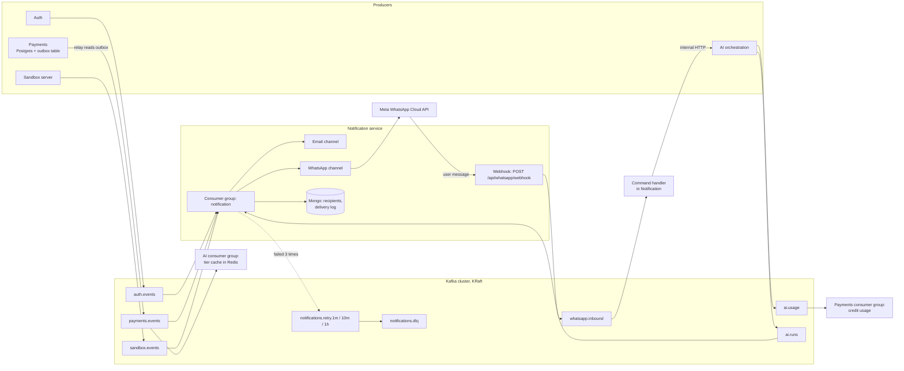

# Event backbone (Kafka) and WhatsApp channel: architecture and learning plan

Status: **plan only, nothing is built yet.** Written 2026-11-11, checked against the code on 2026-11-14.
Mode: learn first (HLD), then build, one lesson at a time.

Plan index and ownership rules: [README.md](README.md). Audit 2026-11-24: [AUDIT-2026-11-24.md](AUDIT-2026-11-24.md). Changed here: AI and Auth use a Mongo outbox (no direct publish, no HTTP fallback for usage), tiered retry topics, WhatsApp pricing checked, admin reads go through Notification's internal admin API, K5 run control needs foundation F1, internal calls use per-caller identity (F2).

| This plan owns | This plan does not own |
|---|---|
| Every broker, topic, producer, consumer, outbox relay, retry and dead letter queue in the project | The admin portal, its login, permissions and data access (`Admin/PLAN.md`, [admin-platform-hld.md](admin-platform-hld.md)) |
| The Notification service: channels, templates, recipients, delivery log | Sandbox tools and tool call logging (the two `taksha-*` plans). They use no broker |
| WhatsApp, in and out | |
| Kafka metrics, and `/metrics` plus JSON logs in the services (stage K7) | |

**Rule:** if another plan needs a queue, the design goes here and that plan links to it. Each stage in section 4 can be built and shipped on its own, in order. Stages that depend on another plan say so, and are skipped when that plan is not built.

---

## 1. What the code does today (checked)

| Area | Today | File |
|---|---|---|
| Broker | RabbitMQ through `amqplib`, two durable queues. The broker is outside the cluster (`MQ_URL` secret), there is no RabbitMQ manifest | `Auth/src/config/mq.js`, `Payments/config/mq.js`, `Notification/src/config/mq.js` |
| Producers | Auth (one `login` message on every Google callback), Payments (success and failed email) | `Auth/src/controllers/auth.controller.js`, `Payments/services/notification.service.js` |
| Consumer | Notification, email only (nodemailer). Consumers start when `app.js` is imported | `Notification/src/app/app.js` |
| Message content | The full email data travels in the message: `email`, `username`, `action`, and for payments `invoiceNumber` and `transactionDetails`. The payment email goes to the address saved on the order | `Payments/services/notification.service.js` |
| Payment settle | **One Postgres transaction**: payment, slots, invoice, transaction row, order status, tier | `Payments/services/billing.service.js` `processSubscriptionPayment` |
| Tier change | One function, always inside a transaction | `Payments/services/account.service.js` `setTier(tx, userId, tier)` |
| AI usage | HTTP `POST /api/payments/credit/update` after a run, errors swallowed | `Ai_orchestration/src/services/credit.service.js` |
| Agent runs | In memory `Map`, single replica | `Ai_orchestration/src/services/agentRun.service.js` |
| Sandbox expiry | Redis keyspace notification | `Sandbox/server/src/config/redis.js` |
| Notification datastore | None. `mongoose` is in `package.json`, but the manifest has no `MONGO_URI` | `k8s/notification-deployment.yml` |
| Internal routes | Auth and Sandbox server have `/internal/*` behind `INTERNAL_SERVICE_TOKEN`. AI, Payments and Notification have none | `Auth/src/routes/internal.routes.js`, `Sandbox/server/src/routes/internal.routes.js` |
| Manifests | `skaffold.yml` lists every manifest by name | `skaffold.yml` |

### Problems found

| # | Problem | Effect |
|---|---|---|
| P1 | Payment email is published after commit, fire and forget (`checkout.service.js:71`, `:176`) | Broker down means the email is lost for ever |
| P2 | Producer drops the message when the channel is missing | Silent loss |
| P3 | Consumer does `nack(requeue=false)` with no dead letter queue | A failed email is deleted |
| P4 | No idempotency key in messages | A redelivery sends a duplicate email |
| P5 | Auth and Payments connect once at startup and never again. Notification retries 10 times at startup only | A RabbitMQ restart needs a service restart |
| P6 | Auth login waits on `await sendAuthNotification` | Login path is coupled to the broker |
| P7 | AI usage report is lost when Payments is down | User gets free credits, revenue leak |
| P8 | AI rate limit tier is always `free` (no `subscription` in the token) | Paid users get free limits |
| P9 | Notification has no datastore | Cannot store phone numbers, opt-in, or a delivery log |

---

## 2. Decisions (and where this differs from the first idea)

| Topic | First idea | Decision | Why |
|---|---|---|---|
| Payment fan-out | Move the whole payment pipeline onto Kafka | **Keep the money transaction in Postgres. Publish one fact after it: `payment.succeeded`.** | The payment, plan, invoice and transaction rows must commit together or not at all. Kafka cannot give that. Async is for side effects only: email, WhatsApp, PDF, analytics. |
| Where Kafka lives | Inside the Notification service | **Shared infrastructure** (`infra/kafka/` compose for local, `k8s/kafka.yml` for the cluster) | Auth, Payments, AI and Sandbox all produce. A broker owned by one service couples every service to it. |
| Where event code lives | All in Notification | **Producer code in each producing service. Consumer and channel code in Notification.** | A service must publish its own facts from its own database (outbox). Notification cannot see the Payments transaction. |
| WhatsApp code | In Notification | **Agreed.** Outbound and inbound webhook both live in Notification, in `src/channels/whatsapp/` | One place holds the Meta credentials. Clean folder boundary so it can become its own service later. |
| Sandbox control from WhatsApp | Notification talks to the sandbox | **Notification only parses and routes. The AI service runs the agent.** | Agent runs, credits and sandbox ownership checks already live in the AI service. Do not copy them. |
| Kafka vs keeping RabbitMQ | Kafka | **Kafka, and remove RabbitMQ fully** | Honest note: at today's load RabbitMQ is enough. Kafka wins on replay, many independent consumer groups on the same event, and per-user ordering, which the fan-out and WhatsApp features need. |
| Where the email address comes from | A `recipients` store built from `auth.events` | **The address travels in the event, as today.** `recipients` only holds what no event carries: phone, opt-in flags, the WhatsApp window | Payment mail must go to the address on the order. A store built from new events would also miss every user who has not logged in since the switch, so it would need a backfill. This way needs none. |
| Cutover | Never run both brokers | **Never both for the same event.** Each event moves in one deploy. RabbitMQ runs next to Kafka from K2 until K3 removes it | Payments moves first, Auth second. A big bang would change three services at once. |

---

## 3. Target architecture



The diagram shows the user-facing topics. `admin.events` and `notifications.broadcast` (section 7) are left out to keep it readable.

### 3.1 Rules

| Rule | Meaning |
|---|---|
| Events are facts | Past tense, owned by the producer: `payment.succeeded`, not `send_email`. |
| Commands stay HTTP | "Start this agent run" needs an answer now. Use the internal HTTP pattern (`/internal/*` + `INTERNAL_SERVICE_TOKEN`). |
| Key = `userId` | All events of one user land on one partition, so they stay in order. |
| At least once + idempotent consumers | Kafka can redeliver. Every consumer must be safe to run twice. |
| Consumer commits after the work | Offset is committed only after the email or message is sent or parked. |
| One consumer group per purpose | `notification`, `payments-usage`, `ai-tier-cache`. Each gets its own copy of every event. This is the fan-out. |
| A broker outage never breaks a request | Producers connect in the background. A service starts and serves with Kafka down. Outbox producers wait, direct producers log and drop (or fall back, see 3.6). |
| Only services may reach Kafka | A NetworkPolicy on the Kafka pod allows the service pods only. Sandbox pods run user code and must never produce or consume. |

### 3.2 Topics

| Topic | Producer | Events | Consumers | Stage |
|---|---|---|---|---|
| `payments.events` | Payments (outbox) | `payment.succeeded`, `payment.failed`, `subscription.tier_changed` | notification, ai-tier-cache | K2, K4 |
| `auth.events` | Auth | `user.registered`, `user.logged_in`, `user.contact_updated` | notification | K3, K5 |
| `ai.usage` | AI | `usage.recorded` | payments-usage | K4 |
| `ai.runs` | AI | `run.started`, `run.plan_ready`, `run.finished`, `run.failed` | notification | K4 |
| `sandbox.events` | Sandbox server | `sandbox.started`, `sandbox.stopped` | notification | K5, only if a WhatsApp status message needs it |
| `whatsapp.inbound` | Notification webhook | `message.received` | notification command handler | K5 |
| `admin.events` | Admin backend, Auth (admin identity) | see section 7.1 | notification | K6 |
| `notifications.broadcast` | Admin backend | `announcement.requested` (one per recipient) | notification-broadcast | K6 |
| `notifications.retry.1m`, `.10m`, `.1h` | Notification | failed deliveries, with attempt count and `notBefore` | notification-retry-<tier> | K2 |
| `notifications.dlq` | Notification | deliveries that failed every retry | a human, through a UI | K2 |

`subscription.tier_changed` covers expiry too: `setTier` is called with `free` when the last slot ends. No separate `subscription.expired` event is needed.

Local: 3 partitions, replication factor 1. Scale lesson: 3 brokers, replication factor 3, `min.insync.replicas=2`.

### 3.3 Event envelope (JSON)

```json
{
  "eventId": "uuid v7",
  "type": "payment.succeeded",
  "version": 1,
  "occurredAt": "2026-11-11T17:00:00.000Z",
  "userId": "…",
  "data": { }
}
```

`eventId` is the idempotency key everywhere.

`data` for `payment.succeeded` and `payment.failed` carries the same fields the RabbitMQ message carries today (`email`, `username`, `invoiceNumber`, `transactionDetails`), so the email templates do not change. `data` for `user.logged_in` carries `email` and `username`.

### 3.4 Payments: transactional outbox

1. New table `outbox` (`id`, `event_id`, `topic`, `key`, `payload`, `created_at`, `published_at`), in a new migration `0003_outbox.sql`. RLS on with no policies, like the other tables. Apply the pending `0002` migration on Supabase first.
2. Three places insert the outbox row **inside the transaction that already exists**:

| Function | Event | Note |
|---|---|---|
| `processSubscriptionPayment` (`billing.service.js`) | `payment.succeeded` | Only on the normal path. A duplicate payment (`recordDuplicatePayment`) sends nothing, as today |
| `recordPaymentFailure` (`billing.service.js`) | `payment.failed` | Only when it writes the failure row, not on a repeat |
| `setTier` (`account.service.js`) | `subscription.tier_changed` | One function covers purchase, refund, lazy expiry and the nightly cron |

3. A relay loop in Payments (`services/outboxRelay.service.js`, started from `server.js`) polls every second: `WHERE published_at IS NULL ORDER BY id LIMIT 100 FOR UPDATE SKIP LOCKED` inside a transaction, produces to Kafka (`acks=all`, idempotent producer), then sets `published_at`. Polling, not `LISTEN`: the Supabase transaction pooler does not support it. `SKIP LOCKED` makes two Payments replicas safe.
4. The nightly cron deletes rows published more than 7 days ago.
5. The two fire and forget email calls in `checkout.service.js`, `services/notification.service.js`, `config/mq.js` and the `closeMQ` call in `server.js` are deleted.

Fixes P1 and P2.

**Mongo outbox for AI and Auth (changed by the audit, 2026-11-24).** "Publish directly for now" is a dual write: the database write succeeds, the publish fails or the pod dies, and the event is gone. For `usage.recorded` that is money (problem P7), so it gets the same guarantee as payments. One small shared helper per Mongo service (`src/events/outbox.js`):

| Step | Rule |
|---|---|
| Write | The `outbox` document (`_id` = `eventId`, `topic`, `key`, `payload`, `createdAt`, `publishedAt: null`, `claimedUntil: null`) is inserted **in the same Mongo transaction** as the business write: the chat message with its `tokenUsage` (AI), the user upsert (Auth). Atlas runs a replica set, so multi-document transactions work |
| Relay | Every second: `findOneAndUpdate({publishedAt: null, claimedUntil < now}, {$set: {claimedUntil: now + 30 s}})` in a loop of up to 100, produce with `acks=all` and the idempotent producer, then set `publishedAt`. The claim makes two replicas safe, like `SKIP LOCKED` in Postgres |
| Order | Per key (`userId`) order is kept because one relay claims oldest-first and Kafka keeps per-partition order; a retry after a crash can repeat an event, and every consumer is idempotent on `eventId` |
| Clean up | TTL index on `publishedAt`, 7 days |
| Change streams? | Not used: they need a resume token store and a single reader, and polling at 1 s is enough here |

Auth's `user.logged_in` (a security notice) and `user.registered` use the same helper. The login redirect never waits on Kafka: the outbox insert is part of the user upsert that already happens.

Tests: the Payments suite runs on local Postgres with Razorpay mocked. The outbox row is asserted in the same tests, and the Kafka producer is mocked the same way.

### 3.5 Notification service

| Part | Design |
|---|---|
| Datastore | Mongo, new database `notification`. Needs a `MONGO_URI` env in `k8s/notification-deployment.yml` and its secret key. Collections: `deliveries` (unique index on `eventId + channel`), and from K5 `recipients` (userId, phone, whatsappOptIn, marketingOptIn, windowOpenUntil). |
| Idempotency | Upsert `deliveries` with status `pending` first. Then: status `sent` means skip. Status `pending` or `failed` means send, then set `sent`. A crash between send and the status update can repeat one message at most. An insert-only check would lose the message when the send fails after the insert. |
| Retry | Tiered retry topics with a fixed delay each: `notifications.retry.1m`, `notifications.retry.10m`, `notifications.retry.1h`. A failure goes to the next tier with `attempt + 1` and `notBefore = now + tier delay`. Each tier's consumer pauses its partition until the head record's `notBefore`; because every record in one tier has the same delay, records behind the head are never due earlier, so there is no head-of-line delay (a single retry topic with mixed delays has that problem). After the 1 h tier fails, publish to `notifications.dlq` and set the delivery to `failed`. The main topic is never blocked. |
| Channels | `src/channels/email/` (existing nodemailer code moves here), `src/channels/whatsapp/` (K5). A small routing table maps event type to channels. |
| Replay | `POST /internal/deliveries/:id/replay`, behind `INTERNAL_SERVICE_TOKEN` (add the `internal-service` secret to the manifest). |

Fixes P3, P4, P5, P9.

### 3.6 Other wins from the same backbone

| Win | How |
|---|---|
| P7 usage leak | AI writes `usage.recorded` to its Mongo outbox in the same transaction as the turn's chat message, the relay publishes to `ai.usage`. A Payments consumer (`payments-usage`) calls the same service function as `POST /credit/update`. `usage_events` is already unique on `(user_id, request_id)`, so the consumer is idempotent for free. **No HTTP fallback:** a second delivery path is a silent bypass that hides relay failures; the outbox already survives Kafka being down, and the unpublished-row count is a K7 metric with an alert. The HTTP `credit/update` route is removed after K4. The credit **check** stays HTTP. |
| P8 tier always free | A Redis key `tier:<userId>` in the AI service. Filled from two sources: the `subscription` field of the credit check response that `creditLedger` already receives, and `subscription.tier_changed` events. `aiRateLimiter` reads the key, and uses `free` when it is missing. The first half needs no Kafka and can ship at any time as a small fix. |
| P6 login coupling | Auth writes to its outbox inside the user upsert. The redirect never waits on Kafka. |

### 3.7 WhatsApp

**Provider: Meta WhatsApp Cloud API, test number (free).** Unofficial libraries (Baileys, whatsapp-web.js) are rejected: they break the terms of service and numbers get banned.

| Flow | Steps |
|---|---|
| Link a phone | Web app shows a 6 digit code. User sends `LINK 123456` to the Taksha number. Webhook matches the code, stores the phone in `recipients`, emits `user.contact_updated`. The user spoke first, so this proves ownership and opens the free 24 hour window. |
| Outbound notify | Event arrives, routing says WhatsApp, window open: send free form text. Window closed: send an approved **utility template**. |
| Inbound command | Meta calls the webhook. Verify `X-Hub-Signature-256` on the raw body. Reply 200 at once. Publish `message.received` to `whatsapp.inbound`. The handler looks up the user by phone, parses the command, calls the AI service internal API. |
| Status back | AI publishes to `ai.runs`. Notification sends "plan ready", "done", "failed" to WhatsApp. |

Commands, first version: `status`, `run <prompt>`, `approve`, `reject <feedback>`, `stop`, `projects`.

| Safety rule | Reason |
|---|---|
| Only linked and opted-in phones | A phone number is not an identity until it is verified. |
| Plan approval stays on by default | A WhatsApp prompt must not change code without the user seeing the plan. |
| Per phone rate limit | Stops spam and credit burn. |
| Webhook dedupe on Meta message id | Meta retries webhooks. |

**What a run needs that today comes from the user's browser token.** A WhatsApp run has only a verified `userId`, so each of these needs a service-to-service path first:

| Need | Today | For a WhatsApp run |
|---|---|---|
| Start, status, approve, reject, stop | Public AI routes with `identifyUser` | New `/internal/runs/*` routes in the AI service that take `userId`, behind `INTERNAL_SERVICE_TOKEN` (new `routes/internal.routes.js`, same middleware pattern as Auth) |
| Sandbox ownership | `requireOwnedSandbox` calls Sandbox `/api/sandbox/projects` with the user's token | New Sandbox server route `GET /internal/users/:userId/projects` |
| Sandbox token | `POST /api/auth/sandbox-token` with the user's token, 2 hours | Existing `POST /internal/sandbox-token`. Its limit is 15 minutes (`MAX_TTL_SECONDS`), so the run renews it or the limit is raised for this caller |
| Credit check | Payments `/credit/check` with the user's token | New Payments route `POST /internal/credit/check` |
| Usage report | Payments `/credit/update` with the user's token | The `ai.usage` event from K4 |

The AI internal routes are also wanted by the admin plan (`ai.stop_run`). Whoever builds first creates `routes/internal.routes.js`, the other adds its route. See [README.md](README.md).

Other changes this stage needs: an ingress path `/api/whatsapp` to `notification-service` in `k8s/ingress.yml`, `express.json({ verify })` in Notification to keep the raw body (same as Payments), and a "link phone" screen in `Frontend`.

**Prerequisite:** foundation F1 ([platform-foundations-plan.md](platform-foundations-plan.md)). A plan sent to WhatsApp may be approved hours later, from a phone, while the AI service has restarted or scaled; that needs the Mongo checkpointer, the `agentruns` record and the compare-and-set resume. The internal routes use per-caller identity (F2): caller `notification` may call AI `/internal/runs/*`, Sandbox `/internal/users/:userId/projects` and Payments `/internal/credit/check`, nothing else.

**Pricing, checked on Meta's pricing page 2026-11-24:** per-message pricing since 1 July 2025 (conversation pricing is gone). Free: every non-template message inside an open 24 hour customer service window, and **utility templates sent inside an open window**. Charged: every marketing template (window or not), and utility or authentication templates sent outside a window, per country rate card. So: status replies to a user who wrote in the last 24 hours are free; "payment received" when the window is closed is a paid utility template; offers (section 7.2) always cost money. Still to verify at Lesson 12: the test number's recipient limit (believed 5), and that the webhook needs public HTTPS (use a free tunnel such as `cloudflared` locally).

---

## 4. Stages and lessons

Build in this order. Each stage ends with its tests green and a local commit, and leaves every user flow working.

| Stage | Scope | Needs | Touches | Done when |
|---|---|---|---|---|
| K0 Learn | Lessons 1 to 5 | nothing | no code | Every decision in section 2 can be explained |
| K1 Kafka core | Local Kafka (`infra/kafka/`), `k8s/kafka.yml` added to the `skaffold.yml` list, Kafka NetworkPolicy, topic script, envelope helper and `config/kafka.js` per service, `KAFKA_BROKERS` env. Nothing produces yet | K0 | infra, one new file per service | Produce and consume work from the CLI. Every service still starts with Kafka stopped |
| K2 Payments mail on Kafka | Notification: Mongo, `deliveries`, consumer for `payments.events`, retry, DLQ. Then Payments: outbox, relay, old email calls deleted | K1 | Notification, Payments | A test payment sends exactly one email. With Kafka stopped during the payment, the email arrives after Kafka is back. Payments tests pass |
| K3 Auth on Kafka, RabbitMQ removed | Auth writes `user.registered` and `user.logged_in` to its Mongo outbox in the user upsert; relay publishes. Notification consumes `auth.events`. Delete all three `mq.js`, `amqplib`, and `MQ_URL` from the manifests and `secrets.yml.example` | K2 | Auth, Notification, k8s | Login email arrives. A search for `amqplib` and `MQ_URL` in the code finds nothing |
| K4 AI events | AI Mongo outbox and relay, `ai.usage`, Payments consumer, tier cache, `ai.runs`; remove HTTP `credit/update` after one release | K1 | AI, Payments | With Payments stopped during a run, the usage row appears after it is back. A Pro user gets Pro rate limits |
| K5 WhatsApp | Section 3.7: internal routes, linking, outbound, inbound, commands | K2, K4, foundations F1 and F2 | Notification, AI, Sandbox server, Payments, Auth, Frontend, ingress | `run`, `approve` and `status` work from a linked phone, and an unlinked phone gets nothing |
| K6 Admin on Kafka | Section 7 | K3, and admin phases P1 and P2 from `Admin/PLAN.md`. **Skip this stage while the admin backend does not exist** | Admin backend, Auth admin files, Notification | An approval email is sent by Notification, and a test announcement reaches only the chosen audience, once |
| K7 Service metrics and logs | Section 6 | nothing (K1 only for the Kafka metrics) | every service | Every service answers `/metrics`, and a log line can be found by `requestId` |
| K8 Scale | 3 brokers, replication, consumer lag, Strimzi | K3 | infra | A broker can be stopped with no lost event |

**Deploy order inside K2:** Notification first (it consumes a topic nothing writes to yet), then Payments. Notification keeps its RabbitMQ consumer for `payment_notification_queue` until K3, so messages published just before the switch are still delivered.

Each lesson: concept, how it maps to Taksha, one check question. Build lessons end with a test and a local commit.

| # | Lesson | Type | Stage | Status |
|---|---|---|---|---|
| 1 | Why queues: sync vs async, producer, broker, consumer | Theory | K0 | Taught |
| 2 | Kafka internals: broker, topic, partition, offset, consumer group, KRaft. Queue vs log | Theory | K0 | Taught |
| 3 | Guarantees: at most / at least / exactly once, ordering, idempotency, retry, DLQ | Theory | K0 | Next |
| 4 | Events vs commands, fan-out with consumer groups, the dual write problem, outbox | Design | K0 | |
| 5 | Walk through this document end to end, challenge every decision | Design | K0 | |
| 6 | Build: local Kafka (single node KRaft) + UI, create topics, produce and consume from the CLI | Build | K1 | |
| 7 | Build: event envelope and a small Kafka client per service | Build | K1 | |
| 8 | Build: Notification consumer, Mongo `deliveries`, retry topic, DLQ | Build | K2 | |
| 9 | Build: Payments outbox table, relay, delete the old email calls | Build | K2 | |
| 10 | Build: move Auth to Kafka, remove RabbitMQ from code, k8s and secrets | Build | K3 | |
| 11 | Build: `ai.usage` to Payments, tier cache in AI, `ai.runs` events | Build | K4 | |
| 12 | WhatsApp Cloud API: app setup, test number, webhooks, templates, 24 hour window, pricing | Theory | K5 | |
| 13 | Build: WhatsApp outbound channel and templates | Build | K5 | |
| 14 | Build: phone linking and opt-in | Build | K5 | |
| 15 | Build: inbound webhook, signature check, `whatsapp.inbound`, command parser | Build | K5 | |
| 16 | Build: internal routes (AI, Sandbox server, Payments), sandbox control and status from WhatsApp | Build | K5 | |
| 17 | Build: admin events, announcements, delivery log and DLQ replay (section 7) | Build | K6 | |
| 18 | Observability basics: metrics vs logs vs traces, Prometheus pull model, PromQL, cardinality | Theory | K7 | |
| 19 | Build: `/metrics` in every service, Kafka exporter, `ServiceMonitor` objects | Build | K7 | |
| 20 | Build: JSON logs with `requestId`, LogQL | Build | K7 | |
| 21 | Scale: 3 broker cluster, replication, consumer lag monitoring, Kafka on k8s (Strimzi) | Theory + Build | K8 | |

Lessons 8 and 9 swapped places on 2026-11-14 (consumer before producer, see the deploy order above). The admin portal lessons (passkeys, admin service, admin frontend) moved out: they are phases of `Admin/PLAN.md`, not queue work.

---

## 5. Open choices (decide at the lesson)

| Choice | Options | Lean |
|---|---|---|
| Node client | `@confluentinc/kafka-javascript` (official, librdkafka) vs `kafkajs` (pure JS, no longer maintained) | **Official client.** Checked 2026-11-24: prebuilt binaries for Node 18 to 22 on Linux x64 and arm64 for glibc **and musl/Alpine**, so `node:20-alpine` needs no compiler. Use its promise API for new code (the KafkaJS-compatible layer has gaps: no custom partitioners, `eachBatch` size 1) |
| Local RAM | Kafka needs about 1 GB on top of the k8s cluster. The monitoring stack needs 1.5 to 2 GB more | Single node first. Do not run Kafka, monitoring and many sandboxes at once on Docker Desktop |
| Schema checks | Plain JSON vs schema registry | Plain JSON with a `version` field. Registry is extra infra with no user today |

---

## 6. Service metrics and logs (stage K7)

Today: only Auth exposes `/metrics` (`prom-client`). No Prometheus, Grafana or Loki is deployed.

```
Auth, Payments, AI, Sandbox, Notification      Kafka
   /metrics + JSON logs to stdout                 |
        |                |                  kafka-exporter
        v                v                        |
   Prometheus  <---------+------------------------+
        |           pod logs -> Grafana Alloy -> Loki
        v                                         |
     Grafana (engineer view)  <-------------------+
```

**Who installs the monitoring stack.** `kube-prometheus-stack`, Loki and Grafana Alloy are shared infrastructure in namespace `monitoring`. Admin phase P5 also needs them. The stage that runs first installs them with Helm from the values files in `k8s/monitoring/`, and the other stage only checks that they are there. Neither plan changes the other's work: this stage adds metrics and log fields **inside the services**, admin P5 only **reads** Prometheus, Loki and the Kubernetes API.

| Decision | Why |
|---|---|
| Grafana stays for deep engineering views | Do not rebuild Grafana. The admin portal pulls the few numbers it needs through the Prometheus and Loki HTTP APIs |
| Per user numbers (tokens per user, revenue per user) **never** come from Prometheus labels | A `userId` label creates one time series per user and kills Prometheus (cardinality). They come from the databases, and later from Kafka rollups (section 7.5) |
| Log collector: Grafana Alloy | Promtail is deprecated |

### What gets measured (two levels)

**Level 1: the whole Kubernetes cluster.** The `kube-prometheus-stack` Helm chart gives Prometheus, Grafana, Alertmanager and these collectors:

| Collector | Answers |
|---|---|
| node-exporter | Each node: CPU, RAM, disk, network |
| kubelet / cAdvisor | Each pod and container: CPU, RAM, restarts, throttling. Covers every sandbox pod too |
| kube-state-metrics | Object state: pods pending / crash looping, deployments ready, replicas, PVCs |
| Built-in Grafana dashboards | Cluster, namespace, node, pod views on day one |

**Level 2: each service.** Every service exposes `/metrics` with `prom-client` (only Auth does today) and the same base set:

| Group | Metrics |
|---|---|
| RED (every HTTP route) | requests per second, error rate, latency p50 / p95 / p99, labelled by `service`, `route`, `status` |
| Node.js runtime | event loop lag, heap, GC, open handles (`collectDefaultMetrics`) |
| Kafka client | messages produced / consumed, consumer lag per group, retry and DLQ counts |
| Service specific | Payments: payments succeeded / failed, webhook latency, unpublished outbox rows. AI: runs, tokens, model errors, 429s. Sandbox: pods starting, start time, active sandboxes. Notification: emails / WhatsApp sent and failed |

`/metrics` is not under any ingress prefix, so it stays cluster-internal, as in Auth. Prometheus finds services through `ServiceMonitor` objects, so a new service needs no Prometheus config change.

| Cost and limits | Note |
|---|---|
| RAM | The stack needs roughly 1.5 to 2 GB on Docker Desktop. Set short retention (for example 3 days) locally |
| Docker Desktop | node-exporter sees the Docker VM, not the Mac. Fine for learning |
| Sandbox pods | Per pod series are fine because pods are short lived, but never add `userId` or `sandboxId` as a label on service metrics |

**Traces come later.** K7 covers metrics and logs. Distributed traces (OpenTelemetry to Grafana Tempo, `traceparent` in the event envelope) and LLM traces (Langfuse: tokens, cost, latency, errors per run, node and tool call) are in [llmops-evals-cicd-plan.md](llmops-evals-cicd-plan.md) section 6, the last phase. Keep a free `traceparent` field in the envelope from K1 so that work only fills it in.

---

## 7. Admin on Kafka (stage K6, added 2026-11-13)

This section is all the queue work the admin platform needs. The admin plan itself needs no broker: until this stage is built, the admin backend sends its own mail (`Admin/PLAN.md` section 8.1), and it keeps working unchanged if this stage is never built.

| Part | Owner | Document |
|---|---|---|
| Portal, login, permissions, data access, audit, the admin mailer | Admin backend, Auth | `Admin/PLAN.md` |
| Channels, templates, recipients, delivery log, retry, DLQ, admin topics | Notification | this document |

After this stage, the admin backend never sends an email or WhatsApp message itself. It publishes a fact, Notification delivers it.

### 7.1 Admin events (`admin.events`)

Key is the admin identity id. The recipient email is in the payload, like every other event.

| Event | Producer | Goes to | Channel |
|---|---|---|---|
| `admin.application_submitted` | Admin backend | maintainer, applicant | email |
| `admin.application_approved` (with grants) | Admin backend | applicant | email |
| `admin.application_rejected` (with reason) | Admin backend | applicant | email |
| `admin.grants_changed`, `admin.suspended`, `admin.reactivated`, `admin.access_expiring` | Admin backend | admin | email |
| `admin.passkey_added`, `admin.passkey_removed` | Auth | admin, maintainer | email |
| `maintainer.logged_in`, `maintainer.login_failed`, `maintainer.locked` | Auth | maintainer | email, WhatsApp once linked |
| `admin.digest_ready` (chat views, data edits, sensitive actions of the day) | Admin backend | maintainer | email |

Rules:

- Emails carry a link to the portal only. No approve button, so a stolen mailbox cannot approve an admin.
- Security events (`maintainer.*`, `admin.passkey_*`) are also written to the admin audit log by the producer, so a failed delivery never hides them.

### 7.2 Announcements and offers (admin to users)

| Step | Where |
|---|---|
| 1. Admin writes the announcement, picks audience (all, tier, user list) and channels | Admin portal, needs the `notify.send` grant and a passkey step-up |
| 2. Admin backend resolves the audience to user ids and emails through the services' internal admin routes (Payments for tier, Auth for emails, paged 500 at a time), and publishes one `announcement.requested` per user to `notifications.broadcast`, key `userId`, `eventId` = hash of announcement id and user id | Admin backend |
| 3. Consumer group `notification-broadcast` sends through the channel rules below and writes `deliveries` | Notification |
| 4. Portal shows sent, failed and skipped counts per announcement | Admin portal, through Notification's internal admin route |

| Rule | Reason |
|---|---|
| Own topic and consumer group | A broadcast to every user must not delay payment receipts or login alerts |
| Throttled sending | Mail provider and Meta rate limits |
| `marketingOptIn` on `recipients`, unsubscribe link in every offer email | Offers are marketing, not service messages |
| WhatsApp offers use an approved **marketing template** and only go to opted-in phones | Meta rule, and marketing templates cost money per message |
| Dedupe on `eventId + channel` | A retry or replay never sends the same offer twice |

### 7.3 What the admin portal shows from Notification

| View | Source |
|---|---|
| Delivery log per user (what was sent, when, which channel, status) | Notification `GET /internal/admin/deliveries?userId=` (caller `admin`). No database user for the admin backend (admin decision 2026-11-24) |
| Failed deliveries and the DLQ | Notification `GET /internal/admin/deliveries?status=failed` |
| Replay a failed delivery | Command, so HTTP: `POST /internal/deliveries/:id/replay` on Notification |
| Channel health (emails and WhatsApp sent and failed, consumer lag) | Prometheus, after K7 |

This is the "human, through a UI" consumer of `notifications.dlq` from section 3.2.

### 7.4 The switch

| Before K6 | In K6 |
|---|---|
| The admin backend's mailer worker sends mail with `nodemailer` from its `outbox` table | The same worker publishes the outbox row to `admin.events` instead. Nothing else in the admin backend changes |
| Auth writes admin identity events to Mongo `adminauthevents`, and the admin mailer reads them | Auth also publishes them to `admin.events` without `await`. The collection stays, because it is the audit record |
| Templates in `Admin/backend/src/emails/` | Moved to Notification `src/emails/template/` |
| No announcements | Topic `notifications.broadcast`, group `notification-broadcast`, portal screens for the `notify` module |

### 7.5 Rollups for admin analytics (required for admin P4 once K4 exists)

**Changed 2026-11-24:** the admin backend no longer reads service databases (admin decision), so this is the analytics source, not an optimisation. A consumer group `admin-analytics` in the admin backend folds `payments.events`, `ai.usage`, `auth.events` and `sandbox.events` into hourly and daily tables in the admin Postgres (upsert keyed by bucket, idempotent on `eventId` through a `processed_events` table with a 30-day TTL job). Backfill for the time before K4: one paged call per service to `GET /internal/admin/stats?from&to&bucket=day`. Until K4 is built, P4 uses those stats routes directly.
