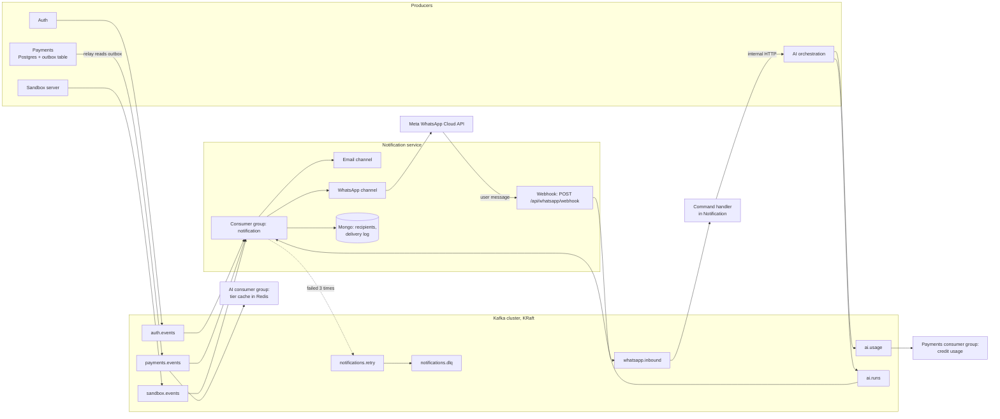
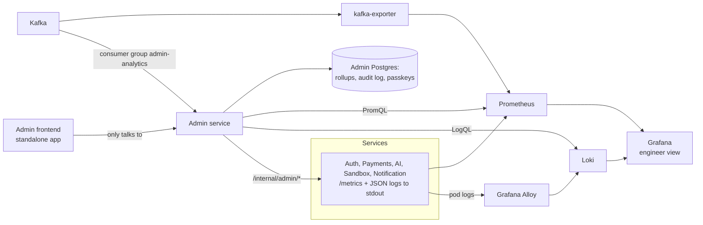

# Event backbone (Kafka) and WhatsApp channel: architecture and learning plan

Status: **plan only, nothing is built yet.** Written 2026-11-11.
Mode: learn first (HLD), then build, one lesson at a time.

---

## 1. What the code does today (checked)

| Area | Today | File |
|---|---|---|
| Broker | RabbitMQ through `amqplib`, two durable queues | `*/config/mq.js` |
| Producers | Auth (login email), Payments (success / failed email) | `Auth/src/controllers/auth.controller.js`, `Payments/services/notification.service.js` |
| Consumer | Notification, email only (nodemailer) | `Notification/src/app/app.js` |
| Payment settle | **One Postgres transaction**: payment, slots, invoice, transaction row, order status, tier | `Payments/services/billing.service.js` `processSubscriptionPayment` |
| AI usage | HTTP `POST /api/payments/credit/update` after a run, errors swallowed | `Ai_orchestration/src/services/credit.service.js` |
| Agent runs | In memory `Map`, single replica | `Ai_orchestration/src/services/agentRun.service.js` |
| Sandbox expiry | Redis keyspace notification | `Sandbox/server/src/config/redis.js` |

### Problems found

| # | Problem | Effect |
|---|---|---|
| P1 | Payment email is published after commit, fire and forget (`checkout.service.js:71`, `:176`) | Broker down means the email is lost for ever |
| P2 | Producer drops the message when the channel is missing | Silent loss |
| P3 | Consumer does `nack(requeue=false)` with no dead letter queue | A failed email is deleted |
| P4 | No idempotency key in messages | A redelivery sends a duplicate email |
| P5 | No reconnect logic in any `mq.js` | RabbitMQ restart needs a service restart |
| P6 | Auth login waits on `await sendAuthNotification` | Login path is coupled to the broker |
| P7 | AI usage report is lost when Payments is down | User gets free credits, revenue leak |
| P8 | AI rate limit tier is always `free` (no `subscription` in the token) | Paid users get free limits |
| P9 | Notification has no datastore | Cannot store phone numbers, opt-in, or a delivery log |

---

## 2. Decisions (and where this differs from the first idea)

| Topic | First idea | Decision | Why |
|---|---|---|---|
| Payment fan-out | Move the whole payment pipeline onto Kafka | **Keep the money transaction in Postgres. Publish one fact after it: `payment.succeeded`.** | The payment, plan, invoice and transaction rows must commit together or not at all. Kafka cannot give that. Async is for side effects only: email, WhatsApp, PDF, analytics. |
| Where Kafka lives | Inside the Notification service | **Shared infrastructure** (`infra/kafka/` compose for local, `k8s/kafka.yml` later) | Auth, Payments, AI and Sandbox all produce. A broker owned by one service couples every service to it. |
| Where event code lives | All in Notification | **Producer code in each producing service. Consumer and channel code in Notification.** | A service must publish its own facts from its own database (outbox). Notification cannot see the Payments transaction. |
| WhatsApp code | In Notification | **Agreed.** Outbound and inbound webhook both live in Notification, in `src/channels/whatsapp/` | One place holds the Meta credentials. Clean folder boundary so it can become its own service later. |
| Sandbox control from WhatsApp | Notification talks to the sandbox | **Notification only parses and routes. The AI service runs the agent.** | Agent runs, credits and sandbox ownership checks already live in the AI service. Do not copy them. |
| Kafka vs keeping RabbitMQ | Kafka | **Kafka, and remove RabbitMQ fully** | Honest note: at today's load RabbitMQ is enough. Kafka wins on replay, many independent consumer groups on the same event, and per-user ordering, which the fan-out and WhatsApp features need. Never run both. |

---

## 3. Target architecture



### 3.1 Rules

| Rule | Meaning |
|---|---|
| Events are facts | Past tense, owned by the producer: `payment.succeeded`, not `send_email`. |
| Commands stay HTTP | "Start this agent run" needs an answer now. Use the internal HTTP pattern (`/internal/*` + `INTERNAL_SERVICE_TOKEN`). |
| Key = `userId` | All events of one user land on one partition, so they stay in order. |
| At least once + idempotent consumers | Kafka can redeliver. Every consumer must be safe to run twice. |
| Consumer commits after the work | Offset is committed only after the email or message is sent or parked. |
| One consumer group per purpose | `notification`, `payments-usage`, `ai-tier-cache`. Each gets its own copy of every event. This is the fan-out. |

### 3.2 Topics

| Topic | Producer | Events | Consumers |
|---|---|---|---|
| `auth.events` | Auth | `user.registered`, `user.logged_in`, `user.contact_updated` | notification |
| `payments.events` | Payments (outbox) | `payment.succeeded`, `payment.failed`, `subscription.tier_changed`, `subscription.expired` | notification, ai-tier-cache |
| `ai.usage` | AI | `usage.recorded` | payments-usage |
| `ai.runs` | AI | `run.started`, `run.plan_ready`, `run.finished`, `run.failed` | notification |
| `sandbox.events` | Sandbox server | `sandbox.started`, `sandbox.stopped` | notification |
| `whatsapp.inbound` | Notification webhook | `message.received` | notification command handler |
| `notifications.retry` | Notification | failed deliveries, with attempt count | notification |
| `notifications.dlq` | Notification | deliveries that failed every retry | a human, through a UI |

Local: 3 partitions, replication factor 1. Scale lesson: 3 brokers, replication factor 3, `min.insync.replicas=2`.

### 3.3 Event envelope (JSON)

```json
{
  "eventId": "uuid v7",
  "type": "payment.succeeded",
  "version": 1,
  "occurredAt": "2026-11-11T17:00:00.000Z",
  "userId": "…",
  "data": { }
}
```

`eventId` is the idempotency key everywhere.

### 3.4 Payments: transactional outbox

1. New table `outbox` (`id`, `event_id`, `topic`, `key`, `payload`, `created_at`, `published_at`).
2. `processSubscriptionPayment` and `recordPaymentFailure` insert the outbox row **inside the same `db.transaction`**.
3. A relay loop in Payments reads `WHERE published_at IS NULL ORDER BY id LIMIT 100 FOR UPDATE SKIP LOCKED`, produces to Kafka (`acks=all`, idempotent producer), then sets `published_at`.
4. The two fire and forget email calls in `checkout.service.js` are deleted.

Fixes P1 and P2. Auth and AI publish directly with retry for now (their databases are Mongo, a Mongo outbox is a later lesson).

### 3.5 Notification service

| Part | Design |
|---|---|
| Datastore | Mongo (`mongoose` is already a dependency). Collections: `recipients` (userId, email, phone, whatsappOptIn, windowOpenUntil), `deliveries` (unique index on `eventId + channel`). |
| Idempotency | Insert into `deliveries` first. Duplicate key means already handled, skip. |
| Retry | Fail, then publish to `notifications.retry` with `attempt + 1` and a delay. After 3 attempts, publish to `notifications.dlq`. The main topic is never blocked. |
| Recipients | Built from `auth.events` (`user.registered`, `user.contact_updated`). No HTTP call to Auth on the hot path. |
| Channels | `src/channels/email/` (existing nodemailer code moves here), `src/channels/whatsapp/`. A small routing table maps event type to channels. |

Fixes P3, P4, P5, P9.

### 3.6 Other wins from the same backbone

| Win | How |
|---|---|
| P7 usage leak | AI publishes `usage.recorded` to `ai.usage`. Payments consumes it. `usage_events` is already unique on `(user_id, request_id)`, so the consumer is idempotent for free. The credit **check** stays HTTP. |
| P8 tier always free | AI consumes `subscription.tier_changed` and caches the tier in Redis for the rate limiter. |
| P6 login coupling | Auth publishes without blocking the redirect. |

### 3.7 WhatsApp

**Provider: Meta WhatsApp Cloud API, test number (free).** Unofficial libraries (Baileys, whatsapp-web.js) are rejected: they break the terms of service and numbers get banned.

| Flow | Steps |
|---|---|
| Link a phone | Web app shows a 6 digit code. User sends `LINK 123456` to the Taksha number. Webhook matches the code, stores the phone on the user, emits `user.contact_updated`. The user spoke first, so this proves ownership and opens the free 24 hour window. |
| Outbound notify | Event arrives, routing says WhatsApp, window open: send free form text. Window closed: send an approved **utility template**. |
| Inbound command | Meta calls the webhook. Verify `X-Hub-Signature-256` on the raw body. Reply 200 at once. Publish `message.received` to `whatsapp.inbound`. The handler looks up the user by phone, parses the command, calls the AI service internal API. |
| Status back | AI publishes to `ai.runs`. Notification sends "plan ready", "done", "failed" to WhatsApp. |

Commands, first version: `status`, `run <prompt>`, `approve`, `reject <feedback>`, `stop`, `projects`.

| Safety rule | Reason |
|---|---|
| Only linked and opted-in phones | A phone number is not an identity until it is verified. |
| Plan approval stays on by default | A WhatsApp prompt must not change code without the user seeing the plan. |
| Per phone rate limit | Stops spam and credit burn. |
| Webhook dedupe on Meta message id | Meta retries webhooks. |

**Needed in the AI service first:** internal routes (start run, status, approve, reject, stop) that take a `userId` from a trusted service, because today every route needs the user's browser token.

**Known limit:** AI runs live in memory on one replica. WhatsApp control works with that, but scaling AI needs a shared checkpointer first. Out of scope here.

**Free tier limits to verify in Meta docs before Lesson 12** (from memory, not checked live): test number sends to at most 5 verified recipient numbers, business initiated messages need an approved template, replies inside the 24 hour window are free, webhook needs public HTTPS (use a free tunnel such as `cloudflared` locally).

---

## 4. Lessons

Each lesson: concept, how it maps to Taksha, one check question. Build lessons end with a test and a local commit.

| # | Lesson | Type | Status |
|---|---|---|---|
| 1 | Why queues: sync vs async, producer, broker, consumer | Theory | Taught |
| 2 | Kafka internals: broker, topic, partition, offset, consumer group, KRaft. Queue vs log | Theory | Taught |
| 3 | Guarantees: at most / at least / exactly once, ordering, idempotency, retry, DLQ | Theory | Next |
| 4 | Events vs commands, fan-out with consumer groups, the dual write problem, outbox | Design | |
| 5 | Walk through this document end to end, challenge every decision | Design | |
| 6 | Build: local Kafka (single node KRaft) + UI, create topics, produce and consume from the CLI | Build | |
| 7 | Build: event envelope and a small Kafka client per service | Build | |
| 8 | Build: Payments outbox table, relay, delete the old email calls | Build | |
| 9 | Build: Notification consumer, Mongo dedupe, retry topic, DLQ | Build | |
| 10 | Build: move Auth to Kafka, remove RabbitMQ from code, k8s and secrets | Build | |
| 11 | Build: `ai.usage` to Payments, tier cache in AI, `ai.runs` events | Build | |
| 12 | WhatsApp Cloud API: app setup, test number, webhooks, templates, 24 hour window, pricing | Theory | |
| 13 | Build: WhatsApp outbound channel and templates | Build | |
| 14 | Build: phone linking and opt-in | Build | |
| 15 | Build: inbound webhook, signature check, `whatsapp.inbound`, command parser | Build | |
| 16 | Build: AI internal routes, sandbox control and status from WhatsApp | Build | |
| 17 | Scale: 3 broker cluster, replication, consumer lag monitoring, Kafka on k8s (Strimzi) | Theory + Build | |
| 18 | Observability basics: metrics vs logs vs traces, Prometheus pull model, PromQL, cardinality | Theory | |
| 19 | Build: kube-prometheus-stack on the cluster (cluster + node + pod metrics), `/metrics` in every service, Kafka exporter | Build | |
| 20 | Build: JSON logs with `requestId`, Grafana Alloy, Loki, LogQL | Build | |
| 21 | Passkeys (WebAuthn): how biometric login works without sending the fingerprint | Theory | |
| 22 | Build: Admin service, passkey login, admin JWT, audit log | Build | |
| 23 | Build: `admin-analytics` Kafka consumer group and rollup tables | Build | |
| 24 | Build: Admin frontend (users, revenue, AI tokens, Kafka, system health) | Build | |

---

## 5. Open choices (decide at the lesson)

| Choice | Options | Lean |
|---|---|---|
| Node client | `@confluentinc/kafka-javascript` (official, native build) vs `kafkajs` (pure JS, no longer maintained) | Official client, check it builds in the service Docker images at Lesson 6 |
| Local RAM | Kafka needs about 1 GB on top of the k8s cluster | Single node first |
| Schema checks | Plain JSON vs schema registry | Plain JSON with a `version` field. Registry is extra infra with no user today |

---

## 6. Observability and Admin dashboard (added 2026-11-11)

Today: only Auth exposes `/metrics` (`prom-client`). No Prometheus, Grafana or Loki is deployed. `Admin/` has only an aspirational README.



| Decision | Why |
|---|---|
| Grafana stays for deep engineering views. Admin dashboard is for product and business views | Do not rebuild Grafana. Admin pulls the few ops numbers it needs through the Prometheus and Loki HTTP APIs |
| Per user numbers (tokens per user, revenue per user) come from Kafka events, **never** Prometheus labels | A `userId` label creates one time series per user and kills Prometheus (cardinality) |
| Admin service builds its own analytics store from Kafka (`admin-analytics` group) | Never reads another service's database. Replay lets it rebuild history from day one of retention |
| Analytics store: Postgres with daily and hourly rollup tables | Free and enough now. ClickHouse is the scale upgrade |
| Admin frontend talks only to Admin service (BFF) | One door to secure and audit |
| Log collector: Grafana Alloy | Promtail is deprecated |

### What gets measured (two levels)

**Level 1: the whole Kubernetes cluster.** Install the `kube-prometheus-stack` Helm chart. One install gives Prometheus, Grafana, Alertmanager and these collectors:

| Collector | Answers |
|---|---|
| node-exporter | Each node: CPU, RAM, disk, network |
| kubelet / cAdvisor | Each pod and container: CPU, RAM, restarts, throttling. Covers every sandbox pod too |
| kube-state-metrics | Object state: pods pending / crash looping, deployments ready, replicas, PVCs |
| Built-in Grafana dashboards | Cluster, namespace, node, pod views on day one |

**Level 2: each service.** Every service exposes `/metrics` with `prom-client` (only Auth does today) and the same base set:

| Group | Metrics |
|---|---|
| RED (every HTTP route) | requests per second, error rate, latency p50 / p95 / p99, labelled by `service`, `route`, `status` |
| Node.js runtime | event loop lag, heap, GC, open handles (`collectDefaultMetrics`) |
| Kafka client | messages produced / consumed, consumer lag per group, retry and DLQ counts |
| Service specific | Payments: payments succeeded / failed, webhook latency. AI: runs, tokens, model errors, 429s. Sandbox: pods starting, start time, active sandboxes. Notification: emails / WhatsApp sent and failed |

Prometheus finds services through `ServiceMonitor` objects, so a new service needs no Prometheus config change.

| Cost and limits | Note |
|---|---|
| RAM | The stack needs roughly 1.5 to 2 GB on Docker Desktop. Set short retention (for example 3 days) locally |
| Docker Desktop | node-exporter sees the Docker VM, not the Mac. Fine for learning |
| Sandbox pods | Per pod series are fine because pods are short lived, but never add `userId` or `sandboxId` as a label on service metrics |

### Admin login: passkeys (WebAuthn)

| Point | Design |
|---|---|
| How "biometric" works | Touch ID / Face ID only unlocks a private key on the device. The device signs a server challenge. The fingerprint never leaves the device |
| Library | `@simplewebauthn/server` and `@simplewebauthn/browser` |
| First admin | One time setup token (env, used once) to register the first passkey. Then registration closes |
| Lockout safety | Register 2 passkeys (laptop + phone) and keep printed recovery codes |
| Session | Separate admin JWT: own audience (`taksha-admin`), short TTL, never accepted by user facing services |
| Exposure | Admin frontend and API on their own host, not under the public `/api` ingress paths |
| Every admin action | Written to an append only audit table |
