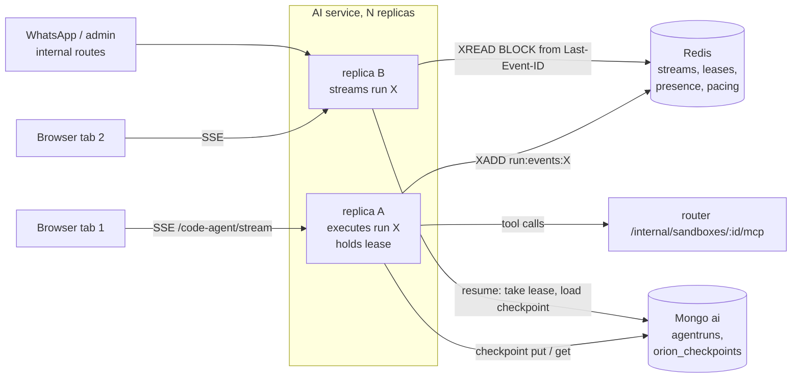
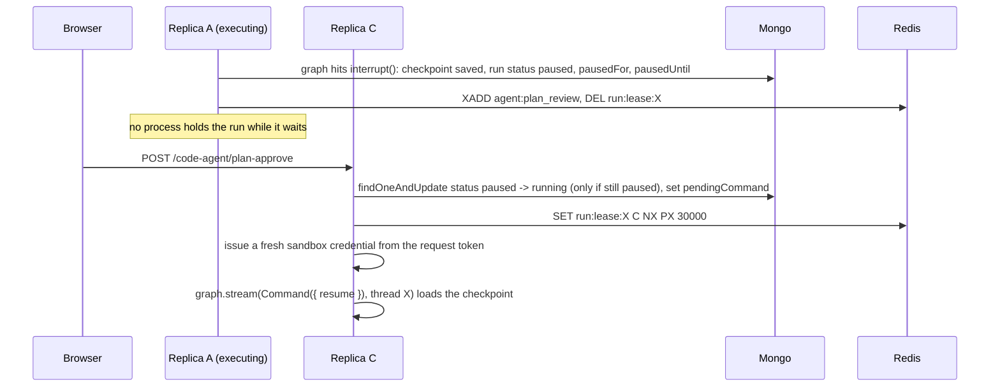

# Plan: platform foundations (durable agent runs, internal service identity, safe sandbox stop)

Status: **plan only, nothing built.** Written 2026-11-24 by the cross-plan audit ([AUDIT-2026-11-24.md](AUDIT-2026-11-24.md)), checked against the code that day.

Plan index and ownership rules: [README.md](README.md).

## 1. Why this plan exists

The audit found three problems that no single plan owns, but that several plans quietly depend on. Each one is a place where a feature works on one laptop with one replica and breaks at scale or loses data. They are built **before** the features that need them.

| Foundation | Problem today (checked) | Plans that depend on it |
|---|---|---|
| **F1 Durable agent runs** | Orion runs live in a process `Map` (`agentRun.service.js` line 64), the graph uses `MemorySaver` (`orion.graph.js` line 35), SSE subscribers, the replay buffer and the plan-review timer are all in memory, and model pacing is per process (`llm/rateLimiter.js` line 18). `k8s/ai-deployment.yml` pins `replicas: 1`. A restart loses every paused run; a second replica breaks streams, pauses and the provider rate limit | GitHub plan G6b (push approve card), G6c (`ask_user`, 24 h pauses), G6d (presence timer); agent tools P4 (ask-first pause); Kafka K5 (approve from WhatsApp); admin P7 (stop run) |
| **F2 Internal service identity** | One shared `INTERNAL_SERVICE_TOKEN` opens every `/internal/*` route in Auth, Sandbox server and the router. Any holder can mint a sandbox token for any user (`internalSandboxToken.controller.js`). Every new caller (git-service, admin backend, Notification, AI internal routes) widens the blast radius | GitHub plan (git-service), Kafka K5 (Notification to AI, Payments, Sandbox), admin P7, this plan's F1 sweeper |
| **F3 Safe sandbox stop** | `deletePod` uses `gracePeriodSeconds: 0` (`pod.js` line 286), so the sync-agent's `SIGTERM` flush (`sync.js` line 426) never runs and edits inside the 400 ms debounce are lost. The sync-agent image runs `npm run dev` (nodemon), so a signal reaches npm, not `sync.js`. A failed S3 listing at restore "continues with the local template" (`sync.js` line 308), and a later user edit to a template file then overwrites the real file on S3 | GitHub plan G2 (`.git` archive on stop), agent tools P4 (checkpoints that outlive the pod) |

## 2. F1: durable agent runs

### 2.1 Target design



| Piece | Today | Target | Why this and not the cheaper option |
|---|---|---|---|
| Graph state | `MemorySaver` | Mongo checkpointer, collections `orion_checkpoints` and `orion_checkpoint_writes` in database `ai` | A paused run must survive a restart and be resumable by any replica. Sticky sessions would only hide the problem until the pod restarts |
| Run record | `runs` Map | Collection `agentruns` (source of truth for status) | Status must be readable by any replica, the admin backend's stop route and WhatsApp |
| Who executes | The replica that got the request | The replica that holds the Redis lease `run:lease:<runId>` | Two replicas resuming the same run would double every tool call |
| Event stream and replay | In-memory `buffer` (4,000 events) and `subscribers` Set | Redis Stream `run:events:<runId>`, `MAXLEN ~ 4000`, entry id = SSE `id` | Any replica can serve `Last-Event-ID` replay, so the ingress needs no session affinity |
| Stop, approve, reject, answer | Function calls on the in-memory run | Commands written to Mongo (`agentruns.pendingCommand`) plus a Redis pub/sub nudge on `run:control:<runId>` | Pub/sub alone is lost when the lease holder is busy or restarting; the Mongo field is the durable copy |
| Plan review timeout, `ask_user` 24 h | `setTimeout` | `pausedUntil` field and a sweeper job every 60 s behind a Redis `SET NX` lock | A timer dies with its process |
| Presence (GitHub plan 4.9) | Not built | Redis key `run:presence:<runId>`, `PX 45000`, refreshed by every open SSE connection's existing 15 s heartbeat, on any replica | Counting subscribers per process is wrong once two tabs sit on two replicas |
| Model pacing | Per-process `pacing` Map | Redis token bucket per model id (Lua, same pattern as `aiRateLimiter`) | N replicas would otherwise send N times the provider's allowed rate and hit 429s |
| Memory agent queue | In-process queue per agent, user and project | Same queue, plus a Redis lock `memlock:<agent>:<userId>:<projectId>` around each update | Ordering per chat must hold across replicas |

### 2.2 Checkpointer choice

| Option | Verdict |
|---|---|
| `@langchain/langgraph-checkpoint-mongodb` (`MongoDBSaver`) | **First choice.** Official package, but young (0.0.x on npm, 2026-11). Spike S1 checks that its peer dependency range accepts `@langchain/langgraph` ^1.3 (the version in `Ai_orchestration/package.json`), and whether it has `deleteThread` (the code calls `checkpointer.deleteThread`, `orion.graph.js` line 69) |
| Own `MongoCheckpointSaver extends BaseCheckpointSaver` | **Only if S1 fails.** About 150 lines: `getTuple`, `list`, `put`, `putWrites`, `deleteThread`. Decided at the spike, written down here, never a silent runtime fallback |
| Redis checkpointer | No. Checkpoints of a 24 h pause must survive a Redis flush; Redis here is cache and coordination only |
| Postgres (Supabase) | No. The AI service has no Postgres today and should not get one for this |

Indexes: `{ thread_id: 1, checkpoint_ns: 1, checkpoint_id: -1 }` on both collections. A TTL index on `updatedAt` (7 days) removes checkpoints of runs that never finished. `deleteThread` still runs on every normal finish, as today.

### 2.3 `agentruns` schema

| Field | Type | Notes |
|---|---|---|
| `_id` | string | `runId` (UUIDv7) |
| `userId`, `projectId`, `sessionId`, `sandboxId`, `threadId` | string | `userId` from the verified token only |
| `agent` | string | `orion` |
| `status` | enum | `queued`, `running`, `paused`, `stopping`, `done`, `stopped`, `failed`, `interrupted` |
| `pausedFor` | object or null | `{ type: plan_review | ask_user | approve_push | ask_first, payload, since }` |
| `pausedUntil` | date or null | Plan review 30 min, `ask_user` 24 h |
| `pendingCommand` | object or null | `{ type: approve | reject | answer | stop, payload, at, by }`, cleared by the lease holder when applied |
| `lastSeq` | string | Last stream id written |
| `leaseOwner`, `leaseUntil` | string, date | Copy of the Redis lease for debugging and the sweeper |
| `usage` | object | Running token totals |
| `createdAt`, `updatedAt`, `endedAt` | date | |

Indexes: unique partial `{ userId: 1, projectId: 1 }` where `status` in (`queued`, `running`, `paused`, `stopping`), so one project never has two live runs (today a Map key does this); `{ status: 1, pausedUntil: 1 }` for the sweeper; TTL on `endedAt`, 30 days.

### 2.4 Flows

**Invoke and stream (any replica):**

```mermaid
sequenceDiagram
  participant B as Browser
  participant A as AI replica A
  participant M as Mongo agentruns
  participant R as Redis
  B->>A: POST /code-agent/invoke
  A->>M: insert run (status queued); unique index refuses a second live run (409)
  A->>R: SET run:lease:X A NX PX 30000
  A-->>B: SSE headers, then XREAD BLOCK run:events:X from 0
  loop every node and tool call
    A->>R: XADD run:events:X MAXLEN ~ 4000 * event
    A->>R: PEXPIRE run:lease:X 30000 (every 10 s, only if value == A)
  end
  A->>M: status done, endedAt
  A->>R: XADD agent:done, EXPIRE run:events:X 120
```

**Reattach on another replica:** `GET /code-agent/stream/:projectId` on replica B reads the live run from Mongo, then `XREAD BLOCK` from `Last-Event-ID`. If the id was trimmed, B sends a snapshot built from the run record and the last 200 stream entries (same idea as today's snapshot path).

**Pause and resume:**



The compare-and-set from `paused` to `running` makes a double click, or approve on one tab and reject on another, apply exactly once.

**Replica crash while running:** the lease runs out after 30 s. The sweeper sees `status: running` with `leaseUntil` in the past, sets `interrupted`, and writes `agent:interrupted` to the stream. The chat shows "Orion was interrupted by a server restart" with **Resume** (continue from the last checkpoint) and **Stop**. There is no automatic resume: the node that was running may have half-applied tool calls, and only the user should decide to repeat them.

**Stop:** the stop route writes `pendingCommand: stop` and publishes on `run:control:X`. The lease holder aborts its `AbortController` on the message, or at the latest at its next lease renewal (10 s) when it re-reads `pendingCommand`. A paused run is stopped by the route itself with a compare-and-set, since nobody holds it.

### 2.5 Failure paths

| Failure | Behaviour |
|---|---|
| Redis down | New runs and resumes fail closed with 503 "Agent runs are unavailable". A running run that loses its lease aborts at the next renewal and is marked `interrupted`. No in-memory fallback, because it would bring back single-replica behaviour silently |
| Mongo down | Same as Redis: 503 for new runs; a running run fails at its next checkpoint and is marked `failed` when Mongo is back (sweeper) |
| Stream trimmed | Snapshot path |
| Sweeper on two replicas | `SET sweeper:lock NX PX 55000`; every update it makes is a compare-and-set |

### 2.6 Steps

| Step | Work | Done when |
|---|---|---|
| S1 spike (1 day) | Install `@langchain/langgraph-checkpoint-mongodb` against the current LangGraph, run the offline flow tests with it | Decision in 2.2 written down |
| F1a (3 days) | Checkpointer + `agentruns` + compare-and-set pause and resume. Still one replica | All 19 offline flow tests pass; a paused plan review survives `kubectl rollout restart` |
| F1b (3 days) | Redis Streams for events, lease, control channel, presence key | Two replicas: start on A, reattach on B, approve on B, stop on A |
| F1c (1 day) | Redis pacing per model, memory agent lock | Load test with 2 replicas stays under the provider limit |
| F1d (1 day) | Sweeper: timeouts, crashed leases. `replicas: 2` in `k8s/ai-deployment.yml` | Kill the executing pod mid-run: the run shows Resume within 45 s |

## 3. F2: internal service identity

### 3.1 Design

Each caller gets its own secret, and each internal route names the callers it accepts.

| Header | Value |
|---|---|
| `X-Internal-Caller` | `router`, `ai`, `git`, `admin`, `notification`, `sandbox`, `payments` |
| `X-Internal-Token` | That caller's own secret |

Receivers load `INTERNAL_CALLERS` (a k8s secret per receiving service, holding `caller -> sha256(secret)`) and check with a constant-time compare. Each route declares `allow: ['router']` and so on; any other caller gets 403. Every accepted call logs `caller`, route and status (no token).

| Route | Allowed callers |
|---|---|
| Auth `POST /internal/sandbox-token` | `router`, `git` (scope `git-remote` only), `ai` (F1 resume) |
| Sandbox server `GET /internal/mcp-tokens/:hash` | `router` |
| Sandbox server `POST /internal/sandboxes/:id/wake` | `router`, `git`, `ai` |
| Sandbox server `GET /internal/projects/:projectId/owner` (new, GitHub plan) | `git`, `ai`, `notification` |
| Router `POST /internal/sandboxes/:id/mcp` | `ai`, `git` |
| AI `/internal/runs/*` (Kafka K5, admin P7) | `notification`, `admin` |
| Payments `/internal/credit/*` (Kafka K5) | `ai`, `notification` |

Migration: receivers accept the old shared token **and** the new per-caller tokens for one release, logging every use of the old one; the next release removes the old token. This is a timed migration with a log line on every old use, not a hidden fallback.

**Later, on a cloud cluster:** projected ServiceAccount tokens (`audience: taksha-internal-<service>`, rotated by the kubelet) verified against the cluster's OIDC keys remove the static secrets entirely. Not done first because Docker Desktop's API server does not expose a usable issuer for this without extra setup.

## 4. F3: safe sandbox stop

| Change | File | Why |
|---|---|---|
| `deletePod` with `gracePeriodSeconds: 30`, pod spec `terminationGracePeriodSeconds: 30` | `Sandbox/server/src/kubernetes/pod.js` | Gives the sync-agent time to flush files (and, with GitHub plan G2, the `.git` archive) |
| Sync-agent container command `["node", "sync.js"]` in the pod spec (the dockerfile `CMD` stays for Skaffold) | `pod.js` | `npm run dev` runs nodemon, which does not reliably pass `SIGTERM` to `sync.js` |
| On `SIGTERM`: stop the watcher, `flushAll()` (the function exists), wait for uploads, exit 0. Hard cap 25 s | `Sandbox/sync-agent/sync.js` | Exists in part; must be tested with a real pod delete |
| Restore fails closed: if listing or downloading from S3 fails for a project that has objects, the init container exits non-zero after 3 retries. The pod stays `Init:Error`, `GET /projects` reconciliation marks the project `error`, the UI says "Could not load your files, try again" | `sync.js` restore path, `Sandbox/server` status reconcile | Today the pod starts with the template and a later edit to `App.jsx` overwrites the user's real `App.jsx` on S3 |
| A brand new project (no S3 objects) is told apart by the `.is-new-project` marker that already exists, not by an empty listing | `sync.js` | An empty listing caused by an error must not look like a new project |

Test: edit a file, delete the pod within 300 ms, start the project again, the edit is there. Block S3 in the restore step, the project shows `error`, S3 is unchanged.

## 5. Order

F3 first (small, fixes data loss today, needed by GitHub G2). F2 before git-service or any new internal caller exists. F1 before GitHub G6b, G6c and G6d, agent tools P4, Kafka K5 and admin P7.
