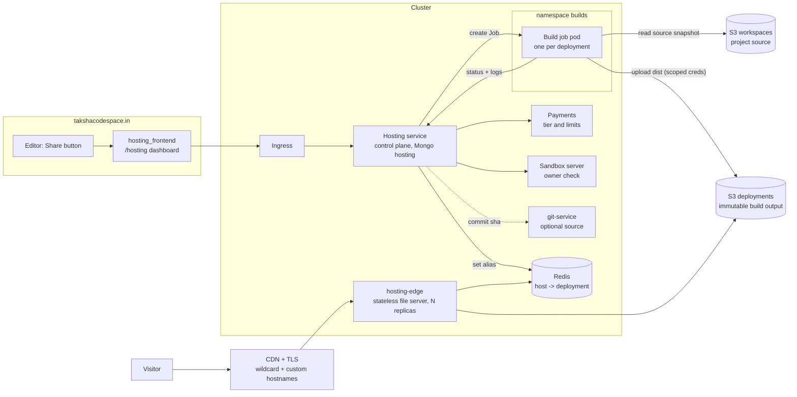
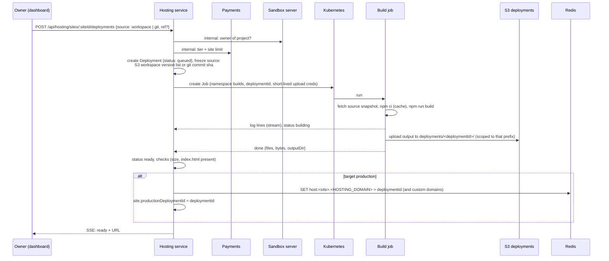
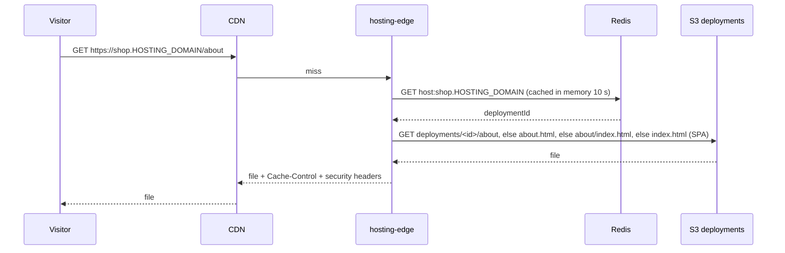
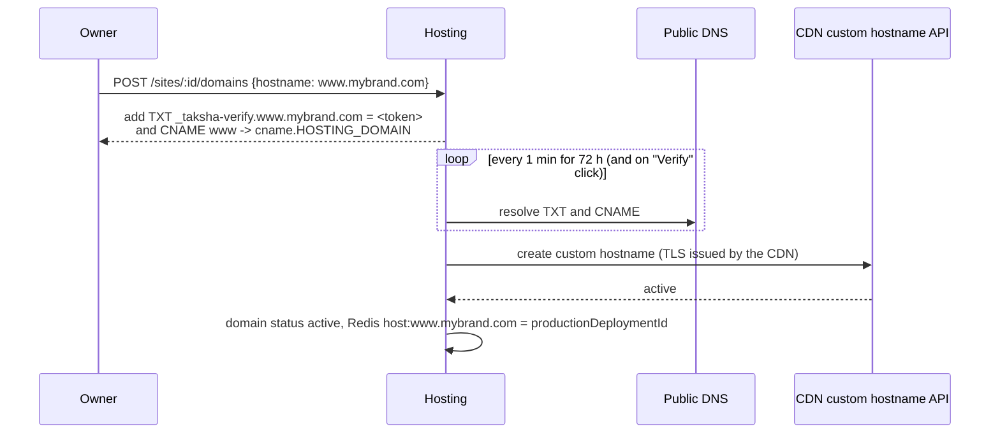

# Plan: Taksha Hosting (deploy built apps, like Vercel) — V2.5

Status: **plan only, nothing built.** Written 2026-11-25. Target release: **V2.5**, after the V2 plans (GitHub source control and the foundations) are built.

Plan index and ownership rules: [README.md](README.md). Related: [github-source-control-plan.md](github-source-control-plan.md) (repo link, webhooks), [platform-foundations-plan.md](platform-foundations-plan.md) (F2 internal identity), [kafka-whatsapp-architecture.md](kafka-whatsapp-architecture.md) (any event or notification for a deploy), [admin-platform-hld.md](admin-platform-hld.md) (abuse takedown).

## 1. Summary

The editor's **Share** button becomes the door to Taksha Hosting: a deployments dashboard where a user publishes a project's production build to a public URL, sees every deployment, rolls back, reads build logs and connects a custom domain.

| Plan | Hosted projects (sites) | Domains |
|---|---|---|
| Free | 1 | `<site>.<HOSTING_DOMAIN>` |
| Pro | 3 | Taksha subdomain + custom domains |
| Max | 5 | Taksha subdomain + custom domains |

Until V2.5 ships, the preview is owner-only and the Share button is hidden (decided 2026-11-25).

Four ideas shape the design:

1. **User code never lives on Taksha's own domain.** Hosted sites get a separate registrable domain (`HOSTING_DOMAIN`, a new `.app` domain the developer will buy), listed on the Public Suffix List. See section 3.
2. **Build and serve are separate from the sandbox.** A deployment is built by a one-shot, locked-down build job from a frozen copy of the source, never from the live sandbox, and served from object storage. A stopped sandbox never takes a site down.
3. **Deployments are immutable.** Each build gets its own id and folder. "Production" is a pointer. Rollback moves the pointer, it never rebuilds.
4. **The serving path is boring and stateless.** It scales by adding replicas and a CDN in front, and it holds no user data in memory.

**V2.5 scope:** static sites, that is anything whose `npm run build` produces a folder of files (the default Vite + React template). Server code (API routes, functions, databases) is **out of scope** and listed in section 14.

## 2. What exists today (checked 2026-11-25)

| Fact | Where | Effect |
|---|---|---|
| Every project starts from one template: Vite + React 19, `npm run build` writes `dist/` | `Sandbox/template/package.json` | The V2.5 build contract is "run `npm run build`, publish the output folder" |
| Workspace files are synced to S3 per project by `sync-agent` (no `node_modules`, `dist`, `.git`) | `Sandbox/sync-agent/sync.js` | The build job can start from the S3 copy without the sandbox running |
| The Share button copies the preview URL (`http://<sandboxId>.preview...`) | `Frontend/src/features/sandbox/components/SandboxHeader.jsx` | Hidden until V2.5; then it opens the dashboard |
| Plans and limits live in Payments (`config/plans.config.js`: free, `pro_regular`, `max_regular`) | `Payments/` | Hosting asks Payments for the user's tier; it never keeps its own copy of plans |
| Payments has its own micro-frontend (`payments_frontend/`, base `/payments/`) | `payments_frontend/` | The deployments dashboard follows the same pattern: `hosting_frontend/`, base `/hosting/` |
| The Sandbox server creates pods through the Kubernetes API with its own RBAC | `Sandbox/server/src/kubernetes/`, `k8s/rabc.yml` | The build orchestrator uses the same pattern, in its own namespace with its own service account |
| PRD Non-Goal: "The AI agent does not deploy" | `docs/prd/taksha-codespace-prd.md` | Stays true. Users deploy, the agent never does |

## 3. Why a separate domain (the "same-site" problem)

If user sites lived on `*.takshacodespace.in`, every one of them would be the **same site** as the Taksha app, in the browser's eyes:

| Risk | How it happens on a shared parent domain |
|---|---|
| Cookie tossing | A user's page sets a cookie for `.takshacodespace.in` that shadows Taksha's own cookies (for example a fake `refreshToken`), breaking or hijacking sessions |
| SameSite does not help | `SameSite=Lax` cookies (Taksha's refresh cookie is Lax) are sent on same-site requests, so a hosted page can trigger requests to `takshacodespace.in/api/...` that carry the user's cookie |
| Phishing trust | `login.takshacodespace.in`-style names look official |
| Reputation | If a hosted site is flagged for malware, browsers and mail filters may flag the whole `takshacodespace.in` domain |

That is why GitHub moved Pages to `github.io` and Vercel serves on `vercel.app`, and why both are on the **Public Suffix List** (PSL). Once a domain is on the PSL, browsers treat `a.taksha.app` and `b.taksha.app` as **different sites**, so one user's site cannot set or read cookies for another's.

**Decisions:**

| # | Decision |
|---|---|
| H-D1 | Buy one `.app` domain for hosting (name to choose, written as `HOSTING_DOMAIN` here). `.app` is HSTS-preloaded, so HTTPS is forced |
| H-D2 | Submit `HOSTING_DOMAIN` to the PSL (github.com/publicsuffix/list) in phase H0. It takes weeks to merge and months to reach browsers, so start early |
| H-D3 | Taksha never sets a cookie on `HOSTING_DOMAIN`, and no Taksha API ever accepts requests from it (CORS allowlist stays the app origin only) |
| H-D4 | **Also move sandbox previews off the main domain.** `*.preview.takshacodespace.in` runs user code on a subdomain of the app domain today, so it has the same risks. Recommendation: `<sandboxId>.preview.<HOSTING_DOMAIN>` or a second domain. The owner-only preview cookie already uses `SameSite=None; Secure` (tested in Chromium 2026-11-25), so it keeps working cross-site |

## 4. High level design

### 4.1 System view

### 4.2 New pieces

| Piece | Type | Owns | Scales by |
|---|---|---|---|
| `Hosting/` (`hosting-service`) | Express service, ingress `/api/hosting` | Sites, deployments, domains, build orchestration, limits, Mongo `hosting` | Replicas (stateless, state in Mongo and Redis) |
| `hosting-edge` | Small Node (or Nginx + Lua) server, its own Deployment, **no** ingress path on the app domain | Serving files for `HOSTING_DOMAIN` and custom domains | Replicas + CDN cache. Never calls Mongo on the hot path |
| Build job image `taksha-builder` | Kubernetes Job, namespace `builds` | One build: fetch source, install, build, upload, report | Kubernetes schedules Jobs; a per-user and global concurrency cap in Hosting |
| `hosting_frontend/` | Micro-frontend like `payments_frontend/`, base `/hosting/` | Dashboard UI | Static |
| S3 bucket `taksha-deployments` | Object storage | Immutable deployment folders | S3 |

Why a separate `hosting-edge` and not the Hosting service itself: the serving path takes all visitor traffic and must stay up even when the control plane is being deployed or is down. Different failure domain, different scaling, no auth code on it.

### 4.3 Deploy flow

Every deployment also gets its own permanent URL, `<site>-<shortId>.<HOSTING_DOMAIN>`, so the owner can check a build before promoting it (like Vercel preview deployments).

### 4.4 Serve flow (hot path)

| Rule | Value |
|---|---|
| Hashed assets (`/assets/*-[hash].js`) | `Cache-Control: public, max-age=31536000, immutable` |
| HTML | `Cache-Control: public, max-age=0, must-revalidate`, so a new deploy shows at once |
| CDN purge on promote | Not needed for assets (new names). HTML revalidates. Optional purge by host on promote |
| SPA fallback | Unknown path with no file extension serves `index.html` with 200. Unknown file with an extension is 404 |
| Headers always set | `X-Content-Type-Options: nosniff`, `Referrer-Policy: strict-origin-when-cross-origin`, `Strict-Transport-Security`. No Taksha cookies, ever |
| Unknown host | Taksha "site not found" page, 404 |
| Paused or taken-down site | Static notice page, 451 for takedown, 503 for paused |

The edge reads only Redis and S3. If Mongo or the Hosting service is down, sites keep serving.

## 5. Build isolation

The build runs `npm install` and `npm run build`, which run **arbitrary user code** (install scripts, Vite plugins). It is treated like the sandbox: untrusted.

| Control | Value |
|---|---|
| Namespace | `builds`, its own `NetworkPolicy`: egress only to DNS and the public internet (npm registry, S3). No cluster services, no private ranges, no cloud metadata (`169.254.169.254`) |
| Identity | No service account token. Runs as uid 1000, no privilege escalation, all capabilities dropped, read-only root filesystem with writable `/work` and `/tmp` |
| Credentials | Only an upload credential that can **write** `deployments/<deploymentId>/` and nothing else (S3 presigned POST policy or STS session policy scoped to that prefix, 30 minutes). Source is read with presigned GET URLs made by Hosting. No database, Redis or internal token |
| Limits | CPU 1, memory 2 GiB, `activeDeadlineSeconds` 600 (Free) / 900 (Pro, Max), ephemeral storage 5 GiB, output max 200 MB / 10,000 files |
| Reporting | The job posts status and logs to Hosting with a one-time **build token** (random, hashed in Mongo, valid for that deployment only). Hosting refuses anything from a finished deployment |
| Cleanup | `ttlSecondsAfterFinished: 300`; Hosting marks a job that disappears as `failed` |
| Cache | npm cache per user on a cache volume or S3 tarball keyed by lockfile hash. Never shared between users |
| Concurrency | 1 running build per user (Free), 2 (Pro, Max); global cap from config; extra builds wait in `queued` |

Why not build inside the user's sandbox: the sandbox may be stopped, it has user edits in progress, and its output could be changed between "build" and "upload". A frozen snapshot plus a fresh pod gives the same result every time and keeps the build away from the editor's 512 MiB limits.

## 6. Source of a deployment

| Source | When | Frozen how |
|---|---|---|
| Workspace (default) | "Deploy" from the dashboard or editor | Hosting lists the project's S3 objects and records each object's `VersionId` (bucket versioning on) in the deployment. The job downloads exactly those versions, so edits made during the build do not leak in |
| Git commit | Project linked to GitHub (V2 plan) | Records the commit sha. The job clones that sha with a 1-hour repo token from `git-service` (same broker pattern as push). Later: auto-deploy on push to the default branch (needs the G7 webhooks) |

## 7. Domains

### 7.1 Taksha subdomains

`<site>.<HOSTING_DOMAIN>`, where `site` is chosen by the user: 3 to 40 characters, lowercase letters, digits and `-`, unique, not on a reserved list (`www`, `api`, `admin`, `app`, `mail`, `status`, `login`, `secure`, `taksha*`, brand names list). Wildcard DNS and a wildcard TLS certificate cover all of them.

### 7.2 Custom domains (Pro and Max)

| Rule | Value |
|---|---|
| Ownership proof | TXT record with a random token, checked before anything is served |
| Apex domains (`mybrand.com`) | `ALIAS`/`ANAME`/CNAME flattening, or A records to the CDN's anycast IPs, shown in the UI |
| Limits | Pro 2 custom domains per site, Max 5 |
| Re-check | Daily DNS check. If the CNAME is gone for 7 days, the domain is detached (stops a dangling domain from being claimed by someone else) |
| One owner | A hostname can be attached to only one site in all of Taksha |

### 7.3 TLS and CDN choice (decision H-D5)

| Option | Cost | Custom domain TLS | Verdict |
|---|---|---|---|
| **Cloudflare in front** (DNS + proxy for `HOSTING_DOMAIN`, "Cloudflare for SaaS" custom hostnames) | Free plan for the domain; custom hostnames have a free allowance (check the current number in H0) | Managed by Cloudflare | **Recommended.** Free tier, global cache, DDoS protection, certificate handling we do not have to build |
| cert-manager + Let's Encrypt in the cluster, Nginx ingress | Free | HTTP-01 per custom domain, cert-manager manages renewals | Fallback. More moving parts, no global cache |
| AWS CloudFront + ACM | Paid per request and GB | ACM, but one distribution has a limit on alternate names | Only if the whole platform moves to AWS-native edge |

## 8. Data model (Mongo `hosting`)

`Site`

| Field | Notes |
|---|---|
| `userId`, `projectId` | `projectId` unique (one site per project) |
| `slug` | Unique, the Taksha subdomain |
| `productionDeploymentId` | Pointer, null until first promote |
| `status` | `active`, `paused_over_limit`, `paused_by_owner`, `taken_down` |
| `buildSettings` | `installCommand` (default `npm ci`), `buildCommand` (`npm run build`), `outputDir` (`dist`), `nodeVersion` (20) |
| `envVars[]` | Build-time only, `VITE_*` names; marked **public** in the UI because they end up in the bundle. Values encrypted at rest |

`Deployment` (immutable after `ready`)

| Field | Notes |
|---|---|
| `siteId`, `userId`, `shortId` | `shortId` for the permanent per-deployment URL |
| `source` | `{ type: workspace, objectVersions[] }` or `{ type: git, repo, sha }` |
| `status` | `queued`, `building`, `uploading`, `ready`, `failed`, `cancelled`, `expired` |
| `target` | `production` or `preview` |
| `files`, `bytes`, `durationMs`, `errorCode` | |
| `logKey` | Build log stored in S3 (`logs/<deploymentId>.txt`), streamed live while building |
| `buildTokenHash`, `jobName` | For the job callback |

`Domain`: `siteId`, `hostname` (unique), `verificationToken`, `status` (`pending`, `active`, `misconfigured`, `detached`), `cdnHostnameId`, `lastCheckedAt`.

Redis (read by the edge): `host:<hostname>` → `deploymentId` (production alias and per-deployment hosts), `site-status:<siteId>` for paused or taken-down notices. Mongo is the source of truth; Redis is rebuilt from Mongo by a reconcile job every 10 minutes and on Hosting start.

Retention: keep the last 10 ready deployments per site plus the production one. Older ones become `expired`; their S3 folders are deleted by a nightly job. Failed builds keep logs for 30 days.

## 9. Plan limits and billing

| Limit | Free | Pro | Max |
|---|---|---|---|
| Active sites | 1 | 3 | 5 |
| Custom domains per site | 0 | 2 | 5 |
| Builds per day | 10 | 50 | 100 |
| Concurrent builds | 1 | 2 | 2 |
| Build time limit | 10 min | 15 min | 15 min |
| Output size | 50 MB | 200 MB | 200 MB |
| Bandwidth (soft, per month) | 10 GB | 100 GB | 250 GB |
| "Made with Taksha" badge | Yes | Optional | Optional |

- Limits are defined in `Payments/config/plans.config.js` next to the existing tier limits (one place for plans), and read by Hosting through an internal Payments route.
- **Downgrade:** no site is deleted. Sites over the new limit become `paused_over_limit` (the edge serves a notice page) and the owner picks which to keep active.
- **Bandwidth** is measured from CDN or edge logs per host, rolled up daily. V2.5 only warns at 80% and 100%; billing for overage is later.
- Deploys cost **no AI credits**.

## 10. APIs

### 10.1 Hosting service (`/api/hosting`, user JWT via JWKS, FaultKit errors)

| Method and path | Does |
|---|---|
| `GET /sites` | The user's sites with status, production URL, last deployment |
| `POST /sites` | `{projectId, slug}` create a site (limit check, slug check) |
| `PATCH /sites/:id` | Build settings, env vars, slug change (old slug redirects for 30 days) |
| `POST /sites/:id/pause`, `/resume` | Owner pause |
| `DELETE /sites/:id` | Delete site, its deployments and domains (confirm in UI). The project is not touched |
| `GET /sites/:id/deployments` | List, newest first, cursor |
| `POST /sites/:id/deployments` | `{source: workspace | git, ref?, target: production | preview}` |
| `GET /deployments/:id` | Detail |
| `GET /deployments/:id/logs` | SSE stream while building, full text after |
| `POST /deployments/:id/cancel` | Deletes the Job |
| `POST /sites/:id/promote` | `{deploymentId}` point production at a ready deployment (rollback is this call) |
| `GET/POST/DELETE /sites/:id/domains`, `POST /domains/:id/verify` | Custom domains |
| `GET /usage` | Sites used, builds today, bandwidth this month against limits |
| `POST /internal/builds/:deploymentId/events` | Job callback, build token only, not in the ingress |

### 10.2 Internal routes it uses

| Route | Owner service | Exists? |
|---|---|---|
| Owner of a project | Sandbox server `/internal/...` | Add (same pattern as the MCP token lookup) |
| Tier and hosting limits for a user | Payments `/internal/...` | Add |
| 1-hour repo token for a clone | git-service (V2 plan) | Comes with G4 |

All internal calls use the F2 internal service identity from [platform-foundations-plan.md](platform-foundations-plan.md).

## 11. Dashboard (`hosting_frontend/`, base `/hosting/`)

| Screen | Content |
|---|---|
| Sites | Cards: name, live URL, status, last deploy (who, when, from), usage bar against the plan limit, "New site" (pick a project) |
| Site overview | Production URL, Visit, Deploy button (Production / Preview), latest deployments, quick rollback |
| Deployments | Table: id, status, source (workspace or commit sha + message), target, duration, time. Row actions: open URL, promote, view logs, cancel |
| Build logs | Live log viewer (SSE), step markers (fetch, install, build, upload), error highlights with the last 30 lines |
| Domains | Add domain, DNS instructions to copy, status badge (pending, active, misconfigured), verify button |
| Settings | Slug, build command, output dir, Node version, public env vars, pause, delete |
| Usage | Sites, builds today, bandwidth this month, upgrade link to `/payments/` |

Editor: the Share button opens `/hosting/` on the current project's site, or "Create a site for this project" when none exists. The editor never shows the private preview URL as a share link again.

## 12. Abuse and safety

| Risk | Control |
|---|---|
| Phishing and malware on `HOSTING_DOMAIN` | Report link in the footer of the not-found page and in a `/.well-known/taksha-report` route; Google Safe Browsing lookup on each new production deploy's URL; admin takedown (`taken_down`, 451) through the admin platform P7 actions |
| Reserved and lookalike names | Reserved slug list, confusable-character check |
| Crypto mining or abuse in builds | Time, CPU and memory limits; builds per day; no network inside the cluster |
| Dangling custom domains | Daily DNS re-check, detach after 7 days |
| Huge sites | Output size and file count limits |
| Secrets in bundles | UI warns that `VITE_*` values are public; build step scans output for common key patterns and warns |

## 13. Phases

Each phase ends with its tests passing and one local commit. No push unless asked.

| Phase | Weeks (one engineer) | What | Gate |
|---|---|---|---|
| **H0 Domain and spike** | 0.5 | Buy `HOSTING_DOMAIN`, put DNS on the CDN, submit the PSL request, check the CDN's custom hostname limits, prove a wildcard cert, decide H-D4 (preview domain) | Written answers in this file; PSL pull request open |
| **H1 Hosting skeleton** | 1 | Service, Mongo `hosting`, `Site`, limits from Payments, owner check, ingress `/api/hosting`, k8s files | Create and list sites with limits enforced |
| **H2 Builds** | 2 | `taksha-builder` image, `builds` namespace, NetworkPolicy, RBAC, scoped upload creds, Job lifecycle, build token callback, logs to S3 and SSE, workspace source snapshot | A Vite project builds from its S3 snapshot and its output lands in `deployments/<id>/`; a build that tries to reach `auth-service` fails |
| **H3 Edge** | 1.5 | `hosting-edge`, Redis alias, SPA fallback, cache headers, security headers, not-found and paused pages, reconcile job | `<site>.HOSTING_DOMAIN` serves the app through the CDN; Hosting down, site still up |
| **H4 Dashboard** | 2 | `hosting_frontend/` screens, Share button change, promote and rollback, per-deployment URLs | Deploy, promote, roll back from the UI |
| **H5 Custom domains** | 1.5 | TXT verification, CDN custom hostnames, apex instructions, daily re-check | `www.example.com` serves the site with valid TLS |
| **H6 Git deploys** | 1 | Deploy from a commit sha; auto-deploy on push (needs GitHub G7 webhooks) | Push to `main` deploys within 2 minutes |
| **H7 Usage and abuse** | 1 | Bandwidth roll-up, 80% and 100% warnings, Safe Browsing check, admin takedown, retention job | Takedown serves 451 in under a minute |

About 10.5 weeks for H0 to H7.

## 14. Out of scope for V2.5 (later)

Server-side code (API routes, serverless functions, Node servers), databases, environment-specific runtime secrets, edge middleware, image optimisation, analytics for visitors, password-protected sites, team members, preview deployments per pull request, other frameworks (Next.js SSR, Python). Each needs its own plan.

## 15. Touch points with other plans

| Touch point | Rule |
|---|---|
| Payments `plans.config.js` | Hosting limits are added there, additive keys only |
| Kafka plan | Deploy events (`hosting.deployment.ready`, `failed`) and their email/WhatsApp notifications are designed in the Kafka plan, not here. Until Kafka exists, the dashboard shows status and no message is sent |
| Admin platform | Read-only access to Mongo `hosting`; takedown through admin P7 actions calling a Hosting internal route |
| GitHub plan | Git source and auto-deploy reuse `git-service`'s token broker and webhooks |
| Router and preview | H-D4 moves preview hosts to a non-app domain; the router's owner check and preview cookie stay the same |
| Ingress | New path `/api/hosting` and `/hosting/` (frontend). The edge has its own Ingress object for `HOSTING_DOMAIN` and custom hostnames |

## 16. Checklist items (for `CHECKLIST.md`, phase "V2.5 Hosting")

**H0**
- [ ] Buy `HOSTING_DOMAIN` (.app), DNS on the CDN
- [ ] Submit to the Public Suffix List
- [ ] Check custom hostname free allowance, wildcard TLS
- [ ] Decide H-D4 (move previews off the app domain)

**H1**
- [ ] `Hosting/` service skeleton, Mongo `hosting`, `/api/hosting`
- [ ] `Site` model, slug rules and reserved list
- [ ] Hosting limits in Payments `plans.config.js` + internal route
- [ ] Owner check through the Sandbox server internal route

**H2**
- [ ] `taksha-builder` image
- [ ] `builds` namespace, NetworkPolicy, RBAC, pod hardening
- [ ] Upload creds scoped to one deployment prefix
- [ ] Job lifecycle, build token callback, cancel
- [ ] Logs to S3 + SSE
- [ ] Workspace snapshot by S3 object versions (bucket versioning on)

**H3**
- [ ] `hosting-edge` with Redis alias and in-memory cache
- [ ] SPA fallback, cache and security headers
- [ ] Not-found, paused, takedown pages
- [ ] Redis reconcile from Mongo

**H4**
- [ ] `hosting_frontend/` (sites, deployments, logs, settings, usage)
- [ ] Share button opens the dashboard
- [ ] Promote and rollback
- [ ] Per-deployment URLs

**H5**
- [ ] Custom domain add, TXT verify, CDN custom hostname
- [ ] Apex instructions
- [ ] Daily re-check, detach after 7 days

**H6**
- [ ] Deploy from a commit sha through git-service
- [ ] Auto-deploy on push (after GitHub G7)

**H7**
- [ ] Bandwidth roll-up and warnings
- [ ] Safe Browsing check
- [ ] Admin takedown route
- [ ] Retention job (last 10 + production)
