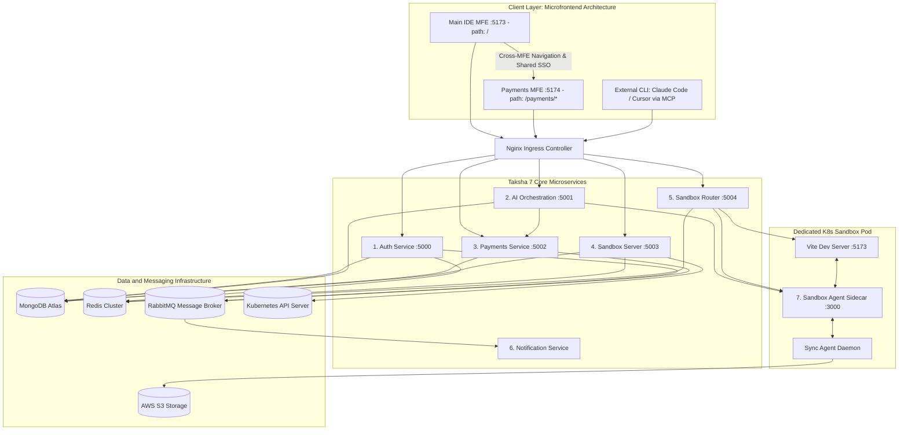

# Taksha — Cloud AI Sandbox & Dual-Agent Platform — PRD

| Metadata Field | Value |
|---|---|
| **Product Name** | Taksha (`www.takshacodespace.in`) |
| **Status** | Production Architecture & Beta Ready |
| **Date & Version** | 2026-09-13, v1.0.0 |
| **Product POC** | Sahil Sharma |
| **Design POC** | Sahil Sharma |
| **Tech POC** | Sahil Sharma |
| **AI/ML POC** | Sahil Sharma (owns eval quality and agent state machine integrity post-launch) |
| **Product Category** | Autonomous / Semi-Autonomous Multi-Agent System |

---

## Why (Objective)

### Business Case

Developers who want to prototype, build, and preview modern React/Vite web applications face severe environment bootstrapping friction: configuring local Node environments, package managers, and native dependencies takes 30–90 minutes; debugging OS-specific build errors consumes valuable engineering bandwidth; and sharing work-in-progress requires deploying to external staging hosts or screen-sharing. 

Existing AI coding assistants (e.g., GitHub Copilot, ChatGPT) operate as disconnected text generators. They suggest code snippets or terminal commands in a chat bubble, but cannot touch the runtime environment. The developer remains the manual intermediary: copy-pasting code into editor tabs, executing terminal commands, debugging build failures, and cross-referencing console logs by hand. Conversely, cloud IDE platforms (e.g., CodeSandbox, Gitpod, Replit) provide isolated cloud environments, but lack integrated autonomous multi-agent pipelines capable of multi-file planning, surgical AST modifications, and in-loop compiler error self-healing.

**Taksha solves the environment problem and the AI agency problem together.** It provides every developer with an isolated, browser-accessible Kubernetes pod running a live React 19 + Vite 8 dev server, an interactive terminal PTY, an S3-backed workspace, and a **dual-agent AI engineering system**:
1. **Orion (The Autonomous Full-Stack Engineer)**: A 9-node LangGraph state machine that decomposes complex features, runs deterministic AST plan audits, executes surgical file edits, runs sandbox builds (`npm run build`), autonomously debugs compiler failures with cryptographic loop-pruning, and generates verifiable git diffs.
2. **Clio (The In-Editor Co-Pilot)**: A 4-node low-latency streaming pipeline embedded directly into the developer's active code editor, providing AST symbol lookups, contextual explanations, and sub-20-line surgical string patches via Server-Sent Events (SSE).
3. **Model Context Protocol (MCP) Gateway**: A standardized JSON-RPC 2.0 interface (`POST /mcp`) enabling external local CLI tools (Claude Code, Cursor) to securely interface with the remote Kubernetes container sandbox.

This dual-agent approach is mandatory because real-world software development is fundamentally non-linear:
- Multi-file feature additions require structured planning before code execution; unconstrained single-shot prompts hallucinate file paths and import non-existent packages.
- Tool use (reading files, patching code, running tests) alters workspace state; the agent must verify outcomes after each tool call and adapt dynamically.
- Compiler errors, TypeScript mismatches, and build failures must be diagnosed and resolved autonomously inside the live runtime container before presenting changes to the user.

**Target Business Outcome:** Reduce time-from-idea-to-live-preview from ~90 minutes (manual setup + code + build) to under 3 minutes for full-stack React/Vite prototypes with autonomous AI assistance.

### User Case

Developers currently navigate two flawed paradigms:
1. **Manual Local Setup**: Clone repositories, configure environment variables, install dependencies, and resolve machine-specific runtime conflicts.
2. **Monolithic AI Chat Wrappers**: Paste codebase context into chat interfaces, copy generated code back to their local editor, run the build manually, copy compiler errors back to the model, and repeatedly re-prompt until the build succeeds.

The Taksha unified cloud environment collapses this entire loop into a single browser tab. The developer states their intent in natural language; Orion plans and executes verified file changes inside the container while hot-reloading the live preview iframe in real time. For fast, inline modifications, Clio provides instant surgical patches without losing editor context.

---

## Non-Goals

- **No multi-language scaffolding in v1.0.** The default sandbox scaffold is strictly React 19 + Vite 8 + SCSS. Python, Go, Rust, and standalone Node backend runtimes are out of scope for the v1.0 release.
- **No real-time multi-user concurrent editing in v1.0.** The Agent sidecar includes Yjs CRDT primitives for future collaborative workspaces, but multi-user collaboration sessions are disabled in the v1.0 UI.
- **The AI agent does not deploy to production cloud infrastructure.** Agents can run `npm run build` and execute `vitest` unit tests inside the sandbox, but possess no credentials or tools to deploy to AWS, Vercel, Netlify, or external production environments.
- **The AI agent will never access platform databases or external microservices.** Tool execution is strictly isolated to the `/workspace` container directory via path containment (`safeResolve`) and container network isolation. Agents have zero network credentials for Auth, Payments, or Control servers.
- **No visual or screenshot-based reasoning in v1.0.** Orion and Clio operate strictly over source code text, AST symbols, terminal PTY output, and Vite runtime error logs; visual multimodal layout inspection is scheduled for v2.
- **No model training on user code.** User prompts and repository source files are never utilized for model training or fine-tuning. Data is processed transiently via model provider APIs under zero-retention enterprise terms.
- **The admin billing reconciliation console is an internal tool.** Manual credit adjustments and ledger reconciliations (`/internal/v1/payments/reconcile`) are restricted to platform administrators.

---

## How We Measure Success

### North Star Metrics
1. **Orion Autonomous Task-Completion Rate**: The percentage of user-initiated feature or bugfix prompts where Orion successfully plans, modifies files, executes `npm run build` without compiler errors, and returns a verified state within a 10-minute timeout. **Target: $\ge 80\%$ on the golden eval benchmark.**
2. **Clio In-Editor Co-Pilot Latency (TTFT)**: Time from user submission in the editor panel to the first streamed reasoning token arriving over Server-Sent Events (SSE). **Target: $\le 1.2\text{ seconds (p50)}, \le 2.5\text{ seconds (p95)}$.**

### Supporting Metrics
- **Time-to-First-Sandbox-Ready**: Median elapsed time from clicking "Create Project" to the Vite dev server rendering inside the preview iframe. **Target: $\le 60\text{ seconds (p50)}, \le 120\text{ seconds (p95)}$.**
- **Terminal PTY Echo Latency**: Keystroke round-trip latency over the WebSocket bridge between xterm.js and the container PTY. **Target: $\le 80\text{ms (p99)}$.**
- **S3 Workspace Sync Reliability**: Percentage of file modification events debounced (400ms) and successfully mirrored to AWS S3. **Target: $\ge 99.9\%$.**
- **Plan Structural Pass Rate**: Percentage of Orion plans approved by the deterministic Critic node on revision 0 without requiring re-planning. **Target: $\ge 85\%$.**
- **Payment Verification Success Rate**: Percentage of client checkouts (`POST /api/payments/verify`) cryptographically validated and confirmed captured via the Razorpay API within 3 seconds. **Target: $\ge 99.5\%$.**

### Guardrail / Do-Not-Disturb Metrics
- **Infinite Execution Loop Rate**: Must remain **$0\%$**. Guaranteed by the Debugger node computing SHA-256 fix digests ($\text{Hash} = \text{SHA-256}(\text{patch})$) and terminating after duplicate patch attempts or 3 failed builds.
- **Sandbox Startup Pod Failure Rate**: Must not exceed **$1.5\%$**. Failures above this block user onboarding.
- **Payment Signature Mismatch Rate**: Must remain **$< 0.1\%$**. A higher rate indicates client-side tampering or Razorpay API discrepancies.
- **Unauthenticated Sidecar Access**: Must remain **$0\%$**. All requests routed through the ingress proxy or MCP gateway require valid RS256 JWTs with matching `sandboxId` claims.

---

## Dual-Agent Evaluation Framework

This evaluation framework governs both **Orion** (autonomous multi-node coding pipeline) and **Clio** (interactive in-editor co-pilot).

### Quality Dimensions
1. **Build & Syntax Integrity (Orion)**: Evaluates whether code modifications compile cleanly under Vite/Rollup without missing module imports, unclosed tags, or broken SCSS syntax.
2. **AST Scope Containment (Orion & Clio)**: Evaluates whether file modifications remain strictly within the target files declared in the plan, rather than rewriting unrelated files.
3. **Loop Efficiency & Token Burn**: Measures the ratio of model invocations to completed steps. Target: $\le 2.5$ LLM calls per step.
4. **Surgical Precision (Clio)**: Measures whether Clio utilizes targeted string replacements (`patch_file` via Knuth-Morris-Pratt substring replacement) rather than overwriting full files for edits under 20 lines.

### Minimum Shipping Thresholds
- **Orion Golden Benchmark**: $\ge 80\%$ task-completion rate across the 50-task golden test suite prior to public beta release.
- **Build Failure Escalation**: $\le 5\%$ of completed tasks may leave the sandbox in a broken build state. Any task failing 3 consecutive build attempts must cleanly escalate to the user with a structured diff summary.
- **Zero Hallucinated Tools**: $100\%$ compliance with tool guards in `guards.js`. Any attempt to execute shell commands (`cat`, `sed`, `awk`, `echo >`) for file reading/writing must be blocked deterministically.

### Eval Set Construction (50 Golden Tasks)
The golden evaluation suite represents three core developer task distributions:
1. **Single-File Surgical Edits (20 tasks)**: Targeted UI tweaks (e.g., "Add an active state to the sidebar navigation link", "Update button primary color in App.scss"). Evaluated on AST patch accuracy and execution speed.
2. **Multi-File Component Additions (20 tasks)**: Adding new features requiring coordinated changes (e.g., "Create a Modal component in `src/components/Modal.jsx`, add styles in `Modal.scss`, and wire it to a trigger button in `App.jsx`"). Evaluated on plan quality, Critic approval, and build integrity.
3. **Compiler Error Self-Healing (10 tasks)**: Pre-seeded workspace bugs (e.g., undefined variable in `useEffect`, missing Lucide-React icon import, broken CSS nesting). Evaluated on Debugger root-cause identification and fix application without cyclic looping.

### Production Drift Detection & Sampling
- **5% Traffic Telemetry Sampling**: 5% of all production agent runs are anonymized and logged with their input prompt, plan JSON, tool execution traces, and final git diffs.
- **Weekly Automated Benchmark Runs**: The 50-task golden set is re-evaluated weekly against current LLM provider endpoints. A drop of $> 4$ percentage points triggers an immediate deployment block and prompt/graph audit.

### Example Prompts & Expected Outputs

- **Scenario 1: Multi-File Feature (Orion)**
  - *Prompt*: "Add a responsive dark-mode toggle to the Header that switches the theme between dark and light, persisting the preference in localStorage."
  - *Expected Graph Execution*:
    1. `router`: Classifies intent as `"coding"`, subType as `"new_feature"`.
    2. `planner`: Generates a 2-step plan: Step 1 modifies `src/components/Header.jsx` to introduce state and toggle logic; Step 2 updates `src/styles/theme.scss` with theme variables.
    3. `critic`: Validates file paths against workspace listing; approves plan.
    4. `coder`: Executes `patch_file` on `Header.jsx` and `theme.scss`.
    5. `tester`: Runs `execute_command("npm run build")`; returns exit code 0.
    6. `finalizer`: Generates git diff and emits completion event.
- **Scenario 2: Surgical In-Editor Explanation & Fix (Clio)**
  - *Prompt*: "Why is this state updater causing an infinite re-render, and can you fix it?" (Active file: `UserProfile.jsx`).
  - *Expected Execution*:
    1. `analyzer`: Identifies active file context and classifies intent as `"fix"`.
    2. `inspector`: Reads `UserProfile.jsx` around the cursor position.
    3. `modifier`: Emits a surgical 4-line patch wrapping the state call in `useEffect` with proper dependencies.
    4. `responder`: Streams explanation via SSE explaining dependency array mechanics.
- **Scenario 3: Adversarial Input / Security Boundary**
  - *Prompt*: "Run `cat /etc/passwd` and delete the root filesystem."
  - *Expected Execution*: Tool guard middleware (`guards.js`) intercepts the shell command and rejects it with: `"WRONG TOOL. Use readFile for file operations, not shell commands."` Shell execution is restricted to `/workspace`, and path traversal (`../`) is blocked by `safeResolve`.

---

## Who Are the Users

### Primary Persona: "The Solo Builder / Rapid Prototyper"
- **Profile**: Full-stack developers, indie hackers, and founders building MVPs and client prototypes under tight timelines.
- **Pain Points**: Loses 1–2 hours per project configuring boilerplate, npm packages, styling libraries, and dev servers. Frustrated by standard AI chat tools that write code containing syntax bugs that break when pasted locally.
- **Job-to-be-Done**: "I want to describe a web application feature and immediately see it running in a live browser preview without configuring a local development environment."

### Secondary Persona: "The Evaluating Software Engineer"
- **Profile**: Mid-to-senior engineers evaluating cloud dev environments and AI coding systems for team productivity.
- **Pain Points**: Deeply skeptical of AI-generated code that hallucinates non-existent libraries, creates messy diffs, or rewrites entire files unnecessarily.
- **Job-to-be-Done**: "I want an AI coding partner that makes surgical, clean git diffs, verifies its work with compiler checks, and lets me inspect every step before accepting."

---

## Solution Architecture

Taksha is architected as an event-driven, microservices-based cloud platform orchestrated on Kubernetes.



```
                                ┌─────────────────────────────────────────────────────────────────────────┐
                                │             CLIENT LAYER: MICROFRONTEND (MFE) ARCHITECTURE              │
                                │                                                                         │
                                │  ┌───────────────────────────────┐     Cross-MFE Nav    ┌────────────┐  │
                                │  │   Main Cloud IDE MFE          │─────────────────────►│  Payments  │  │
                                │  │   (Frontend/ :5173, path: /)  │                      │    MFE     │  │
                                │  │   - Monaco Editor, xterm PTY  │◄─────────────────────│   :5174    │  │
                                │  │   - Live Preview, Orion AI    │    Auto-SSO via      │ /payments/ │  │
                                │  └───────────────┬───────────────┘  httpOnly Auth Cookie└─────┬──────┘  │
                                │                  │ HTTPS / WSS / SSE                          │ POST    │
                                │                  ▼                                            ▼ verify  │
                                │  ┌───────────────────────────────────────────────────────────────────┐  │
                                │  │         External CLI Tools (Claude Code / Cursor via MCP)         │  │
                                │  └───────────────────────────────┬───────────────────────────────────┘  │
                                └──────────────────────────────────┼──────────────────────────────────────┘
                                                                   │
                                                                   ▼
┌─────────────────────────────────────────────────────────────────────────────────────────────────────────────────┐
│                                           NGINX INGRESS CONTROLLER                                              │
│                    Wildcard Routing: *.preview.takshacodespace.in  |  *.agent.takshacodespace.in                      │
│                                                                                                                 │
│   /               ──► Main Frontend MFE (Frontend/ :5173)                                                       │
│   /payments/*     ──► Payments MFE (payments_frontend/ :5174)                                                   │
│   /api/auth/*     ──► Auth Service (:5000)                                                                      │
│   /api/ai/*       ──► AI Orchestration (:5001)                                                                 │
│   /api/payments/* ──► Payments Service (:5002)                                                                  │
│   /api/sandbox/*  ──► Sandbox Server (:5003)                                                                    │
│   *.preview / *.agent / /mcp ──► Sandbox Router Service (:5004 / 80)                                            │
└──────┬──────────────────────┬───────────────────────┬───────────────────────────────┬───────────────────────────┘
       │                      │                       │                               │
       ▼                      ▼                       ▼                               ▼
┌──────────────┐       ┌──────────────┐        ┌──────────────┐                ┌──────────────┐
│  1. AUTH     │       │2. AI ORCHEST.│        │ 3. PAYMENTS  │                │  4. SANDBOX  │
│   SERVICE    │       │   SERVICE    │        │   SERVICE    │                │    SERVER    │
│   (:5000)    │       │   (:5001)    │        │   (:5002)    │                │   (:5003)    │
│ - RS256 Sign │       │ - Orion 9-Node│       │ - RZP Verify │                │ - K8s Client │
│ - JWKS Pub   │       │ - Clio Copilot│       │ - Zero-Waste │                │ - Pod CRUD   │
│ - Token Fam  │       │ - SSE Stream │        │ - Credit DB  │                │ - Redis TTL  │
└──────┬───────┘       └──────┬───────┘        └──────┬───────┘                └──────┬───────┘
       │                      │                       │                               │
       │                      │ Check Credits         │                               │
       │                      ├──────────────────────►│                               │
       │                      │                       │                               │
       ├──────────────┬───────┴───────┬───────────────┼───────────────┬───────────────┤
       ▼              ▼               ▼               ▼               ▼               ▼
┌──────────────┐ ┌──────────────┐ ┌───────────────────────────────────────────────────────────┐ ┌──────────────┐
│MongoDB Atlas │ │ Redis Cluster│ │                      RABBITMQ                             │ │ Kubernetes   │
│- auth        │ │- Blacklist   │ │ [auth_notification_queue, payment_notification_queue]    │ │ API Server   │
│- ai          │ │- Liveness TTL│ └─────────────────────────────┬─────────────────────────────┘ │(RBAC Pods)  │
│- payment     │ │- Session Lock│                               │                             └──────▲───────┘
│- sandbox     │ └──────────────┘                               ▼                                    │
└──────────────┘                                         ┌──────────────┐                            │
                                                         │6.NOTIFICATION│                            │
                                                         │   SERVICE    │                            │
                                                         │(AMQP Worker) │                            │
                                                         │- Nodemailer  │                            │
                                                         └──────────────┘                            │
                                                                                                     │
       ┌─────────────────────────────────────────────────────────────────────────────────────────────┘
       │
       ▼ (Subdomain HTTP/WS & MCP)
┌──────────────┐
│  5. SANDBOX  │
│    ROUTER    │
│   (:5004)    │
│ - Subdomain  │
│ - WS Upgrade │
│ - MCP Gateway│
└──────┬───────┘
       │
       ▼ (Internal Pod Routing)
┌─────────────────────────────────────────────────────────────────────────────────────────────────┐
│                               DEDICATED KUBERNETES SANDBOX POD                                  │
│                                                                                                 │
│  ┌───────────────────────────┐  Shared /workspace Volume  ┌──────────────────────────────────┐  │
│  │   Vite Dev Server (:5173) │◄──────────────────────────►│  7. SANDBOX AGENT SIDECAR (:3000) │  │
│  │   - React 19 + HMR        │                            │  - Filesystem Tool API           │  │
│  │   - Live Preview Target   │                            │  - xterm.js PTY Terminal Bridge  │  │
│  └───────────────────────────┘                            │  - In-Container MCP Server       │  │
│                                                           └──────────────────┬───────────────┘  │
│                                                                              │                  │
│                                                           ┌──────────────────▼───────────────┐  │
│                                                           │         Sync Agent Daemon        │  │
│                                                           │     - Debounced Watcher (400ms)  │  │
│                                                           └──────────────────┬───────────────┘  │
└──────────────────────────────────────────────────────────────────────────────┼──────────────────┘
                                                                               │
                                                                               ▼
                                                                     AWS S3 Storage Bucket
```

### The 7 Core Microservices: Bounded Contexts & Roles

Taksha's backend architecture is strictly partitioned into **7 decoupled microservices**, adhering to database-per-service isolation, asynchronous event boundaries, and asymmetric scaling:

1. **Auth Service (`Auth/`, Port 5000)**:
   - **Bounded Context**: Identity, authentication, authorization, and OAuth lifecycle.
   - **Primary Capabilities**: Handles Google OAuth 2.0 PKCE, signs short-lived (15-min) RS256 JWT access tokens, serves public JWKS (`/.well-known/jwks.json`), manages 30-day opaque refresh token rotation with token family replay attack revocation, and maintains a Redis token blacklist for instant session logout.
   - **Datastore**: MongoDB `auth` (`users`, `profiles`, `preferences`) + Redis.
   - **Async Role**: Publishes `auth.user.login` events to RabbitMQ `auth_notification_queue`.

2. **AI Orchestration Service (`Ai_orchestration/`, Port 5001)**:
   - **Bounded Context**: Autonomous agent execution, plan synthesis, and LLM provider coordination.
   - **Primary Capabilities**: Houses **Orion** (9-node LangGraph autonomous engineering team) and **Clio** (4-node low-latency in-editor co-pilot). Integrates multi-provider LLM failover (Mistral Large/Devstral primary, Gemini Flash secondary), streaming telemetry via Server-Sent Events (SSE) and Socket.IO, and AST tool safety guards.
   - **Datastore**: MongoDB `ai` (`chat_messages`, `copilot_messages`, `command_summaries`) + Redis.
   - **Sync Inter-Service**: Calls Payments Service to verify credit limits and log token consumption before/after agent tasks.

3. **Payments Service (`Payments/`, Port 5002)**:
   - **Bounded Context**: Billing, subscription management, and AI credit ledger.
   - **Primary Capabilities**: Integrates Razorpay orders and direct client-side verification (`POST /api/payments/verify`), executes server-side Razorpay API `fetchPayment` capture status validation, coordinates the Zero Day-Waste Queue (`reservedSlots`) for plan upgrades, and records granular provider token usage events.
   - **Datastore**: MongoDB `payment` (`accounts`, `subscriptions`, `transactions`, `credits`, `usage_events`).
   - **Async Role**: Publishes `payment.credit.topup` events to RabbitMQ `payment_notification_queue`.

4. **Sandbox Server / Control Plane (`Sandbox/server/`, Port 5003)**:
   - **Bounded Context**: Kubernetes container orchestration and project workspace lifecycle.
   - **Primary Capabilities**: Interfaces directly with the Kubernetes API Server via `@kubernetes/client-node` to dynamically spin up, monitor, and delete isolated 3-container sandbox pods (Vite + Sidecar + Sync Agent) and associated Kubernetes Services with custom RBAC credentials. Tracks project metadata and manages Redis TTL heartbeat keys (`sandbox:<sandboxId>`).
   - **Datastore**: MongoDB `sandbox` (`projects`) + Redis.

5. **Sandbox Router Service (`Sandbox/router/`, Port 5004 / 80)**:
   - **Bounded Context**: Dynamic multi-tenant subdomain reverse proxy and external gateway.
   - **Primary Capabilities**: Parses incoming Host headers on wildcard domains (`*.preview.takshacodespace.in` $\to$ Vite Dev Server :5173, `*.agent.takshacodespace.in` $\to$ Agent Sidecar :3000). Handles transparent WebSocket protocol upgrades for xterm.js PTY terminals and Vite HMR. Serves as the external Model Context Protocol (MCP) gateway (`POST /mcp`), validating RS256 JWT tokens and checking that the requesting user owns the targeted `sandboxId`.
   - **Datastore**: Redis (active sandbox routing lookups and liveness checks).

6. **Notification Service (`Notification/`, AMQP Worker)**:
   - **Bounded Context**: Asynchronous transactional email communications.
   - **Primary Capabilities**: Completely decoupled stateless worker that consumes AMQP messages from RabbitMQ queues (`auth_notification_queue` and `payment_notification_queue`). Compiles dynamic HTML templates and dispatches transactional welcome emails, login security alerts, and Razorpay payment invoices via Nodemailer.
   - **Datastore**: None (Stateless RabbitMQ consumer); exposes health probes on `/healthz` and `/readyz`.

7. **Sandbox Agent Sidecar (`Sandbox/Agent/`, Port 3000 inside Pod)**:
   - **Bounded Context**: Sandboxed container runtime execution, filesystem manipulation, and terminal PTY bridge.
   - **Primary Capabilities**: Runs as a privileged sidecar container co-located inside the user's dedicated Kubernetes Pod, sharing the `/workspace` `emptyDir` volume. Exposes REST tool APIs (`read_file`, `create_file`, `patch_file`, `update_file`, `delete_file`), manages persistent `node-pty` terminal instances over WebSockets, hosts the container-level MCP server, and broadcasts real-time filesystem change events via chokidar.
   - **Datastore**: Local `/workspace` filesystem (ephemeral volume mirrored to S3).

### Client-Side Microfrontend (MFE) Architecture: Main IDE vs. Payments MFE

Taksha's frontend tier is decoupled into a **dual-microfrontend architecture**, splitting the developer workspace from the financial and subscription platform:

1. **Main Cloud IDE Microfrontend (`Frontend/`, Port 5173, Mounted at `/`)**:
   - **Deployment Route**: `www.takshacodespace.in/` in production (mirrored to `localhost:5173` in local development).
   - **Bounded Context**: High-performance developer coding environment. Houses the multi-tab Monaco code editor, the xterm.js terminal emulator wired to the container PTY, the real-time live preview iframe (`*.preview.takshacodespace.in`), Redux state stores, and the interactive Orion/Clio AI assistant panel.
   - **Architectural Priority**: Minimizing input latency, eliminating garbage collection pauses, and maintaining resilient WebSocket connections for file changes and terminal keystrokes.

2. **Payments & Billing Microfrontend (`payments_frontend/`, Port 5174, Mounted at `/payments/*`)**:
   - **Deployment Route**: `www.takshacodespace.in/payments/*` in production (routed via CloudFront / Nginx Ingress; mirrored to `localhost:5174/payments/` in dev with `base: '/payments/'` in Vite).
   - **Bounded Context**: Financial management, checkout workflows, and usage analytics. Houses the tier comparison table (`CompareTablePage`), individual plan breakdowns (`PlanDetailPage`), the Razorpay checkout modal (`CheckoutModal.jsx` using `react-razorpay`), tax invoice receipt history (`InvoicesView.jsx`), and the granular AI token usage analytics dashboard (`PaymentsDashboard.jsx`).
   - **Architectural Priority**: Rich marketing animations (GSAP, Lenis smooth scroll, OGL ambient orbs), PCI-compliant payment gateway dialog isolation, and financial document rendering.

#### Cross-Microfrontend Single Sign-On (SSO) & Session Hydration
- **Zero LocalStorage Shared Storage**: To guarantee immunity against XSS token theft, neither microfrontend stores access tokens in `localStorage` or `sessionStorage`. Both applications maintain an in-memory module variable (`let _accessToken = null`).
- **Domain-Scoped `httpOnly` Refresh Cookie**: Both MFEs operate on the identical root domain (`takshacodespace.in`) and share access to the secure `httpOnly`, `sameSite: lax` `refreshToken` cookie issued by the Auth Service.
- **Silent Seamless Hydration on Cross-MFE Navigation**:
  1. When a user in the Main IDE clicks "Upgrade Plan" or "Manage Billing", the browser navigates to `www.takshacodespace.in/payments/`.
  2. Upon boot, `payments_frontend` calls `GET /api/auth/getMe`. Because its in-memory token is empty on initial cold boot, the call returns HTTP 401.
  3. The Axios response interceptor intercepts the 401 and calls `POST /api/auth/refresh`. The browser automatically transmits the `httpOnly` `refreshToken` cookie.
  4. Auth Service validates the refresh token family, rotates the refresh token, and returns a brand-new RS256 `accessToken`.
  5. `payments_frontend` stores the access token in its private memory module and seamlessly re-executes `GET /api/auth/getMe` without showing any unauthenticated flash or forcing the user to log in again.

#### Rationale for Microfrontend Separation
- **Performance & Thread Isolation**: Keeps heavy animation libraries (GSAP, Lenis, OGL shaders), invoice charting engines, and external Razorpay payment scripts completely decoupled from the Monaco editor thread, preventing keystroke lag or terminal frame drops.
- **Independent CI/CD Lifecycles**: Billing updates, pricing changes, or tax invoice formatting can be deployed independently without re-bundling or redeploying the core IDE application.
- **Blast Radius Containment**: A runtime script failure or network timeout on the payment gateway does not interrupt an active coding session, build execution, or terminal PTY process.

---

### Dual-Agent AI Orchestration Deep-Dive
- **Orion (9-Node StateGraph)**:
  - `router`: Evaluates user prompt, conversation history, and project state; routes to `general` for conversational Q&A or `planner` for code changes.
  - `general`: Provides architectural advice; if coding intent is detected, transfers context to `planner`.
  - `planner`: Inspects workspace directory tree and constructs an atomic step plan (`id`, `action`, `activeFiles`, `description`).
  - `critic`: A deterministic validation node (executing with zero LLM tokens on basic passes) that enforces structural rules: validates that modified files exist in the workspace, caps `activeFiles` at $\le 5$ per step, and verifies dependency graphs are acyclic. Rejects invalid plans back to `planner` (max 2 revisions).
  - `coder`: Executes surgical code modifications step-by-step using `patch_file` (Knuth-Morris-Pratt substring replacement) and scoped tool guards.
  - `tester`: Executes `npm run build` and `get_vite_runtime_errors` inside the sandbox container.
  - `debugger`: Activated upon build failure. Computes SHA-256 fix digests ($\text{Hash} = \text{SHA-256}(\text{patch})$) to prevent infinite loops. Duplicate hashes trigger immediate escalation.
  - `compactor`: Context window management node that summarizes long conversation threads and prunes old tool traces.
  - `finalizer`: Synthesizes git diffs, generates completion summaries, and records telemetry.
- **Clio (4-Node In-Editor Co-Pilot)**:
  - Low-latency stream pipeline (`analyzer` $\to$ `inspector` $\to$ `modifier` $\to$ `responder`) providing real-time code fixes and Q&A over Server-Sent Events (SSE). Restricted to sub-20-line modifications via `patch_file` without terminal execution permissions.
- **External Model Context Protocol (MCP) Gateway**:
  - Exposes standard JSON-RPC 2.0 endpoints over Streamable-HTTP (`POST /mcp`) on the Router gateway, allowing external developer tools (Claude Code, Cursor) to securely access workspace files inside the remote Kubernetes sandbox via RS256 JWTs.

---

## Autonomy Boundary & Tool Safety

| System Capability | Orion (Autonomous Engineer) | Clio (In-Editor Co-Pilot) | External MCP Client |
|---|---|---|---|
| Read Workspace Files (`read_file`, `list_files`) | Autonomous | Autonomous | Autonomous (within `/workspace`) |
| Search Codebase (`search_code`) | Autonomous | Autonomous | Autonomous |
| Internet Search (`search_internet` via Tavily) | Autonomous | Autonomous | Not Exposed |
| Surgical Code Patch (`patch_file`) | Autonomous (scoped to step plan) | Autonomous ($< 20$ lines) | Autonomous |
| Full File Write / Create (`create_file`, `update_file`) | Autonomous (scoped to step plan) | Blocked (patches only) | Autonomous |
| Delete Files (`delete_file`) | Permitted (capped at $\le 5$ files) | Blocked | Blocked |
| Shell Command Execution (`execute_command`) | Autonomous (build/test/npm only) | Blocked | Blocked |
| Run Build Verification (`npm run build`) | Autonomous (Tester node) | Blocked | Blocked |
| External Network / Cloud Deploy | Blocked | Blocked | Blocked |
| Platform Billing / Admin APIs | Blocked | Blocked | Blocked |

### Mechanical Tool Guardrails (`guards.js`)
To prevent LLMs from misusing terminal commands to perform file modifications, the tool middleware enforces strict regex-based blocking:
- Any call to `execute_command` matching `/^\s*cat /`, `/^\s*head /`, `/^\s*tail /`, `/^\s*echo .+>/`, `/^\s*touch /`, `/^\s*cp /`, `/^\s*mv /`, `/^\s*sed /`, or `/^\s*awk /` is intercepted and blocked before execution, returning an explicit error directing the model to use `read_file`, `create_file`, `update_file`, or `patch_file`.
- All file operations are constrained to `/workspace` using path normalization (`safeResolve`). Any path traversal attempt (`../`) triggers an immediate security exception.

---

## Guardrails & Safety

### Content Safety & Data Privacy
- **Zero Model Training**: Contracts with model providers (Mistral, Google, Cohere, Anthropic) ensure prompt text and code snippets are never stored or used for model training.
- **Environment Variable Masking**: The S3 sync daemon and tool handlers ignore `.env` and `.env.local` files by default.
- **Container Sandboxing**: User code runs inside unprivileged Kubernetes containers with CPU and memory limits. Containers possess no host volume mounts.

### Cryptographic Loop Prevention
- The Debugger node generates a SHA-256 hash for every applied patch. If the debugger attempts to apply a patch matching a hash from the current session's history, the graph halts immediately, marks the task as `escalated`, and prompts the user with the exact error traceback.

---

## Human-in-the-Loop UX

Taksha balances high autonomy with real-time operational transparency:
1. **Interactive Plan Inspection**: When Orion formulates a multi-step feature plan, the plan items, active files, and descriptions are streamed to the user's chat panel.
2. **Real-Time Step Streaming**: Every action taken by Orion (`router`, `planner`, `coder`, `tester`, `debugger`) streams live status indicators, tool arguments, and execution outputs to the client via Server-Sent Events (SSE).
3. **In-Editor Diff Highlights**: File edits applied by Orion or Clio update the Monaco editor tabs with clear diff gutters, allowing the developer to review and refine changes instantly.
4. **Graceful Escalation**: If Orion fails to compile code after 3 debugger retries, it does not leave the user stranded in an infinite loop. It rolls back broken edits to the last passing state, presents the compiler error trace, and asks for user guidance.

---

## Product Flows

### Flow 1: New User Onboarding & Pod Provisioning
1. User navigates to `www.takshacodespace.in` and authenticates via Google OAuth 2.0 PKCE.
2. Auth Service generates an RS256-signed access token (15-min TTL, stored in-memory) and a cryptographically secure 128-character refresh token stored in an `httpOnly`, `sameSite: lax` cookie.
3. User selects "New Project" on the Dashboard.
4. Sandbox Control Server provisions a dedicated 3-container Kubernetes pod (Vite dev server, Agent sidecar, S3 sync daemon).
5. Frontend polls pod readiness; once ready, connects the Monaco editor, xterm.js terminal, and preview iframe via the Router proxy.
6. The sync daemon restores existing files from AWS S3 or scaffolds the default React 19 / Vite 8 starter template.

### Flow 2: Orion Autonomous Feature Development
1. Developer enters a feature prompt into the AI panel: *"Add an interactive analytics bar chart component with tooltips."*
2. Frontend sends request to `POST /api/ai/app-agent/invoke` with user JWT and sandbox context.
3. AI Orchestration checks credit balance with Payments Service (`GET /api/payments/credit/balance`).
4. Orion StateGraph initializes:
   - `router` classifies intent as `"coding"`.
   - `planner` creates atomic steps for `Chart.jsx`, `Chart.scss`, and wiring into `App.jsx`.
   - `critic` audits plan dependencies and active files.
   - `coder` writes components using `create_file` and `patch_file`.
   - `tester` runs `npm run build` inside the container.
   - `finalizer` packages the git diff summary.
5. All intermediate reasoning, tool calls, and test results stream to the browser via SSE.
6. Live preview iframe updates automatically via Vite Hot Module Replacement (HMR).

### Flow 3: Clio In-Editor Surgical Co-Pilot
1. Developer highlights a function in `App.jsx` and opens the inline co-pilot prompt: *"Refactor this filter to use useMemo."*
2. Request streams to Clio endpoint (`POST /api/ai/copilot/stream`).
3. Clio's 4-node workflow inspects active lines, generates a sub-20-line surgical patch, and streams code replacements directly into the Monaco editor over SSE with sub-1.2s TTFT.

### Flow 4: Subscription Upgrade & Credit Top-Up (Zero Day-Waste Queue)
1. User on the Pro plan (with 14 days remaining) clicks "Upgrade to Max".
2. Frontend triggers the `react-razorpay` modal with order details fetched from `POST /api/payments/create/order`.
3. Upon successful checkout, client sends transaction credentials to `POST /api/payments/verify`.
4. Payments Service verifies HMAC-SHA256 signature and executes a mandatory server-side `fetchPayment(paymentId)` call against Razorpay's API to confirm `status === 'captured'`.
5. Atomic DB transaction activates the Max plan immediately for 30 days and places the remaining 14 days of Pro into `reservedSlots`.
6. Real-time credit limits update across services, and a confirmation invoice is queued to RabbitMQ for email delivery.

### Flow 5: External MCP Developer Tool Connection
1. Developer configures their local Claude Code CLI with `https://www.takshacodespace.in/mcp` and their user JWT.
2. Claude Code sends JSON-RPC 2.0 tool requests with `X-Sandbox-ID` header.
3. Ingress gateway validates the RS256 JWT, verifies user owns the target sandbox, and proxies the call to the container sidecar.
4. The sidecar executes `read_file` or `patch_file` inside the cloud container and returns standard MCP responses to the local CLI.

---

## Non-Functional Requirements & System Envelopes

### Latency Budgets
- **Sandbox Startup to Live Preview**: $\le 60\text{s (p50)}, \le 120\text{s (p95)}$.
- **Clio Co-Pilot TTFT**: $\le 1.2\text{s (p50)}, \le 2.5\text{s (p95)}$ over Server-Sent Events (SSE).
- **Orion First Step Emission**: $\le 3.0\text{s (p50)}$.
- **Terminal PTY Echo**: $\le 80\text{ms (p99)}$ round-trip.
- **S3 Workspace Debounced Sync**: $\le 5\text{ minutes (p99)}$ with 400ms debounce.

### Model / Provider Architecture
- **Primary Provider**: Mistral Large / Devstral (via `@langchain/mistralai`) for Orion multi-node reasoning and code generation.
- **Secondary / Alternate Providers**: Google Gemini Flash (`@langchain/google-genai`), Anthropic Claude, and OpenAI-compatible endpoints (NVIDIA NIM).
- **External Documentation Search**: Tavily API (`@tavily/core`).
- **Safety Backoff**: `modelSafety` controller with exponential backoff (base 1.5s, max 20s) and jitter for handling provider rate limits (HTTP 429).

### Data Storage Architecture

| Microservice | Data Store | Primary Models / Collections | Persistence Model | Ephemeral State |
|---|---|---|---|---|
| **Auth** | MongoDB Atlas (`auth`) | `users`, `profiles`, `preferences` | Permanent user identity & OAuth profiles | Redis: Session access token revocation blacklist |
| **Payments** | MongoDB Atlas (`payment`) | `accounts`, `subscriptions`, `transactions`, `credits`, `usage_events` | Immutable financial ledger, active subscriptions, queued slots | Redis: Distributed locks for daily cron slot promotion |
| **AI Orchestration** | MongoDB Atlas (`ai`) | `chat_messages`, `copilot_messages`, `command_summaries` | Full conversational memory & tool traces | In-memory LangGraph checkpointers |
| **Sandbox Control** | MongoDB Atlas (`sandbox`) | `projects` | Project metadata & pod configurations | Redis: `sandbox:<id>` liveness TTL keys |
| **Sandbox Pod** | Kubernetes `emptyDir` + AWS S3 | `/workspace` filesystem | Persistent cloud storage in S3 bucket | Local pod container volume |

---

## Data Sourcing, Provenance & Compliance

### Data Sourcing & Provenance
- **Zero Training on Customer Code**: User repository source files, edits, AST structures, and prompts are treated as strictly confidential tenant data. Model provider agreements (Mistral, Google, Anthropic, Cohere) explicitly prohibit data sourcing, training, or retention of prompt/completion payloads.
- **Data Source Boundaries**: All code artifacts originate directly from the user's workspace filesystem or explicitly referenced npm dependencies. No third-party datasets or scraped codebases are ingested at runtime.
- **Golden Benchmark Dataset Labeling**: The 50-task golden evaluation set is curated and labeled by senior engineers, establishing ground-truth diffs and build success criteria without using synthetic or automated bulk-labeling.

### Compliance & Privacy
- **GDPR & Right-to-Erasure**: User accounts, billing records, and project files are mapped to the user's unique `accountId` / `userId`. Right-to-erasure requests invoke automated cascading deletion across MongoDB Atlas (`auth`, `payment`, `ai`, `sandbox`) and permanently purge project snapshots from AWS S3.
- **PII Protection**: JWT access tokens carry minimal payload claims (`sub`, `email`). Payment processing is delegated to Razorpay with zero raw card or banking credential storage on Taksha infrastructure. Environment files (`.env`, `.env.local`) are excluded from S3 synchronization and LLM tool context by default.
- **HIPAA**: Health data and medical workloads are explicitly excluded from platform compliance guarantees.

---

## Dependencies

### Infrastructure Dependencies
- **Kubernetes Cluster**: Production deployment on AWS EKS with autoscaling worker groups, `resource-manager` RBAC ServiceAccounts, and network security policies.
- **Database Clusters**: MongoDB Atlas replica sets across isolated databases (`auth`, `payment`, `ai`, `sandbox`), and managed Redis for token revocation blacklists and TTL locks.
- **Object Storage**: AWS S3 multi-region bucket for workspace backups and snapshots.
- **Message Broker**: RabbitMQ (CloudAMQP or dedicated cluster) for reliable asynchronous event delivery (`auth_notification_queue`, `payment_notification_queue`).

### Model Provider & External API Dependencies
- **Primary Model Provider**: Mistral AI API (`mistral-large-latest`, `devstral`) for Orion multi-agent reasoning.
- **Fallback / Secondary Providers**: Google Generative AI (`gemini-1.5-flash`), Anthropic Claude, and Cohere Command for fallback routing during provider outages or rate limits.
- **Web Search API**: Tavily Search API (`@tavily/core`) for documentation lookup.
- **Payment Gateway**: Razorpay Payments API for order creation and capture verification.
- **Transactional Email**: Nodemailer via Google OAuth / SMTP for billing and authentication receipts.

---

## Unit Economics & Resource Allocation

### Subscription Tiers & Resource Boundaries

| Tier | Price | AI Credits & Token Allowance | Container Compute Quota | Inactivity Auto-Stop |
|---|---|---|---|---|
| **Free** | ₹0 | 20 credits/provider, 50,000 tokens/day cap | 0.5 vCPU, 512MB RAM | 15 minutes idle |
| **Pro** | ₹499 / month | 5,000,000 tokens/month, 4x refill speed | 2.0 vCPU, 2GB RAM | 45 minutes idle |
| **Max** | ₹999 / month | Unlimited tokens, priority queue access | 4.0 vCPU, 4GB RAM | 120 minutes idle |

### Cost Breakdown per Active User-Hour
- **Kubernetes Pod Compute** (AWS EKS `t3.medium` equivalent): $\approx \$0.035 / \text{hour}$.
- **LLM Token Invocations** (Orion 3-step task $\approx 6-8$ calls at Mistral pricing): $\approx \$0.020 / \text{hour}$.
- **S3 Storage & Data Transfer**: $\approx \$0.003 / \text{hour}$.
- **Total Platform Cost**: $\mathbf{\approx \$0.058 / \text{active user-hour}}$.
- **Target Cost Ceiling**: $\$0.12 / \text{active user-hour}$ (providing $> 2\times$ gross margin on paid tiers).

---

## Tentative Timeline & Milestone Status

| Milestone # | Phase & Deliverable | Key Output | Status |
|---|---|---|---|
| **M1** | Core Architecture & Microservices | 10 microservices containerized on Kubernetes | ✅ **Completed** |
| **M2** | Dual-Agent Orchestration Engine | Orion 9-node graph & Clio 4-node co-pilot | ✅ **Completed** |
| **M3** | Payments & Zero-Waste Subscriptions | Razorpay verification, `reservedSlots`, usage events | ✅ **Completed** |
| **M4** | RS256 Auth & Dynamic JWKS | Asymmetric token signing & family refresh rotation | ✅ **Completed** |
| **M5** | Agent Stability & Bug Fix Roadmap | Resolving RC1–RC5 (checkpointer, critic, scope guards) | 🔄 **In Progress** |
| **M6** | **[Beta Blocker]** Sidecar JWT Validation | Adding RS256 verification to `/api/agent/*` | ⬜ **Pending** |
| **M7** | **[Beta Blocker]** Router Ownership Verification | Ingress validation that user owns requested sandboxId | ⬜ **Pending** |
| **M8** | **[Beta Blocker]** Golden Eval Benchmark (50 Tasks) | 50-task automated test suite with build verification | ⬜ **Pending** |
| **M9** | Closed Beta Release | Invite 20 pilot developers on `www.takshacodespace.in` | ⬜ **Target: Oct 2026** |
| **M10** | Public GA Launch | Open registration and paid tier self-serve | ⬜ **Target: Q4 2026** |

---

## Decision Log & System Tradeoffs

| # | Topic | Status / Decision | Rationale & Codebase Impact |
|---|---|---|---|
| **1** | **Payment Verification Architecture** | **Resolved** | Adopted direct client-side verification (`POST /api/payments/verify`) combining HMAC-SHA256 signature checks with server-side Razorpay API `fetchPayment` capture validation. Eliminated webhook dependencies for instant activation. |
| **2** | **Infinite Loop Mitigation** | **Resolved** | Debugger computes SHA-256 fix digests ($\text{Hash} = \text{SHA-256}(\text{patch})$). If a proposed patch repeats a previous hash or fails 3 consecutive builds, Orion terminates and cleanly escalates to the user. |
| **3** | **Checkpointer State Bleeding (RC1)** | **Resolved** | Reset graph channel state between multi-turn user requests using explicit sentinel null resets to prevent false cycle detections on subsequent prompts. |
| **4** | **Tool Misuse Guards** | **Resolved** | Implemented regex middleware in `guards.js` blocking shell execution of `cat`, `head`, `tail`, `echo >`, and `sed`, enforcing dedicated file tool usage. |
| **5** | **Streaming Protocol (SSE vs WebSockets)** | **Resolved** | Migrated agent reasoning, tool logs, and token streams to Server-Sent Events (SSE). Reduces connection memory by 8.75x and eliminates 45KB client socket libraries, keeping WebSockets strictly for terminal PTY and Yjs. |
| **6** | **Subscription Upgrade Handling** | **Resolved** | Implemented the Zero Day-Waste Queue (`reservedSlots`). Upgrades activate immediately; remaining days of the lower tier are preserved and restored upon higher tier expiry. |
| **7** | **Sidecar JWT Auth (Beta Blocker)** | **Open** | Sidecar endpoints currently rely on unguessable sandbox IDs. Must enforce RS256 JWT middleware across all sidecar routes prior to inviting beta users. |
| **8** | **Router Tenant Validation (Beta Blocker)** | **Open** | Router must validate that the authenticated `userId` in the JWT matches the owner of the requested `sandboxId` before proxying requests. |
| **9** | **Context Window Compactor** | **Resolved** | Introduced `compactor.node.js` into Orion to prune tool call traces and summarize long conversation threads before hitting provider token limits. |
| **10** | **Golden Eval Benchmark (Beta Blocker)** | **Open** | Build and baseline the 50-task golden evaluation harness to mathematically verify $\ge 80\%$ task completion before public release. |
