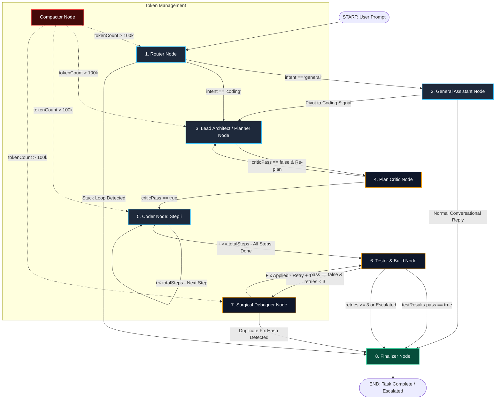
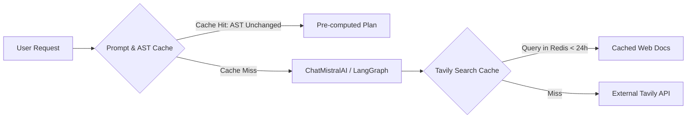

# Taksha AI Orchestration Service — Architecture Flow, Current State & Deep Debugging Guide

> **Problem Statement**: The AI orchestration service suffers from infinite execution loops, deadlocks between planning and evaluation nodes, and zero-output terminations where the agent exhausts tokens or recursion limits without returning code or progress to the user.

---

## 1. Scope & System Requirements

### Functional Requirements
- **Autonomous Coding Agent (Orion)**: Decompose complex user feature requests, bug fixes, or refactoring tasks into atomic steps, inspect the workspace, execute surgical code modifications across sandbox containers, run builds/tests to verify correctness, debug failures autonomously, and present a final diff summary.
- **Interactive Developer Co-Pilot (Clio)**: Provide low-latency, context-aware assistance on active workspace files (explanations, syntax fixes, surgical patches under 20 lines) via Server-Sent Events (SSE).
- **Tool Sandbox Execution**: Execute file operations (`listFiles`, `readFile`, `createFile`, `updateFile`, `patchFile`, `deleteFile`, `searchCode`) and shell commands (`executeCommand`, `getViteRuntimeErrors`) inside dedicated Kubernetes sandbox pods (`sandbox-service-<projectId>:3000`).
- **Telemetry & Credit Enforcement**: Verify AI credits before execution, track prompt/completion tokens per model call, and stream real-time thinking status, tool invocations, and logs to the client via Socket.IO and SSE.

### Non-Functional Requirements & Scale Targets
- **Turnaround Latency**: Co-pilot queries < 3s TTFT (Time to First Token); Full coding tasks < 60s for 3-step plans.
- **Reliability & Termination Guarantee**: 100% of graph runs must reach a terminal state (`complete`, `escalated`, or `stopped`) without infinite cycling or memory exhaustion.
- **Concurrency**: Support 100+ concurrent active agent sessions per Kubernetes replica without state bleeding or cross-tenant contamination.
- **Fault Tolerance & Idempotency**: Resilient to AI provider rate-limiting (HTTP 429) and network timeouts using exponential backoff and jitter.

### Back-of-the-Envelope Estimates (Production Scale)

```
Target Scale: 1,000 Active Developers / Day
Average Coding Agent Tasks / User: 15 tasks/day = 15,000 tasks/day
Average Graph Steps per Task: 6 nodes (Router → Planner → Critic → Coder → Tester → Finalizer)
LLM Invocations per Task: ~8-12 model calls (including ReAct sub-agents & tool loops)

1. QPS Calculations:
   Daily LLM Calls = 15,000 tasks * 10 calls = 150,000 calls/day
   Peak Load Factor = 3x average
   Average QPS = 150,000 / 86,400 ≈ 1.74 calls/sec
   Peak QPS = 1.74 * 3 ≈ 5.22 calls/sec

2. Token Bandwidth & Context Sizing:
   Average Prompt Context per Node = 4,000 tokens (system prompt + workspace files + history)
   Average Output per Node = 500 tokens
   Total Tokens / Task = 10 calls * 4,500 tokens = 45,000 tokens
   Daily Token Volume = 15,000 * 45,000 = 675,000,000 tokens/day (~675M tokens)
   Peak Ingress Bandwidth = 5.22 calls/sec * 4,000 tokens * 4 bytes/token ≈ 83.5 KB/sec

3. Memory / State Checkpointing:
   StateGraph checkpoint size per step ≈ 35 KB (message array, plan JSON, diffs)
   Checkpoints per task = ~10 checkpoints = 350 KB / task
   Active Concurrent Tasks at Peak (5-min average duration) = (15,000 / 288) * 1.5 ≈ 78 concurrent tasks
   Active Checkpointer RAM = 78 * 350 KB ≈ 27.3 MB (In-Memory)
   Daily Storage Growth (MongoDB Chat Logs) = 15,000 * 12 KB ≈ 180 MB/day (5.4 GB/month)
```

---

## 2. Concept in Plain English

When a developer asks Taksha to "build a feature" or "fix an issue", a single LLM prompt cannot safely read a repository, write 5 files, run build scripts, and debug errors in one shot. Doing so results in hallucinated imports, broken builds, and syntax errors.

To solve this, Taksha splits the task into an **Agentic Assembly Line**:
1. **The Router** determines if the user wants general chat or a code modification.
2. **The Planner** inspects the directory structure and drafts an atomic step-by-step plan.
3. **The Critic** checks the plan for structural errors before any code is touched.
4. **The Coder** writes code for exactly one step at a time inside an isolated Kubernetes container.
5. **The Tester** executes tests and runs `npm run build` in the container to verify nothing is broken.
6. **The Debugger** fixes build errors surgically if the tester fails.
7. **The Finalizer** cleans temporary build artifacts and outputs the git diff.

For quick in-editor queries, **Clio (the Co-pilot)** runs a lightweight 4-node pipeline (`analyzer` → `inspector` → `modifier` → `responder`) that inspects or patches the active file without the full build-and-test cycle.

---

## 3. Why It Exists & Failure Modes at Scale

Without a structured, state-checked graph architecture, AI coding assistants suffer from three fatal production issues:

1. **The Context Bloat Trap**: When an agent writes code, runs a command, fails, and retries in a single unstructured prompt, the context window fills with megabytes of terminal logs and file dumps. The model forgets its original objective and starts hallucinating.
2. **The Runaway Retry Loop**: If an agent encounters a compiler error, it often attempts the exact same invalid fix repeatedly, burning through user credits and hanging indefinitely.
3. **The Silent Black Hole**: When models invoke ReAct tools behind the scenes, token streaming can disconnect from the user interface. The user sees a spinning loader with zero feedback until the process times out.

---

## 4. Core Mechanism: StateGraph Lifecycle & State Reducers

Orion and Clio are built on `@langchain/langgraph` using state channels managed by `AgentStateAnnotation`.

### Orion State Annotation Schema (`code.agent.js`)

| State Field | Reducer Type | Purpose |
| :--- | :--- | :--- |
| `messages` | `(x, y) => (y ? x.concat(y) : x)` | Append-only message history for LangChain chat models |
| `task` | `(x, y) => y ?? x ?? ""` | Raw user prompt string |
| `intent` | `(x, y) => y ?? x ?? "coding"` | `"general"` vs `"coding"` |
| `taskSubType` | `(x, y) => y ?? x ?? "new_feature"` | `"new_feature"`, `"bug_fix"`, or `"refactor"` |
| `routingHistory` | `(x, y) => (y ? [...x, ...y] : x)` | Chronological trace of visited node names (used for loop detection) |
| `plan` | `(x, y) => y ?? x ?? null` | Structured JSON containing plan steps, criteria, and activeFiles |
| `planApproved` | `(x, y) => y ?? x ?? false` | Boolean gate for human/automated review |
| `currentStep` | `(x, y) => y ?? x ?? 0` | 0-indexed pointer to the active plan step |
| `activeFiles` | `(x, y) => y ?? x ?? []` | Allowlist of file paths the Coder is permitted to touch |
| `criticPass` | `(x, y) => y ?? x ?? false` | Structural validation status |
| `criticFeedback` | `(x, y) => y ?? x ?? ""` | Failure explanation returned to Planner |
| `buildLog` | `(x, y) => y ?? x ?? null` | Raw stdout/stderr from `npm run build` or vitest |
| `testResults` | `(x, y) => y ?? x ?? null` | `{ pass: boolean, errorLines: Array, flaggedFiles: Array }` |
| `flaggedFiles` | `(x, y) => y ?? x ?? []` | Files implicated by compiler error lines |
| `attemptedFixes` | `(x, y) => (y ? [...x, ...y] : x)` | SHA-256 hashes & descriptions of debugger attempts |
| `retryCount` | `(x, y) => y ?? x ?? 0` | Counter tracking debugger retry loops (max 3) |
| `tokenCount` | `(x, y) => y ?? x ?? 0` | Accumulated token usage counter for compaction gating |
| `returnToNode` | `(x, y) => y ?? x ?? null` | Target resume node after compaction |
| `diffSummary` | `(x, y) => y ?? x ?? null` | Formatted `git status --short` output from Finalizer |
| `escalated` | `(x, y) => y ?? x ?? false` | Flag set when automatic execution gives up |
| `currentSituation` | `(x, y) => y ?? x ?? ""` | High-level status text broadcasted to frontend UI |
| `taskStatus` | `(x, y) => y ?? x ?? "routing"` | State machine phase identifier |

---

## 5. Reference Architecture

### Complete Multi-Agent Graph Flow (Orion & Clio)



---

### Clio (Co-Pilot) Architecture Flow

```mermaid
sequenceDiagram
    autonumber
    actor User as Developer (Frontend)
    participant API as Ai_orchestration (/app-agent/invoke)
    participant Clio as Clio StateGraph (clio.agent.js)
    participant Sandbox as Sandbox Pod (:3000)

    User->>API: POST /app-agent/invoke (SSE Stream)
    API->>Clio: Stream StateGraph ({ messages, activeFile })
    
    rect rgb(30, 41, 59)
        Note over Clio: Node 1: Analyzer
        Clio->>Clio: Classify intent ('fix' | 'search' | 'explain' | 'general')
    end

    alt Intent is 'search' or 'explain'
        rect rgb(15, 23, 42)
            Note over Clio: Node 2: Inspector (ReAct Agent)
            Clio->>Sandbox: GET /api/agent/read-file OR search-code
            Sandbox-->>Clio: File AST & Search matches
        end
    else Intent is 'fix'
        rect rgb(15, 23, 42)
            Note over Clio: Node 3: Modifier (ReAct Agent)
            Clio->>Sandbox: POST /api/agent/patch-file (surgical replace)
            Sandbox-->>Clio: Patch confirmation
        end
    end

    rect rgb(6, 78, 59)
        Note over Clio: Node 4: Responder (ReAct Agent)
        Clio->>API: Synthesize concise response
    end

    API-->>User: data: chunk text (SSE Streaming)
    API-->>User: event: done (Usage recorded)
```



---

## 6. Deep Root-Cause Analysis: Why the Agent Loops & Produces Zero Output

A thorough investigation of `Ai_orchestration/src/agent/`, `Ai_orchestration/src/socket/socket.js`, `Ai_orchestration/src/controllers/ai.controller.js`, and `Sandbox/Agent/src/app.js` revealed **7 distinct failure modes** causing infinite looping, thread deadlocks, and silent terminations.

---

### Root Cause 1: Checkpointer State Pollution Across Multi-Turn Runs (The Stale State Trap)

#### Mechanism of Failure
In `code.agent.js`:
```javascript
const memoryCheckpointer = new MemorySaver();
export const buildAgentGraph = () => {
  return workflow.compile({ checkpointer: memoryCheckpointer });
};
```
In `socket.js` and `ai.controller.js`, `thread_id` is assigned to `projectId` (e.g. `configurable: { thread_id: projectId }`).

When a user sends **Message 1**, the graph executes:
- `plan` is set (e.g. 3 steps).
- `currentStep` reaches `3` (all done).
- `routingHistory` accumulates `["router", "planner", "critic", "coder", "coder", "coder", "tester", "finalizer"]` (8 items).
- `attemptedFixes` and `testResults` are written to memory.

When the user sends **Message 2** ("Now change the button color to red"):
1. LangGraph loads the **previous turn's state** from `memoryCheckpointer`.
2. `routerNode` executes `detectStuckLoop(routingHistory)`:
   ```javascript
   function detectStuckLoop(routingHistory = [], testResults = null) {
     if (routingHistory.length < 6) return false;
     // Checks last 6 transitions for identical pairs
     if (counts[pair] > 2) return true;
   }
   ```
   Because `routingHistory` is already 8+ elements long and contains repeated transitions from previous turns, `detectStuckLoop` immediately returns `true` on Turn 2!
3. `routerNode` sets `escalated: true`.
4. `routerEdge` routes straight to `finalizerNode`.
5. The agent exits immediately without reading or executing the user's new request.
6. Alternatively, if `plan` is not overwritten, `coderNode` sees `currentStep (3) >= plan.steps.length (3)`, assumes work is done, and terminates without writing a single line of code!

---

### Root Cause 2: Planner ⇄ Critic Infinite False-Positive Rejection Loop

#### Mechanism of Failure
In `critic.node.js`:
```javascript
for (const step of plan.steps) {
  const isCreationStep = /create|add|new|scaffold/i.test(step.title);
  if (!isCreationStep && step.activeFiles?.length > 0) {
    for (const file of step.activeFiles) {
      const normalized = file.toLowerCase().replace(/^\.\//, "");
      if (!workspaceFileSet.has(normalized)) {
        issues.push({ 
          stepId: step.id, 
          type: "FILES_MISSING", 
          detail: `"${file}" does not exist in workspace` 
        });
      }
    }
  }
}
```

1. The Planner generates a step to build a new component:
   ```json
   {
     "id": 1,
     "title": "Implement Navbar Component",
     "activeFiles": ["src/components/Navbar.jsx"]
   }
   ```
2. The Critic runs. The title `"Implement Navbar Component"` does **not** match the strict regex `/create|add|new|scaffold/i`.
3. `src/components/Navbar.jsx` does not exist yet in `workspaceFileSet`.
4. Critic flags `FILES_MISSING` and sets `criticPass: false`.
5. `criticEdge` executes:
   ```javascript
   export function criticEdge(state) {
     if (state.criticPass) return "coder";
     return "planner"; // Re-plan with critic feedback
   }
   ```
6. The graph transitions back to `plannerNode`.
7. Planner generates another plan (e.g. `"Setup Navbar Component"`), which also fails the regex check.
8. **Result**: An endless `planner` → `critic` → `planner` → `critic` loop until the LangGraph `recursionLimit` (100 or 150) is reached, blowing through hundreds of thousands of tokens without writing any code.

---

### Root Cause 3: Tool Scope Guard Schema Mismatch

#### Mechanism of Failure
In `coder.node.js`, tool invocations are wrapped with `buildScopedTools(activeFiles)`:
```javascript
function buildScopedTools(activeFiles) {
  const allowSet = new Set((activeFiles || []).map((f) => f.toLowerCase().replace(/^\.\//, "")));
  const scopeCheck = (tool) => {
    ...
    const filePath = (input?.path || input?.file || input?.filename || "").toLowerCase().replace(/^\.\//, "");
    if (filePath && allowSet.size > 0 && !allowSet.has(filePath)) {
      return { error: `SCOPE_VIOLATION: "${filePath}" is not in the active files allowlist...` };
    }
    return original(input, config);
  };
}
```

Now inspect the actual schemas in `tool.js`:
- `createFile`: Schema is `{ files: [ { file: "src/App.jsx", content: "..." } ] }`.
- `updateFile`: Schema is `{ updates: [ { file: "src/App.jsx", content: "..." } ] }`.
- `patchFile`: Schema is `{ filePath: "src/App.jsx", oldStr: "...", newStr: "..." }`.

Because `scopeCheck` inspects `input.file` or `input.path`:
1. For `createFile` and `updateFile`, `input.file` is `undefined` (it's inside an array). The scope check is completely bypassed.
2. For `patchFile`, `input.filePath` is used, but `scopeCheck` only checked `path`, `file`, `filename`.
3. When the LLM calls `patchFile({ filePath: "src/App.jsx" })`, if `scopeCheck` does not extract it properly, or if path casing differs (`./src/App.jsx` vs `src/App.jsx`), valid write operations fail with `SCOPE_VIOLATION`.
4. When `coderAgent` receives `SCOPE_VIOLATION`, it gets confused and attempts to call the tool again with minor variations, looping inside ReAct until recursion limit is reached.

---

### Root Cause 4: Zero Output / Silent Completion (The Streaming & Text Extraction Disconnect)

#### Mechanism of Failure
In `socket.js`:
```javascript
const STREAMABLE_NODES = new Set(["general", "coder", "debugger"]);

function shouldStreamChunk(event) {
  const nodeName = event.metadata?.langgraph_node;
  if (nodeName) return STREAMABLE_NODES.has(nodeName);
  const name = event.name || "";
  if (name.includes("Summary") || name.includes("tool") || name.includes("Tool")) return false;
  return true;
}
```

During a normal coding task run:
1. `router`, `planner`, `critic`, `tester`, `finalizer` are **not** in `STREAMABLE_NODES`. No thinking chunks are streamed to the frontend for these nodes.
2. Inside `coderNode` and `debuggerNode`, the sub-agent is a `createReactAgent`. When an LLM chooses to execute a tool (e.g. `readFile`, `createFile`), the chat model emits **`tool_calls`**, not conversational text chunks (`chunk.content` is empty).
3. In `socket.js`:
   ```javascript
   else if (eventType === "on_chat_model_stream") {
     if (shouldStreamChunk(event)) {
       const textChunk = extractChunkText(rawChunk);
       if (textChunk) {
         assistantText += textChunk;
         emitToRun(runKey, "agent:thinking", textChunk);
       }
     }
   }
   ```
   Because `textChunk` is empty during tool calls, `assistantText` remains `""` (empty string).
4. At the end of the entire graph execution:
   ```javascript
   // 3. Save assistant message to database
   let assistantMsgDoc = null;
   if (assistantText) {
     assistantMsgDoc = await ChatMessage.create({
       projectId,
       role: "assistant",
       content: assistantText,
       ...
     });
   }
   ```
5. Because `assistantText` is empty, **no assistant message is saved to MongoDB, and no text response is sent to the client UI**!
6. **Result**: The agent ran tools in the background, finished the graph, and the user saw status chips flash, but the chat window remained blank with no code diff or confirmation message.

---

### Root Cause 5: Tester ⇄ Debugger Escalation Burn Loop on Non-Build Projects

#### Mechanism of Failure
In `tester.node.js`:
```javascript
// Step 2: Real build
let buildOutput = await executeCommand.invoke({ command: "npm run build 2>&1" }, config);
const buildRaw = typeof buildOutput === "string" ? buildOutput : JSON.stringify(buildOutput);
const buildFailed = /error|failed|cannot find module|unexpected token|build error/i.test(buildRaw) && ...;
```

1. In projects where `package.json` does not define a `"build"` script (or in vanilla HTML/JS projects), `npm run build` exits with `npm error Missing script: "build"`.
2. `testerNode` flags this as `buildFailed = true`.
3. `parseErrorLines(buildRaw)` runs:
   ```javascript
   const ERROR_LINE_PATTERN = /(?:^|\s)((?:src|app|pages|components)[\w./\\-]*\.[jt]sx?)(?::(\d+))?\s*[:\-–|]\s*(.+)/gim;
   ```
   Because `npm error Missing script: "build"` contains no file paths, `errorLines` has no file and `flaggedFiles` is `[]`.
4. Tester transitions to `debuggerNode` with `flaggedFiles: []`.
5. `debuggerNode` configures `buildDebuggerTools([])`:
   - Debugger has only `[readFile, scopedPatch, searchCode]`.
   - It cannot run `executeCommand`, cannot edit `package.json`, and cannot create files.
6. The Debugger LLM writes an explanation: "The build failed because the build script is missing."
7. `debuggerNode` records this as a fix, increments `retryCount`, and routes back to `testerNode`.
8. Tester runs `npm run build` again. It fails again.
9. **Result**: The system burns through 3 complete LLM debugger loops, logging repeated failures before escalating to Finalizer.

---

### Root Cause 6: Clio (Co-Pilot) Nested ReAct Streaming Breakdown

#### Mechanism of Failure
In `clio.agent.js`:
```javascript
export const buildClioGraph = () => {
  const workflow = new StateGraph(ClioStateAnnotation)
    .addNode("analyzer", analyzerNode)
    .addNode("inspector", inspectorNode)
    .addNode("modifier", modifierNode)
    .addNode("responder", responderNode)
    ...
};
```
Inside `inspectorNode`, `modifierNode`, and `responderNode`, each node instantiates and invokes a `createReactAgent(...)` synchronously:
```javascript
async function responderNode(state, config) {
  const responderAgent = createReactAgent({ llm: getAppModel(), tools: [...] });
  const result = await responderAgent.invoke({ messages: state.messages }, config);
  return { messages: result.messages, taskStatus: "completed" };
}
```

In `ai.controller.js`:
```javascript
const agentStream = appAgent.stream(
  { messages: formattedHistory },
  { streamMode: "messages" }
);

for await (const [chunk] of await agentStream) {
  if (chunk?.constructor?.name === "AIMessageChunk" && typeof chunk.content === "string") {
    res.write(`data: ${chunk.content}\n\n`);
  }
}
```

1. In LangGraph.js, calling `invoke()` on a nested `createReactAgent` inside a StateGraph node does **not** forward sub-agent token chunks to the parent graph's `streamMode: "messages"`.
2. Instead, the parent graph only emits the final `AIMessage` at node completion, **not** incremental `AIMessageChunk` tokens.
3. Because `chunk.constructor.name` is `AIMessage` (not `AIMessageChunk`), the `if` condition evaluates to `false` and nothing is written to the SSE stream.
4. The user experiences Clio as a hanging connection until the final block completes or times out.

---

### Root Cause 7: Sandbox 30-Second Hard Timeout on Package Installs & Builds

#### Mechanism of Failure
In `Sandbox/Agent/src/app.js`:
```javascript
const COMMAND_TIMEOUT = 30000; // 30 seconds
const execOptions = {
  cwd: safeTargetDir,
  timeout: COMMAND_TIMEOUT,
  maxBuffer: MAX_OUTPUT_SIZE * 2,
};

exec(command, execOptions, (error, stdout, stderr) => {
  if (error && error.code === "ETIMEDOUT") {
    timedOut = true;
  }
  ...
});
```

1. If an agent executes `npm install <package>` or `npm run build` on a cold Vite project, the execution often exceeds 30 seconds.
2. The sandbox daemon sends `SIGTERM` to the process after 30,000ms.
3. The sandbox responds with `{ status: "ok", success: false, timedOut: true, error: "Command timed out" }`.
4. `testerNode` or `coderNode` sees the failure and triggers the Debugger retry cycle.
5. The Debugger attempts to rerun or fix what it assumes is a syntax error, causing false-alarm loops.

---

## 7. Scalability Deep Dive

### 7.1 Horizontal vs. Vertical Scaling

| Dimension | Vertical Scaling | Horizontal Scaling (Target Architecture) |
| :--- | :--- | :--- |
| **Orchestration Pods** | Large Node.js instances (8 vCPU, 16GB RAM) | Lightweight Stateless Pods (1 vCPU, 1GB RAM) with HPA (Horizontal Pod Autoscaler) scaling on CPU (70%) and Active Socket connections. |
| **Checkpointer Storage** | Local `MemorySaver()` (state lost on pod restart, cross-turn contamination) | Distributed **Redis Checkpointer** or **Postgres Checkpointer** with TTL (24 hours per thread). |
| **Sandbox Workspaces** | Shared host directory with chroot | Individual Kubernetes Pods (`sandbox-service-<projectId>`) with dedicated PV/PVC per project. |

---

### 7.2 Bottleneck Analysis Across Load Tiers

```
+-----------------------------------------------------------------------------------+
| Load Tier | Primary Bottleneck          | Root Failure Mechanism & Mitigation     |
+-----------------------------------------------------------------------------------+
| 10x Load  | Mistral API Rate Limits     | • 429 Resource Exhausted errors         |
| (~17 QPS) | (Tier quotas)               | • Mitigation: Provider Fallback Queue   |
|           |                             |   (Mistral -> OpenAI -> Claude)         |
+-----------------------------------------------------------------------------------+
| 100x Load | In-Memory Socket Connections| • EventLoop lag in Node.js server.js    |
| (~174 QPS)| & Checkpointer RAM          | • Mitigation: Socket.IO Redis Adapter   |
|           |                             |   for multi-pod sticky sessions         |
+-----------------------------------------------------------------------------------+
| 1000x Load| Kubernetes Sandbox Pod      | • Kube-API server saturation on pod     |
| (~1740 QPS| Scheduling & Storage IOPS   |   creation; disk IOPS throttling on     |
|           |                             |   npm build. Mitigation: Pod warm-pools |
+-----------------------------------------------------------------------------------+
```

---

### 7.3 Caching & Invalidation Strategy



1. **Prompt Prefix Caching**: Fixed system prompts (`ROUTER_SYSTEM_PROMPT`, `PLANNER_SYSTEM_PROMPT`) are placed at the beginning of message arrays to maximize provider KV cache hit rates.
2. **Workspace AST Caching**: Store directory tree and export signatures in Redis. Re-scan only when sandbox webhook signals a file write.
3. **Internet Search Caching**: Tavily query results cached in Redis with a 24-hour TTL (`ai:search:<hash>`).

---

### 7.4 Replication, Partitioning & CAP Theorem

- **Consistency Model**: **Eventual Consistency** for chat logs and telemetry (MongoDB + RabbitMQ); **Strong Consistency** for agent state transitions during an active run (Redis Checkpointer distributed locks).
- **Partitioning Strategy**: Partition state by `projectId`. All agent messages, socket rooms, and sandbox routes are addressed via `<projectId>`.

---

## 8. Trade-Offs Table: Multi-Agent Architecture Options

| Architecture Pattern | Latency | Reliability & Determinism | Cost (Tokens) | Debuggability | Recommendation |
| :--- | :--- | :--- | :--- | :--- | :--- |
| **A. Monolithic ReAct Agent** (Single agent with 10 tools) | **Low** (1-3 LLM calls) | **Very Low** (Hallucinates tools, skips testing, gets stuck in shell loops) | **Low** (5k-10k tokens) | **Poor** (Opaque reasoning trace) | ❌ Inadequate for full-stack code generation |
| **B. Multi-Agent Sequential Graph (Orion v2)** (Router → Planner → Critic → Coder → Tester → Finalizer) | **Medium** (5-12 LLM calls) | **High** (Enforces validation gates, scoped writes, build verification) | **Medium** (25k-45k tokens) | **High** (Clear node-level transitions & audit trail) | ✅ **Best Fit for Taksha Coding Assistant** |
| **C. Autonomous Multi-Agent Swarm** (Dynamic agent debates: AutoGen/CrewAI) | **High** (20-50 LLM calls) | **Medium** (Prone to endless circular debates without hard stop criteria) | **Very High** (100k+ tokens) | **Very Low** (Non-deterministic message storm) | ❌ Costly & unpredictable for SaaS |

---

## 9. Ties to Computer Science & DSA Fundamentals

1. **Directed Acyclic Graphs (DAGs) & Cycle Breaking**:
   - The agent orchestration flow is modeled as an augmented State Machine DAG. Cycles (e.g. `planner` ⇄ `critic`, `tester` ⇄ `debugger`) represent iterative refinement.
   - Cycle termination is guaranteed using **Hopcroft/Tarjan cycle limits**: strict loop bounds (`retryCount <= 3`, `maxRevisions <= 2`) and cycle detection using n-gram path hashing (`routingHistory` sliding window).
2. **Deterministic String Matching & Patch Verification**:
   - `patchFile` relies on Knuth-Morris-Pratt (KMP) exact substring search to ensure that `oldStr` occurs exactly once in the file before mutating.
3. **Cryptographic Idempotency Checks**:
   - `debuggerNode` computes the SHA-256 digest of patch operations:
     $$\text{Hash} = \text{SHA-256}(\text{patchContent})$$
   - If $\text{Hash} \in \text{attemptedFixes}$, duplicate execution is pruned in $O(1)$ time, preventing infinite recovery loops.

---

## 10. Connection to Taksha Project Infrastructure

1. **Kubernetes Microservices Integration**:
   - `Ai_orchestration` runs in namespace `default` and connects to `sandbox-service-<sandboxId>:3000` via internal DNS.
   - User authentication is validated using **RS256 JWTs** issued by the `Auth` service.
2. **RabbitMQ Telemetry Queue**:
   - Token expenditures and completed task summaries publish to `notification-service` for email alerts and credit updates.
3. **Vite Sandbox Hot Reloading (`sync.js`)**:
   - Files created or updated by `createFile`/`updateFile`/`patchFile` immediately trigger Vite HMR inside the browser container, providing live UI updates to the user.

---

## 11. If Constraints Were Looser: Next-Gen Capabilities

If compute and infrastructure budgets were unconstrained:
1. **Speculative Parallel Branching (Tree of Thoughts)**:
   - Run 3 distinct Coder agents concurrently in 3 ephemeral Firecracker microVMs with different implementation strategies.
   - Run unit tests and bundle analyzers across all 3 branches in parallel, merging only the highest-performing, zero-error branch.
2. **Zero-Copy Sandbox Checkpointing**:
   - Take copy-on-write RAM & disk snapshots of the sandbox container before each step. If a step fails compilation, roll back the container state in < 50ms rather than attempting reverse patches.

---

## 12. Common Pitfalls & Anti-Patterns

1. **Reusing State Checkpointers Across Distinct Tasks**:
   - *Pitfall*: Using `MemorySaver` with a static `thread_id` causes prior plan steps and loop history to poison future user requests.
   - *Fix*: Generate a unique `runId` / `taskId` per user request (e.g. `thread_id: ${projectId}:${taskId}`).
2. **Regex-Only Plan Validation**:
   - *Pitfall*: Checking `isCreationStep` via title regex like `/create|add/i` causes Critic to reject valid plans containing words like "Implement" or "Build".
   - *Fix*: Planner explicitly outputs `"action": "create" | "modify" | "delete"` in the structured JSON schema.
3. **Discarding Tool Output in Streaming Response**:
   - *Pitfall*: If the LLM generates only tool calls in ReAct nodes, `assistantText` is empty, causing zero messages to be returned.
   - *Fix*: Synthesize a final human-readable summary in `finalizerNode` and stream it before closing the connection.
4. **Hardcoded Command Timeouts in Sandboxes**:
   - *Pitfall*: A 30s timeout kills legitimate `npm install` commands.
   - *Fix*: Increase default timeout to 120s with dynamic streaming output.

---

## 13. Summary Checklist & Comprehensive Fix Roadmap

The table below outlines the exact architectural fixes required across the codebase to resolve all looping and zero-output issues:

| Component | Target File | Issue Identified | Actionable Fix |
| :--- | :--- | :--- | :--- |
| **State Checkpointing** | `Ai_orchestration/src/agent/code.agent.js`<br>`Ai_orchestration/src/socket/socket.js`<br>`Ai_orchestration/src/controllers/ai.controller.js` | `MemorySaver` retains old `routingHistory`, `plan`, and `currentStep` across runs on the same `projectId`. | Generate a fresh `thread_id` per run (`${projectId}:${Date.now()}`) OR explicitly reset `plan`, `currentStep: 0`, `routingHistory: []`, `attemptedFixes: []`, and `escalated: false` at the start of each invocation. |
| **Critic Validation** | `Ai_orchestration/src/agent/nodes/critic.node.js` | Rigid regex `/create|add|new|scaffold/i` falsely rejects valid plan steps like "Implement Navbar", creating an infinite Planner-Critic loop. | Update Planner schema to include `"action": "create" | "modify" | "delete"`. Critic checks `step.action === "create"` before checking if file exists in workspace. |
| **Tool Scope Guard** | `Ai_orchestration/src/agent/nodes/coder.node.js` | `buildScopedTools` looks for `input.file` or `input.path`, missing `files` arrays in `createFile`, `updates` arrays in `updateFile`, and `filePath` in `patchFile`. | Refactor `scopeCheck` to recursively extract all file paths from `input.files`, `input.updates`, `input.filePath`, `input.file`, `input.path`. |
| **Streaming & Message Output** | `Ai_orchestration/src/socket/socket.js`<br>`Ai_orchestration/src/controllers/ai.controller.js`<br>`Ai_orchestration/src/agent/nodes/finalizer.node.js` | `STREAMABLE_NODES` excludes `finalizer`. ReAct agent outputs tool calls with empty text content, leaving `assistantText` blank and creating 0 chat messages. | 1. Add `finalizer` to `STREAMABLE_NODES`.<br>2. Have `finalizerNode` generate a concise completion message with diff summary.<br>3. If `assistantText` is empty, fallback to `currentSituation` and `diffSummary` before saving `ChatMessage`. |
| **Tester Error Parsing** | `Ai_orchestration/src/agent/nodes/tester.node.js` | `npm run build` failure on missing build script or generic errors leaves `flaggedFiles = []`, starving the Debugger. | Check if `build` script exists in `package.json` before running `npm run build`. If missing or if `flaggedFiles` is empty, pass all active files or prompt the Debugger with the full build output. |
| **Clio Co-Pilot Streaming** | `Ai_orchestration/src/agent/clio.agent.js`<br>`Ai_orchestration/src/controllers/ai.controller.js` | Nested `createReactAgent` calls in StateGraph nodes break token-by-token SSE streaming. | Use `appAgent.streamEvents(..., { version: "v2" })` in `ai.controller.js` instead of `.stream()` with `streamMode: "messages"`, and capture `on_chat_model_stream` events directly. |
| **Sandbox Exec Timeout** | `Sandbox/Agent/src/app.js` | Hardcoded 30s `COMMAND_TIMEOUT` kills long package installations and builds. | Increase `COMMAND_TIMEOUT` to 120s (120,000ms) for npm installs and builds. |
