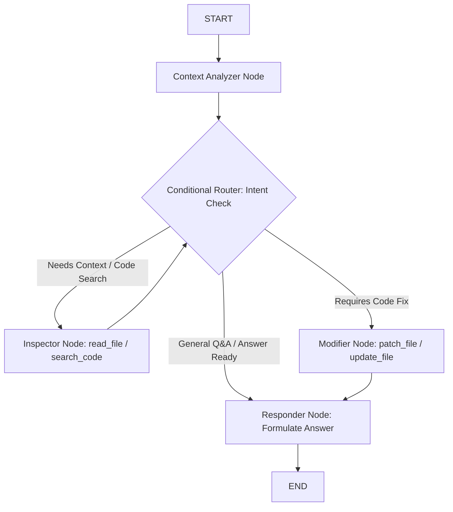

# Decoupling Clio Co-Pilot into a Stateful LangGraph Conditional Workflow

## 1. Concept in Plain English

In Taksha's `Ai_orchestration` service, **Clio** is the developer co-pilot embedded inside the IDE assistant panel. It answers user questions about specific files, explains complex codebase logic, and performs surgical single-file fixes.

Previously, Clio lived inside `code.agent.js` alongside Orion (the full-stack coding agent) as a monolithic file and used a basic, unstructured ReAct loop. Decoupling Clio into its own dedicated module (`clio.agent.js`) and converting it into an explicit **LangGraph Conditional Workflow Agent** structures Clio's execution into clear, specialized stages:

1. **Context Analyzer Node**: Inspects the user's question, active file context, and history to determine whether file inspection, internet research, or direct code editing is required.
2. **Code & Web Inspector Node**: Executes read-only tools (`read_file`, `search_code`, `search_internet`) to gather exact facts before making decisions.
3. **Surgical Modifier Node**: Executes write tools (`patch_file`, `update_file`) if the user specifically asked for code fixes.
4. **Responder Node**: Formulates a clear, direct, senior-engineer response.
5. **Conditional Router**: Routes execution dynamically based on query type (Question vs Surgical Fix) and tool output state.

---

## 2. Why It Exists

* **Separation of Concerns**: Orion (full-stack agent with multi-file write and terminal permissions) and Clio (surgical co-pilot for chat & Q&A) have distinct responsibilities, safety profiles, and system prompts. Combining them in a single 800+ line `code.agent.js` file creates high coupling and maintenance friction.
* **Controlled Tool Scope for Co-Pilot**: Clio does not need destructive terminal commands (`execute_command`) or full workspace workspace manipulation (`delete_file`). Keeping Clio in its own module enforces strict tool isolation (`read_file`, `update_file`, `patch_file`, `search_code`, `search_internet`).
* **Deterministic Execution Phases**: A user asking "What does this function do?" should never trigger write tools. LangGraph's state routing ensures read-only paths bypass code mutation nodes completely.

---

## 3. Core Mechanism

### Clio State Schema (`ClioAgentState`)

```typescript
interface ClioAgentState {
  // Input Context
  prompt: string;
  activeFile?: string;
  activeFileContent?: string;

  // Analysis & Intent Classification
  intent: 'explain' | 'search' | 'fix' | 'general';
  inspectedFiles: string[];

  // Execution Outputs
  patchApplied: boolean;
  finalResponse: string;

  // LangChain Message History
  messages: BaseMessage[];
}
```

### Node Workflow Breakdown



---

## 4. Scalability Deep Dive

### Modular Independence & Micro-Optimization
* **Independent Model Tuning**: Clio can be configured with lower temperature or faster LLM inference parameters optimized for low-latency streaming SSE responses in `ai.controller.js`, while Orion uses heavy-duty reasoning setups for complex multi-file builds.
* **Isolated Memory Footprint**: Splitting `clio.agent.js` prevents importing heavy multi-agent planning state when executing lightweight co-pilot chat requests.

---

## 5. Trade-offs Table

| Architecture Pattern | Monolithic File (`code.agent.js`) | Decoupled LangGraph Module (`clio.agent.js`) |
| :--- | :--- | :--- |
| **Code Organization** | Bloated single file (800+ lines) | Clean bounded context (2 independent agent files) |
| **Tool Scoping** | Shared / mixed tool guards | Strict role-based tool isolation |
| **Routing Reliability** | Free-form ReAct loop | Intent-driven conditional StateGraph |
| **Maintainability** | Low (changes to Orion risk breaking Clio) | High (isolated unit testing & independent deploys) |

---

## 6. Ties to Fundamentals

1. **Single Responsibility Principle (SRP)**: Each agent file handles a distinct domain (Orion = Project Builder, Clio = File Co-Pilot).
2. **Intent Classification & Branching**: Uses deterministic condition evaluation to prevent unauthorized state transitions in finite state machines.

---

## 7. Connect It to What I'm Actually Building (Taksha Codebase)

In Taksha's `Ai_orchestration` microservice:

1. **New File `Ai_orchestration/src/agent/clio.agent.js`**:
   - Contains Clio's `ClioAgentState` and LangGraph workflow.
   - Binds tools: `readFile`, `updateFile`, `patchFile`, `searchCode`, `searchInternetTool`.
   - Exports `appAgent`, `appModel`, `getAppModelInfo`, `getAppAgent`.

2. **Refactored `Ai_orchestration/src/agent/code.agent.js`**:
   - Contains strictly Orion's multi-agent team (`plannerNode`, `coderNode`, `testerNode`, `debuggerNode`, `routeNextNode`).
   - Cleaned up from Clio definitions.

3. **`Ai_orchestration/src/controllers/ai.controller.js`**:
   - Update import: `import { appAgent, appModel, getAppModelInfo } from "../agent/clio.agent.js";`

---

## 8. Summary Checklist

- [ ] Create `Ai_orchestration/src/agent/clio.agent.js` with LangGraph `StateGraph` workflow.
- [ ] Bind Clio tools: `readFile`, `updateFile`, `patchFile`, `searchCode`, `searchInternetTool`.
- [ ] Remove Clio definitions from `Ai_orchestration/src/agent/code.agent.js`.
- [ ] Update import references in `ai.controller.js` to point to `./clio.agent.js`.
- [ ] Verify both agents build and import cleanly.
