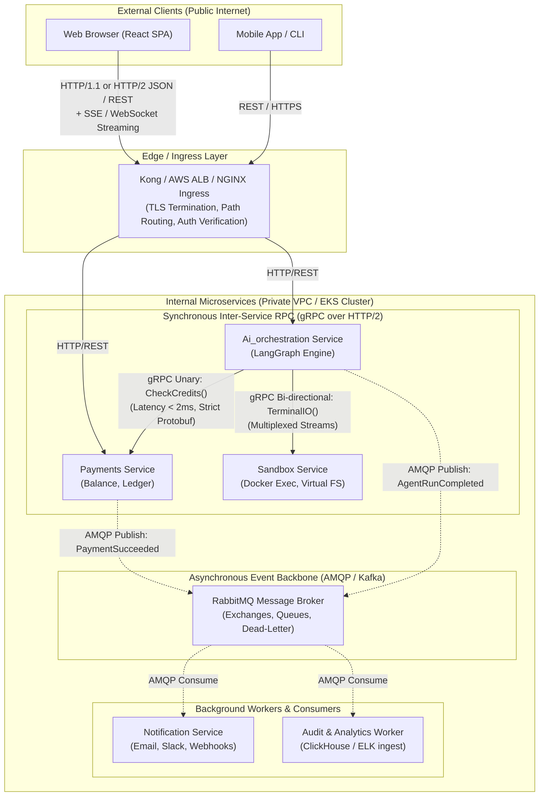

# Inter-Microservice Communication: Is gRPC the "Best" Protocol?

## Problem Statement & Architectural Scope
In distributed microservice architectures (including **Taksha**'s microservices ecosystem across `Ai_orchestration`, `Payments`, `Auth`, `Sandbox`, and `Notification`), determining the optimal inter-service communication protocol is a critical trade-off between latency, throughput, type safety, operational complexity, and decoupling. The claim that **"gRPC is the best way to talk between microservices"** is partially true for internal synchronous Remote Procedure Calls (RPC), but dangerously flawed if applied indiscriminately to event-driven choreography, browser-to-backend traffic, or loosely coupled domain boundaries.

---

## Scope & System Bounds

### Functional Requirements
1. **Contract-Driven Synchronous RPC**: Low-latency, strongly typed query/mutation interface between tightly coupled internal services (e.g., `Ai_orchestration` verifying and burning credits in `Payments`).
2. **Streaming Primitives**: Support for client-streaming, server-streaming, and bidirectional streaming (e.g., tool execution streams, sandbox file sync, continuous token verification).
3. **Decoupled Asynchronous Signaling**: Broadcast lifecycle events without blocking the originating service (e.g., user signup, payment invoices, audit logs).

### Non-Functional Requirements & Back-of-the-Envelope Estimates
To evaluate whether gRPC's binary serialization and HTTP/2 framing justify replacing HTTP/1.1 JSON or message queues, we analyze a production microservices cluster handling AI agent workflows.

- **Scale Target**: 5,000 concurrent active developer sessions on Taksha.
- **Internal RPC Rate**: Each agent action triggers credit checks, credit burns, and sandbox file operations.
  $$\text{Internal RPC QPS} = 5,000 \text{ agents} \times 0.5 \text{ RPCs/sec} = 2,500 \text{ QPS}$$

#### Payload Size & Bandwidth Comparison: HTTP/1.1 JSON vs gRPC Protobuf
For an internal call like `CheckUserCredit(userId, tier, requestedTokens)`:

| Dimension | REST / HTTP/1.1 (JSON) | gRPC / HTTP/2 (Protobuf) | Savings Factor |
| :--- | :--- | :--- | :--- |
| **Header Overhead** | ~800 bytes (plain ASCII cookies, user-agent, content-type) | ~30 bytes (HPACK compressed binary headers) | **26.6x smaller** |
| **Body Size** | ~420 bytes (string keys: `"userId"`, `"requestedTokens"`, whitespace) | ~65 bytes (Varint tag-length-value binary encoding) | **6.5x smaller** |
| **Total Wire Size** | $\approx 1,220 \text{ bytes per request}$ | $\approx 95 \text{ bytes per request}$ | **~12.8x reduction** |
| **Cluster Ingress Bandwidth** | $2,500 \times 1.22 \text{ KB} = 3.05 \text{ MB/s} = \mathbf{24.4\text{ Mbps}}$ | $2,500 \times 0.095 \text{ KB} = 0.237 \text{ MB/s} = \mathbf{1.9\text{ Mbps}}$ | **92.2% bandwidth reduction** |

#### CPU Serialization & Deserialization Overhead
- **JSON Parsing**: V8 (Node.js) or Python runtime spends significant CPU cycles scanning strings, validating Unicode, and building object hashes. At 2,500 QPS, JSON serialization/parsing consumes ~15–20% of an entire CPU core.
- **Protobuf Binary Unpacking**: Uses pre-compiled schema offsets, bit-shifts, and Varint decoding. CPU consumption drops to **< 3% of a core**, freeing compute for business logic and agent orchestration.

#### Network Connection & Latency (p99)
- **HTTP/1.1 (Keep-Alive Pool)**: Subject to Head-of-Line (HoL) blocking on the application layer (only 1 request per TCP socket at a time). Connection pool exhaustion causes queuing delay. p99 internal latency: **25–40 ms**.
- **gRPC (HTTP/2 Multiplexing)**: Thousands of concurrent requests interleaved as binary frames over a single persistent TCP connection. p99 internal latency: **1.8–4.5 ms**.

---

## 1. Concept in Plain English
Imagine two offices that need to exchange data:

- **REST / JSON** is like sending formal letters typed on paper in English. Every letter includes full headers ("To", "From", "Date"), human-readable paragraphs, and punctuation. Anyone can open the envelope and read it immediately without special tools, but typing, mailing, and reading the letters takes time, paper, and physical space.
- **gRPC (Google Remote Procedure Call)** is like sending compact binary Morse code over a dedicated direct fiber line. Instead of sending the English words `"user_id": "67cb1a"`, it converts the data into raw numbered bytes using a shared translation booklet (**Protocol Buffers**). It travels nearly instantaneously, consumes tiny bandwidth, and uses almost no memory, but humans cannot read the raw signal without the translation booklet.
- **Message Queues (RabbitMQ / Kafka)** are like a centralized postal drop-box. The sender drops off an envelope and immediately walks away. The recipient picks it up whenever they are free. The sender never waits for a reply.

**The Golden Truth**: gRPC is **not** the universally "best" way to talk between microservices. It is the best way for **synchronous, internal, request-response RPCs requiring high speed and strict contracts**. It is the **wrong** tool when services should be asynchronously decoupled or when communicating directly with web browsers.

---

## 2. Why It Exists & What Breaks at Scale

### What Breaks Without gRPC (At 100x – 1,000x Load)
1. **Schema Drift & Runtime Type Errors**: In standard REST/JSON, Service A changes a field from `creditBalance` to `credits_remaining`. Service B crashes in production with `TypeError: Cannot read properties of undefined` because there was no enforced compile-time or build-time contract.
2. **Socket Exhaustion & TCP Churn**: HTTP/1.1 can only send one request at a time per TCP socket. Under a sudden spike of 10,000 concurrent agent queries, Node.js connection pools run out of sockets, leading to `ECONNRESET` or high latency while sockets wait in `TIME_WAIT`.
3. **Serialization CPU Burn**: When microservices form deep call chains (e.g., `Gateway` $\to$ `Ai_orchestration` $\to$ `Payments` $\to$ `User-DB`), parsing and re-stringifying the exact same JSON payload 3–4 times eats massive CPU budget.

```
Without gRPC (REST HTTP/1.1):
Request 1  ───[ TCP Socket 1 (Waiting for Response...) ]───>
Request 2  ───[ TCP Socket 2 (Waiting for Response...) ]───> (High Socket Count, HoL Blocking)
Request 3  ───[ Queued in pool... ]────────────────────────>

With gRPC (HTTP/2 Multiplexing):
Stream 1 [Frame 1] ──┐
Stream 2 [Frame 1] ──┼───[ Single Persistent TCP Socket ]───> (Multiplexed concurrently)
Stream 3 [Frame 1] ──┘
```

---

## 3. Core Mechanism

gRPC achieves its speed and contract guarantees through three foundational building blocks:

### 1. Protocol Buffers (Protobuf) Serialization
Instead of transmitting text keys like `{"username": "sahil", "age": 25}`, Protobuf defines fields by integer index tags:
```protobuf
syntax = "proto3";

package payments;

service CreditService {
  rpc CheckCredits (CreditCheckRequest) returns (CreditCheckResponse);
  rpc DeductCredits (CreditDeductRequest) returns (CreditDeductResponse);
}

message CreditCheckRequest {
  string user_id = 1;      // Tag 1
  int32 required_tokens = 2; // Tag 2
}

message CreditCheckResponse {
  bool is_allowed = 1;     // Tag 1
  int32 balance = 2;       // Tag 2
}
```
On the wire, Protobuf encodes this as **Tag-Length-Value (TLV)** binary:
- Field 1 tag and wire-type: `00001 010` (Field 1, Length-delimited string).
- String length: `00000110` (6 bytes).
- Raw ASCII bytes of `"sahil"`.
- Field 2 tag and wire-type: `00010 000` (Field 2, Varint).
- Integer value using 7-bit chunks.
Notice: **The field names `user_id` and `required_tokens` are NEVER sent across the network!** Only the tags `1` and `2` are transmitted.

### 2. HTTP/2 Transport & Binary Framing
gRPC runs exclusively over **HTTP/2**:
- **Multiplexing**: Many logical requests (called "Streams") are chopped into binary frames (`DATA`, `HEADERS`, `SETTINGS`, `RST_STREAM`) and interleaved over a single TCP connection.
- **HPACK Compression**: Headers are indexed in static and dynamic tables. Repeating headers (like authorization or tracing tokens) take only 1–2 bytes.
- **Flow Control (Backpressure)**: HTTP/2 allows receiver window updates (`WINDOW_UPDATE` frames) per stream and per connection, preventing a fast sender from crashing a slow receiver.

### 3. RPC Lifecycles (The 4 Communication Modes)
1. **Unary RPC**: Standard request $\to$ response (e.g., check credit balance).
2. **Server Streaming RPC**: Client sends 1 request, server sends stream of messages (e.g., streaming LLM tokens down to orchestration).
3. **Client Streaming RPC**: Client sends stream of messages, server answers with 1 response (e.g., chunked file upload to sandbox).
4. **Bidirectional Streaming RPC**: Both sides read and write simultaneously (e.g., interactive terminal IO in sandbox).

---

## 4. Reference Architecture

Here is how modern production architectures organize East-West vs North-South communications:



### Architectural Walkthrough
1. **North-South (Client-to-Cluster)**: Kept on standard **REST / JSON + SSE** because web browsers lack full native HTTP/2 framing access for gRPC (browsers cannot control trailers or frame boundaries without a translation proxy like `envoy-grpc-web`).
2. **East-West Synchronous (Service-to-Service)**: Connected via **gRPC**. `Ai_orchestration` makes direct, lightning-fast in-cluster calls to `Payments` to check user credits before spinning up an expensive LLM plan.
3. **East-West Asynchronous (Events)**: Decoupled via **RabbitMQ / AMQP**. When a payment succeeds, `Payments` does NOT call `Notification` with gRPC. Doing so would tightly couple payment checkout to email delivery latency and uptime.

---

## 5. Scalability Deep Dive

### 1. Horizontal vs Vertical Scaling Trade-Off
- **Horizontal Scaling with gRPC**: High efficiency per node. Because Protobuf decoding uses ~80% less CPU than JSON parsing, each microservice pod can handle 3x to 5x higher throughput on the same vCPU allocation.
- **The Catch**: Client-side connection state. When 20 instances of Service A connect to 5 instances of Service B over HTTP/2, each connection stays open indefinitely. If Service B scales up to 15 pods, the existing connections don't automatically re-distribute! (See Bottleneck Analysis below).

### 2. Bottleneck Analysis: What Breaks at 10x, 100x, 1000x Load
The biggest production pitfall in Kubernetes microservices using gRPC is the **L4 Load Balancing Trap**:

```
Client Pod (Ai_orchestration)
      │
      │ 1 persistent TCP connection (HTTP/2)
      ▼
[ Kube-Proxy / ClusterIP (Layer 4 TCP Load Balancer) ]
      │
      │ ⚠️ Routes the 1 TCP connection to Pod 1 ONLY!
      ├───────────────────────┬───────────────────────┐
      ▼                       ▼                       ▼
Service Pod 1           Service Pod 2           Service Pod 3
(100% CPU Melt 🔥)       (0% Traffic Idle 💤)    (0% Traffic Idle 💤)
```

- **At 10x Load**: Default Kubernetes `ClusterIP` services operate at Layer 4 (TCP packet level). Because gRPC opens **one** long-lived TCP connection and multiplexes all calls over it, kube-proxy sends that single TCP socket to a single pod. Even if you autoscale from 3 to 30 pods, **100% of the traffic hammers Pod 1** while the other 29 pods sit idle!
- **Solution at 100x Load**:
  1. **Client-Side Load Balancing**: Use a Kubernetes *Headless Service* (`clusterIP: None`). The gRPC client resolves DNS to receive all pod IP addresses and maintains a sub-connection pool using round-robin.
  2. **Layer 7 Service Mesh / Proxy**: Use Envoy, Linkerd, or Istio to terminate HTTP/2 frames and balance requests per stream across backends.
- **At 1,000x Load**: TCP Head-of-Line Blocking at kernel level. If packet loss occurs on the physical network, the entire TCP connection halts until the missing packet is retransmitted, stalling all multiplexed streams. Solution: gRPC over **HTTP/3 (QUIC / UDP)**.

### 3. Caching Strategy
- In REST, HTTP caching is standardized (`Cache-Control`, `ETag`, CDN edge caching).
- In gRPC, every request is an `HTTP POST` with a binary body. CDNs and standard proxies cannot inspect or cache it out-of-the-box.
- **Application-Level Caching**: You must implement explicit caching using Redis inside the service handler, hashing the canonical Protobuf serialized bytes of the request as the Redis key.

### 4. Data Partitioning & Sharding
If services are sharded by `tenantId` or `userId`:
- REST requires consistent-hashing ingress routers.
- gRPC allows custom client-side name resolvers and load-balancing policies (e.g. Ring-hash balancing built into gRPC client libraries) without needing external gateway hops.

### 5. Replication & Consistency Model (CAP Theorem)
- gRPC calls are typically **CP (Consistency / Partition-Tolerance)** oriented: a service synchronously blocks waiting for the peer to confirm state.
- If your system requires high **Availability (AP)** during network partitions, synchronous gRPC calls between services create a cascading failure chain. If Service C fails, Service B fails, and Service A fails.
- Therefore, critical transactional flows must pair gRPC with **Circuit Breakers** (e.g., using `resilience4j` or Polly) and strict deadlines (`context.WithTimeout`).

### 6. Async Processing & Backpressure
- In HTTP/1.1, backpressure is crude (closing sockets or returning 429).
- In gRPC, HTTP/2 native credit-based flow control ensures that if a streaming consumer (e.g. log collector or terminal reader) falls behind, the producer is automatically throttled at the network transport layer without dropping packets or buffering infinite memory.

### 7. Rate Limiting & Load Shedding
- gRPC provides standardized status codes: `RESOURCE_EXHAUSTED` (equivalent to HTTP 429) and `UNAVAILABLE` (HTTP 503).
- Implement token-bucket interceptors (`UnaryServerInterceptor`) directly in the gRPC middleware pipeline.

### 8. Observability & Telemetry
Which metrics alert you when gRPC is failing?
- `grpc_server_handled_total{grpc_code="OK|RESOURCE_EXHAUSTED|DEADLINE_EXCEEDED"}`
- `grpc_server_handling_seconds_bucket` (p95 and p99 latency)
- `grpc_client_open_connections` (monitors connection health and distribution)
- Distributed Tracing: gRPC metadata (context) automatically propagates W3C `traceparent` headers across microservices for OpenTelemetry / Jaeger traces.

---

## 6. Comprehensive Protocol Trade-Offs Matrix

| Protocol / Pattern | Transport / Format | Best Suited For | Major Strengths | Major Limitations | When NOT to Use |
| :--- | :--- | :--- | :--- | :--- | :--- |
| **gRPC** | HTTP/2 + Protobuf (Binary) | Internal East-West Synchronous RPCs, Real-time bi-directional microservice streams | Ultra-low latency, 7–10x smaller payload, strict schema contracts, multi-language code-gen | Requires Protobuf compilation, difficult human debugging (requires `grpcurl`), L4 K8s LB issues, poor native browser support | Public third-party APIs, direct browser frontend communication, asynchronous event fan-out |
| **REST / JSON** | HTTP/1.1 or HTTP/2 + JSON (Text) | North-South Client-to-Backend APIs, Public developer APIs | Human readable, universal browser & tool support (`curl`, Postman), simple edge caching | Heavy header & JSON parsing CPU cost, loose contract enforcement (runtime crashes), no streaming multiplexing | Ultra-high QPS low-latency internal service meshes |
| **GraphQL** | HTTP + JSON (Text Query) | Complex Frontend UI data aggregation | Client fetches exact shape of data needed, single endpoint for multiple entities | High backend query parsing complexity, N+1 query vulnerability, poor caching, overhead for internal RPC | Internal East-West microservice-to-microservice calls |
| **Message Queues (AMQP / Kafka)** | TCP + Custom Binary Framing (Async Pub/Sub) | Asynchronous events, audit logs, notifications, decoupled transactions | Complete sender-receiver decoupling, offline queue buffering, spike leveling, zero cascading outages | Asynchronous only (no immediate response), eventual consistency, operational broker management | When caller immediately needs return data to proceed (e.g., credit validation) |
| **tRPC** | HTTP + JSON (TypeScript-native) | Monorepo Fullstack Next.js / Node.js apps | Zero build-step schema sync, end-to-end TypeScript types without Protobuf | Locked into TypeScript/Node ecosystems; cannot bridge Python / Go / Java services | Polyglot multi-language microservices |

---

## 7. Ties to CS Fundamentals & Data Structures

```
1. Varints & ZigZag Encoding (Protobuf)
   Ordinary 32-bit int 1 takes 4 bytes: 00000000 00000000 00000000 00000001
   Protobuf Varint takes 1 byte:        00000001 (MSB determines continuation)
   Negative numbers: ZigZag maps (-1 -> 1, 1 -> 2, -2 -> 3) to keep small integers small.

2. Static & Dynamic Huffman Trees (HTTP/2 HPACK)
   Headers like ':method: POST' are stored in a predefined 61-entry static dictionary.
   Wire cost: exactly 1 single index byte!

3. Multiplexing via Framing (OS / Transport Layer)
   Chunking distinct byte streams into header-tagged frames prevents Head-of-Line blocking,
   mirroring time-division multiplexing (TDM) in telecommunications.
```

---

## 8. Connecting to Taksha: What We're Actually Building

Let's examine Taksha's specific repository and evaluate whether gRPC makes sense for our microservices:

### 1. `Ai_orchestration` $\leftrightarrow$ `Payments` (The Ideal Candidate for gRPC)
- **Current State**: In `Ai_orchestration/src/services/credit.service.js`:
  ```javascript
  const response = await axios.get(`${PAYMENTS_SERVICE_URL}/api/payments/credit/check`, ...);
  const response = await axios.post(`${PAYMENTS_SERVICE_URL}/api/payments/credit/update`, ...);
  ```
- **Evaluation**: Every LLM agent turn performs a synchronous credit balance validation and token burn. Under 5,000 active concurrent users, this HTTP/1.1 REST interface creates thousands of short-lived TCP handshakes and JSON parsing cycles.
- **Architectural Recommendation**: **Upgrade to gRPC Unary RPC**. Define a `credit.proto` schema. Both services get compile-time type safety, sub-3ms latency, and connection multiplexing.

### 2. `Ai_orchestration` $\leftrightarrow$ `Sandbox` (Candidate for gRPC Streaming)
- **Current State**: In `Ai_orchestration/src/agent/tool.js`, the agent makes synchronous `axios.get/post/patch` calls to run terminal commands and modify files in Docker sandboxes.
- **Evaluation**: Commands and terminal outputs are streaming events.
- **Architectural Recommendation**: **gRPC Bi-directional Streaming**. Allows sending stdin chunks and streaming stdout/stderr back without opening separate HTTP requests.

### 3. `Auth` / `Payments` $\leftrightarrow$ `Notification` (Keep RabbitMQ, DO NOT use gRPC!)
- **Current State**: Services publish messages to RabbitMQ (`amqplib`) via `AUTH_QUEUE` and `PAYMENT_QUEUE`.
- **Evaluation**: **This decision is 100% correct**. Sending a welcome email or payment invoice is asynchronous. If the Notification service is down or slow, RabbitMQ buffers the messages. Replacing RabbitMQ with gRPC here would introduce dangerous synchronous coupling: if the SMTP server or Notification service hung, user logins and payment checkouts would time out!

### 4. `Frontend` $\leftrightarrow$ Microservices (Keep REST / SSE, DO NOT force gRPC)
- **Current State**: Frontend uses `apiClient.js` (Axios) for REST endpoints and Server-Sent Events / Socket.IO for token streaming.
- **Evaluation**: **Correct decision**. Direct gRPC from browsers requires `grpc-web` and an Envoy proxy translation layer. REST + SSE provides superior browser ergonomics and debugging tools.

---

## 9. If Constraints Were Looser: The Bleeding-Edge Alternative

If we were designing a hyper-scale, ultra-low-latency platform (e.g., sub-millisecond automated trading or multi-tenant real-time gaming engines):

### eBPF + Shared Memory IPC / gRPC over QUIC
- **eBPF Service Routing (Cilium)**: Bypasses the Linux kernel TCP/IP stack entirely for pods running on the same Kubernetes worker node. When `Ai_orchestration` talks to `Payments`, the network packets never leave RAM—they are copied socket-to-socket via eBPF kernel bypass, dropping latency to **< 50 microseconds**.
- **Cap'n Proto / FlatBuffers instead of Protobuf**: While Protobuf is fast, it still requires an unpacking step. FlatBuffers and Cap'n Proto allow reading values directly from raw serialized bytes without an unpack step (**Zero-Copy Deserialization**).

---

## 10. Common Pitfalls & Mistakes

1. **Thinking gRPC replaces Message Queues**:
   - *Mistake*: "gRPC is fast, so let's call `NotificationService.sendEmail()` directly from `AuthService`."
   - *Production Consequence*: Cascading failure. A transient email provider outage cascades backward and crashes your authentication login flow.
2. **The Kubernetes L4 Load Balancing Blind Spot**:
   - *Mistake*: Deploying gRPC services behind a standard Kubernetes `ClusterIP` without headless services or an L7 proxy (Envoy).
   - *Production Consequence*: 100% of all requests route to a single pod; autoscaling fails to absorb any load.
3. **Changing Tag Numbers in `.proto` Files**:
   - *Mistake*: Renaming or renumbering tags: `string user_id = 1;` changed to `int32 user_id = 2;`.
   - *Production Consequence*: Binary data corruption. Services running the old proto will read the new field as an entirely different data type. Tag numbers are immutable forever!
4. **Missing Timeouts / Deadlines**:
   - *Mistake*: Making gRPC calls without `deadline` (`context.WithTimeout`).
   - *Production Consequence*: Thread/goroutine exhaustion. If the downstream service hangs, upstream clients stay blocked forever.
5. **Trying to use gRPC directly in standard web browsers**:
   - *Mistake*: Attempting to invoke native gRPC from vanilla JavaScript in a browser.
   - *Production Consequence*: Browsers don't expose HTTP/2 frame manipulation. Requires deploying and maintaining complex Envoy `grpc-web` proxy pipelines.

---

## 11. Summary Checklist: How to Choose in Production

| Question | If YES $\implies$ | If NO $\implies$ |
| :--- | :--- | :--- |
| **Is the client a standard web browser?** | Use **REST / GraphQL / SSE** | Proceed to next check |
| **Does the caller need an immediate response to proceed?** | Synchronous RPC: Use **gRPC** | Asynchronous: Use **RabbitMQ / Kafka** |
| **Are the services polyglot (Go, Python, Node, Java)?** | Use **gRPC (Protobuf guarantees type safety)** | Consider **tRPC** if 100% TypeScript |
| **Is the traffic internal East-West between cluster pods?** | Use **gRPC over HTTP/2** | Use **REST / JSON** |
| **Is this fire-and-forget, fan-out, or event audit logging?** | Use **Message Queue (AMQP / Kafka)** | Use **gRPC Unary** |
