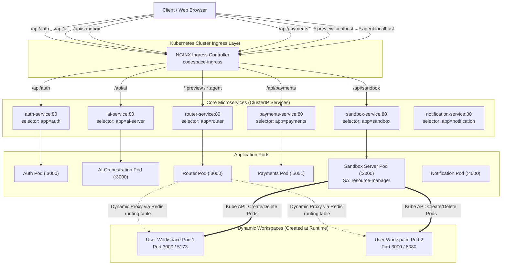
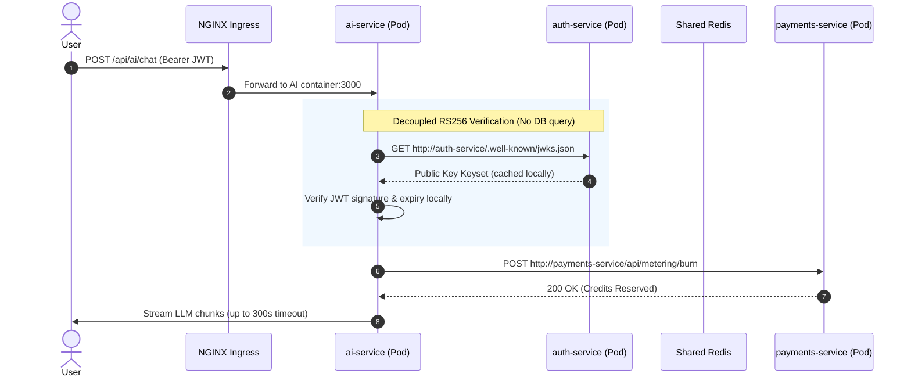

# End-to-End Kubernetes Microservices Manifests Architecture Guide

A comprehensive architectural reference and blueprint based on production manifests: Ingress, ClusterIP Services, Deployments, RBAC, Secrets, and Skaffold developer loops.

---

## 1. Concept in Plain English

When a web platform grows beyond a single monolithic application, it is divided into specialized microservices. In this project (Taksha CodeSpace), independent services handle distinct responsibilities:
- `Auth`: Handles identity, RS256 token generation, and Google OAuth.
- `Ai_orchestration`: Streams LLM agent reasoning and tool execution.
- `Sandbox Server`: Dynamically spins up and destroys Kubernetes pods for developer workspaces.
- `Router`: Proxies traffic to dynamic developer preview ports and agent endpoints.
- `Payments`: Manages Razorpay orders, subscriptions, and credit balances.
- `Notification`: Asynchronously consumes events and sends emails.

Kubernetes (`k8s`) acts as the distributed operating system that runs these microservices. The configuration files (`.yml` / `.yaml`) are declarative blueprints telling the cluster:
- **Deployments:** How many instances of each service to run, how much CPU/RAM they can use, and how to verify if they are alive.
- **Services (ClusterIP):** Internal virtual IP addresses and DNS records that allow microservices to talk to each other without knowing individual pod IP addresses.
- **Ingress:** The single public gateway that routes incoming internet HTTP traffic to the appropriate internal service based on path or domain name.
- **RBAC (Role-Based Access Control):** Permissions granted to specific services (such as the sandbox server) to interact with the Kubernetes API itself.
- **Secrets:** Encrypted or masked environment variables that prevent API keys and database credentials from leaking into source code.
- **Skaffold:** An automated developer loop tool that synchronizes local code changes directly into running pods without manual Docker rebuilds.

---

## 2. Why It Exists and What Breaks Without It

Without a declarative Kubernetes architecture:

```
Direct Monolith / Manual VMs:
[Client] --> [Monolith EC2 / VM] (Port conflicts, shared DB, single point of failure)

Microservices with Kubernetes & Ingress:
[Client] --> [NGINX Ingress Controller] (Port 80/443, SSL termination, path routing)
                  |--> /api/auth     --> [auth-service]     --> [Auth Pods]
                  |--> /api/ai       --> [ai-service]       --> [AI Pods]
                  |--> /api/sandbox  --> [sandbox-service]  --> [Sandbox Pods]
                  |--> /api/payments --> [payments-service] --> [Payments Pods]
                  |--> *.preview.*   --> [router-service]   --> [Dynamic Pods]
```

### What breaks without these specific manifests:

1. **Without Ingress:** Every microservice would require its own cloud load balancer (e.g. AWS ALB) or external NodePort. This increases cloud costs by 5x-10x, complicates SSL certificate management, and exposes internal microservices directly to the public internet.
2. **Without ClusterIP Services:** Pods are ephemeral; their IP addresses change every time they crash or restart. Without a Service abstraction, services would need hardcoded dynamic IP discovery.
3. **Without RBAC:** The Sandbox service must create and terminate developer pods on demand. Giving it root cluster-admin access would create a catastrophic security risk where a compromised sandbox could delete the entire cluster.
4. **Without Liveness/Readiness Probes:** Traffic gets routed to pods that are still booting up, leading to 502 Bad Gateway errors during deployments or autoscaling.
5. **Without Secrets Separation:** Committing credentials or sharing a single global secret file creates a single blast radius where an engineer working on notifications has access to payment private keys.

---

## 3. Core Mechanism: Step-by-Step Request Lifecycle

Here is the exact step-by-step path of a request moving through this architecture:

```
[User Browser]
      |
      | 1. HTTP Request (e.g., POST /api/ai/stream)
      v
[NGINX Ingress Controller (Port 80/443)]
      |
      | 2. Checks ingress.yml rules:
      |    Path matches prefix "/api/ai"
      |    Applies annotation: proxy-read-timeout = 300s
      v
[ai-service (ClusterIP Virtual IP)]
      |
      | 3. iptables / IPVS rule rewrites destination IP
      |    Load balances across matching pods (app=ai-server)
      v
[ai-server-container (Port 3000 inside Pod)]
      |
      | 4. Reads env vars injected from database & ai-secret
      | 5. Verifies JWT by querying internal DNS:
      |    GET http://auth-service/.well-known/jwks.json
      | 6. Checks user credits via internal DNS:
      |    POST http://payments-service/api/payments/verify
      | 7. Calls LLM Provider and streams chunks back through Ingress
      v
[User receives SSE stream without timeout drop]
```

---

## 4. Reference Architecture

### 4.1 Ingress Routing and Dynamic Preview Topology



### 4.2 Inter-Service Communication and Decoupled Auth



---

## 5. End-to-End Custom Manifests Breakdown

### 5.1 Ingress Controller Manifest (`k8s/ingress.yml`)

The ingress manifest defines the ingress controller class, path-based routing, wildcard hosts, and critical timeout annotations.

```yaml
apiVersion: networking.k8s.io/v1
kind: Ingress
metadata:
  name: codespace-ingress
  labels:
    app.kubernetes.io/name: codespace-ingress
  annotations:
    # Allow up to 5 minutes for LLM agent responses (default nginx timeout is 60s)
    nginx.ingress.kubernetes.io/proxy-read-timeout: "300"
    nginx.ingress.kubernetes.io/proxy-send-timeout: "300"
    nginx.ingress.kubernetes.io/proxy-connect-timeout: "10"
spec:
  ingressClassName: nginx
  rules:
    - http:
        paths:
          - pathType: Prefix
            path: "/api/sandbox"
            backend:
              service:
                name: sandbox-service
                port:
                  number: 80
    - http:
        paths:
          - pathType: Prefix
            path: "/api/auth"
            backend:
              service:
                name: auth-service
                port:
                  number: 80
    - http:
        paths:
          - pathType: Prefix
            path: "/api/ai"
            backend:
              service:
                name: ai-service
                port:
                  number: 80
    - http:
        paths:
          - pathType: Prefix
            path: "/api/payments"
            backend:
              service:
                name: payments-service
                port:
                  number: 80
    - host: "*.preview.localhost"
      http:
        paths:
          - pathType: Prefix
            path: "/"
            backend:
              service:
                name: router-service
                port:
                  number: 80
    - host: "*.agent.localhost"
      http:
        paths:
          - pathType: Prefix
            path: "/"
            backend:
              service:
                name: router-service
                port:
                  number: 80
```

#### Why This Works Best:
- **`proxy-read-timeout: "300"`:** Default NGINX proxy timeout is 60 seconds. LLM tool-calling and multi-step reasoning take 90-180 seconds. Without this custom annotation, the ingress drops the connection mid-stream with a 504 Gateway Timeout.
- **Path Separation:** `/api/auth`, `/api/ai`, `/api/sandbox`, `/api/payments` cleanly divide traffic by domain boundary.
- **Wildcard Subdomains:** `*.preview.localhost` and `*.agent.localhost` catch any user project subdomains (e.g. `proj-123.preview.localhost`) and route them to `router-service`, which does dynamic Redis-backed reverse proxying.

---

### 5.2 Granular RBAC for Dynamic Orchestration (`k8s/rabc.yml`)

The Sandbox service needs to orchestrate Kubernetes resources directly from code. Rather than using an admin token, it uses a scoped `ServiceAccount`, `Role`, and `RoleBinding`.

```yaml
apiVersion: v1
kind: ServiceAccount
metadata:
  name: resource-manager

---
apiVersion: rbac.authorization.k8s.io/v1
kind: Role
metadata:
  name: resource-manager
rules:
- apiGroups: [""]
  resources: ["pods", "pods/log", "services", "deployment"]
  verbs: ["get", "list", "watch", "create", "delete"]

---
apiVersion: rbac.authorization.k8s.io/v1
kind: RoleBinding
metadata:
  name: resource-manager-binding
subjects:
- kind: ServiceAccount
  name: resource-manager
  namespace: default
roleRef:
  kind: Role
  name: resource-manager
  apiGroup: rbac.authorization.k8s.io

---
apiVersion: v1
kind: ServiceAccount
metadata:
  name: sandbox-agent-sa
  namespace: default

---
apiVersion: rbac.authorization.k8s.io/v1
kind: Role
metadata:
  name: sandbox-agent-role
  namespace: default
rules:
- apiGroups: [""]
  resources: ["pods", "pods/log"]
  verbs: ["get", "list"]

---
apiVersion: rbac.authorization.k8s.io/v1
kind: RoleBinding
metadata:
  name: sandbox-agent-role-binding
  namespace: default
subjects:
- kind: ServiceAccount
  name: sandbox-agent-sa
  namespace: default
roleRef:
  kind: Role
  name: sandbox-agent-role
  apiGroup: rbac.authorization.k8s.io
```

#### Why This Works Best:
- **Principle of Least Privilege:** `resource-manager` can only create/delete pods and services in its assigned namespace (`default`). It cannot touch secrets, cluster nodes, ingress, or cluster-wide configs.
- **Read-Only Sidecar Role:** `sandbox-agent-role` only gets `get` and `list` permissions to inspect its own pod and stream logs, preventing agent-level lateral privilege escalation.

---

### 5.3 Modular Secrets Management (`k8s/secrets.yml.example`)

Instead of one giant secret file, secrets are segregated by logical service context.

```yaml
apiVersion: v1
kind: Secret
metadata:
  name: database
type: Opaque
stringData:
  AUTH: AUTH_DATABASE_URL
  SANDBOX: SANDBOX_DATABASE_URL
  AI: AI_DATABASE_URL
  PAYMENT: PAYMENT_DATABASE_URL
  REDIS_URL: redis://default
  MQ_URL: RABBITMQ_URL_URL

---
apiVersion: v1
kind: Secret
metadata:
  name: jwt
type: Opaque
stringData:
  JWT_SECRET: JWT_SECRET_VALUE

---
apiVersion: v1
kind: Secret
metadata:
  name: google
type: Opaque
stringData:
  GOOGLE_CLIENT_ID: GOOGLE_CLIENT_ID_VALUE
  GOOGLE_CLIENT_SECRET: GOOGLE_CLIENT_SECRET_VALUE
  GOOGLE_REFRESH_TOKEN: GOOGLE_REFRESH_TOKEN_VALUE
  EMAIL_USER: EMAIL_USER_VALUE

---
apiVersion: v1
kind: Secret
metadata:
  name: razorpay
type: Opaque
stringData:
  RAZORPAY_KEY_ID: RAZORPAY_KEY_ID_VALUE
  RAZORPAY_KEY_SECRET: RAZORPAY_KEY_SECRET_VALUE
  RAZORPAY_SECRET_ID: RAZORPAY_SECRET_ID_VALUE
  RAZORPAY_SECRET_KEY: RAZORPAY_SECRET_KEY_VALUE
  RAZORPAY_WEBHOOK_SECRET: RAZORPAY_WEBHOOK_SECRET_VALUE

---
apiVersion: v1
kind: Secret
metadata:
  name: ai-secret
type: Opaque
stringData:
  MISTRALAI_API_KEY: MISTRALAI_API_KEY_VALUE
  GOOGLE_API_KEY: GOOGLE_API_KEY_VALUE
  COHERE_API_KEY: COHERE_API_KEY_VALUE

---
apiVersion: v1
kind: Secret
metadata:
  name: aws
type: Opaque
stringData:
  AWS_REGION: ap-southeast-1
  AWS_ACCESS_KEY_ID: AWS_ACCESS_KEY_ID_VALUE
  AWS_SECRET_ACCESS_KEY: AWS_SECRET_ACCESS_KEY_VALUE
```

#### Why This Works Best:
- **Blast Radius Isolation:** If Razorpay keys are rotated, only the `razorpay` Secret changes. Deployments consuming only `ai-secret` or `google` are not affected.
- **Selective Injection:** Deployments use `valueFrom.secretKeyRef` to pull only the specific keys they require.

---

### 5.4 Deployment Manifest Pattern (`k8s/auth.deployment.yml` & `k8s/ai-deployment.yml`)

Every deployment follows a production standard: defined CPU/Memory requests and limits, health checks, and explicit secret injection.

```yaml
apiVersion: apps/v1
kind: Deployment
metadata:
  name: auth-deployment
  labels:
    name: auth-deployment
spec:
  replicas: 1
  selector:
    matchLabels:
      app: auth
  template:
    metadata:
      labels:
        app: auth
    spec:
      containers:
      - image: auth
        imagePullPolicy: IfNotPresent
        name: auth-container
        resources:
          requests:
            cpu: "250m"
            memory: "128Mi"
          limits:
            cpu: "500m"
            memory: "256Mi"
        livenessProbe:
          httpGet:
            path: /healthz
            port: 3000
          initialDelaySeconds: 90
          timeoutSeconds: 10
        readinessProbe:
          httpGet:
            path: /readyz
            port: 3000
          initialDelaySeconds: 30
          timeoutSeconds: 10
        env:
        - name: MONGO_URI
          valueFrom:
            secretKeyRef:
              name: database
              key: AUTH
        - name: MQ_URL
          valueFrom:
            secretKeyRef:
              name: database
              key: MQ_URL
        - name: RSA_PRIVATE_KEY
          valueFrom:
            secretKeyRef:
              name: jwt
              key: RSA_PRIVATE_KEY
        - name: REDIS_URI
          valueFrom:
            secretKeyRef:
              name: database
              key: REDIS_URI
        ports:
        - containerPort: 3000
          name: auth-http
```

In the dynamic `sandbox-deployment.yml`, notice the ServiceAccount injection:

```yaml
spec:
  serviceAccountName: resource-manager
  containers:
  - image: sandbox:latest
    name: main-sandbox-container
    env:
      - name: AUTH_JWKS_URI
        value: "http://auth-service/.well-known/jwks.json"
```

#### Why This Works Best:
- **`resources.requests` & `resources.limits`:** Requests guarantee node capacity for scheduling; limits prevent runaway Node.js memory leaks from starving neighbouring pods (OOMKilled guardrail).
- **Probes Segregation:** 
  - `readinessProbe` (delay: 30s) prevents traffic from arriving before Express connects to MongoDB and Redis.
  - `livenessProbe` (delay: 90s) automatically restarts hung event loops.
- **Internal DNS for JWKS:** `AUTH_JWKS_URI: "http://auth-service/.well-known/jwks.json"` bypasses external network hops, verifying credentials internally with zero internet latency.

---

### 5.5 ClusterIP Service Manifest Pattern (`k8s/auth.service.yml`)

Services map stable virtual IP addresses and port 80 to container target ports.

```yaml
kind: Service
apiVersion: v1
metadata:
  name: auth-service
  labels:
    app: auth
spec:
  selector:
    app: auth
  type: ClusterIP
  ports:
  - name: auth-http
    port: 80
    targetPort: 3000
```

#### Why This Works Best:
- **Decoupled Ports:** Other microservices call `http://auth-service/` on default HTTP port 80. Inside the container, Express can listen on 3000, 4000, or 5051. Changing a container's internal port does not break inter-service callers.
- **Selector Matching:** `selector.app: auth` automatically adds and removes pod endpoints as pods scale up or restart.

---

### 5.6 Developer Loop Automation (`skaffold.yml`)

Skaffold ties the entire multi-service codebase into a unified local dev workflow. Without Skaffold, every small code change requires manually running `docker build`, tagging, pushing, and running `kubectl rollout restart`. 

Here is the exact, complete custom `skaffold.yml` configured for this project:

```yaml
# Developement process fast hojaye, hume baar baar image ko banana na pade baar baar deploy na karna pade koi change hone pe files me. This is the main function of skaffold that's why we are using it in our project.

apiVersion: skaffold/v4beta2
kind: Config

build:
  tagPolicy:
    sha256: {}
  artifacts:
    - image: ai-orchestration
      context: Ai_orchestration
      docker:
        dockerfile: dockerfile
      sync:
        infer:
          - "src/**"
          - "server.js"

    - image: agent
      context: Sandbox/Agent
      docker:
        dockerfile: dockerfile
      sync:
        infer:
          - "src/**"
    
    - image: router
      context: Sandbox/router
      docker:
        dockerfile: dockerfile
      sync:
        infer:
          - "src/**"
    
    - image: template
      context: Sandbox/template
      docker:
        dockerfile: dockerfile
      sync:
        infer:
          - "src/**"

    - image: sync-agent
      context: Sandbox/sync-agent
      docker:
        dockerfile: dockerfile
      sync:
        infer:
          - "*.js"
          - "package.json"

    - image: sandbox
      context: Sandbox/server
      docker:
        dockerfile: dockerfile
      sync:
        infer:
          - "src/**"

    - image: auth
      context: Auth
      docker:
        dockerfile: dockerfile
      sync:
        infer:
          - "src/**"

    - image: notification
      context: Notification
      docker:
        dockerfile: dockerfile
      sync:
        infer:
          - "src/**"

    - image: payments
      context: Payments
      docker:
        dockerfile: dockerfile
      sync:
        infer:
          - "app/**"
          - "config/**"
          - "controllers/**"
          - "middleware/**"
          - "models/**"
          - "routes/**"
          - "services/**"
          - "server.js"
          - "package.json"
    
manifests:
  rawYaml:
    - k8s/ai-deployment.yml
    - k8s/router-deployment.yml
    - k8s/sandbox-deployment.yml
    - k8s/ai-service.yml
    - k8s/router-service.yml
    - k8s/sandbox-service.yml
    - k8s/rabc.yml
    - k8s/ingress.yml
    - k8s/auth.deployment.yml
    - k8s/auth.service.yml
    - k8s/secrets.yml
    - k8s/notification-deployment.yml
    - k8s/notification-service.yml
    - k8s/payments.deployment.yml
    - k8s/payments.service.yml
```

#### Why This Skaffold Configuration Works Best:

1. **`tagPolicy: sha256: {}`:** Generates content-hash tags. This avoids stale image caching bugs where a pod keeps running an old `:latest` image from the node's local Docker daemon.
2. **`sync.infer` on Hot Code Paths:**
   - **`Ai_orchestration`:** Changes inside `src/**` and `server.js` are copied instantly into the running container. Nodemon or Node watch picks them up in less than 500ms.
   - **`Sandbox/sync-agent` & `Payments`:** Granular sync rules include controller, middleware, route, and package files so edits in any application layer sync immediately.
   - **Bypassing the Build Pipeline:** A full Docker build for 9 microservices takes 3 to 7 minutes. `sync.infer` reduces iteration time to under 2 seconds.
3. **Unified Declarative Manifest List (`manifests.rawYaml`):**
   - Running `skaffold dev` deploys all 15 Kubernetes manifests in one command.
   - Skaffold automatically attaches log streams from all 9 microservices into your terminal with distinct color prefixes.
   - Pressing `Ctrl+C` cleans up all created pods, services, and ingress rules automatically.


---

## 6. Scalability Deep Dive

### 6.1 Horizontal vs. Vertical Scaling

| Dimension | Vertical Scaling | Horizontal Scaling (HPA) | Recommended Strategy Here |
|---|---|---|---|
| **Auth Service** | Increase CPU to handle bcrypt hashing | Scale to 3-5 replicas behind ClusterIP | Horizontal (stateless, token issuing is CPU-bound) |
| **AI Orchestration** | Increase RAM for in-memory token buffer | Scale to 5-20 replicas | Horizontal (SSE streaming connections hold sockets open) |
| **Sandbox Server** | Increase CPU/RAM for concurrent K8s API calls | Keep 1-2 replicas (stateful lock / reconcile) | Moderate Horizontal with leader election |
| **Router** | Increase RAM for reverse-proxy buffers | Scale to 5-15 replicas | Horizontal (I/O bound reverse proxying) |
| **Payments** | Increase CPU for transaction processing | 2-3 replicas | Horizontal with DB transaction locking |

### 6.2 Bottleneck Analysis Across Scale Tiers

```
Scale Tier 1x (Dev / 10 concurrent users):
- 1 replica per service.
- Single MongoDB and Redis instance.
- Ingress handles traffic effortlessly.

Scale Tier 10x (100 concurrent developers / 500 active pods):
- Bottleneck 1: Kubernetes API rate limits triggered by Sandbox server creating pods.
  Fix: Implement client-side queueing and throttling for pod creation.
- Bottleneck 2: Ingress NGINX connection limits on SSE connections.
  Fix: Tune `worker-connections: 16384` and `keepalive: 32` in Ingress ConfigMap.

Scale Tier 100x (1,000 active projects / 10,000 pods):
- Bottleneck 1: Node IP exhaustion in the VPC subnet.
  Fix: Switch to AWS VPC CNI with secondary CIDR blocks or Calico overlay.
- Bottleneck 2: DNS queries to CoreDNS (`kube-dns`) spike due to inter-service calls.
  Fix: Deploy `NodeLocal DNSCache` to serve DNS lookups on every node.

Scale Tier 1000x (10,000+ active projects / 100,000 pods):
- Bottleneck 1: Single Kubernetes etcd cluster degrades under thousands of pod status updates.
  Fix: Partition cluster into dedicated workload clusters (Virtual Clusters / vcluster).
- Bottleneck 2: Database connections exhaust MongoDB pool.
  Fix: Dedicated connection poolers and read replicas per microservice.
```

### 6.3 Caching and Consistency Strategy

- **Asymmetric JWKS Caching:** Downstream services (`ai-service`, `payments`, `sandbox`) fetch `http://auth-service/.well-known/jwks.json` once and cache it in memory with a 15-minute TTL. Verification requires zero database access.
- **Dynamic Routing Table in Redis:** The `Router` service queries Redis for sandbox subdomain mappings (`<sandboxId>` -> `pod_ip:port`). Key lookups run in sub-millisecond O(1) time.

### 6.4 Async Processing and Backpressure Handling

- **RabbitMQ for Notifications:** When an order is verified in `Payments`, it does not make a synchronous HTTP call to `Notification`. Instead, it publishes an event to RabbitMQ (`MQ_URL`).
- **Consumer Isolation:** If Gmail API slows down, messages pile up safely in the RabbitMQ queue. Neither Payments nor Auth experiences latency spikes.

### 6.5 Observability and Health Signals

To detect failures early, ensure your deployment templates expose:
- Prometheus metrics at `/metrics` (request duration histograms, event loop lag).
- Structured logs with `requestId` and `correlationId` passed through Ingress headers.
- Alerts on:
  - `PodRestartCount > 3` in 15 minutes (indicates crash loop).
  - `CPUThrottlingHigh` (> 25% of runtime throttled by cgroups limits).
  - Ingress 5xx rate exceeding 1% of total requests.

---

## 7. Trade-offs Table

| Architecture Choice | Chosen Approach | Alternative 1 | Alternative 2 | Trade-off Rationale |
|---|---|---|---|---|
| **Ingress Layer** | Ingress NGINX (`networking.k8s.io/v1`) | Traefik | Kubernetes Gateway API | Ingress NGINX is mature, supports regex and custom annotations like `proxy-read-timeout`, and is standard across cloud and minikube. |
| **Inter-Service Communication** | Internal ClusterIP DNS (`http://auth-service`) | External Ingress Re-entry | gRPC / Protocol Buffers | Internal ClusterIP avoids hairpin NAT and SSL overhead. gRPC provides typing but adds proto compilation complexity. |
| **Token Verification** | RS256 JWKS via internal endpoint | Shared Symmetric Secret (`JWT_SECRET`) | Central Auth Validation Endpoint | RS256 allows verification without giving all microservices the private signing key or hammering the Auth database. |
| **Workspaces Provisioning** | Dynamic Pods via RBAC `resource-manager` | Docker-in-Docker (DinD) | External Cloud Sandboxes (Fly.io / AWS ECS) | Kubernetes-native pods leverage cluster networking, node scheduling, and resource limits without extra external vendor costs. |
| **Secrets Distribution** | Domain-split K8s Secrets | Single giant Secret manifest | HashiCorp Vault / AWS Secrets Manager | Split secrets provide clean separation without the operational weight of hosting a Vault cluster. |

---

## 8. Fundamental Computer Science and Networking Concepts

1. **iptables and IPVS (How ClusterIP Actually Routes):**
   A ClusterIP (e.g. `10.96.0.12`) is not a real physical network interface. It is a virtual IP managed by `kube-proxy`. When a pod calls `auth-service:80`, `kube-proxy` rules intercept the packets in the Linux kernel and rewrite the destination IP to one of the healthy pod IPs using random load-balancing.
2. **Reverse Proxying and Socket Buffering:**
   Ingress acts as a reverse proxy. When streaming responses (SSE), NGINX buffers packets by default. Disabling buffering or extending `proxy-read-timeout` ensures the client's socket stays open across long LLM thought processes.
3. **Asymmetric Cryptography (RS256):**
   Only `Auth` holds the RSA Private Key to sign tokens. All other services fetch the RSA Public Key via JWKS. If an attacker gains full read access to `ai-service` or `payments`, they cannot forge authentication tokens for other users.
4. **POSIX Signals and Graceful Shutdown:**
   When Kubernetes terminates a pod, it sends `SIGTERM`. If the container does not exit within `terminationGracePeriodSeconds` (default 30s), it sends `SIGKILL`. Well-written microservices listen for `SIGTERM`, stop accepting new requests, close database connections, and flush logs.

---

## 9. Taksha CodeSpace: Architecture Evaluation

Your microservices setup is built cleanly and intentionally for a cloud IDE platform:

1. **Clean Service Decoupling:** 
   Auth, Payments, AI, and Sandboxes do not share databases. Each reads its own database URI from the `database` secret (`AUTH`, `SANDBOX`, `AI`, `PAYMENT`).
2. **First-Class AI Streaming Support:**
   Recognizing that LLM responses require up to 5 minutes, configuring `proxy-read-timeout: "300"` in `ingress.yml` prevents the most common bug in AI microservices architectures.
3. **Smart In-Cluster Orchestration:**
   Creating a dedicated `resource-manager` ServiceAccount and passing it to `sandbox-deployment.yml` allows the sandbox backend to act as a micro-Kubernetes-controller, spinning up workspaces on the fly.
4. **Wildcard Routing Integration:**
   Routing `*.preview.localhost` to `router-service` allows dynamic ports without writing new ingress rules every time a user starts a development server in their sandbox.

---

## 10. Common Pitfalls and Production Hardening

1. **Liveness Probe Misconfiguration:**
   Setting `initialDelaySeconds` too low (e.g. 5s) will cause Kubernetes to kill your container while it is still running MongoDB migrations or initializing Mongoose. Keep it at 30-90s or use a `startupProbe`.
2. **Missing Ingress Controller in Production:**
   When migrating from local (Minikube / Docker Desktop) to AWS EKS or GCP GKE:
   - Install the NGINX Ingress Controller via Helm (`ingress-nginx`).
   - Create an AWS ALB pointing to the Ingress Controller NodePorts.
   - Replace `.localhost` wildcard domains with a real wildcard domain (e.g. `*.preview.yourdomain.com`) with a wildcard ACM SSL certificate.
3. **Secret Encoding:**
   In production pipelines, use external secrets operators (`ExternalSecrets` with AWS Secrets Manager) or SealedSecrets to avoid committing raw base64 or plaintext strings to git.
4. **Readiness Probe vs. Liveness Probe:**
   - **Readiness Probe:** If this fails, the pod is removed from the Service endpoints (it stops getting traffic, but does not restart).
   - **Liveness Probe:** If this fails, the container is killed and restarted. Never test downstream third-party services in your liveness probe, or an outage in Razorpay will cause all your payment pods to crash-loop.

---

## 11. Summary Checklist for New Projects

When copying this pattern to your future microservice projects, follow this checklist:

- [ ] **Define Bounded Contexts:** Ensure each service has its own database connection string and folder.
- [ ] **Create Domain Secrets:** Split secrets into `database`, `jwt`, `api-keys`, etc.
- [ ] **Deploy Services with Standard Ports:** Use port 80 for `ClusterIP` and map to `targetPort` (3000/5000).
- [ ] **Apply Resource Boundaries:** Always specify both `requests` and `limits` for CPU and Memory.
- [ ] **Set Health Probes:** Configure `/healthz` for liveness and `/readyz` for readiness.
- [ ] **Configure Ingress Timeouts:** For long-running operations or AI agents, set `proxy-read-timeout: "300"` in Ingress annotations.
- [ ] **Scope RBAC:** If any service interacts with Kubernetes, assign a dedicated `ServiceAccount` with minimal verbs.
- [ ] **Wire Skaffold Sync:** Configure `sync.infer` on source folders to enable instant hot-reloading during development.
