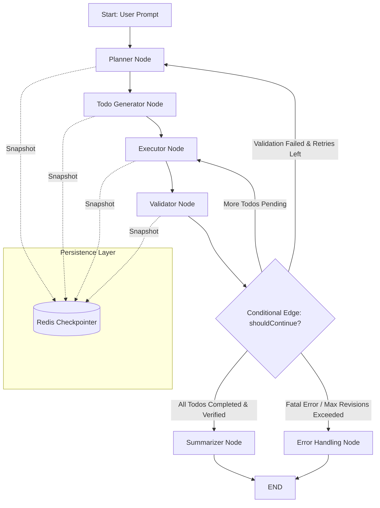

# Refactoring Code Agent to a Stateful Conditional LangGraph Workflow

## 1. Concept in Plain English

A standard **ReAct agent** (like the current setup in `code.agent.js`) operates like an engineer who improvises everything step by step: it looks at user input, picks a tool, runs it, reads the output, and decides what to do next in a free-form loop. While flexible, this leads to unpredictable tool looping, bloated prompt contexts, missing memory between reconnections, and hard-to-enforce rules (which currently require fragile custom wrappers, monkey-patched tool gates, and regex blockers).

A **LangGraph Conditional Workflow Agent**, by contrast, functions like a structured assembly line:
1. **Planner Node**: Analyzes the user's prompt and generates a structured `implementationPlan`.
2. **Task Allocator / Todo Node**: Breaks the plan into a granular `todoList` array of structured task objects (`[{ id, title, file, status }]`).
3. **Executor Node**: Performs tool calls (reading, writing, patching, running shell commands) specifically targeted at the active todo item.
4. **Validator Node**: Runs syntax checks or Vite error checks to verify if the code compiled cleanly.
5. **Conditional Edge**: Decides based on state whether to pick the next pending todo, replan upon failure, or terminate (`END`).
6. **Persistence Checkpointer**: Automatically snapshots the entire state to persistent memory (Redis / MongoDB) after every node transition, allowing agent runs to pause, resume, or recover seamlessly after socket disconnections or server restarts.

---

## 2. Why It Exists

At scale, unstructured ReAct agents break down in production for several critical reasons:

* **Context Bloat & Token Waste**: Free-form agent loops re-send the full chat history and every tool output on every single step. In complex multi-file edits, prompt length explodes, increasing latency and cost exponentially.
* **Lack of Deterministic Control**: Enforcing strict sequence rules (e.g., "Must submit plan before writing files", "Must create `todo.md`", "Must clear Vite template code") via natural language prompts or monkey-patched JS wrappers is brittle. LLMs often bypass prompt instructions or get stuck in tool call retries.
* **Loss of State on Reconnection**: If a user refreshes the browser or loses Socket.io connection mid-task, standard in-memory agent runs lose context or leak background executions.
* **Unobservable Execution**: Frontend clients only see raw LLM text streams or raw tool calls, making it difficult to render a clean, structured progress UI (like a real-time progress bar or interactive checklist).

LangGraph solves this by turning agent execution into an explicit, stateful Finite State Machine (FSM) where transitions are deterministic, state is explicitly schema-typed, and execution history is persisted durably.

---

## 3. Core Mechanism

The LangGraph workflow relies on a shared `StateGraph` object passed between discrete node functions.

### State Schema (`AgentState`)

```typescript
interface TodoItem {
  id: string;
  title: string;
  file?: string;
  status: 'pending' | 'in_progress' | 'completed' | 'failed';
  result?: string;
}

interface ImplementationStep {
  stepNumber: number;
  description: string;
  targetFiles: string[];
}

interface AgentState {
  // Input & Meta
  prompt: string;
  projectId: string;
  sandboxId: string;

  // Plan & Structured Progress
  implementationPlan: ImplementationStep[];
  todoList: TodoItem[];
  currentTodoIndex: number;

  // LangChain Message Thread
  messages: BaseMessage[];

  // Control Flags & Metadata
  revisionCount: number;
  maxRevisions: number;
  verificationPassed: boolean;
  status: 'planning' | 'executing' | 'validating' | 'completed' | 'failed';
}
```

### State Reduction & Immutability
In LangGraph, node functions accept the current state and return an update payload. Graph channels automatically merge returned properties back into the state without in-place mutations.

---

## 4. Reference Architecture



### Workflow Execution Steps

1. **Planner Node (`planner_node`)**: Reads user prompt and attached codebase context; calls LLM with structured output schema to emit `implementationPlan`.
2. **Todo Generator Node (`todo_node`)**: Converts `implementationPlan` into structured `todoList` array items and creates/syncs `todo.md` in the workspace root.
3. **Executor Node (`executor_node`)**: Selects the first item in `todoList` where `status === 'pending'`, sets status to `'in_progress'`, and runs targeted tool calls (`read_file`, `patch_file`, `update_file`).
4. **Validator Node (`validator_node`)**: Invokes `get_vite_runtime_errors` or `execute_command` (`npm run build`) to confirm syntax correctness. Marks item as `'completed'` or `'failed'`.
5. **Conditional Router (`shouldContinue`)**: Evaluates:
   * If errors exist and `revisionCount < maxRevisions`: route to `planner_node` with error context.
   * If pending items exist: increment `currentTodoIndex` and route back to `executor_node`.
   * If all items are completed: route to `summarizer_node`.

---

## 5. Scalability Deep Dive

### Horizontal vs Vertical Scaling
* **Vertical Scaling**: Standard in-memory agent instances hit memory caps when handling hundreds of concurrent streaming socket connections.
* **Horizontal Scaling**: Stateless worker instances running LangGraph workflows with an external persistent checkpointer (**RedisSaver**). Any API node can handle any step of an agent run by resuming from the thread checkpoint key (`projectId:threadId`).

### Bottleneck Analysis

| Load Factor | Primary Bottleneck | Mitigation Strategy |
| :--- | :--- | :--- |
| **10x Load** | LLM API Rate Limits (Mistral 429s) | Adaptive exponential backoff queue with jitter and Redis distributed locks per model tier. |
| **100x Load** | Redis Checkpoint Payload Bloat | Store large file contents in object store/S3; store only diffs or file hashes in graph state. |
| **1000x Load** | Socket.io Connection Swarms | Split Socket.io Gateway from AI Orchestration Workers; use Redis Pub/Sub for state event broadcasting. |

### Caching Strategy
* **Prompt Caching**: System prompts, standard tool descriptions, and base codebase guidelines are static. Use Mistral/LLM prompt caching markers to decrease input token latency by up to 80%.
* **State Caching**: Read-heavy tools (`read_file`, `list_files`, `search_code`) cache file hashes in Redis to avoid redundant disk I/O in cloud sandboxes.

### Data Partitioning & Sharding
Checkpoints are keyed by `thread_id` formatted as `${tenantId}:${projectId}:${sessionId}`. Redis Cluster uses default CRC16 hashing on `{tenantId:projectId}` hash tags to guarantee all state snapshots for a single project reside on the same Redis shard.

### Replication & Consistency Model
* **Checkpoints**: Eventual consistency for history logs; strong consistency for active run locks using Redis `SET key value NX PX 30000`.
* **State Recovery**: If a worker process crashes mid-execution, another worker fetches the last checkpoint from Redis and resumes from the exact node where it failed.

### Async Processing & Backpressure
Socket.io streams updates directly from node events using `graph.streamEvents()`. If the client socket buffer builds up (backpressure), node events queue up in memory with bounded buffer limits before shedding non-critical logging events.

### Observability Metrics
* **Node Latency**: Duration of `planner_node`, `executor_node`, `validator_node`.
* **Token Burn Rate**: Input/output tokens consumed per state transition.
* **State Mutation Diffs**: Tracking changes to `todoList` array items over time.

---

## 6. Trade-offs Table

| Feature / Architecture | Legacy `code.agent.js` (Current) | Stateful LangGraph Workflow (Proposed) | Hierarchical Multi-Agent Swarm |
| :--- | :--- | :--- | :--- |
| **Control Flow** | Unstructured ReAct loop | Explicit Conditional State Graph | Multi-agent delegator graph |
| **State Management** | WeakMap JS variables & tool closures | Schema-typed, immutable `AgentState` | Shared vector memory + message queues |
| **Persistence** | None (in-memory only) | Redis / Mongo Checkpointer | Distributed state store |
| **Debugging & Traceability** | Hard (opaque tool loops) | Easy (node-by-node state snapshots) | Complex (cross-agent communication) |
| **Implementation Complexity** | Medium (lots of custom guard code) | Medium-Low (declarative graph structure) | Very High |
| **Token Efficiency** | Low (re-sends full history constantly) | High (isolated node contexts) | Low-Medium (agent handoff overhead) |

---

## 7. Ties to Fundamentals

1. **Finite State Machines (FSM)**: Nodes represent states, tools represent actions, and conditional functions represent deterministic state transition functions $T(S, A) \rightarrow S'$.
2. **Directed Acyclic Graphs (DAG)**: The execution path across nodes forms a execution DAG, preventing cyclic deadlocks by enforcing max loop depth bounds.
3. **Write-Ahead Logging (WAL)**: LangGraph checkpointers persist every state delta prior to executing downstream nodes, mirroring database WAL logs for crash recovery.
4. **Topological Ordering**: The `todoList` execution engine processes independent tasks in topologically sorted order based on file dependency constraints.

---

## 8. Connect It to What I'm Actually Building (Taksha Codebase)

In Taksha's `Ai_orchestration` microservice:

1. **`Ai_orchestration/src/agent/code.agent.js`**:
   * Replace fragile `applyPlanGate`, monkey-patched `guardedToolInvokes`, and regex string checks with clean, isolated LangGraph node functions.
   * Define explicit `StateGraph` channels for `prompt`, `implementationPlan`, `todoList` array, and `messages`.

2. **`Ai_orchestration/src/socket/socket.js`**:
   * Consume `graph.streamEvents({ thread_id: projectId })`.
   * Broadcast structured events (`agent:plan`, `agent:todo_update`, `agent:validation_status`) directly to frontend clients over Socket.io.

3. **`Ai_orchestration/src/config/redis.js` & `ioredis`**:
   * Connect `@langchain/langgraph-checkpoint-redis` or custom Redis checkpointer using the existing `ioredis` connection pool.

---

## 9. If Constraints Were Looser

If infrastructure constraints were relaxed:
* **Human-in-the-Loop Interruption Nodes**: Graph automatically pauses prior to destructive file updates or shell execution (`execute_command`), waiting for an explicit Socket.io approval signal from the user UI.
* **Local AST Validation Nodes**: Perform client-side tree-sitter or ESLint parsing inside a zero-token Node.js worker node before running LLM validation loops.

---

## 10. Common Pitfalls

1. **Infinite Loop Cycles**: Executor and Validator nodes looping indefinitely on persistent compiler errors. *Fix*: Enforce strict `maxRevisions` cap in conditional routing functions.
2. **Direct State Mutation**: Modifying `state.todoList[0].status = 'completed'` directly in JS instead of returning `{ todoList: updatedTodoList }`. *Fix*: Treat state as strictly immutable in node returns.
3. **Payload Bloat**: Including entire multi-megabyte file contents inside `AgentState`. *Fix*: Store file references/paths in state and load file contents dynamically inside tool calls.
4. **Serialization Failures**: Storing non-serializable objects (like `AbortController`, socket instances, or HTTP response streams) in graph channels. *Fix*: Keep state strictly serializable (JSON-compatible).

---

## 11. Summary Checklist

- [ ] Define `AgentState` interface with `prompt`, `implementationPlan`, `todoList` array, and control flags.
- [ ] Create `plannerNode` to generate structured implementation steps.
- [ ] Create `todoNode` to initialize and update `todoList` objects and sync `todo.md`.
- [ ] Create `executorNode` to run targeted tool actions for the active todo item.
- [ ] Create `validatorNode` for runtime/syntax verification.
- [ ] Configure `shouldContinue` conditional edge with max retry bounds.
- [ ] Wire Redis checkpointer for persistent state recovery across user sessions.
- [ ] Update `socket.js` to emit clean, state-driven Socket.io progress events.
