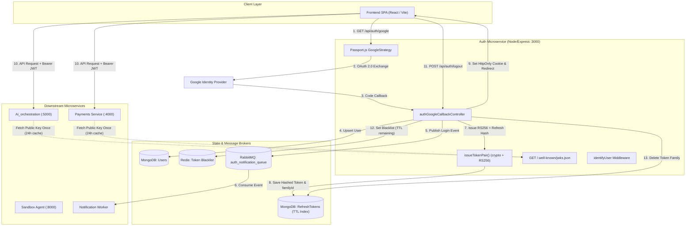

# POST /api/auth/login Deep Dive — Distributed OAuth2 & Asymmetric Session Architecture

> **System**: Taksha CodeSpace Cloud Sandbox Platform  
> **Service**: `Auth` Service (`port 3000` / `/api/auth`)  
> **Route Group**: Google OAuth 2.0 Flow (`GET /api/auth/google`, `GET /api/auth/google/callback`, `POST /api/auth/refresh`, `GET /api/auth/getMe`, `POST /api/auth/logout`)  
> **Protocols**: OAuth 2.0, RS256 Asymmetric JWT, JWKS (RFC 7517), AMQP 0-9-1 (RabbitMQ), Redis In-Memory Blacklist  

---

## 0. Problem Statement & Scope Definition

### One-Sentence Definition
The `/login` mechanism authenticates user identity via Google OAuth 2.0 without ever handling raw user credentials, issuing short-lived cryptographically signed RS256 Access Tokens and rotating opaque SHA-256-hashed Refresh Tokens with automatic replay-attack detection and cross-service JWKS verification.

---

### Scope (Interview-Style Requirements)

#### Functional Requirements (FR)
1. **Delegated Authentication**: User initiates login via Google OAuth 2.0 identity federation; no passwords are stored or handled by Taksha.
2. **User Identity Ingestion & Provisioning**: On successful callback, match existing user by `googleId` or provision a new user record (`name`, `email`, `photo`).
3. **Stateless Asymmetric Token Issuance**: Issue a short-lived (15-minute) RS256-signed Access Token containing standard claims (`sub`, `email`, `role`, `iss`, `aud`, `kid`).
4. **Rotating Refresh Token Family**: Issue an opaque 64-byte random hex Refresh Token (30-day lifetime) stored as an SHA-256 hash in MongoDB associated with a `familyId`.
5. **Replay & Reuse Detection**: If a previously rotated refresh token is submitted, revoke the entire token family immediately (mitigating stolen session replay).
6. **Decentralized Verification (JWKS)**: Publish the Auth Service's RSA Public Key at `/.well-known/jwks.json` so downstream services (Payments, AI Orchestration, Sandbox) verify JWTs locally without querying Auth DB.
7. **Asynchronous Audit & Security Alerting**: Emit an `auth.login` event to RabbitMQ (`auth_notification_queue`) for decoupled email notification dispatch.
8. **Instant Token Invalidation (Logout)**: Blacklist active JWTs in Redis until their natural expiration and delete refresh token families on user logout.

#### Non-Functional Requirements (NFR)
- **Latency**: 
  - Token verification at downstream services: `< 1ms` (in-memory RSA crypto via cached JWKS).
  - OAuth callback controller execution: `< 150ms` (DB query + token generation + AMQP push + cookie setup).
- **Scale**: Target support for 100,000 DAU, 25,000 peak concurrent users.
- **Availability vs. Consistency (CAP Theorem)**:
  - Token Verification: **AP** (stateless RS256 verification in downstream microservices never blocks on Auth database availability).
  - Refresh Token State & Rotation: **CP** (strict consistency on MongoDB primary for atomic token invalidation and reuse detection).
- **Security Boundaries**:
  - Private RSA Key never leaves the Auth Service pod.
  - Refresh tokens stored in browser strictly as `HttpOnly`, `SameSite=Lax`, `Secure` cookies with path restricted to `/api/auth/refresh`.
  - Raw refresh tokens never stored in plaintext in the database (SHA-256 hashed).

---

### Back-of-the-Envelope Calculations

```
Scale Estimates (Production Target: 100,000 Daily Active Users)
-----------------------------------------------------------------
1. Login Traffic:
   - 100,000 DAU * 2 logins/refreshes per active day = 200,000 auth events/day.
   - Peak load factor: 3x average.
   - Average QPS = 200,000 / 86,400 ≈ 2.3 QPS.
   - Peak QPS = 2.3 * 3 ≈ 7.0 QPS.
   - Spike load (e.g. platform launch / marketing campaign): 100 QPS on Auth service.

2. Access Token Verification Traffic (Downstream Microservices):
   - Average user active session = 30 minutes, 1 request every 3 seconds.
   - 20 requests/minute * 30 min = 600 requests/user session.
   - Total microservice requests = 100,000 * 600 = 60,000,000 requests/day.
   - Downstream verification QPS = ~700 QPS avg, ~2,100 QPS peak.
   - Critical Architectural Advantage: Because of RS256 + JWKS, these 2,100 QPS 
     hit zero database queries and zero HTTP requests to Auth service.

3. Refresh Token Storage Growth (MongoDB):
   - Schema per token document:
     - _id: 12 bytes
     - userId: 12 bytes
     - tokenHash: 64 bytes (hex SHA-256)
     - familyId: 36 bytes (UUID string)
     - used: 1 byte
     - expiresAt: 8 bytes (Date)
     - timestamps + indexes: ~150 bytes
     Total ≈ 300 bytes per record.
   - 100,000 users * 2 sessions * 4 rotations/day = 800,000 documents/day.
   - Daily storage: 800,000 * 300 B ≈ 240 MB/day.
   - 30-day retention with MongoDB TTL Index:
     Active collection size = 240 MB * 30 ≈ 7.2 GB steady-state.

4. Redis Blacklist Sizing (Instant Logout Revocation):
   - Only logged-out tokens with remaining TTL need to be stored in Redis.
   - Average logout rate: 5% of sessions = 10,000 logouts/day.
   - Max remaining TTL = 15 minutes (900 seconds).
   - Concurrently stored blacklisted keys at peak = (10,000 / 86,400) * 900 ≈ 105 keys.
   - Memory footprint in Redis = 105 * 500 B ≈ 52.5 KB (negligible memory footprint).
```

---

## 1. Concept in Plain English

When a user visits Taksha CodeSpace and logs in, we don't ask them for a username and password. Instead:
1. We ask Google: *"Can you vouch that this person owns this email address?"*
2. Google confirms their identity and hands back a verified profile.
3. The Auth Service issues two keys:
   - A **Passport (Access Token)**: A tiny, cryptographically signed digital badge valid for only 15 minutes. The user shows this to any microservice (AI agent, terminal sandbox, payments) to get immediate service without anyone checking a database.
   - A **Claim Check (Refresh Token)**: A secure, invisible cookie stored in the browser. When the 15-minute passport expires, the frontend hands the claim check to the Auth Service to get a new passport.
4. If a malicious attacker steals and uses an expired claim check, the system detects this duplicate usage and immediately revokes all sessions belonging to that family.

---

## 2. Why It Exists & What Breaks Without It

| Without This Pattern | Failure at Scale | How Taksha's Design Solves It |
|---|---|---|
| **Centralized DB Session Lookups** | At 2,000 QPS across 7 microservices, the Auth database becomes an extreme bottleneck, causing cascading 504 timeouts. | **Stateless RS256 JWTs**: Microservices verify signatures locally using Auth's public key from JWKS with zero network I/O. |
| **Symmetric HS256 JWTs** | Every microservice must know the shared secret. If one container is compromised, the attacker can forge tokens for any user. | **Asymmetric RS256**: Only Auth holds the Private Key. Downstream microservices only hold the Public Key (read-only). |
| **Static Long-Lived Refresh Tokens** | If an attacker steals a 30-day token, they hold persistent access until manual administrative eviction. | **Refresh Token Rotation + Family Revocation**: Every refresh produces a brand new token; using an old one nukes all sessions. |
| **Synchronous Welcome/Login Emails** | If SMTP server or email provider experiences latency (e.g., 2-5 seconds), the entire user login request hangs. | **Asynchronous AMQP (RabbitMQ)**: Auth drops a persistent message in `<2ms` and redirects user immediately. |

---

## 3. Core Mechanism (Step-by-Step)

```
[Browser / User]          [Google Identity]         [Auth Service]         [MongoDB]       [RabbitMQ]
       │                         │                        │                    │               │
  1. Click "Sign in" ────────────┼───────────────────────>│                    │               │
       │                         │                        │                    │               │
  2. Redirect to Google Consent ─┴───────────────────────>│                    │               │
       │                         │                        │                    │               │
  3. User Consents & Hands Code ─┼───────────────────────>│                    │               │
       │                         │                        │                    │               │
  4. Exchange Code for Profile ──> [Google Profile] ─────>│                    │               │
       │                                                  │                    │               │
  5. Lookup or Provision User ───────────────────────────┼───────────────────>│ [Upsert User]  │
       │                                                  │                    │               │
  6. Publish `auth.login` Event ─────────────────────────┼────────────────────┼──────────────>│ [Queue Message]
       │                                                  │                    │               │
  7. Generate RS256 Access Token + 64-byte Refresh Token  │                    │               │
       │                                                  │                    │               │
  8. Store Token SHA-256 Hash + familyId in DB ──────────┼───────────────────>│ [Insert Token] │
       │                                                  │                    │               │
  9. Set HttpOnly Cookie (path: /api/auth/refresh) ──────<│                    │               │
       │                                                  │                    │               │
 10. Redirect to Frontend SPA (`clientUrl`) ─────────────<│                    │               │
```

---

## 4. Reference Architecture



---

## 5. Codebase Trace: Exact Files and Implementation

### 5.1 Route Mapping
- **File**: [`Auth/src/routes/auth.routes.js`](file:///Users/home/Desktop/Projects/Capstone/Auth/src/routes/auth.routes.js)
  - `GET /google`: Triggers `passport.authenticate('google', { scope: ['profile', 'email'], session: false })`
  - `GET /google/callback`: Receives OAuth redirect, validates via passport, passes to `authGoogleCallbackController`
  - `POST /refresh`: `authGenerateAccessToken` — rotates refresh token and issues fresh access token
  - `GET /getMe`: `identifyUser`, `authGetMeController` — returns authenticated profile
  - `POST /logout`: `identifyUser`, `authLogoutController` — blacklists token and deletes token family

### 5.2 Controller Layer
- **File**: [`Auth/src/controllers/auth.controller.js`](file:///Users/home/Desktop/Projects/Capstone/Auth/src/controllers/auth.controller.js)
  - `authGoogleCallbackController`: Core coordinator for OAuth ingestion, user creation, AMQP event publishing, token creation, and cookie attachment.
  - `authGenerateAccessToken`: Manages rotation logic, detects reuse of already rotated tokens, and revokes families.
  - `authLogoutController`: Stores active JWT in Redis with TTL and clears refresh token family.

### 5.3 Token Utilities & Cryptography
- **File**: [`Auth/src/utils/generateTokens.js`](file:///Users/home/Desktop/Projects/Capstone/Auth/src/utils/generateTokens.js)
  - Loads RSA Private Key (`certs/private.pem` or `RSA_PRIVATE_KEY` env).
  - Configures `RS256` with issuer `auth.takshacodespace.in` and audience `takshacodespace-services`.
  - Generates 64-byte random hex string via `crypto.randomBytes(64)`.
  - Computes SHA-256 hash using `crypto.createHash('sha256')`.

### 5.4 Database Schemas
- **File**: [`Auth/src/models/refreshToken.model.js`](file:///Users/home/Desktop/Projects/Capstone/Auth/src/models/refreshToken.model.js)
  - Fields: `userId`, `tokenHash` (unique index), `familyId` (indexed), `used` (boolean), `expiresAt` (TTL index).
- **File**: [`Auth/src/models/user.model.js`](file:///Users/home/Desktop/Projects/Capstone/Auth/src/models/user.model.js)
  - Fields: `googleId`, `name`, `email`, `photo`.

---

## 6. Important Code Extractions & Deep Mechanisms

### Snippet 1: The Callback Controller (User Ingestion & Async Event)
```javascript
// Auth/src/controllers/auth.controller.js (Lines 11-46)
export const authGoogleCallbackController = async (req, res, next) => {
    try {
        const { id, displayName, emails, photos } = req.user;
        let user = await User.findOne({ googleId: id });

        if (!user) {
            user = await User.create({
                googleId: id,
                name: displayName,
                email: emails[0].value,
                photo: photos[0].value
            });
            await user.save();
        }

        await sendAuthNotification({
            username: displayName,
            userId: user._id,
            action: 'login',
            timestamps: new Date(),
            email: emails[0].value
        });

        // Issue new token pair (access JWT + rotating opaque refresh token)
        const { refreshToken } = await issueTokenPair(user);

        // Attach refresh token cookie (scoped strictly to /api/auth/refresh)
        setRefreshCookie(res, refreshToken);

        const clientUrl = process.env.CLIENT_URL || 'http://localhost:5173';
        res.redirect(clientUrl);
    } catch (err) {
        next(err);
    }
};
```
- **What it does**: Ingests Google user profile, upserts user record, dispatches login audit message to RabbitMQ, issues cryptographic tokens, attaches HttpOnly cookie, and redirects user.
- **Why it exists**: Bridges third-party identity verification into Taksha's native session state.
- **Important Mechanism**: Decoupled messaging (`sendAuthNotification`). Login completion does not block on downstream email servers.
- **Failure Case**: If RabbitMQ is down, `sendAuthNotification` could throw and abort login unless wrapped in resilient fallback or non-blocking try/catch.
- **Security**: Notice that `accessToken` is NOT sent in query parameters on the redirect! Passing tokens in URL redirects leaks them into browser history, proxies, and referrer headers. Instead, only an HttpOnly cookie scoped to `/api/auth/refresh` is set.
- **Interview Angle**: *"Why do you redirect to `clientUrl` without an access token in the query string?"* -> Answer: Passing JWTs in URL query parameters violates OWASP standards because URLs are stored in browser history, proxy access logs, and transmitted via `Referer` headers.

---

### Snippet 2: RS256 Token Signing & Family Generation
```javascript
// Auth/src/utils/generateTokens.js (Lines 43-84)
export const signAccessToken = (user) => jwt.sign(
    {
        sub: String(user._id || user.id),
        id: String(user._id || user.id),
        email: user.email,
        name: user.name,
        role: user.role || 'user',
    },
    PRIVATE_KEY,
    { ...JWT_OPTIONS, expiresIn: '15m' }
);

export const issueTokenPair = async (user, familyId = null) => {
    const accessToken = signAccessToken(user);

    // Opaque 64-byte random hex refresh token
    const rawRefreshToken = crypto.randomBytes(64).toString('hex');
    const tokenHash = hashToken(rawRefreshToken);
    const activeFamilyId = familyId || crypto.randomUUID();

    // Store hash in DB with 30 day expiration
    const expiresAt = new Date(Date.now() + 30 * 24 * 60 * 60 * 1000);
    await RefreshToken.create({
        userId: user._id || user.id,
        tokenHash,
        familyId: activeFamilyId,
        expiresAt,
    });

    return {
        accessToken,
        refreshToken: rawRefreshToken,
        familyId: activeFamilyId,
    };
};
```
- **What it does**: Signs an RS256 JWT using an RSA-2048 private key. Generates a 64-byte high-entropy random string, hashes it with SHA-256, and records it with an associated `familyId`.
- **Why it exists**: Prevents token forgery and protects database storage against compromise (if DB is dumped, attacker only gets SHA-256 hashes, not usable refresh tokens).
- **Important Mechanism**: Refresh Token Families. Every initial login spawns a `familyId`. Rotations keep the family ID to track session ancestry.
- **Performance**: RSA signing (`signAccessToken`) is CPU-bound math. Doing it synchronously in Node's event loop at 10,000 QPS can cause event loop lag. At high scale, signing is offloaded or worker-threaded.
- **Interview Angle**: *"Why store the hash of the refresh token instead of the token itself?"* -> Answer: Defense-in-depth. If an attacker gains read access to the database (SQL/NoSQL injection or backup leak), plaintext refresh tokens would allow instant account takeover. Storing SHA-256 hashes renders leaked database records useless to attackers.

---

### Snippet 3: Replay Attack Detection & Nuclear Revocation
```javascript
// Auth/src/controllers/auth.controller.js (Lines 136-150)
// REUSE DETECTED: This token was already rotated!
// Someone is attempting a replay attack — revoke the ENTIRE token family.
if (stored.used) {
    console.warn(`[Security Alert] Refresh token reuse detected for family ${stored.familyId}! Revoking family.`);
    await RefreshToken.deleteMany({ familyId: stored.familyId });
    res.clearCookie('refreshToken', { path: '/api/auth/refresh' });
    return res.status(401).json({
        status: 'error',
        message: 'Token reuse detected — all sessions revoked'
    });
}

// Valid first use: Mark old token as used (rotated)
stored.used = true;
await stored.save();
```
- **What it does**: When a refresh token is presented, checks if `stored.used === true`. If true, an attacker or compromised client is reusing a spent token. The system deletes all tokens with that `familyId`.
- **Why it exists**: Neutralizes token theft. If a legitimate user rotates token $T_1 \to T_2$, and an attacker subsequently presents stolen token $T_1$, the system detects the anomaly and evicts both the user and the attacker immediately, forcing re-authentication.
- **Interview Angle**: *"What is Refresh Token Rotation and how does reuse detection work?"* -> Answer: It's an RFC 6749 security best practice. Each refresh token can be exchanged exactly once. If a used token is seen again, it indicates a token replay condition, requiring immediate revocation of the whole ancestral chain.

---

### Snippet 4: Strict Cookie Hardening
```javascript
// Auth/src/utils/generateTokens.js (Lines 89-97)
export const setRefreshCookie = (res, rawRefreshToken) => {
    res.cookie('refreshToken', rawRefreshToken, {
        httpOnly: true,
        secure: process.env.NODE_ENV === 'production',
        sameSite: 'lax',
        path: '/api/auth/refresh',
        maxAge: 30 * 24 * 60 * 60 * 1000, // 30 days
    });
};
```
- **What it does**: Configures the HTTP `Set-Cookie` response header with strict defense flags.
- **Key Security Mechanisms**:
  - `httpOnly: true`: JavaScript cannot access `document.cookie`. Protects token against XSS extraction.
  - `secure: true`: Cookie is only transmitted over HTTPS (encrypted in transit).
  - `sameSite: 'lax'`: Mitigates Cross-Site Request Forgery (CSRF).
  - `path: '/api/auth/refresh'`: The browser will **never** send this cookie when the frontend makes requests to `/api/sandbox`, `/api/ai`, or `/api/payments`. It is only sent when explicitly refreshing tokens.

---

### Snippet 5: JWKS Public Key Discovery (Zero-DB Microservice Auth)
```javascript
// Auth/src/routes/jwks.route.js (Lines 48-71)
const JWKS_RESPONSE = {
    keys: [
        {
            kty: jwkKey.kty,          // Key Type: "RSA"
            use: 'sig',               // Usage: signature verification only
            alg: 'RS256',             // Algorithm
            kid: 'auth-rsa-v1',       // Key ID — must match JWT header
            n: jwkKey.n,              // RSA Public Modulus (Base64URL)
            e: jwkKey.e,              // RSA Public Exponent (Base64URL)
        },
    ],
};

jwksRouter.get('/', (req, res) => {
    res
        .setHeader('Cache-Control', 'public, max-age=86400') // 24 hours
        .setHeader('Content-Type', 'application/json')
        .json(JWKS_RESPONSE);
});
```
- **What it does**: Exposes RFC 7517 JSON Web Key Set at `/.well-known/jwks.json` with a 24-hour cache header.
- **Why it exists**: Enables all downstream microservices to verify access tokens locally using public-key cryptography. Downstream services never need to call the Auth service or the database during incoming API requests.

---

## 7. Scalability Deep Dive (Mandatory System Design Analysis)

### Horizontal vs. Vertical Scaling
- **Auth Service (Stateless Node.js)**: Horizontally scalable behind Kubernetes Service (`k8s/` ingress). Because all session state is stored in MongoDB and Redis, any pod can handle any `/google/callback` or `/refresh` request.
- **Downstream Services**: Linearly scalable. Adding 20 more pods of `Ai_orchestration` or `Sandbox` puts **zero** additional load on the Auth Service, because token verification is decentralized via RS256 public key verification.

### Bottleneck Analysis Across Scale

```
               TRAFFIC GROWTH & FAILURE CHARACTERISTICS
┌─────────────┬───────────────────────────┬────────────────────────────────────────────┐
│ Scale       │ First Component to Break  │ Engineering Fix Required                   │
├─────────────┼───────────────────────────┼────────────────────────────────────────────┤
│ 10x Load    │ MongoDB RefreshToken Write│ Add composite indexes on (tokenHash, used) │
│ (100 QPS)   │ connection pool exhaustion│ and tune Mongoose connection pool (maxPool)│
├─────────────┼───────────────────────────┼────────────────────────────────────────────┤
│ 100x Load   │ RSA Private Key Crypto    │ RSA-2048 signing is CPU heavy. Offload     │
│ (1,000 QPS) │ blocking Node Event Loop  │ token signing to worker threads or migrate │
│             │                           │ to Ed25519 (faster & lower CPU footprint)  │
├─────────────┼───────────────────────────┼────────────────────────────────────────────┤
│ 1,000x Load │ MongoDB TTL deletion lock │ Move Refresh Token rotation state to Redis │
│ (10,000 QPS)│ & high write replication  │ Cluster with native EXPIRE; DB for audit   │
└─────────────┴───────────────────────────┴────────────────────────────────────────────┘
```

### Data Partitioning & Sharding
- **MongoDB `RefreshToken` Collection**:
  - Shard Key: `{ userId: "hashed" }` or `{ familyId: 1 }`.
  - Sharding by `userId` ensures all tokens for a single user live on the same shard, making family revocation (`deleteMany({ familyId })`) and user eviction local to a single shard replica set.

### Replication & Consistency (CAP)
- **Session Refresh**: **CP**. When an access token is refreshed, the old refresh token must be atomically marked `used = true` before issuing the new token. A split-brain or stale read could allow a race condition where a token is reused without triggering reuse detection.
- **Access Token Verification**: **AP**. Once signed, an access token is verified completely offline by downstream services using public-key cryptography. Even if Auth DB and Redis are unreachable, downstream services continue processing authenticated user requests until the 15-minute token expires.

### Rate Limiting & Abuse Prevention
- The `/api/auth/google` and `/api/auth/refresh` routes must be protected with IP and User-based rate limiting (e.g. Redis sliding window rate limiter):
  - Limit `/refresh` to max 30 requests/minute per IP/User to prevent brute-force attacks against refresh tokens.

---

## 8. Trade-Offs Table

| Architectural Decision | Chosen Approach | Alternative 1: State In Redis | Alternative 2: Symmetric JWT (HS256) |
|---|---|---|---|
| **Token Verification** | **RS256 Asymmetric via JWKS** | Session ID in Redis checked on every request | Shared secret across all microservices |
| **Pros** | Zero network calls for microservices; private key isolated in Auth pod; mathematically verifiable. | Instant revocation of any session; simplest implementation. | Fast CPU computation; shorter token payload size. |
| **Cons** | Higher CPU cost for signing; revocation requires Redis blacklist workaround. | Every API call across 7 microservices hits Redis; Redis downtime kills platform. | Leaking secret in any one microservice compromises entire system; no public verification. |
| **Verdict** | **Gold standard for distributed microservices.** | Suitable for small monoliths, bad for microservices. | High security risk in multi-service Kubernetes clusters. |

---

## 9. Ties to Computer Science & DSA Fundamentals

1. **Public-Key Cryptography (RSA & Trapdoor Functions)**:
   - Built on the mathematical hardness of factoring large prime numbers ($N = p \cdot q$).
   - The private key computes a modular exponentiation signature: $S = M^d \pmod N$.
   - Any service holding the public exponent $e$ verifies: $M = S^e \pmod N$.
   - This asymmetrical property decouples *trust creation* (Auth Service) from *trust verification* (all other services).
2. **Cryptographic Hashing & Avalanche Effect (SHA-256)**:
   - When storing refresh tokens, we hash raw tokens using SHA-256. A 1-bit change in the token completely scrambles the output hash, preventing pre-image attacks.
3. **Inverted Indexing & TTL Queues (B-Tree + Expiration Rings)**:
   - MongoDB uses B-Tree indexes on `tokenHash` for $O(\log N)$ lookup.
   - The TTL index operates like an active priority queue / min-heap: documents ordered by `expiresAt` are efficiently culled by background threads.
4. **Bloom Filters & In-Memory Lookups**:
   - The Redis blacklist can be optimized with a Bloom Filter to perform $O(1)$ negative lookups before querying Redis keys directly.

---

## 10. Connection to Taksha CodeSpace Codebase

1. **Decoupled EKS Architecture**:
   - Taksha splits services into Auth, Admin, AI Orchestration, Notification, Payments, and Sandbox.
   - Taksha's JWKS design ([`Auth/src/routes/jwks.route.js`](file:///Users/home/Desktop/Projects/Capstone/Auth/src/routes/jwks.route.js)) eliminates inter-service HTTP chatter.
2. **RabbitMQ Notification Queue**:
   - `authGoogleCallbackController` sends `{ action: 'login', userId, email }` directly to `auth_notification_queue`.
   - The decoupled worker in `Notification/src/emails/template/authNotification.js` renders the branded login alert email and sends it via Nodemailer without degrading login response times.
3. **Frontend Redux & Token Hydration**:
   - Frontend ([`Frontend/src/features/auth/Hooks/auth.hooks.js`](file:///Users/home/Desktop/Projects/Capstone/Frontend/src/features/auth/Hooks/auth.hooks.js)) invokes `/api/auth/getMe` on boot.
   - Access tokens live in memory, protecting against browser local-storage extraction attacks.

---

## 11. AI-Dependency Analysis (What to Know vs. What AI Handles)

### 🟢 What You MUST Know Yourself (System & Security Engineering)
- Why RS256 is chosen over HS256 in a microservices architecture.
- The mechanics of Refresh Token Rotation and how reuse detection prevents replay attacks.
- Why access tokens are short-lived (15 min) and kept in memory, while refresh tokens are stored in HttpOnly cookies.
- Why login notifications must be pushed asynchronously via message queues (RabbitMQ).
- The difference between authentication failure (401) and authorization failure (403).

### 🔵 What AI Can Handle for You
- Boilerplate Express routing and cookie-parser options.
- Exact syntax for Mongoose schema creation and TTL index definitions.
- Converting PEM strings to JSON Web Key (JWK) objects.
- Writing Nodemailer HTML email templates and SCSS styling for login screens.

---

## 12. Implementation Reproduction Exercise

To prove mastery of this mechanism, you should be able to implement this minimal token rotation and reuse detection script without looking at library docs:

```javascript
// Minimal Token Family Rotation & Reuse Detection Engine
const crypto = require('crypto');

const tokenStore = new Map(); // tokenHash -> { familyId, used, expiresAt, userId }

function hashToken(raw) {
    return crypto.createHash('sha256').update(raw).digest('hex');
}

function issueToken(userId, familyId = null) {
    const raw = crypto.randomBytes(32).toString('hex');
    const hash = hashToken(raw);
    const activeFamily = familyId || crypto.randomUUID();
    
    tokenStore.set(hash, {
        userId,
        familyId: activeFamily,
        used: false,
        expiresAt: Date.now() + 1000 * 60 * 60 // 1 hour
    });
    
    return { refreshToken: raw, familyId: activeFamily };
}

function rotateToken(presentedRawToken) {
    const hash = hashToken(presentedRawToken);
    const record = tokenStore.get(hash);

    if (!record || record.expiresAt < Date.now()) {
        throw new Error("Invalid or expired token");
    }

    // REUSE DETECTION: If this token was already consumed, wipe the whole family!
    if (record.used) {
        console.warn(`[SECURITY] Reuse detected for family ${record.familyId}! Revoking all.`);
        for (const [key, val] of tokenStore.entries()) {
            if (val.familyId === record.familyId) tokenStore.delete(key);
        }
        throw new Error("Token reuse detected: Session terminated");
    }

    // Mark current token as consumed
    record.used = true;

    // Issue next token in the same family
    return issueToken(record.userId, record.familyId);
}
```

---

## 13. Production Incident Simulation

### Incident Scenario
> **Alert**: At 14:02 UTC, user login attempts spike to a 22% failure rate with `500 Internal Server Error` responses on `/api/auth/google/callback`. Meanwhile, users with existing active sessions report no disruption.

### Investigation & Root Cause Checklist
1. **Check Logs**:
   - Run: `kubectl logs -l app=auth-service -n taksha --tail=100 | grep -E "ERROR|WARN"`
   - Observation: `Error: connect ECONNREFUSED 10.0.4.15:5672` (RabbitMQ connection failure).
2. **Identify the Failure Domain**:
   - In `auth.controller.js`:
     ```javascript
     await sendAuthNotification({ ... }); // Line 26
     ```
   - Because `sendAuthNotification` is awaited directly in the main request try/catch block without local error suppression, RabbitMQ network timeouts or restarts crash the entire login transaction!
3. **Immediate Mitigation & Architectural Patch**:
   - Wrap the AMQP dispatch in a non-blocking safe executor:
     ```javascript
     sendAuthNotification(...).catch(err => {
         console.error("[Non-Critical Failure] Failed to enqueue auth email:", err.message);
         // Do not fail the user's login session if the email queue blips!
     });
     ```

---

## 14. 5-Minute Revision Sheet

| Attribute | System Details |
|---|---|
| **API** | `GET /api/auth/google/callback` |
| **Purpose** | Exchange OAuth profile for authenticated session credentials |
| **Protocol** | Google OAuth 2.0 + RS256 JWT + Opaque Refresh Token |
| **Access Token** | 15-minute lifespan, signed via RSA-2048 private key, verified via JWKS |
| **Refresh Token** | 30-day lifespan, 64-byte random hex, stored as SHA-256 hash in MongoDB |
| **Security Flags** | `HttpOnly`, `SameSite=Lax`, `Secure`, `Path=/api/auth/refresh` |
| **Rotation Policy** | One-time use per refresh token; reuse triggers full `familyId` nuclear deletion |
| **Cross-Service Auth** | Downstream services verify JWT locally via cached `/.well-known/jwks.json` |
| **Async Tasks** | `auth.login` event sent to RabbitMQ `auth_notification_queue` for email alert |
| **Logout Policy** | Redis blacklists access token for remaining TTL; DB deletes refresh family |

---

## 15. Active Recall Questions (Test Your Mental Model)

1. Why does Taksha use **RS256 asymmetric signing** rather than **HS256 symmetric signing** across its microservices?
2. If an attacker intercepts a user's `accessToken`, what is the maximum duration they can impersonate the user, and how does the user cut that window short?
3. Why is the `refreshToken` cookie scoped strictly to `path: '/api/auth/refresh'` instead of `path: '/'`?
4. What exact sequence of events occurs if an attacker steals an already-rotated refresh token and tries to use it?
5. Why are refresh tokens stored as SHA-256 hashes in MongoDB rather than in plaintext?
6. If the RabbitMQ cluster experiences a temporary outage, should a user's Google login fail? Why or why not, and how is that handled in code?
7. How does a downstream service like `Ai_orchestration` verify a token if the Auth Service pod is completely down?
8. What is the role of MongoDB's TTL index in `RefreshToken` and what problem does it solve at scale?
9. Why does `authGoogleCallbackController` issue a redirect to the frontend rather than returning the user object and tokens directly in the HTTP body?
10. If 10,000 users log in concurrently, which single operation in the Auth Service consumes the most CPU?
