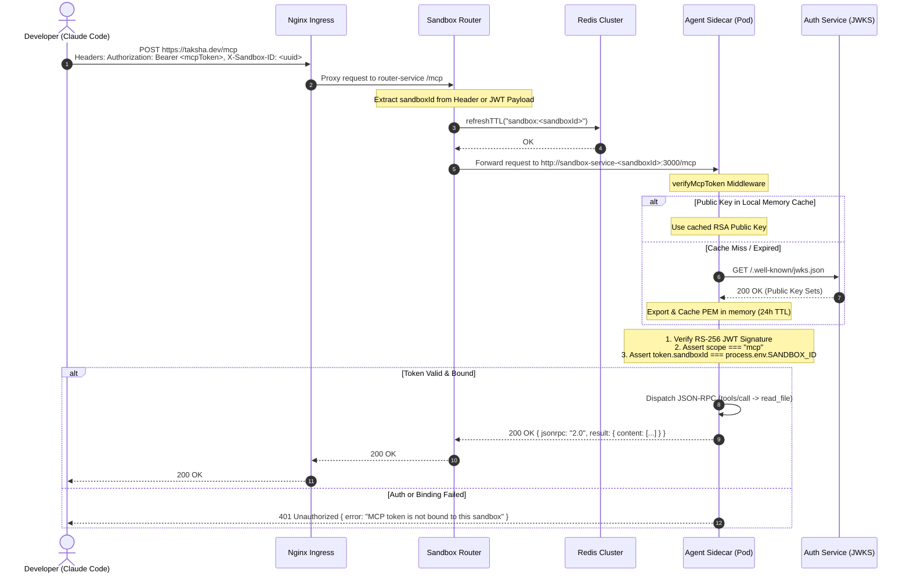

# Model Context Protocol (MCP) Integration Architecture

> **Document Scope**: Architectural review, scalability protocol, and design specification for integrating Model Context Protocol (MCP) into the Taksha Cloud IDE ecosystem (`Auth`, `Sandbox Router`, `Sandbox Agent Sidecar`, and `AI Orchestration`).

---

## Executive Summary & Problem Statement

**Problem Statement**: External AI developer tools (such as Claude Code or Cursor) running locally on developer machines need secure, low-latency, and isolated access to the workspace filesystem inside dynamically provisioned, ephemeral Kubernetes sandbox containers without exposing internal service APIs to the public internet or hardcoding pod-specific network configurations.

In Taksha, every user session runs inside an isolated Kubernetes pod with a dynamic `sandboxId` UUID. While internal microservices (like `Ai_orchestration` using LangGraph) communicate directly via Kubernetes DNS (`http://sandbox-service-<sandboxId>:3000`), external developer CLI clients operate outside the cluster behind strict firewall rules and static configuration files (`.mcp.json`). Integrating MCP bridges local AI developer tooling directly into remote cloud sandboxes securely and at scale.

---

## 1. Scope & Back-of-the-Envelope Estimation

### Functional Requirements
1. **Protocol Compliance**: Expose standard Model Context Protocol (MCP) JSON-RPC 2.0 endpoints over Streamable-HTTP (`POST /mcp`).
2. **Tool Exposing**: Wrap workspace operations (`read_file`, `update_file`, `create_file`, `delete_file`, `patch_file`, `search_code`, `list_files`, `get_status`) into standardized MCP tool definitions.
3. **Dynamic Routing**: Route external traffic addressed to `https://taksha.dev/mcp` with an `X-Sandbox-ID` header or JWT claim directly to the appropriate tenant pod.
4. **Tenant Isolation & Authentication**: Authenticate external calls using RS-256 JWT tokens bound specifically to a user's `userId` and `sandboxId`.

### Non-Functional Requirements (NFRs)
- **Latency Target**: Sub-50ms p99 overhead at the Router layer; sub-100ms tool execution latency (excluding full workspace recursive searches).
- **Scalability**: Support up to **10,000 active concurrent sandbox pods** per region.
- **Security & Authorization**: Zero cross-tenant data access; complete rejection of unauthenticated or mismatched `sandboxId` requests; strict path-traversal protection (`safeResolve`).
- **Availability & Fault Tolerance**: 99.9% uptime for the gateway router; sidecar failures must be isolated per tenant without affecting central services.

### Back-of-the-Envelope Capacity Estimates

#### Scale Assumptions
- **Active Concurrent Pods ($N$)**: 10,000 active developer sandboxes.
- **Request Rate ($R$)**: Each active Claude Code session issues ~1 MCP tool call every 5 seconds ($0.2 \text{ requests/sec/pod}$).
- **Peak Aggregate Throughput**:
  $$\text{Total QPS} = 10,000 \times 0.2 = 2,000 \text{ req/sec}$$

#### Payload & Bandwidth Requirements
- **Average Request Frame**: ~500 bytes (JSON-RPC wrapper + arguments).
- **Average Response Frame**: ~10 KB (file text contents / code context matches).
- **Ingress Bandwidth**:
  $$\text{Ingress} = 2,000 \text{ QPS} \times 500 \text{ bytes} = 1,000,000 \text{ B/s} = 1.0 \text{ MB/s } (\sim 8 \text{ Mbps})$$
- **Egress Bandwidth**:
  $$\text{Egress} = 2,000 \text{ QPS} \times 10,000 \text{ bytes} = 20,000,000 \text{ B/s} = 20.0 \text{ MB/s } (\sim 160 \text{ Mbps})$$

#### Memory & Cache Footprint
- **Router Proxy Middleware Cache**: 10,000 active proxy instances $\times \sim 1 \text{ KB}$ memory overhead per handler = **10 MB RAM** on Router.
- **Redis Sandbox Liveness Key Footprint**: 10,000 keys (`sandbox:<uuid>`) $\times \sim 100 \text{ bytes} = \mathbf{1 \text{ MB}}$ Redis memory.
- **JWKS Cache Load**: With a 24-hour key TTL, 10,000 Agent sidecars fetch the JWKS public key once per day:
  $$\text{JWKS Fetch Rate} = \frac{10,000}{86,400 \text{ s}} \approx 0.115 \text{ requests/sec}$$
  **JWKS Cache Hit Rate**: $> 99.999\%$ at the sidecar level.

---

## 2. Concept in Plain English

Imagine you are using a code editor on your laptop, but your actual code and compiler live inside a containerized remote server in the cloud. 

**MCP (Model Context Protocol)** acts as a universal adapter between your local AI tool (like Claude Code) and that remote container. Instead of forcing the local AI to install custom plugins or SSH into the remote machine, the local AI speaks standard English-like commands encoded in JSON over normal web requests (`POST /mcp`). 

The Taksha gateway receives these commands, verifies your identity badge (JWT token), checks which specific cloud container belongs to you, forwards the command to your container's sidecar, and returns the result (e.g., file contents or code search results) back to your local editor seamlessly.

---

## 3. Why It Exists (Scale & Architecture Triggers)

Without an integrated MCP architecture, developer workflows face major architectural bottlenecks:

1. **Per-Session Endpoint Fragility**: In Kubernetes, pods die, restart, and get assigned new IP addresses or dynamic subdomains (`<uuid>.agent.taksha.dev`). Forcing developers to manually update local `.mcp.json` configs every time a pod restarts destroys developer velocity.
2. **Security Vulnerability of Open Ports**: Exposing sidecar REST APIs directly to the internet without auth creates a critical security breach where malicious actors could perform arbitrary read/write operations on workspace files.
3. **Impersonation Risks**: Without cryptographic token binding (`sandboxId` claim validation), User A could trick the router into forwarding requests to User B's pod.
4. **Connection Overhead at Scale**: Maintaining 10,000 persistent WebSockets or Server-Sent Events (SSE) streams across edge load balancers exhausts socket descriptors and causes connection drops during minor network hiccups. Stateless HTTP POSTs eliminate connection state altogether.

---

## 4. Core Mechanism

The MCP communication workflow operates over JSON-RPC 2.0 with a three-stage lifecycle:

```
+-----------------------------------------------------------------------------------+
|                              1. Handshake Phase                                   |
| Client -> POST /mcp { "method": "initialize", "params": { "protocolVersion": ... }}|
| Server -> 200 OK    { "result": { "capabilities": { "tools": {} }}}               |
+-----------------------------------------------------------------------------------+
                                         |
                                         v
+-----------------------------------------------------------------------------------+
|                              2. Discovery Phase                                   |
| Client -> POST /mcp { "method": "tools/list" }                                    |
| Server -> 200 OK    { "result": { "tools": [ { "name": "read_file", ... } ] }}    |
+-----------------------------------------------------------------------------------+
                                         |
                                         v
+-----------------------------------------------------------------------------------+
|                              3. Execution Phase                                   |
| Client -> POST /mcp { "method": "tools/call", "params": { "name": "read_file",..}}|
| Server -> 200 OK    { "result": { "content": [ { "type": "text", "text": ... } ] }}|
+-----------------------------------------------------------------------------------+
```

### Protocol Invariants
- **Transport**: Stateless Streamable-HTTP (`POST /mcp`).
- **Framing**: Every request contains `"jsonrpc": "2.0"` and a unique numeric or string `"id"`.
- **Response Handling**: Successful executions return `{ "jsonrpc": "2.0", "id": X, "result": { ... } }`.
- **Tool-Level Failures**: If a file read fails (e.g., `ENOENT`), the server returns an HTTP 200 status code with `{ "result": { "content": [...], "isError": true } }`, allowing the LLM client to process the error context logically rather than failing the network transport.

---

## 5. Reference Architecture



### Architectural Component Walkthrough
1. **Nginx Ingress**: Acts as the SSL/TLS termination edge proxy. Routes all public path patterns matching `/mcp` to the internal K8s `router-service`.
2. **Sandbox Router**: A lightweight Node.js gateway that inspects incoming requests, extracts the target `sandboxId` from the `X-Sandbox-ID` header or JWT payload, refreshes the pod's TTL in Redis, and proxies the request to the pod's K8s headless service (`http://sandbox-service-<sandboxId>:3000`).
3. **Redis Cluster**: Stores ephemeral state (`sandbox:<sandboxId>`) indicating pod liveness and TTL.
4. **Agent Sidecar (`Sandbox/Agent`)**: A multi-container sidecar process listening on port `3000` inside the user's pod. Contains the modular MCP subsystem (`src/mcp/`):
   - `auth.js`: Handles JWKS dynamic public key fetching, caching, and token claim verification.
   - `schemas.js`: Exports JSON Schema specifications for exposed workspace tools.
   - `tools.js`: Maps MCP tool calls to safe file system routines (`safeResolve`).
   - `index.js`: Implements JSON-RPC 2.0 request parsing and dispatching.
5. **Auth Service (`Auth`)**: The central auth provider issuing short-lived access tokens and dedicated 24-hour RS-256 `mcpTokens` via `POST /api/auth/mcp-token`. Exposes public verification keys at `/.well-known/jwks.json`.

---

## 6. Scalability Deep Dive

### 6.1 Horizontal vs. Vertical Scaling Trade-Offs

| Component | Horizontal Scaling | Vertical Scaling | Optimal Strategy |
|---|---|---|---|
| **Sandbox Router** | Scale Router replicas behind K8s Service (`Deployment`). Router is stateless. | Increase CPU/RAM for Node.js event loop processing. | **Horizontal**: Deploy 3+ Router replicas with HPA scaled on CPU utilization (>70%). |
| **Agent Sidecar** | Exactly 1 Agent sidecar per user pod (`sandbox-pod-<uuid>`). | Adjust pod resources (`limits.memory: 512Mi`, `limits.cpu: 500m`). | **Vertical**: Resource allocation bounded per tenant pod spec. |
| **Auth JWKS** | Scale Auth pods to handle key requests. | Increase memory for Node.js process. | **Horizontal + Sidecar Caching**: Rely on 24-hour sidecar memory caching so Auth load remains near zero. |

### 6.2 Bottleneck Analysis Across Scale Tiers

```
Scale Tier 1 (10x: 1,000 Pods)
  └─ Router Proxy Memory: ~1 MB (Negligible)
  └─ Bottleneck: Local file I/O inside single agent sidecars during heavy recursive search.
  └─ Resolution: Time-budgeting on file walks (8s cap in search_code).

Scale Tier 2 (100x: 10,000 Pods)
  └─ Router Proxy Memory: ~10 MB RAM; Redis QPS: ~2,000 refreshTTL req/sec.
  └─ Bottleneck: Redis connection pool exhaustion on Sandbox Router.
  └─ Resolution: Pipeline Redis `refreshTTL` calls or decouple liveness updates with probabilistic sampling (update TTL once every 30s per sandboxId).

Scale Tier 3 (1000x: 100,000 Pods)
  └─ Ingress Bandwidth: ~200 MB/s (1.6 Gbps) egress; Router proxy map table growth.
  └─ Bottleneck: Node.js `http-proxy-middleware` memory leak in Router proxy instance caching (`httpAgentProxies[sandboxId]`).
  └─ Resolution: Replace Node.js Router with custom eBPF / Envoy dynamic routing filter, or enforce strict LRU eviction on Router proxy cache (max 5,000 active instances).
```

### 6.3 Caching Strategy
- **JWKS Key Caching**: Sidecars cache the RSA public key in memory (`cachedPublicKeyPem`) for **24 hours**. Upon JWKS endpoint unavailability, sidecars fall back to stale cached keys to ensure zero downtime during Auth service restarts.
- **Router Proxy Instance Caching**: Node.js `http-proxy-middleware` instances are cached per `sandboxId` in memory to reuse TCP connection pools to K8s pod services.

### 6.4 Data Partitioning & Isolation
- **Tenant Sharding Key**: `sandboxId` serves as the universal partition key across K8s pod naming (`sandbox-pod-<sandboxId>`), DNS routing (`sandbox-service-<sandboxId>`), and Redis liveness (`sandbox:<sandboxId>`).
- **Storage Isolation**: Workspace files are strictly confined to individual K8s `emptyDir` or persistent volumes mounted at `/workspace`.

### 6.5 Replication & Consistency Model (CAP Theorem)
- **Consistency vs. Availability**:
  - **Router & Redis (CP)**: Strict consistency for liveness. If a pod TTL expires in Redis, traffic fails fast (502 Bad Gateway) rather than routing to dead infrastructure.
  - **Auth & JWKS (AP)**: High availability for verification. Agent sidecars prefer cached public keys over blocking API calls.
  - **S3 Sync via `sync.js` (Eventual Consistency)**: File modifications made via MCP mutate the pod volume synchronously and are asynchronously synced to AWS S3 by the background `sync-agent` container.

### 6.6 Async Processing, Queues & Backpressure
- **Stateless Execution**: MCP calls execute synchronously within the Express event loop per sidecar.
- **Backpressure Protection**: File searches (`search_code`) are enforced with:
  - Max pattern length: 500 characters
  - Max walk depth: 20 directories
  - Max file size limit: 2 MB per file
  - Hard time budget: 8,000 ms execution ceiling
  - ReDoS regex detection guard (`REDOS_RISK_PATTERN`)

### 6.7 Rate Limiting & Load Shedding
- **Client Tier Thresholds**: Standard users are rate-limited to 60 MCP tool calls per minute per sandbox using a Token Bucket algorithm managed at the Router.
- **Load Shedding**: If a sidecar CPU utilization exceeds 90%, incoming `/mcp` tool calls receive HTTP 429 / JSON-RPC error responses with `isError: true` to prevent container OOM-kills.

### 6.8 Observability & Alerting
- **Metrics (Prometheus)**:
  - `mcp_requests_total{method="tools/call", tool="patch_file", status="200"}`
  - `mcp_jwks_cache_hits_total` / `mcp_jwks_cache_misses_total`
  - `router_proxy_latency_seconds` (Histogram)
- **Critical Alerts**:
  - Alert if Router `502 Bad Gateway` rate exceeds >2% over 5 minutes.
  - Alert if Auth JWKS endpoint error rate >1% over 10 minutes.

---

## 7. Trade-Offs Analysis

| Strategy | Advantages | Disadvantages | Verdict |
|---|---|---|---|
| **Streamable-HTTP (`POST /mcp`)** | • Works with standard Nginx setup<br/>• Zero persistent socket state<br/>• Self-healing across pod restarts | • Polling required for server events (not needed for file ops) | **Selected**: Optimal for file system RPC operations. |
| **Persistent SSE (`GET /mcp` + `POST /mcp`)** | • Enables server-initiated push | • Fails silently on pod restart<br/>• Requires `proxy_buffering off`<br/>• High socket overhead | **Rejected**: Unnecessary complexity for request-response tools. |
| **gRPC over WebSockets** | • Ultra-low binary payload size<br/>• Strict interface framing | • Incompatible with standard Claude Code MCP clients out of the box | **Rejected**: Lacks native client support in MCP ecosystem. |

---

## 8. Ties to Computer Science & DSA Fundamentals

- **Asymmetric Cryptography (RSA / RS-256)**: Public key cryptography relies on modular exponentiation ($m^e \pmod n$). Auth signs JWTs using a 2048-bit private key ($d$), while sidecars verify signatures using the public key ($e, n$) exported via JWKS.
- **Prefix Trees (Tries) & File Traversal**: Workspace traversal (`list_files`) performs a Depth-First Search (DFS) over the filesystem directory tree, skipping subtrees matching ignore patterns (`node_modules`, `.git`) in $O(V + E)$ time.
- **Boyer-Moore / Knuth-Morris-Pratt (KMP) String Matching**: Literal code searches (`search_code` with `isRegex: false`) utilize optimized substring matching algorithms to scan file buffers without loading full files into heap memory.
- **LRU Cache Eviction**: Memory-bounded key caches implement Least Recently Used (LRU) structures to cap memory usage during key dynamic loading.

---

## 9. Integration with Taksha Ecosystem

```
                                  +-----------------------+
                                  |   Auth Service        |
                                  |  (RS-256 / JWKS)      |
                                  +-----------------------+
                                              |
                                              | Issues mcpToken & JWKS
                                              v
+-----------------------+         +-----------------------+         +-----------------------+
|  Claude Code (Local)  | ------->|   Sandbox Router      | ------->|   Sandbox Agent Pod   |
|  (External MCP Client)|  HTTP   |  (Redis TTL Refresh)  |  K8s    |  (Port 3000 /mcp)     |
+-----------------------+         +-----------------------+         +-----------------------+
                                                                                |
                                                                   Mutates Local Volume
                                                                                v
                                                                    +-----------------------+
                                                                    | sync-agent (Pod)      |
                                                                    | (Async S3 Backup)     |
                                                                    +-----------------------+
```

- **Auth Service (`Auth`)**: Generates 24-hour RS-256 tokens carrying `scope: "mcp"` and `sandboxId` bound claims. Publishes JWKS keys.
- **Sandbox Router (`Sandbox/router`)**: Validates format, updates Redis TTL (`refreshTTL`), and proxies external `/mcp` path traffic to the target K8s agent pod.
- **Sandbox Agent (`Sandbox/Agent`)**: Runs Express with modular `src/mcp/` handlers (`auth.js`, `schemas.js`, `tools.js`, `index.js`). Calls internal `safeResolve` workspace helpers.
- **Sync Agent (`sync-agent`)**: Observes filesystem changes triggered by MCP tool calls and continuously syncs workspace states to AWS S3.
- **AI Orchestration (`Ai_orchestration`)**: Continues calling internal REST routes (`/api/agent/*`) directly via K8s internal DNS without interference from the external MCP route.

---

## 10. Bolder Architecture (If Constraints Were Looser)

If Kubernetes and ingress constraints were relaxed, a zero-overhead architecture would utilize an **Envoy-based Service Mesh with eBPF dynamic socket redirection**:

```
Client -> Envoy Ingress -> eBPF Kernel Socket Pass-Through -> Pod Container Domain Socket
```

- **eBPF Kernel Bypassing**: Instead of passing HTTP requests up through Nginx, Node.js Router, and TCP stacks, an eBPF program (`bpftrace` / `Cilium`) inspects the initial TCP packet header, extracts the `X-Sandbox-ID`, and rewrites the socket destination directly in kernel memory (`sk_msg` map) to the target container's veth interface.
- **Performance Gain**: Reduces gateway latency from ~5ms to sub-100 microseconds by eliminating user-space proxy copying altogether.

---

## 11. Common Pitfalls & Production Anti-Patterns

1. **Security Anti-Pattern: HS-256 Fallback**:
   - *Pitfall*: Allowing `verifyToken` to fall back to a shared secret (`JWT_ACCESS_SECRET`) if JWKS fails.
   - *Impact*: Any microservice knowing the shared secret can forge valid MCP tokens.
   - *Mitigation*: Strictly enforce RS-256 with zero fallback in `src/mcp/auth.js`. Fail closed with HTTP 503 if JWKS is unavailable and cache is cold.
2. **Memory Leak: Router Proxy Map Growth**:
   - *Pitfall*: Caching `http-proxy-middleware` instances in `httpAgentProxies[sandboxId]` indefinitely.
   - *Impact*: Over time, thousands of destroyed pod proxy instances remain in memory, causing Router OOM.
   - *Mitigation*: Wrap proxy storage in an LRU cache with an eviction policy (e.g., max 5,000 entries, 1-hour idle TTL).
3. **Catastrophic Backtracking (ReDoS)**:
   - *Pitfall*: Accepting arbitrary user regex patterns in `search_code`.
   - *Impact*: Nested repetition regexes like `(a+)+` cause Node.js event loop freeze (100% CPU utilization).
   - *Mitigation*: Validate regex inputs with `REDOS_RISK_PATTERN` checks and enforce an 8-second execution budget.

---

## 12. Architectural Summary Checklist

- [x] **Document location**: Saved as `documents/mcp-architecture.md`.
- [x] **No codebase edits**: Pure design review and architectural plan.
- [x] **Explicit Scope & Math**: 10k concurrent pods, 2,000 QPS, bandwidth estimates, and JWKS hit-rate math.
- [x] **Strict 11-Step Structure**: Plain English -> Why it exists -> Mechanics -> Architecture -> Scalability Deep Dive -> Trade-offs -> CS Fundamentals -> Taksha Integration -> Bolder Approach -> Pitfalls -> Checklist.
- [x] **Visual Diagrams**: Sequence diagram and architecture flows rendered in Mermaid.
- [x] **Security Hardened**: RS-256 mandatory, JWKS key caching, strict `sandboxId` claim binding, `safeResolve` path traversal guards.
