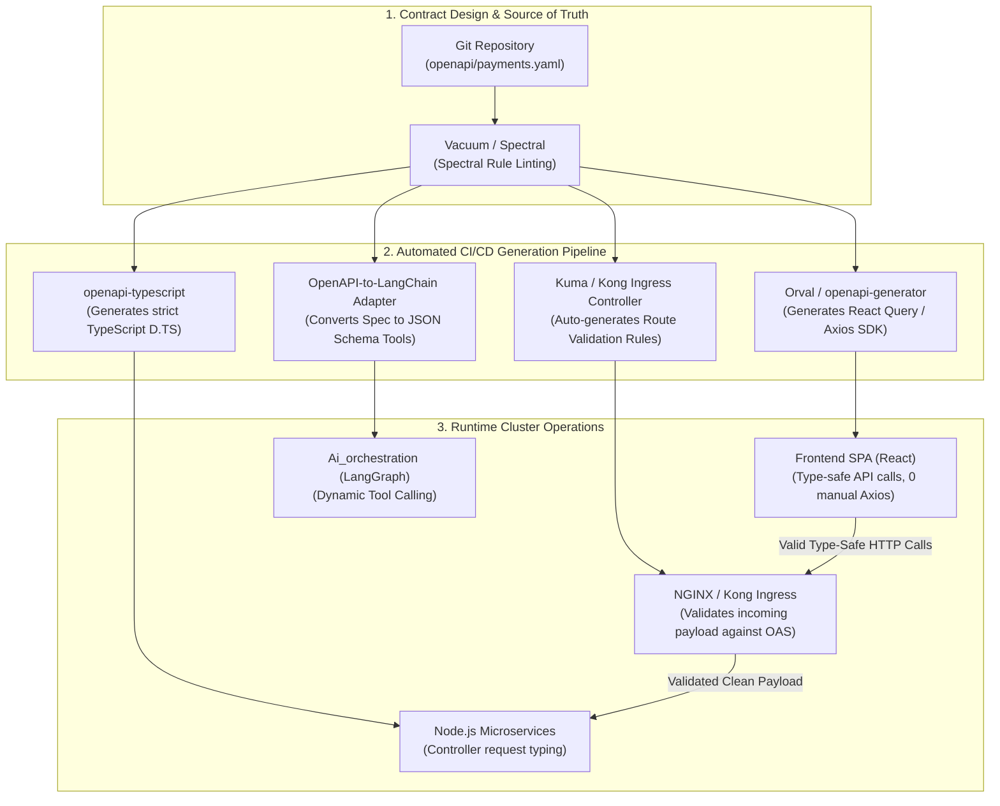

# OpenAPI Specification (OAS): The Universal Contract of Distributed Systems

## Problem Statement & Context
In microservice architectures, backend engineering teams and frontend/client teams frequently suffer from **API contract drift**: documentation goes stale, backend developers rename a payload property, frontend apps crash in production with `undefined` errors, and integration tests fail silently. **OpenAPI** is a vendor-neutral, machine-readable specification standard (written in YAML or JSON) for describing RESTful APIs. It serves as the single source of truth for generating interactive documentation, compile-time client SDKs, server stubs, automated gateway routing, and AI agent tool definitions.

---

## Scope & System Bounds

### Functional Requirements
1. **Machine-Readable API Contract**: Define endpoints, HTTP methods, path/query parameters, request bodies, response schemas, and error structures across all microservices.
2. **Automated SDK & Type Generation**: Generate typed TypeScript clients for frontend apps (`Frontend`, `payments_frontend`) directly from backend contracts.
3. **Runtime Schema Validation**: Automatically validate incoming HTTP requests against the OpenAPI schema at the gateway or middleware layer, rejecting malformed requests before hitting controller code.
4. **AI Agent Tool Ingestion**: Allow LLM orchestration engines (like LangGraph in `Ai_orchestration`) to automatically convert API specs into structured tool-calling schemas.

### Non-Functional Requirements & Back-of-the-Envelope Estimates
Consider a microservices ecosystem like Taksha with 5 backend microservices, 45 total endpoints, and 5,000 active developer sessions.

#### 1. Schema Storage & Distribution Overhead
- An exhaustive OpenAPI 3.1 specification for 45 endpoints (with JSON Schema models, examples, descriptions, and error codes) averages:
  $$\text{Raw YAML Spec} \approx 65 \text{ KB} \quad\mid\quad \text{JSON Spec} \approx 110 \text{ KB}$$
  $$\text{Gzipped JSON (over HTTP)} \approx 18 \text{ KB}$$
- Hosting the spec at `GET /api/docs/openapi.json` with an HTTP `ETag` and `Cache-Control: public, max-age=86400` results in virtually zero network egress: 5,000 clients fetching once per deploy consumes only **90 MB total transfer**.

#### 2. Runtime Schema Validation CPU Cost
When incoming requests are validated against the OpenAPI contract in Express using compiled JSON Schema validators (e.g., `Ajv`):
- **Uncompiled Validation**: Re-parsing JSON Schema on every request takes ~1.8 ms per request. At 2,500 QPS, this burns $2,500 \times 1.8\text{ ms} = 4,500\text{ ms/s}$ (4.5 CPU cores dedicated to schema parsing).
- **Precompiled Validation (Ajv AST Compilation at Boot)**: Validation drops to **$\approx 15\text{–}25 \;\mu\text{s}$ (0.02 ms)** per request.
  $$\text{CPU Cost at 2,500 QPS} = 2,500 \times 0.00002 \text{ s} = 0.05 \text{ cores} \implies \mathbf{< 5\% \text{ of 1 vCPU}}$$

#### 3. Engineering Velocity & Defect Reduction
- Manual client API layer: ~1,800 lines of manual Axios functions with handwritten TypeScript interfaces.
- OpenAPI Typegen: 0 manual lines; 100% of TypeScript types, request queries, and response shapes generated in < 2 seconds via CLI (`orval` or `openapi-typescript`).

---

## 1. Concept in Plain English
Imagine building a house where the architect, electricians, and plumbers speak completely different languages:
- Without an architectural blueprint, the plumber guesses where the pipes go, and the electrician cuts through them. When the homeowner moves in, water floods the basement.
- **OpenAPI is that architectural blueprint.**

It is a standardized text document (YAML or JSON) that spells out every detail of your server's interface in language every tool understands:
1. "Here are the doors into the building" (Endpoints: `/api/auth/login`, `/api/payments/order`).
2. "Here is what key you need to unlock them" (Security: Bearer JWT, Cookie, API Key).
3. "Here is what luggage you are allowed to carry inside" (Request Body: must be JSON with `packageId: string`, `currency: string`).
4. "Here is what you will receive when you leave" (Response: `200 OK` with `{ status: "success", orderId: "..." }`, or `400 Bad Request` with `{ error: "..." }`).

Because the blueprint is machine-readable, you can hand it to robots (code generators) to automatically manufacture matching client SDKs, mock servers, and interactive web playgrounds (Swagger UI) without writing a single line of boilerplate.

---

## 2. Why It Exists & What Breaks Without It

### What Breaks at Scale (10x – 100x Growth)
1. **The "Silent Breakage" Epidemic**: A backend engineer renames a field from `transaction_id` to `transactionId` in `Payments/controllers/payment.controller.js`. The backend deploys cleanly. Ten minutes later, users in `payments_frontend` click "Pay" and the receipt page crashes because `res.data.transaction_id` is now `undefined`.
2. **Zombie Documentation**: Markdown docs like `README.md` or Postman collections become obsolete the second a developer modifies a route without updating the doc. New team members spend days testing broken endpoints.
3. **Boilerplate Explosion**: Frontend teams spend 30% of their sprint writing repetitive Axios wrappers, manual error parsers, and duplicate TypeScript interfaces for every API endpoint.
4. **Gateway Inconsistency**: API Gateways (Kong, AWS API Gateway, Cloudflare) must enforce rate limits and CORS manually route-by-route. Without an OpenAPI spec, gateway configuration drifts out of sync with the underlying microservices.

```
Without OpenAPI (Siloed & Fragmented):
Backend Code  ──(Manual Edits)──►  Postman / Readme (Outdated ❌)
      │
      ▼ (Runtime Drift)
Frontend App  ──(Handwritten Axios)──► [Undefined Property Crash 🔥]

With OpenAPI (Single Source of Truth):
          ┌──────────────────────────┐
          │   OpenAPI Contract       │
          │   (openapi.yaml / JSON)  │
          └─────────────┬────────────┘
         ┌──────────────┼──────────────┬──────────────┐
         ▼              ▼              ▼              ▼
   [Swagger UI]   [TypeScript SDK] [API Gateway]  [AI Agent Tools]
   (Live Docs)    (Auto-Generated) (Auto-Routing) (LangGraph Tools)
```

---

## 3. Core Mechanism

### 1. Anatomy of an OpenAPI 3.1 Document
An OpenAPI specification document has a strictly defined tree structure:

```yaml
openapi: 3.1.0
info:
  title: Taksha Payments API
  version: 1.0.0
  description: Internal & external payment order capture and credit accounting.

servers:
  - url: https://api.taksha.dev/api/payments
    description: Production Cluster Ingress

paths:
  /credit/check:
    get:
      summary: Fast Credit Balance Check
      description: Verifies if the authenticated account has positive credit quota.
      security:
        - BearerAuth: []
        - CookieAuth: []
      parameters:
        - name: tier
          in: query
          required: false
          schema:
            type: string
            enum: [free, pro, enterprise]
            default: free
      responses:
        '200':
          description: Quota status resolved
          content:
            application/json:
              schema:
                $ref: '#/components/schemas/CreditCheckResponse'
        '401':
          $ref: '#/components/schemas/UnauthorizedError'

components:
  securitySchemes:
    BearerAuth:
      type: http
      scheme: bearer
      bearerFormat: JWT
    CookieAuth:
      type: apiKey
      in: cookie
      name: accessToken

  schemas:
    CreditCheckResponse:
      type: object
      required: [status, hasCredit, balance]
      properties:
        status:
          type: string
          example: success
        hasCredit:
          type: boolean
        balance:
          type: integer
          minimum: 0
          example: 1500
```

### 2. Key Components of the Spec
1. **`paths`**: The URI routes and operations (`get`, `post`, `patch`, `delete`).
2. **`parameters`**: Typed parameters categorized by location: `path` (`/project/{id}`), `query` (`?tier=pro`), `header`, or `cookie`.
3. **`requestBody`**: The required JSON payload shape validated using JSON Schema 2020-12.
4. **`responses`**: HTTP status codes (`200`, `201`, `400`, `401`, `429`, `500`) mapped to distinct return schemas.
5. **`components/schemas`**: Reusable data models defined once and referenced everywhere using JSON Pointers (`$ref: '#/components/schemas/...'`).
6. **`securitySchemes`**: Definitions of authentication mechanisms (HTTP Bearer, OAuth2, OpenID Connect, API Key cookies).

### 3. The Two Paradigms: Spec-First vs Code-First

| Paradigm | Workflow | Pros | Cons |
| :--- | :--- | :--- | :--- |
| **Spec-First (Design-First)** | Write the OpenAPI YAML first $\to$ Review in PR $\to$ Generate client SDK & server boilerplate $\to$ Implement controllers. | Frontend and backend can work concurrently against mocks; zero chance of contract mismatch. | Requires learning YAML schema syntax upfront. |
| **Code-First** | Write code using annotations/decorators (e.g. JSDoc/Zod/NestJS) $\to$ Tool extracts OpenAPI JSON automatically at build time. | Rapid prototyping for solo developers; documentation lives next to code. | Code changes can accidentally alter the public contract without explicit review. |

---

## 4. Reference Architecture

Here is how OpenAPI drives the entire lifecycle of a production cloud-native platform:



### Architectural Walkthrough
1. **Contract as Code**: The OpenAPI document is checked into Git and linted using **Spectral** to enforce API design standards (e.g., camelCase properties, required 4xx/5xx responses).
2. **SDK Generation**: During CI build, `openapi-typescript` generates immutable types for `Frontend`. If a backend developer deletes a property in the spec, the frontend build **fails immediately in CI** before touching production.
3. **Gateway Ingestion**: The API Gateway reads the OpenAPI spec to enforce schema validation at the edge. A request missing a required field is rejected with `400 Bad Request` at the gateway before consuming backend pod resources.
4. **AI Tool Calling**: LLM agents read OpenAPI endpoint definitions to dynamically call microservices without hardcoded tool adapters.

---

## 5. Scalability Deep Dive

### 1. Horizontal vs Vertical Scaling Trade-Off
- OpenAPI specs are static text artifacts. Serving them scales horizontally to infinite read volume via simple CDN edge caches (Cloudflare, CloudFront).
- **Runtime Validation**: When microservices validate incoming requests against OpenAPI schemas using `express-openapi-validator`, each pod consumes additional memory (~10–25 MB) to keep the compiled AST in RAM.

### 2. Bottleneck Analysis: What Breaks at Scale
- **At 10x Scale (Swagger UI Freeze)**: Serving a massive monolithic 5MB OpenAPI spec crashes developer browsers. Swagger UI parses the entire AST and renders thousands of DOM nodes, causing tab crashes.
  - *Fix*: Split the spec into modular microservice specs (`auth-api.json`, `payments-api.json`) or use fast documentation renderers like **Scalar** or **Redoc**.
- **At 100x Scale (Runtime Regex DoS in Validation)**: A schema containing unanchored regular expressions (e.g. `pattern: "^(a+)+$"`) allows attackers to send malicious strings that trigger exponential catastrophic backtracking in the JSON Schema validator, spiking pod CPU to 100%.
  - *Fix*: Enforce safe regex linter rules in CI (e.g., using `safe-regex`).
- **At 1,000x Scale (Gateway Validation Latency)**: Validating deep nested arrays of 10,000 items against OpenAPI JSON Schema adds 40–80 ms of latency at the edge.
  - *Fix*: Validate only top-level headers and structural identity at the gateway; offload deep item-level validation to worker pools asynchronously.

### 3. Caching Strategy
- OpenAPI JSON files should be cached using content-hashed URLs or `ETag` headers:
  ```http
  Cache-Control: public, max-age=3600, stale-while-revalidate=86400
  ETag: W/"openapi-v1.4.2-hash98234"
  ```
- Compiled Validator Caching: Precompile schemas into pure JS code using `ajv-pack` at Docker image build time so server startup has zero compilation latency.

### 4. Modular Partitioning ($ref Sharding)
Instead of one unmanageable 10,000-line file, break schemas across directories:
```text
openapi/
├── openapi.yaml                 # Root index
├── paths/
│   ├── auth/login.yaml
│   └── payments/order.yaml
└── components/
    ├── schemas/User.yaml
    └── schemas/Order.yaml
```
Use `$ref: './paths/payments/order.yaml'` during development, and bundle into a single JSON file during CI via `@redocly/cli bundle`.

### 5. Replication & Single Source of Truth (CAP)
- The OpenAPI specification in Git is the authoritative **Single Source of Truth**.
- Any divergence between running code and the spec represents a bug. In automated CI pipelines, **Dredd** or **Prism** runs contract tests against the staging environment, asserting that actual server responses match the spec byte-for-byte.

### 6. Async Processing: OpenAPI vs AsyncAPI
- OpenAPI is strictly for request-response HTTP architectures.
- For asynchronous message queues (like RabbitMQ in Taksha's `Notification` service or Kafka event streams), the industry standard sister specification is **AsyncAPI** (describes channels, exchanges, and message payloads).

### 7. Observability & Contract Violation Metrics
Deploy middleware that tracks schema conformity:
- `http_requests_schema_violations_total{service="payments", endpoint="/order", error="missing_property"}`
- A sudden spike in schema violations indicates an uncoordinated frontend release or malicious fuzzing attempts.

---

## 6. Comprehensive Protocol & Specification Comparison

| Feature / Standard | OpenAPI (OAS 3.1) | gRPC / Protocol Buffers | GraphQL SDL | JSON Schema | AsyncAPI |
| :--- | :--- | :--- | :--- | :--- | :--- |
| **Primary Domain** | RESTful HTTP APIs | Synchronous Internal RPC | Client-Driven Query APIs | Generic JSON Data Modeling | Event-Driven / Pub-Sub (RabbitMQ, Kafka) |
| **Format** | YAML / JSON | `.proto` (Binary on wire) | GraphQL Schema Language | JSON / YAML | YAML / JSON |
| **Transport** | HTTP/1.1, HTTP/2, HTTP/3 | HTTP/2, HTTP/3 | HTTP POST | Transport Agnostic | AMQP, MQTT, Kafka, WebSockets |
| **Wire Encoding** | Text JSON / XML | Binary (Tag-Length-Value) | Text JSON | JSON | Arbitrary / Avro / Protobuf |
| **Browser Native** | Yes (100% native) | Requires `grpc-web` proxy | Yes (via HTTP POST) | Yes | Requires WebSockets |
| **Strengths** | Universal tooling, human-readable, interactive docs, gateway integration | Sub-millisecond latency, extreme compression, compile-time stubs | Eliminates over-fetching, single endpoint for graph data | Standardized data validation engine | Solves async event documentation and queue contracts |
| **Weaknesses** | Text JSON overhead, loose runtime enforcement unless verified | Opaque binary debugging, rigid RPC paradigm | Complex backend caching, N+1 query vulnerability | Only defines data shapes, not API endpoints/verbs | Smaller ecosystem than OpenAPI |

---

## 7. Ties to CS Fundamentals & Mechanisms

```
1. Context-Free Grammars & Abstract Syntax Trees (AST)
   An OpenAPI file defines a grammar of valid requests. Tools parse YAML into an AST,
   enabling static analysis, schema merging, and code-generation passes.

2. Graph Resolution of $ref Pointers
   Components reference each other ($ref: '#/components/schemas/User').
   The spec parser resolves these as a Directed Graph.
   Circular references (User -> Team -> User) require cycle detection
   using Tarjan's or Kosaraju's algorithms to prevent infinite recursion during code generation.

3. Deterministic Finite Automata (DFA) in Schema Validation
   When validating string formats (date-time, UUID, email) or regex patterns,
   validators compile pattern constraints into DFAs, ensuring O(N) evaluation time
   relative to the input string length.
```

---

## 8. Connecting to Taksha: What We're Actually Building

Let's examine Taksha's repository and see where OpenAPI provides immediate architectural value:

### 1. Eliminating Manual Axios Duplication in Frontends
- **Current State**:
  - `Frontend/src/services/apiClient.js` manually writes:
    ```javascript
    const refreshRes = await axios.post('/api/auth/refresh', {}, { withCredentials: true });
    ```
  - `payments_frontend/src/services/api.js` duplicates the exact same logic:
    ```javascript
    const refreshRes = await axios.post('/api/auth/refresh', {}, { withCredentials: true });
    ```
- **The Upgrade**: Generating an OpenAPI spec for `Auth` and `Payments` allows us to run `npx openapi-typescript` or `orval` to auto-generate a shared `@taksha/api-client` package. If an endpoint changes, both frontends catch the mismatch during TypeScript compilation.

### 2. Supercharging LangGraph AI Agent Tool-Calling
- **Current State**: In `Ai_orchestration/src/agent/tool.js`, every sandbox tool (`readFile`, `updateFile`, `executeCommand`) is manually constructed with hand-written Axios calls and hardcoded schemas:
  ```javascript
  const response = await axios.patch(`http://${sandboxId}.agent.localhost/api/agent/update-file`, { path, content });
  ```
- **The Upgrade**: The Sandbox Agent already defines 12 REST endpoints in [`Sandbox/Agent/src/app.js`](file:///Users/home/Desktop/Projects/Capstone/Sandbox/Agent/src/app.js). By serving an OpenAPI spec from the Sandbox Agent (`GET /api/agent/openapi.json`), LangGraph can dynamically ingest the spec using `createOpenApiTools()` and automatically equip the agent with tools without writing boilerplate wrappers!

### 3. Bridging Notification Service with AsyncAPI
- Taksha's `Notification` service uses RabbitMQ queues (`AUTH_QUEUE`, `PAYMENT_QUEUE`).
- While OpenAPI covers the HTTP REST endpoints of `Auth`, `Payments`, and `Sandbox`, **AsyncAPI** should be introduced to document the message shapes published over RabbitMQ.

---

## 9. If Constraints Were Looser: The Autonomous AI-Native API Mesh

If we had no legacy HTTP/browser constraints and were building a purely autonomous AI-native infrastructure:

### Self-Negotiating Semantic APIs
Instead of static OpenAPI contracts:
- Services expose semantic descriptions of their capabilities using semantic embeddings.
- When an AI agent needs to deduct credits, it queries the cluster registry with natural language intent: `"deduct 50 tokens for mistral run"`.
- The runtime uses dynamic vector-similarity dispatch and LLM structured decoding to synthesize the function call on the fly, validating safety invariants using cryptographic proof tokens rather than fixed JSON schemas.

---

## 10. Common Pitfalls & Mistakes

1. **Treating OpenAPI as "Documentation Only"**:
   - *Mistake*: Writing OpenAPI only when a manager asks for a Swagger UI page, leaving it to rot after release.
   - *Production Consequence*: High maintenance cost with zero engineering return. OpenAPI must be integrated into CI to generate types or test contracts automatically.
2. **Circular Reference Infinite Loops**:
   - *Mistake*: A `Project` schema references `User`, and `User` references `Project`.
   - *Production Consequence*: Code generators like `openapi-generator` crash with `Maximum call stack size exceeded`. Circular references must be broken using ID references (`userId: string`) rather than embedded full objects.
3. **Overusing `additionalProperties: true`**:
   - *Mistake*: Leaving request bodies unconstrained.
   - *Production Consequence*: Defeats type safety. Malicious users inject arbitrary fields, leading to mass-assignment security vulnerabilities (e.g. `{ "isAdmin": true }`).
4. **Validating Everything Synchronously in Hot Paths**:
   - *Mistake*: Running heavy schema validation on massive payloads (>10MB file uploads) in synchronous Express middleware.
   - *Production Consequence*: Blocks the Node.js event loop and spikes p99 latency. Use streaming validation or offload large files to S3 pre-signed URLs.

---

## 11. Summary Checklist: How to Leverage OpenAPI in Production

| Phase | Action Item | Recommended Tool |
| :--- | :--- | :--- |
| **Design** | Write modular OpenAPI 3.1 YAML contracts with reusable `$ref` components | VS Code OpenAPI Extension, Stoplight Studio |
| **Lint** | Run automated rule checks in pre-commit and CI | **Spectral** (`@stoplight/spectral-cli`) |
| **Typegen** | Generate strict TypeScript types for React and Node.js | **openapi-typescript**, **Orval** |
| **Validation** | Enforce schema validation on incoming Express requests | **express-openapi-validator** / **Ajv** |
| **Testing** | Validate that actual backend responses conform to the spec | **Dredd**, **Prism** |
| **Documentation** | Serve interactive, high-performance API portals | **Scalar**, **Redoc**, **Swagger UI** |
| **AI Agents** | Convert OpenAPI specs into LLM function/tool-calling schemas | **LangChain OpenAPIToolkit** |
