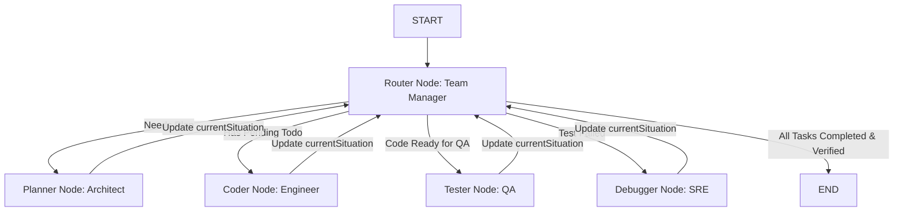

# Multi-Agent Team Architecture: Router-Manager with Specialized Worker Nodes in LangGraph

## 1. Concept in Plain English

Instead of relying on a single worker node that attempts to handle planning, coding, testing, and debugging in one homogenous loop, this architecture structures the AI agent into an **Engineering Team with a Team Manager (Router)**:

1. **Router Node (Team Manager)**: Acts as the central coordinator. It evaluates the project's current state and `currentSituation` context after every action to decide which specialist node to dispatch next (`planner`, `coder`, `tester`, `debugger`, or `end`).
2. **Planner Node (Lead Architect)**: Inspects the codebase, analyzes requirements, and constructs a concrete `implementationPlan` and `todoList`.
3. **Coder Node (Software Engineer)**: Takes active todo items from the state and performs surgical file operations (`read_file`, `create_file`, `update_file`, `patch_file`).
4. **Tester Node (QA Engineer)**: Executes build verifications (`execute_command` for `npm run build`) and runtime inspection (`get_vite_runtime_errors`) to confirm system integrity.
5. **Debugger Node (Site Reliability / Debug Engineer)**: Activates specifically when tests fail. It analyzes exact error tracebacks, isolates root causes, applies fixes, and logs details in `currentSituation`.

---

## 2. Why It Exists

In complex software engineering tasks, single-prompt or single-loop agents frequently suffer from **role confusion** and **context collapse**:

* **Role Confusion**: An agent writing a multi-file UI component mid-execution suddenly gets distracted, attempts to run random terminal commands, forgets which file it was editing, or declares victory without building.
* **Context Overload**: Combining planning, code generation, error output parsing, and debugging into one single LLM prompt degrades instruction compliance. Specialist nodes receive focused system prompts tailored strictly to their role.
* **Opaque Progress**: Without an explicit `currentSituation` state channel, neither the agent nor the user can answer basic progress questions ("What just happened?", "Why did we revert back to planning?", "What error is being fixed?").
* **Deterministic Routing**: A central Router node prevents infinite ping-pong loops between coding and testing by enforcing state checks and retry limits.

---

## 3. Core Mechanism

### State Schema (`TeamAgentState`)

```typescript
interface TodoItem {
  id: number;
  title: string;
  file?: string;
  status: 'pending' | 'in_progress' | 'completed' | 'failed';
  result?: string;
}

interface TeamAgentState {
  // Task Inputs & Specs
  prompt: string;
  projectId: string;
  sandboxId: string;

  // Project Progress State
  implementationPlan: string[];
  todoList: TodoItem[];
  currentTodoIndex: number;

  // Live Situation & Progress Tracking
  currentSituation: string; // E.g., "Coder finished Navbar.jsx. Needs QA testing."
  lastNodeInvoked: string;  // "planner" | "coder" | "tester" | "debugger" | "router"
  nextTargetNode: string;   // Routing directive determined by Router

  // Errors & Debugging State
  lastErrorTrace: string | null;
  revisionCount: number;
  maxRevisions: number;
  verificationPassed: boolean;

  // Message Thread & Status
  messages: BaseMessage[];
  taskStatus: 'planning' | 'coding' | 'testing' | 'debugging' | 'completed' | 'failed';
}
```

### State Updates by Node

Each specialist node performs its work and updates `currentSituation` before yielding back to the Router:

* **Planner**: Sets `currentSituation = "Plan generated with N tasks. Ready for coding."`
* **Coder**: Sets `currentSituation = "Completed task K (Component.jsx). Ready for next task or testing."`
* **Tester**: Sets `currentSituation = "Build clean. All checks passed."` OR `"Build failed: SyntaxError in line 42 of App.jsx"`.
* **Debugger**: Sets `currentSituation = "Applied fix for SyntaxError in line 42. Ready for re-testing."`

---

## 4. Reference Architecture



### Router Routing Decision Matrix

```javascript
function routeNextNode(state) {
  const { todoList, currentTodoIndex, verificationPassed, lastErrorTrace, revisionCount, maxRevisions, lastNodeInvoked } = state;

  // 1. If no plan exists, route to Planner
  if (!todoList || todoList.length === 0) {
    return "planner";
  }

  // 2. If tests failed and under retry limit, route to Debugger
  if (lastErrorTrace && !verificationPassed && revisionCount < maxRevisions) {
    return "debugger";
  }

  // 3. If pending todo items remain, route to Coder
  if (currentTodoIndex < todoList.length) {
    return "coder";
  }

  // 4. If all todos executed but not yet tested in this cycle, route to Tester
  if (lastNodeInvoked === "coder" || (lastNodeInvoked === "debugger" && !verificationPassed)) {
    return "tester";
  }

  // 5. All done and verified (or max revisions hit)
  return "end";
}
```

---

## 5. Scalability Deep Dive

### Horizontal Scaling & Session Recovery
* **State Isolation**: Worker nodes do not hold local memory. All state (including `currentSituation` and `todoList`) is stored in `TeamAgentState`.
* **Worker Statelessness**: In a multi-tenant cloud environment, `plannerNode` can run on Server A, `coderNode` on Server B, and `testerNode` on Server C. The Redis checkpointer ensures state consistency across nodes.

### Bottleneck Analysis

| Component | 10x Load | 100x Load | 1000x Load |
| :--- | :--- | :--- | :--- |
| **Router Decisions** | Fast LLM or deterministic routing JS function (< 50ms) | Deterministic routing function (0ms token latency) | Cached state evaluation in Redis |
| **Coder Disk I/O** | Direct sandbox file writes | Concurrent sandbox file locks | Sharded file sync per sandbox ID |
| **Tester Execution** | Serial build commands (`npm run build`) | Async subprocess execution | Isolated docker container test runners |

---

## 6. Trade-offs Table

| Architecture Pattern | Single ReAct Loop | Fixed Sequence (Plan->Code->Test) | Router + 4 Specialist Nodes (Proposed) |
| :--- | :--- | :--- | :--- |
| **Adaptability** | Low (improvises single path) | Rigorous (cannot loop back on bug) | High (dynamic router branching) |
| **Error Recovery** | Unreliable (swallows errors) | Fails on first error | High (dedicated Debugger node loop) |
| **Role Specialization** | Low (generic system prompt) | Medium | High (focused role prompts & tools) |
| **Token Cost** | High (bloated full history) | Medium | Optimized (specialist context windows) |
| **Observability** | Opaque | Medium | Excellent (`currentSituation` state channel) |

---

## 7. Ties to Fundamentals

1. **State Machine Routers**: The Router implements a **Moore Finite State Machine** where next state $S_{next} = \delta(S_{current}, I)$ depends on the current situation payload $I$.
2. **Actor Model**: Specialist nodes act like isolated actors receiving messages (state updates) and emitting events to the Router actor.
3. **Supervisor Pattern**: Derived from Erlang/OTP supervisor patterns, where a manager process monitors worker child states and handles fault recovery.

---

## 8. Connect It to What I'm Actually Building (Taksha Codebase)

In Taksha's `Ai_orchestration` service:

1. **`Ai_orchestration/src/agent/code.agent.js`**:
   - Replace linear node setup with 4 specialized node functions (`plannerNode`, `coderNode`, `testerNode`, `debuggerNode`) plus `routerNode`.
   - Add `currentSituation` and `lastErrorTrace` to `AgentStateAnnotation`.
   - Expose `currentSituation` directly over Socket.io so the frontend displays real-time team status (e.g. *"Team Manager assigned task to Debugger Node: Fixing line 42 error"*).

2. **`Ai_orchestration/src/socket/socket.js`**:
   - Emit `agent:situation_update` whenever `currentSituation` changes.

---

## 9. Common Pitfalls

1. **Ping-Pong Deadlocks**: Coder and Debugger nodes looping endlessly without fixing the error. *Fix*: Increment `revisionCount` in `debuggerNode` and enforce `maxRevisions` cap in Router.
2. **Loss of Context in Debugger**: Passing generic "test failed" message without exact line numbers. *Fix*: `testerNode` extracts full stack traces into `lastErrorTrace`.

---

## 10. Summary Checklist

- [ ] Add `currentSituation`, `lastErrorTrace`, and `lastNodeInvoked` to `AgentStateAnnotation`.
- [ ] Build `plannerNode` (Architect prompt).
- [ ] Build `coderNode` (Engineer prompt with file tools).
- [ ] Build `testerNode` (QA prompt with build/error tools).
- [ ] Build `debuggerNode` (SRE prompt with error log input).
- [ ] Build deterministic `routerNode` conditional edge manager.
- [ ] Update `socket.js` to emit live `currentSituation` updates to client UI.
